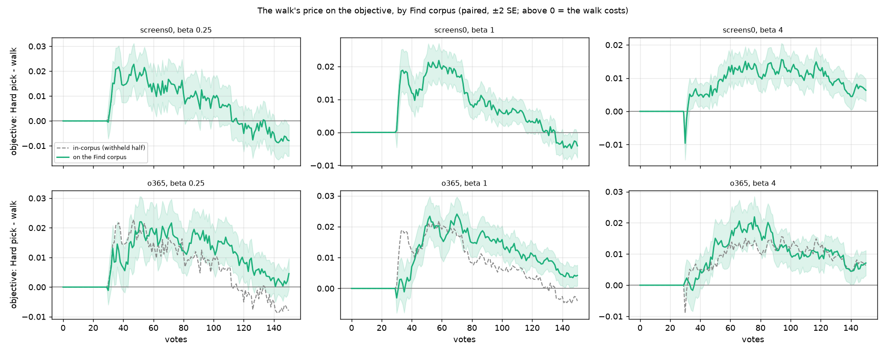
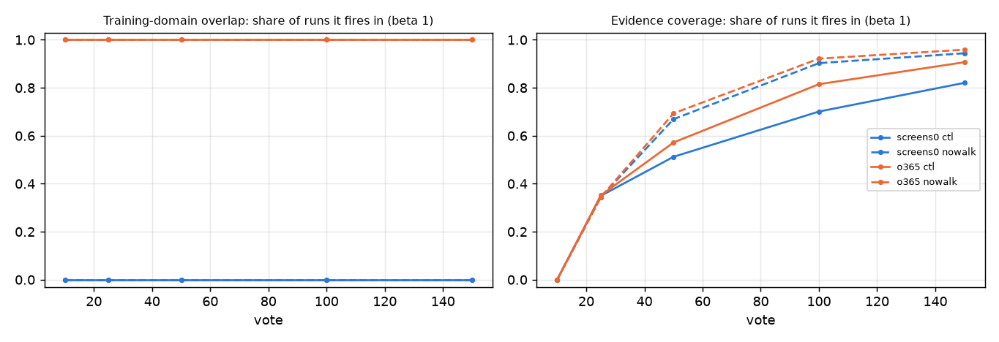

# The Coverage Atlas walk on its own case, an Objects365 Find: it costs more, not less (issue #4739, Leg 1)

**The walk does not pay on Objects365 Better either.** Leg 1 is the case the walk was built for: a boundary that has
seen every region of its haystack, Finding on busier photos of the same classes. Today's app is set against New
taking the Hard pick (`CALIB_NEW_WALK=hard`, #4671's arm), and each run Finds on `o365_better`'s cell of the same
name (#4815, built in #4817). Over the 107 cells the two corpora share, 535 paired runs a preset, at beta 1/4 / 1 / 4:

| `nowalk` minus `ctl` (positive = the Hard pick ahead) | beta 1/4 | beta 1 | beta 4 |
|---|---|---|---|
| **on Objects365**, objective, votes 1–150 | **+0.010** ± 0.001 | **+0.010** ± 0.001 | **+0.009** ± 0.001 |
| in-corpus (the withheld half), same runs | **+0.006** ± 0.001 | **+0.007** ± 0.001 | **+0.008** ± 0.001 |
| the difference, paired per run | **+0.004** ± 0.002 | **+0.003** ± 0.001 | +0.001 ± 0.001 |
| on Objects365, at vote 150 | +0.005 ± 0.003 | **+0.004** ± 0.002 | **+0.007** ± 0.002 |
| in-corpus, at vote 150 | **−0.008** ± 0.003 | **−0.004** ± 0.002 | **+0.006** ± 0.002 |

- **The walk's price on the Objects365 Find is larger than its in-corpus price**, by 0.004 / 0.003 / 0.001. At beta
  1/4 and 1 that is about 2 and 3 SE.
- **The late crossover disappears.** In-corpus, the walk's detector is ahead from about vote 126 (beta 1/4) and
  138 (beta 1). On Objects365 the Hard pick is never behind at 2 SE, at any vote or preset.
- **Where the gap is:** after vote 50. Over votes 1–50 the walk costs a little *less* on Objects365 (−0.002 /
  −0.003 / +0.000). Over votes 51–150 it costs more (+0.007 / +0.006 / +0.001).
- **The Training-domain overlap check fires on every Objects365 run** (atypical share 0.18), as it does on the
  screens mixed in at 22% (0.17). It is silent with no shift (0 of 535, 0.042).
- **Leg 1 was the one that could change the ship decision, and it does not.** On neither kind of shift does the
  walk buy F-beta. Its case rests on Done and on coverage, as the screens legs found (#5090).

## What ran

- **Design and bench:** as the screens legs (`docs/experiments/2026-10-18-cross-corpus-4739/`): `ctl` (today's app)
  against `nowalk`, at beta 1/4, 1 and 4. COCO Better, binary SigLIP, 144 cells × 5 seeds, 150 votes, the user's
  pool at 1%.
- **Find corpus:** `CALIB_FIND_CORPUS=o365_better`, mix `only`: the run Finds on Objects365 Better's cell of the
  same class and band and nothing else. A cell holds about 17,800 photos with 100 positives (`airplane@large`:
  17,780).
- **Scale and provenance:** 2 arms × 3 presets × 720 runs = 4,320 runs, on the same frozen commit as the screens
  legs (`vts-4739-run` @ f576b3c75), 04:27–06:47 on 2026-10-23.
  - The 37 COCO Better cells with no Objects365 cell ran too. There they Find on the whole dataset, which holds no
    positive for them, so they are left out of every number here. The read is the 107 cells in
    `paired-107.txt` (analyzer `--categories`, new here).
- **One repair:** from 04:31 to 04:35:10 a `--force` rebuild for #5191 replaced `coco_better__siglip.pkl`. It was then
  restored, byte-identical.
  - 181 cells started in that window. Their first runs were set aside and they were re-run (07:05–07:15).
  - 84 of the first runs had a different trajectory (47 `nowalk_b1`, 37 `nowalk_b4`). Every re-run matches its
    screens-leg twin exactly.
- **The Find corpus is only ever scored:** all 3,210 runs read (107 cells × 5 seeds × 6 arms) have in-corpus rows
  identical to the screens legs' `screens0` (`identity.csv`). So this leg's in-corpus row is the screens legs'
  `screens0`, restricted to these 107 cells.
- **Score:** the objective, F-beta at the run's preset above the line the app shows, refitted on the Find corpus
  (`LabelsLine.on_corpus`, #4960). Every run counts at every vote (#4631). Before a run shows a detector, each
  corpus scores the typed query's own set there. Paired on (category, seed); session means (#4668, #4671).
- **Absolute levels do not compare across the two corpora** (#4815: busier photos, a median haystack of 16,693
  against 23,891). The session objective is 0.29–0.41 on Objects365 against 0.39–0.51 in-corpus. The paired
  contrast within each corpus does compare.

## Result

*`nowalk` minus `ctl` at every vote, paired over 535 runs, ±2 SE; above zero the walk costs. Solid: on the Find
corpus. Dashed: in-corpus, the same runs. Top: the withheld half alone (`screens0`), where the two are one series.
Bottom: Objects365. Votes 1–29 are zero because both arms show the typed query's set until vote 30 (#4736).*

The per-vote curves (`o365/find_paired_curve.csv`, `screens0/paired_curve.csv`):

| | beta 1/4 | beta 1 | beta 4 |
|---|---|---|---|
| Objects365: peak price (vote) | +0.022 (51) | +0.024 (70) | +0.022 (76) |
| Objects365: Hard pick ahead at 2 SE | 91 votes, 33–132 | 111 votes, 40–150 | 108 votes, 43–150 |
| Objects365: walk ahead at 2 SE | none | none | none |
| in-corpus: peak price (vote) | +0.023 (47) | +0.022 (58) | +0.016 (94) |
| in-corpus: Hard pick ahead at 2 SE | 66 votes, 33–103 | 88 votes, 31–125 | 118 votes, 33–150 |
| in-corpus: walk ahead at 2 SE | 8 votes, 126–150 | 8 votes, 138–150 | 1 vote, 30 |

Session levels, votes 1–150, `ctl` / `nowalk`:

| | beta 1/4 | beta 1 | beta 4 |
|---|---|---|---|
| objective on Objects365 | 0.38 / 0.39 | 0.29 / 0.30 | 0.41 / 0.41 |
| objective in-corpus | 0.51 / 0.51 | 0.39 / 0.40 | 0.48 / 0.49 |
| returned on Objects365, mean | 35 / 40 | 84 / 98 | 287 / 310 |

The Hard pick's detectors return more on Objects365: +5.5 / +14 / +23 a vote over the session.

**Where it lands, beta 1:**
- **By run:** the Hard pick is ahead in 62% of runs on Objects365 and the walk in 27% (60% / 29% in-corpus). Per
  run, the two corpora's prices correlate at 0.41.
- **By band:** the price is largest at the large band, +0.015 on Objects365 against +0.008 in-corpus. Medium is
  +0.010 against +0.008, small +0.0065 against +0.0051.

**Examples, beta 1** (`examples_b1.csv`; session objective, `ctl` → `nowalk`):

| run | Objects365 | in-corpus | at vote 100 on Objects365: objective, returned |
|---|---|---|---|
| `microwave@large` seed 1 | 0.51 → 0.63 | 0.70 → 0.73 | 0.57 → 0.69; 47 → 76 |
| `single serving drinking vessel@large` seed 0 | 0.30 → 0.42 | 0.50 → 0.54 | 0.37 → 0.57; 25 → 66 |
| `spoon@large` seed 4 | 0.26 → 0.38 | 0.38 → 0.46 | 0.45 → 0.48; 85 → 91 |
| `bird@large` seed 0 (the walk ahead) | 0.65 → 0.59 | 0.85 → 0.84 | 0.87 → 0.75; 96 → 74 |
| `sink@medium` seed 4 (the walk ahead) | 0.37 → 0.31 | 0.41 → 0.37 | 0.45 → 0.32; 61 → 351 |

The three where the Hard pick gains most on Objects365 gain less in-corpus: `microwave@large` +0.12 against
+0.028. Without the walk, the votes' detector returns more Objects365 positives from the same COCO votes. `bird@large`
seed 0 runs the other way: the walk's detector holds 0.87 at vote 100 where the Hard pick's falls to 0.75. In-corpus
the two are level over the session (0.85 / 0.84).

## The flags

*Beta 1; the other presets read the same (`flags.csv`). Solid `ctl`, dashed `nowalk`.*

| Find corpus (107 cells) | overlap fires | atypical share | evidence fires at vote 25 / 50 / 150, `ctl` | `nowalk` | unsupported share at 150, `ctl` / `nowalk` |
|---|---|---|---|---|---|
| withheld half alone | 0% | 0.042 | 35% / 51% / 82% | 34% / 67% / 94% | 0.18 / 0.36 |
| Objects365 Better | 100% | 0.18 | 35% / 57% / 91% | 34% / 69% / 96% | 0.24 / 0.40 |

With the screens legs, the overlap check's operating range is now:

| shift | atypical share | runs it fires in |
|---|---|---|
| none | 0.042 | 0% |
| Objects365 photos | 0.18 | 100% |
| 22% screens | 0.17 | 99.6% |
| screens alone | 0.61 | 100% |

The issue expected Objects365 to sit between the two screens cases. Its atypical share does, but the verdict
fires on every run. So the check cannot tell busier photos of the same classes from a phone's screenshots; only
its share can. The evidence verdict reads as it did on the screens legs (#5089). Its unsupported share is 0.04–0.06
higher on Objects365. The walk lowers it by 0.18 on the withheld half and 0.16 on Objects365.

## Span and Done

On these 107 cells (`span.csv`), the runs repeat the screens legs:

- **With the walk:** Span goes green by vote 150 in 68–78% of runs, and 93–95% reach Done.
- **Without it:** Span never goes green. 41–46% reach Done, by the level route (#4878).

## Readings

- **On neither kind of shift does the walk buy F-beta on Find.** On the screens (a region new to both arms) its
  price is its in-corpus price. On Objects365 (the walk's own case) its price is larger.
  - The walk spreads its votes over the COCO haystack's atlas. That covers COCO's regions, not Objects365's.
  - The Hard pick's votes sit near the boundary. That appears to carry over to a busier corpus better than
    coverage of the haystack the votes came from does. This is a reading of the result, not a tested mechanism.
- **What the walk buys is unchanged:**
  - Done for about half the sessions that would otherwise not reach it (93–95% against 41–46%);
  - a labelled set covering more of the haystack (evidence unsupported share 0.18–0.24 against 0.36–0.40).

  Neither is priced in the objective.

## What this means

These are the owner's calls; nothing changes in the app here.

1. **The cross-corpus question the owner asked (2026-10-09) is answered:** the walk does not pay on Find. That
   holds on a cross-corpus Find of either kind, at every preset.
2. **If the walk stays, it stays for Done and coverage.** Replacing it with the Hard pick in New would gain
   +0.007–0.010 of the objective. It would lose Span, so about half the sessions would lose Done, unless Done or
   Span is re-plumbed to stand without the walk.
3. **The overlap check fires on a same-class photo shift as loudly as on screenshots.** If #4961's alarm is meant to
   separate them, it needs the share, not the verdict.

## Files

- `legs.csv`, `flags.csv`, `span.csv`, `identity.csv`, `REPORT_cross_corpus.md`, `provenance.json`:
  `analyze_cross_corpus_4739.py --legs screens0,o365 --categories paired-107.txt` (`--no-viewer`). The screens legs'
  `viewer.html` holds these trajectories.
- `o365/`, `screens0/`: each leg's `analyze_autopilot_4671.py` read, on the 107 cells.
- `price_gap.csv`: per preset and window, the in-corpus and Objects365 prices and their paired difference with SE.
- `examples_b1.csv`: per run at beta 1, both arms' session objective on both corpora, and the objective and
  returned count on Objects365 at vote 100. Both are made by `price_gap_o365.py`.
- `paired-107.txt`: the 107 cells both corpora hold.
- The cells stay at `/expscratch/sgreenberg/cross-corpus-4739/o365/`. The 181 set-aside first runs are under each
  arm's `results/cells-exposed-5191/`.
