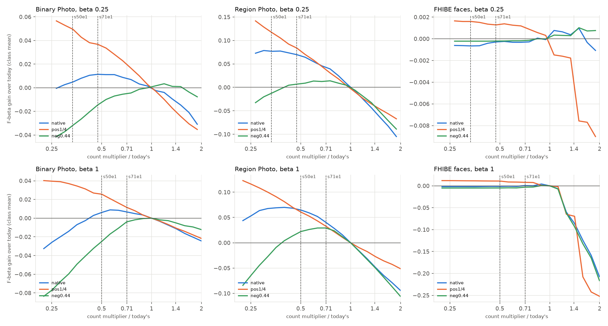
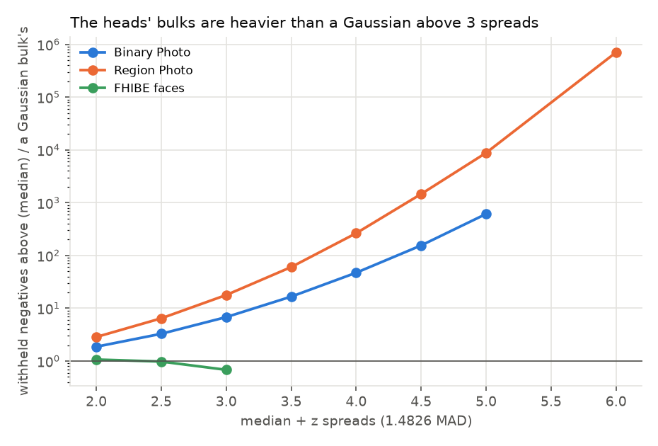
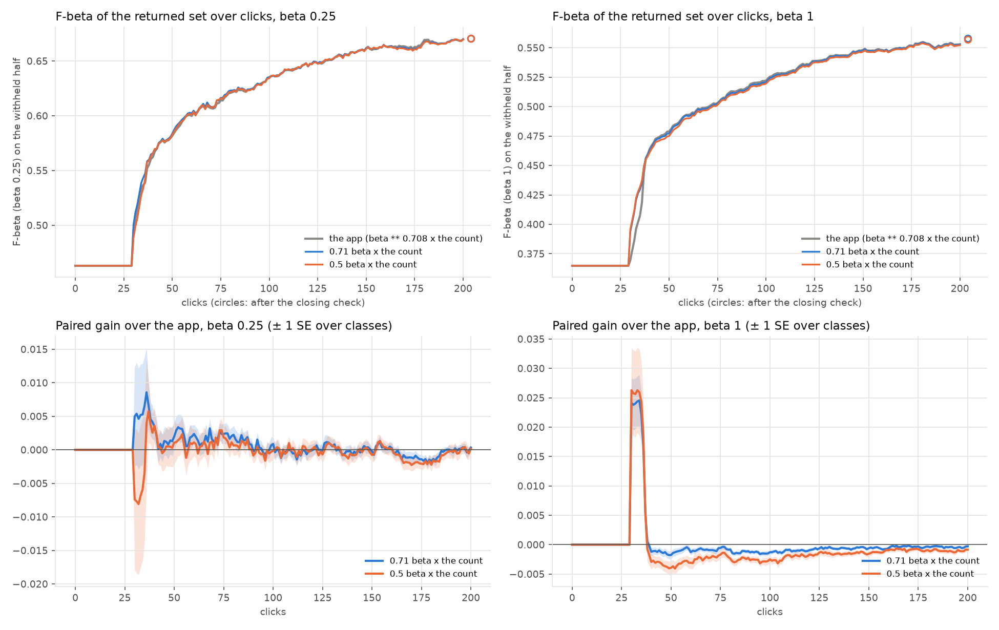
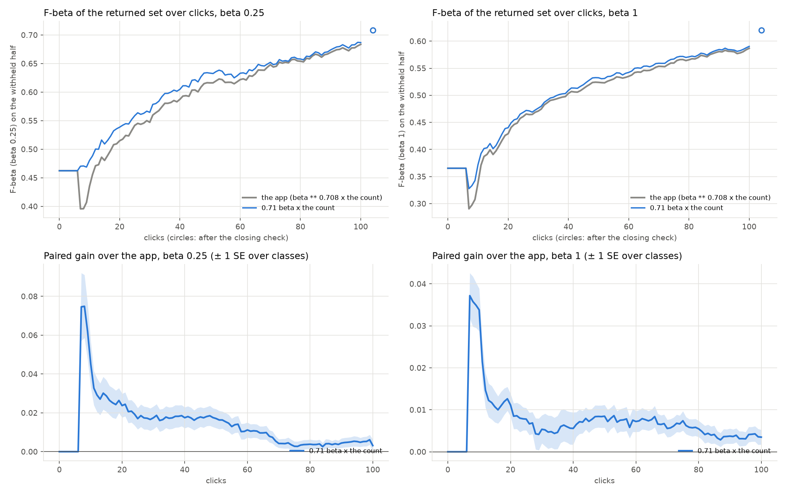

# The head's count reads the bulk's heavy tail: keep 0.71 beta times it at a balance of 1 and below (issue #5084)

**Status (2026-10-24): offline on every snapshot on the head's count line of three benches (Binary Photo, Region
Photo, FHIBE faces), at beta 1/4, 1 and 4, in four corpora each (0.44%, 0.1%, 1% and no positives); closed loop at
beta 1/4 and 1 on Binary Photo (720 sessions per arm and preset, 5 seeds) and Region Photo (144 per arm and preset,
1 seed, 100 clicks). Shipped: `HEAD_COUNT_PRECISION_SCALE` 0.71 and `HEAD_COUNT_PRECISION_EXPONENT` 1 are the
defaults (the owner's call on these numbers); `CALIB_HEAD_COUNT_PRECISION_SCALE=off
CALIB_HEAD_COUNT_PRECISION_EXPONENT=off` is the count before.**

**The count of what stands out over-reads the head's scores because the heads' bulks are not Gaussian above 3
spreads: Region Photo's withheld negatives above median + 4 spreads number 96 where a Gaussian bulk puts 0.36, and its
count reads 2.6x its positives. A better model of the bulk does not fix it on every bench; a smaller multiplier on
today's count does most of what any candidate does.** While the class model holds fewer than 6 held-out Goods the
labels line is the head's count (#4786, #4798): `beta ** 0.708` times what stands out (#4603: the logits above
median + 4 spreads less a Gaussian bulk's share), and never above the head's top drop. Priced in F-beta on the same
heads, against today's line:

1. **Why it over-counts.** Above 3 spreads the heads' bulks are 7x (Binary) to 18x (Region) heavier than a Gaussian,
   and 47x and 270x at 4 spreads (figure 1). The count subtracts a Gaussian's share, so the bulk's tail is counted as
   positives: on Region at beta 1 the line keeps 2.6x the positives at 0.44%, 10x at 0.1%, and 145 images on a corpus
   with none. Faces' bulk is Gaussian (no negatives above 4 spreads in the median snapshot), so the count is right
   there, and the line is mostly the drop below the person's photos.
2. **Every candidate the issue named, at its own best multiplier** (tables 2, `tables/offline_candidates.csv`): fitted
   heavier tails (exponential or quadratic in z, fitted between 1 and 3 spreads), counting from 5 spreads, the excess
   curve's F-beta peak (#5039's reach) on those tails, and counts read from the labels (the share of labelled items
   above the line that are Goods, and the held-out Goods' share above it as the line's recall). On Binary + Region
   the best of them beats today's count at its own best multiplier by at most 0.009 at beta 1/4 (a quadratic tail,
   which costs faces 0.020 at 0.1%; counting from 5 spreads gains 0.003 and is free on faces) and 0.014 at beta 1
   (the excess peak over a quadratic tail, which costs faces 0.049 at 0.1% and keeps 124 images of an empty Region
   corpus). The oracle count (the true positives) is 0.04 to 0.06 above all of them: what is left is not the bulk's
   shape. **The labels do not carry it
   either:** held-out Goods sit at 4.9 spreads on Region (the withheld positives at 4.5) and their share above the line
   tracks the positives' (0.63 vs 0.55, r 0.61), but on Binary they sit at 4.0 against the positives' 1.5 (0.49 vs
   0.12 above): the labels are the found positives, not a sample. Label-read counts gain less than today's count at
   each one's best multiplier (+0.031 / +0.032 against +0.034 at beta 1/4, +0.015 / +0.018 against +0.026 at beta 1).
3. **The patch path does want a smaller multiplier than Binary** (Region alone peaks at 0.30x today's at beta 1/4 and
   0.40x at beta 1; Binary at 0.53x and 0.71x), but a per-path multiplier is a second knob for +0.003 over one shared
   one. **One multiplier, 0.71 beta** (0.18 at beta 1/4 where today's is 0.375; 0.71 at beta 1 where today's is
   1): Region gains at every preset and prevalence (+0.007 to +0.084), Binary at 0.44% and 0.1% (+0.007 to +0.037) and
   loses at 1% (-0.014 at beta 1/4, -0.004 at beta 1), faces move by at most 0.008. 0.5 beta gains more on Region
   (+0.065 at beta 1 native) and loses twice as much on Binary at 1% (-0.032, -0.025).
4. **Beta 4 stays as #5039 left it** (1.3x and the gated reach): nothing priced beats it on Binary + Region except the
   oracle, and the reach that serves there is gated on the labels, which the offline count does not model.
5. **Closed loop.** On Binary, where the line serves the first ~40 clicks and weak classes beyond, 0.71 beta adds
   +0.0030 (± 0.0007) to Find's mean F-beta over clicks 0 to 50 at beta 1 and +0.0014 (± 0.0013) at beta 1/4, and is
   level over 0 to 200 (+0.0002 ± 0.0003, +0.0006 ± 0.0005); F-beta at the stop moves -0.0015 (± 0.0005) at beta 1 and
   +0.0012 (± 0.0018) at beta 1/4. 0.5 beta is worse at both (stop -0.0035 ± 0.0008 at beta 1). On Region at beta 1,
   where the line serves from the first trained click (7), 0.71 beta adds +0.034 at click 10, +0.0093 (± 0.0023) over
   clicks 0 to 50 and +0.0075 (± 0.0019) over 0 to 100, and +0.0040 (± 0.0018) at the stop (+0.0006 ± 0.0005 after
   the closing check); 4 of 144 sessions pick a different image. At beta 1/4: +0.045 at click 10, +0.021 (± 0.0048) over 0 to 50, +0.014 (± 0.0032) over 0 to
   100, +0.0031 (± 0.0032) at the stop; no session picks a different image.

| beta <= 1, on the head's count line (mean over classes; people on faces) | Binary Photo | Region Photo | FHIBE faces |
|---|---|---|---|
| heads priced (snapshots at beta 1/4 / 1) | 1,119 / 1,048 | 201 / 201 (from beta 1 sessions) | 8,992 / 8,992 |
| today's kept / positives at beta 1, 0.44% (median) | 0.42 | 2.6 | 1.0 |
| withheld negatives above median + 4 spreads (median) / a Gaussian bulk's | 17 / 0.36 | 96 / 0.36 | 0 / 0.17 |
| **beta 1/4: 0.71 beta** (0.18x the count), F-beta gain at 0.44% / 0.1% / 1% | **+0.011 / +0.037 / -0.014** | **+0.070 / +0.084 / +0.007** | **-0.000 / +0.001 / -0.000** |
| beta 1/4: 0.5 beta (0.125x) | +0.005 / +0.050 / -0.032 | +0.078 / +0.117 / -0.015 | -0.001 / +0.002 / -0.000 |
| **beta 1: 0.71 beta** (0.71x), F-beta gain at 0.44% / 0.1% / 1% | **+0.007 / +0.011 / -0.004** | **+0.040 / +0.033 / +0.030** | **+0.001 / +0.008 / -0.003** |
| beta 1: 0.5 beta (0.5x) | +0.006 / +0.026 / -0.025 | +0.065 / +0.061 / +0.022 | -0.001 / +0.011 / -0.005 |
| images kept on a corpus with no positives, beta 1/4: today / 0.71 beta / 0.5 beta | 12 / 6.3 / 4.7 | 54 / 26 / 18 | 2.4 / 2.4 / 2.4 |
| … beta 1 | 31 / 22 / 16 | 145 / 103 / 72 | 3.6 / 3.6 / 3.6 |
| **closed loop, 0.71 beta: Find's mean F-beta gain, clicks 0-50 / 0-200 (Region 0-100), beta 1** | **+0.0030 (± 0.0007) / +0.0002 (± 0.0003)** | **+0.0093 (± 0.0023) / +0.0075 (± 0.0019)** | not run |
| … beta 1/4 | +0.0014 (± 0.0013) / +0.0006 (± 0.0005) | +0.021 (± 0.0048) / +0.014 (± 0.0032) | not run |
| … F-beta at the stop, beta 1 / beta 1/4 | -0.0015 (± 0.0005) / +0.0012 (± 0.0018) | +0.0040 (± 0.0018) / +0.0031 (± 0.0032) | not run |

*± one SE over classes: offline 0.004 to 0.008 on Binary, 0.004 to 0.015 on Region, under 0.002 on faces
(`tables/offline_presets.csv`). Faces' corpora are at a person's own prevalence (about 4 of 5,439 crops) and its
thinned and sparse versions.*



*Figure 2: F-beta gain over today's line as the count's multiplier moves, today's count (Gaussian bulk, 4 spreads),
per bench and preset; dashed: the two closed-loop arms. Region gains down to a third of today's multiplier at 0.44%
and 0.1%; Binary at 1% (green) loses as soon as the multiplier falls, so 0.71 beta is where the benches agree.*

## The question

#5039 left the head's count alone below beta 4 ("about the F-beta-best count already" on Binary). #5084 read the
snapshots on Region Photo and FHIBE faces too: the line keeps 2.6x Region's positives at beta 1, and Binary's best
multiplier moves with prevalence (0.69x at 0.44%, more at 0.1%, less at 1%). The issue asked to price candidate counts
offline on #5039-style snapshots, on all three benches, at every preset and prevalence and the empty corpus (a
heavier-tailed bulk model, a patch-path correction, reading the count's error from the labels), then close the loop
on Region Photo, and Binary if it moves.

## What was run

- **Snapshots** (dev f92a75558, after #5191 and #5040):
  - **Binary Photo:** `fold_scale_4936.sh` on #4711's post-#5191 grid, 5 seeds x 144 cells per preset, scores saved
    at clicks 10, 25, 35, 40, 50, 75, 100, 125 and 150; 702 of 720 cells per preset saved a snapshot (18 never trained a head).
  - **FHIBE faces:** `sota_face.sh` (roll arm, 1 and 4 photos, 1024 px), 562 people per preset.
  - **Region Photo:** no fresh snapshots (the V100s were held by #4711, and a Region cell needs ~26 GB on the cpu
    partition); the 201 head-count snapshots of #4936's beta 1 run (2026-10-15, before #5191 and #5040) serve every
    preset.
  - `head_bulk_5084.py extract` keeps the snapshots on the head's count line (the class model holds fewer than 6
    held-out Goods; a typed query past its hold), and `head_bulk_5084.py price` prices every candidate on each in four
    corpora: native (0.44%), a quarter of the positives (0.1%), 44% of the negatives (1%), and the negatives alone.
  - Each head is priced at the preset its own session ran (the line steered the session that reached it), except
    Region's.
- **The knob:** `HEAD_COUNT_PRECISION_SCALE` / `_EXPONENT` in `labels_line.py`, default `None` (today's
  `beta ** 0.708`). Set, the count at beta <= 1 keeps `scale * beta ** exponent` times what stands out, still never
  above the top drop. The pricer's line matches `head_count_cut` under the knob on 5,952 snapshot x preset x arm cases
  (0 mismatches), and the knob at (1, 0.708) is today's line on 400 random heads.
- **Closed loop** (`head_bulk_5084.sh`, from a frozen worktree at 6863aa637), arms paired by cell and seed:
  - **arms:** `ctl` (today), `s71e1` (0.71 beta), `s50e1` (0.5 beta);
  - **Binary Photo:** 5 seeds x 144 cells, 200 clicks and the closing check, beta 1/4 and 1;
  - **Region Photo:** max_patch, 1 seed x 144 cells, 100 clicks, beta 1/4 and 1, `ctl` and `s71e1` only (0.5 beta
    lost on Binary; a Region arm is ~26 h of the memory cap).
  - Beta 4 is untouched by the knob and was not run.

## Why the count over-reads



*Figure 1: withheld negatives above median + z spreads (median over beta 1 heads, 0.44%) over what a Gaussian bulk of
the same size puts there. Faces stop at 3 spreads: the median face head has no negative above.*

`_count_estimate` takes the logits above median + 4 robust spreads and subtracts `n * Phi(-4)`, about 0.36 of 11,400
images. On Binary and Region the bulk's negatives above 4 spreads are 47x and 270x that (median 17 and 96). The
positives above the same mark are 3 on Binary and 29 on Region, so Region's count (127) is three quarters bulk.
Binary's count is mostly bulk too (21 against 3 positives above), but its positives sit low (median 1.5 spreads), so
the count lands near 0.4x the positives by accident of two errors cancelling, and moves with prevalence because the
bulk's part does not: 1.5x at 0.1%, 0.23x at 1% (`tables/offline_diagnosis.csv`).

| beta 1 heads, median (0.44% / 0.1% / 1% / none) | Binary Photo | Region Photo | FHIBE faces |
|---|---|---|---|
| positives | 50 / 13 / 50 / 0 | 50 / 12 / 50 / 0 | 4 / 1 / 4 / 0 |
| today's count of what stands out | 21 / 19 / 11 / 18 | 127 / 108 / 71 / 100 | 2.8 / 1.0 / 2.9 / 1.0 |
| positives above median + 4 spreads | 3 / 1 / 3 / 0 | 29 / 6 / 29 / 0 | 3 / 1 / 3 / 0 |
| negatives above median + 4 spreads | 17 / 18 / 7 / 18 | 96 / 100 / 42 / 100 | 0 / 0 / 0 / 0 |
| … a Gaussian bulk's | 0.36 / 0.36 / 0.16 / 0.36 | 0.36 / 0.36 / 0.16 / 0.36 | 0.17 / 0.17 / 0.08 / 0.17 |
| the line's kept / positives | 0.42 / 1.6 / 0.23 / - | 2.6 / 10 / 1.5 / - | 1.0 / 1.0 / 1.0 / - |

## The candidates

At each candidate's own best multiplier, one multiplier for Binary + Region's six preset x prevalence cells (mean of
the six), and what that multiplier does on faces (`tables/offline_candidates.csv`; the full grid per cell is there):

| count of what stands out | beta 1/4: Binary + Region | faces 0.44 / 0.1 / 1% | empty Region | beta 1: Binary + Region | faces 0.44 / 0.1 / 1% | empty Region |
|---|---|---|---|---|---|---|
| today's (Gaussian bulk, 4 spreads), x0.30 / x0.50 | +0.034 | -0.001 / +0.002 / -0.000 | 16 | +0.026 | -0.001 / +0.011 / -0.005 | 73 |
| Gaussian, from 5 spreads | +0.037 | -0.001 / +0.002 / -0.000 | 18 | +0.025 | -0.002 / +0.012 / -0.005 | 57 |
| quadratic tail fitted 1-3 spreads, counted where it is under 3 | +0.043 | -0.000 / -0.020 / +0.000 | 19 | +0.032 | -0.010 / -0.058 / -0.006 | 42 |
| quadratic tail 1.5-2.5, the same | +0.042 | -0.002 / -0.024 / -0.001 | 15 | +0.033 | -0.038 / -0.093 / -0.025 | 46 |
| exponential tail 2-2.5, the same | +0.037 | -0.001 / -0.010 / +0.000 | 15 | +0.026 | -0.056 / -0.080 / -0.064 | 38 |
| excess curve's F-beta peak over a quadratic tail from 3 spreads (#5039's reach) | +0.039 | -0.000 / -0.013 / +0.000 | 73 | +0.040 | -0.001 / -0.049 / +0.001 | 124 |
| excess peak over a Gaussian from 2.75 | -0.026 | -0.028 / -0.088 / -0.009 | 74 | +0.031 | -0.047 / -0.117 / -0.009 | 70 |
| labels: above 4 spreads x the labelled Goods' share there | +0.031 | -0.001 / +0.001 / -0.000 | 19 | +0.015 | -0.001 / +0.010 / -0.005 | 60 |
| labels: … / the held-out Goods' share above (recall) | +0.032 | +0.001 / +0.002 / +0.000 | 30 | +0.018 | -0.006 / -0.011 / -0.010 | 84 |
| the true positives (oracle) | +0.081 | +0.001 / +0.002 / +0.001 | 2.2 | +0.098 | +0.022 / +0.013 / +0.018 | 3.5 |
| **0.71 beta x today's count (the arm)** | **+0.033** | **-0.000 / +0.001 / -0.000** | **26** | **+0.020** | **+0.001 / +0.008 / -0.003** | **103** |

*Empty Region: images kept on Region's corpora with no positives (today 54 at beta 1/4, 145 at beta 1). The tail fits
are least squares on log #above(z) in the named z range; "counted where it is under 3" takes the excess over the fit
from the first z where the fit drops below 3 images.*

- **The tail fits gain on Binary and Region and cost faces**, where the bulk is Gaussian and a fitted tail extrapolates
  noise in a few dozen negatives above 2 spreads into a count of zero, so the line falls to the top drop or below it
  (-0.058 to -0.093 at 0.1%, beta 1). The excess peak from 3 spreads keeps 124 images of an empty Region corpus at
  beta 1.
- **The labels:** the held-out Goods are what the user found, the top of the head's ranking. On Region the head's
  positives are mostly high anyway (4.5 spreads), so the Goods' share above the line is close to the positives' (0.63
  against 0.55); on Binary 49% of held-out Goods are above against 12% of positives. With 2 to 4 Goods per head the
  share is also coarse (0, 1/4, 1/2 ...). Read as precision or recall, the labels shrink the count where it is
  already small (Binary) and lose to today's count at the same multiplier everywhere.
- **A patch-path multiplier:** Region alone peaks at 0.30x today's (beta 1/4, +0.062) and 0.40x (beta 1, +0.052),
  Binary at 0.53x and 0.71x (+0.012, +0.005). Splitting buys +0.003 over one multiplier at either preset and puts a
  path switch in the count; not taken.
- **Beta 4:** no candidate beats today's #5039 rule on Binary + Region at beta 4 bar the oracle; the gated reach is
  not in the offline count, so beta 4 numbers are not a comparison of the shipped rule and are left out of the tables.

## The closed loop



*Figure 3: Binary Photo, Find's F-beta on the withheld half over clicks (top) and the paired gain over the app (bottom,
± one SE over classes), 720 sessions per arm.*

**Binary Photo** (`tables/ab_binary_summary.csv`). The head's count line serves from the first trained click (~29)
until the class model holds 6 held-out Goods (~40 for most classes):

- **beta 1:** 0.71 beta gains +0.022 (± 0.004) at click 35 and +0.0030 (± 0.0007) over clicks 0-50, then gives back
  -0.0006 to -0.0018 at clicks 50-150, where the line still serves the weakest classes (offline Binary at 1% is where
  a smaller count costs). Over 0-200: +0.0002 (± 0.0003). At the stop: -0.0015 (± 0.0005), after the closing check
  -0.0004 (± 0.0002).
- **beta 1/4:** +0.0066 (± 0.0073) at click 35, +0.0014 (± 0.0013) over 0-50, +0.0006 (± 0.0005) over 0-200,
  +0.0012 (± 0.0018) at the stop.
- 0.5 beta: level or worse at both presets (stop -0.0035 ± 0.0008 at beta 1).
- Sessions barely part: 1.3% of beta 1 runs pick a different image before click 200 (median click 61), all on a
  phase change, and Done moves by under 0.06 clicks.



*Figure 4: Region Photo, as figure 3, 144 sessions per arm (1 seed, 100 clicks on the cpu partition).*

**Region Photo** (`tables/ab_region_summary.csv`, `ab_region_splits.csv`, `ab_region_examples.csv`). The patch path
trains from click 7, and the head's count line serves from there until 6 held-out Goods:

- **beta 1:** 0.71 beta gains +0.034 at click 10 (the first trained line keeps 2.6x its positives today, offline), then
  +0.005 to +0.012 out to click 75 and +0.0035 at click 100. Over clicks 0-25 +0.012 (± 0.0022), 0-50 +0.0093
  (± 0.0023), 0-100 +0.0075 (± 0.0019). At the stop +0.0040 (± 0.0018), after the closing check +0.0006 (± 0.0005).
  Done is reached as often (76%) at the same median click (48).
- **By band** (clicks 0-50): large objects +0.016 (± 0.005, 86% of classes better), medium +0.0084 (± 0.0022, 80%),
  small +0.0031 (± 0.0016, 52%). Classes both arms leave under F 0.2 at click 100 are level (-0.0007 ± 0.0015).
- **The gain is the line, not the session:** 4 of 144 sessions pick a different image (median click 12.5, all on a
  phase change). The other 140 label the same images and return a smaller, more precise set.
- **Sessions that part:** "orange", medium (parts at click 10): F at click 50 0.76 → 0.84, 49 Goods by click 100
  instead of 41, Done at 43 instead of 47. "bus", large (parts at 13): F at click 50 0.92 → 0.90, Done at 61 instead
  of 44, mean F over 0-100 -0.053, the run that costs most.
- **beta 1/4:** +0.045 at click 10, +0.017 at clicks 25 to 50, +0.003 at 75 and 100. Over clicks 0-25 +0.025
  (± 0.0053), 0-50 +0.021 (± 0.0048), 0-100 +0.014 (± 0.0032). At the stop +0.0031 (± 0.0032), after the closing
  check -0.0006 (± 0.0007). Not one session picks a different image: the line is the only change. Done is reached as
  often (84%) at the same median click (35).
- **By band at beta 1/4** (clicks 0-50): large +0.035 (± 0.011, 71% of classes better), medium +0.019 (± 0.0053, 73%),
  small +0.0090 (± 0.0027, 65%); classes both arms leave under F 0.2 at click 100 level (-0.0001 ± 0.0011).
- Six beta 1/4 cells of the 0.71 beta arm failed to start on one node (`OSError: failed to make path absolute`) and
  were rerun on another; a first rerun went to 150 clicks by mistake and was set aside, the second to 100 clicks
  pairs click for click with the control.

## Literal examples

From `tables/offline_examples.csv`, the head at the median of today's kept / positives, native corpus:

- **Region Photo, "person", beta 1** (#4936 run, cell 234, click 50; 7,743 images, 50 positives, 4 held-out Goods):
  - **The count:** 128 stand out above median + 4 spreads; 49 of the positives are up there, and so are 79 negatives,
    where a Gaussian bulk puts 0.25.
  - **Today's line:** keeps 128, F1 0.55.
  - **0.71 beta:** keeps 91, F1 0.67.
  - **0.5 beta:** keeps 64, F1 0.77.
  - **The best cut:** 51 images, F1 0.83.
- **Region Photo, "person", beta 1/4, click 25:** today keeps 48 (F 0.83); 0.71 beta keeps 22 (F 0.85); 0.5 beta keeps
  16 (F 0.83). The best cut is 24.
- **Binary Photo, "book", beta 1** (cell 315, click 38; 11,200 images, 50 positives, 2 held-out Goods):
  - **The count:** 21 stand out; 5 positives are above 4 spreads and 16 negatives.
  - **Today's line:** keeps 21, F1 0.14.
  - **0.71 beta:** keeps 15, F1 0.12.
  - **0.5 beta:** keeps 10, F1 0.10.
  - **The best cut:** 17 images, F1 0.15.
  - The positives are below the bulk's tail, so shrinking the count only drops them.
- **FHIBE faces, person 0, beta 1** (click 20; 5,440 crops, 4 photos of the person, 2 held-out): 2.8 stand out and
  none of the bulk is above 4 spreads. The top drop keeps 4 under all three multipliers (F1 0.75).

## What this leaves

- Region's closed loop is 1 seed (144 sessions per arm) to 100 clicks; more seeds and 150 clicks wait for the V100s (#4711 holds them): #5214.
- Binary at 1% prevalence pays for any smaller count (-0.004 at beta 1, -0.014 at beta 1/4 offline). What separates
  a head whose positives sit under the bulk's tail (Binary's "book") from one whose positives sit above it (Region's
  "person") is not in the scores' shape or in 2 to 4 labels; the class model takes over at 6 held-out Goods. Finding a signal that does: #5215.
- The earlier label check in this study read the held-out Goods' probabilities against the corpus's logits and put
  them at 6 to 8 spreads; corrected (logits on both), they sit at 4 to 5, and the labels route was priced in full
  above.

## Provenance

- Code: `scripts/experiments/state_of_app/head_bulk_5084.py` (extract, price, tables), `head_bulk_5084.sh` (closed
  loop), `head_bulk_5084_ab.py` (closed-loop reader, on `head_count_5039_ab.py`), the knob in
  `vtscore/training/thresholds/labels_line.py` and `vtscore/eval/live_threshold_rules.py`
  (`head_count_precision`), tests in `tests_lib/sorting/test_head_count_line.py`.
- Snapshots on dev f92a75558; closed loop on 6863aa637 (dev f92a75558 + the knob, default off).
- Data under `/expscratch/sgreenberg/`: `head-bulk-5084/` (extracts, priced pickles `pr_*.pkl`, text baseline),
  `state-of-the-app/2026-10-23-fscale4936-hb5084-binary-b*` and `2026-10-23-headbulk5084-<arm>-<path>-b*`,
  `fhibe/fhibe-full-resolution-674a7dcf-derived/runs/2026-10-23-5084snap-roll-k*-b*`.

## Reproduce

```bash
S=scripts/experiments/state_of_app
# Binary snapshots: fold_scale_4936.sh with FSCALE4936_GRID=<state-of-the-app>/2026-10-23-regstyles4711-grid,
#   FSCALE4936_AT=10,25,35,40,50,75,100,125,150, beta 0.25 / 1 / 4
# faces: sota_face.sh with SOTA_FACE_TAG=5084snap SOTA_FACE_ARM=roll SOTA_FACE_BASE=2026-10-10-prep-roll
#   SOTA_FACE_BETAS="0.25 1 4" SOTA_FACE_SIZES=1024 CALIB_SAVE_TEST_SCORES=1 CALIB_SAVE_TEST_SCORES_AT=10,20,30,40,60,80,100,150
python $S/head_bulk_5084.py extract --results <sota>/2026-10-23-fscale4936-hb5084-binary-b025/results ... --out xbin
python $S/head_count_5039.py extract --snapshots <early-line-4937>/mall/snapshots.csv.gz \
  --results <sota>/2026-10-15-fscale4936-region-b1/results --out xreg_old
python $S/head_count_5039.py extract-faces --runs <faces runs>/2026-10-23-5084snap-roll-k1-b025 ... --out xfaces
for x in xbin xreg_old xfaces; do python $S/head_bulk_5084.py price --x $x --out pr_$x.pkl --procs 16; done
python $S/head_bulk_5084.py tables --priced pr_xbin.pkl pr_xreg_old.pkl pr_xfaces.pkl \
  --out docs/experiments/2026-10-24-head-bulk-5084/tables --figures docs/experiments/2026-10-24-head-bulk-5084/figures
# the closed loop, from a frozen worktree
bash $S/head_bulk_5084.sh dirs
for arm in ctl s71e1 s50e1; do for b in 0.25 1; do bash $S/head_bulk_5084.sh cpack $arm binary $b; done; done
for arm in ctl s71e1; do for b in 0.25 1; do
  CALIB_PACK_JOBS=24 CALIB_PACK_PAR=2 CALIB_MEM=26G HEADBULK5084_STEPS_REGION=100 \
    bash $S/head_bulk_5084.sh cpack $arm region $b "$(bash $S/head_bulk_5084.sh idx region 1)"; done; done
python $S/head_bulk_5084_ab.py --root <sota> --seeds 5 --path binary --baseline text_baseline.csv --out ab_binary \
  --docs docs/experiments/2026-10-24-head-bulk-5084/tables
python $S/head_bulk_5084_ab.py --root <sota> --seeds 1 --path region --arms s71e1 --baseline text_baseline.csv \
  --out ab_region --docs docs/experiments/2026-10-24-head-bulk-5084/tables
```
