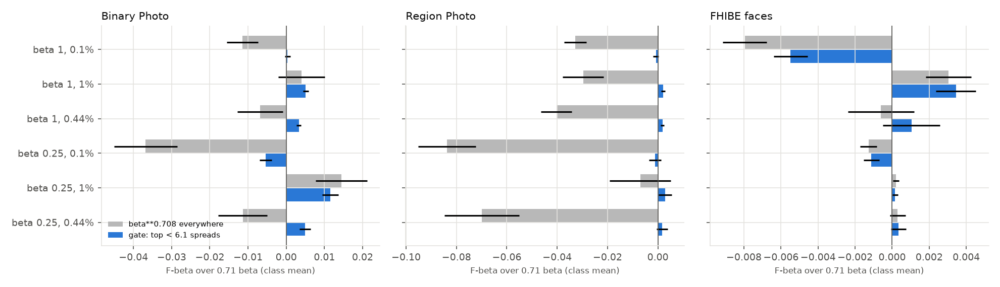
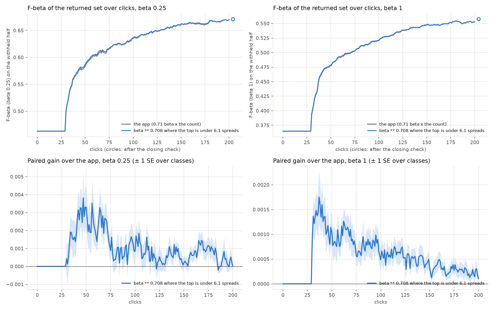
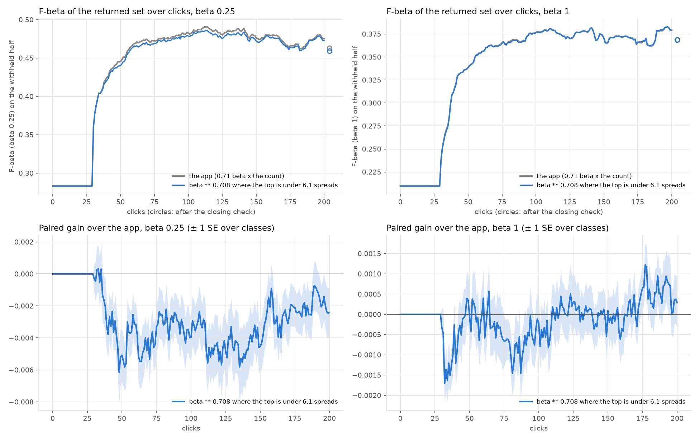

# Telling a head whose positives sit under the bulk's tail before shrinking its count (issue #5215)

**Status (2026-10-25): offline on #5084's snapshots on the head's count line (Binary Photo, Region Photo, FHIBE faces), at
beta 1/4 and 1, in three corpora each (0.44% as run, 0.1%, 1%), then a closed loop on Binary Photo at 0.44%, 1% (the pool) and 0.1% (the whole cell). The gate
is a knob, `HEAD_COUNT_PRECISION_TOP_Z`, off by default (`None`); nothing in the app changes. The gate is chosen on
Binary + Region Photo and read on faces.**

**One label-free signal tells the two kinds of head apart well enough to price: how far the head's top score stands
above the bulk.** Keeping #4603's count (`beta ** 0.708`) wherever the top corpus logit sits under 6.1 bulk spreads,
and 0.71 beta above, recovers 0.012 of Binary Photo's 0.014 loss at 1% and beta 1/4, and gains on Binary at 0.44% too.
It costs Binary at 0.1% (-0.005 at beta 1/4) and faces at 0.1% (-0.005 at beta 1). It holds Region Photo within 0.003
of the shipped line. None of the label signals the issue suggested separates the heads. The held-out Bads' placement
does not, and neither do the Goods' rank, the labelled precision above the line, or the Goods-vs-Bads AUC.

**The closed loop does not confirm the gate.** On Binary Photo it gains +0.0012 mean F-beta over clicks 0-50 at 0.44%
and +0.0004 at 1%, and costs -0.0024 at 0.1% (beta 1/4). Beta 1 is level within 0.0007 everywhere. Recommendation: do
not ship; the knob stays off.

## What was priced

#5084 shipped the head's count line at `0.71 beta` times what stands out at beta <= 1 (`HEAD_COUNT_PRECISION_SCALE`).
Offline that cost Binary Photo at 1% prevalence. For every head-count snapshot `head_tail_5215.py price` reads 23
signals the app has at the line, and the F-beta of the line at multipliers from 0.1x to 4x #4603's:

- **The scores' shape:**
  - the count over n;
  - the corpus above 3 spreads over a Gaussian bulk's;
  - above 3 over above 4 spreads;
  - the count over a quadratic-tail fit's;
  - the curvature of the log tail;
  - the top logit in spreads (`top_z`).
- **The drop:** the widest and `skip25` gaps against the beta-1 count, and the widest gap in spreads.
- **The held-out Goods and Bads (logits, against the beta-1 line):**
  - the Goods' share above it, and the Bads above it (count and share);
  - the labelled precision above it;
  - the Goods' median and lowest z, and the Bads' median and highest z;
  - the Bads above 4 spreads;
  - the Goods-vs-Bads AUC;
  - the corpus rank of the deepest and median Good and of the top Bad, over the count;
  - the Bads above the deepest Good.

The text sort's agreement is not in the snapshots and was not priced.

A gate keeps a second multiplier where a signal is below (or above) a threshold, and 0.71 beta elsewhere. The second
multiplier is #4603's count, or 1.4x it. The scan runs every signal, every Binary + Region quantile from 10% to 90%,
both sides, and both multipliers (`tables/offline_scan_best.csv`). Gains are class means (each class once), paired per
snapshot, against 0.71 beta. ± is the SE over classes. Heads run at their own preset; Region's beta-1 heads serve both.

## Findings

1. **The room is small.** Per head, the better of 0.71 beta and #4603's count beats 0.71 beta by at most 0.036 in any
   cell (Binary, 1%, beta 1/4), and by 0.003 to 0.043 elsewhere on Binary + Region (`ceiling` in
   `tables/offline_cells.csv`). Within the 1% Binary cell no signal's rank correlation with the per-head gain of
   shrinking exceeds 0.16.
2. **The best signal is `top_z`, and the best gate keeps #4603's count below 6.1 spreads** (table, figure 1). Gating to
   1.4x #4603's count instead pays more on Binary + Region (+0.0034 mean against +0.0022). It costs faces 0.054 to
   0.068 at beta 1, because 93% of face heads have their top under 6.1 spreads (faces' median top is 4.9). The
   runners-up are the drop's position (`skip25` gap at 1/4 or more of the count: +0.0015 mean, Binary 1% +0.007) and
   the tail's heaviness (+0.0012, worst cell -0.016). No label signal reaches +0.001 on Binary + Region.
3. **`top_z` partly tells the benches apart.** At beta 1, the median top sits at 9.1 spreads on Region, 5.8 on Binary
   and 4.9 on faces. The gate keeps #4603's count on 15-19% of Region heads, 57-66% of Binary's and 92-96% of faces'.
   Within Binary it separates heads only in part. It beats both uniform choices (0.71 beta and #4603's count) in 4
   of 6 Binary cells. It loses to 0.71 beta at 0.1% and to #4603's count at 1%, both at beta 1/4. Bicycle (1 of 51
   positives above the line, top 5.3 spreads) is a right call: it keeps #4603's count.
   It also carries a fixed scale (6.1 spreads of a logit bulk), which a different embedding or head may not share.
4. **What the gate trades.** It moves Binary's loss from 1% to 0.1% at beta 1/4 (-0.0054 ± 0.0016, where #4603's
   count everywhere loses -0.037 there). On faces it is #4603's count with a few heads shrunk, which is level except at
   0.1% and beta 1 (-0.0055 ± 0.0009, against -0.0080 for #4603's count everywhere).

| beta <= 1, gain over 0.71 beta (F-beta, class mean ± SE) | Binary Photo | Region Photo | FHIBE faces |
|---|---|---|---|
| heads (snapshots at beta 1/4 / 1) | 1,119 / 1,048 | 201 / 201 | 8,992 / 8,992 |
| share kept at #4603's count (top under 6.1 spreads), beta 1, 0.44% | 0.59 | 0.15 | 0.93 |
| **gate, beta 1/4 at 0.44% / 0.1% / 1%** | **+0.0049 / -0.0054 / +0.0115** | **+0.0017 / -0.0011 / +0.0028** | **+0.0003 / -0.0011 / +0.0002** |
| #4603's count everywhere, beta 1/4 | -0.011 / -0.037 / +0.014 | -0.070 / -0.084 / -0.007 | +0.0003 / -0.0013 / +0.0002 |
| per-head best of the two (ceiling), beta 1/4 | +0.023 / +0.008 / +0.036 | +0.022 / +0.005 / +0.043 | +0.0008 / +0.0003 / +0.0003 |
| **gate, beta 1 at 0.44% / 0.1% / 1%** | **+0.0033 / +0.0004 / +0.0051** | **+0.0018 / -0.0008 / +0.0021** | **+0.0010 / -0.0055 / +0.0034** |
| #4603's count everywhere, beta 1 | -0.007 / -0.012 / +0.004 | -0.040 / -0.033 / -0.030 | -0.0006 / -0.0080 / +0.0030 |
| per-head best of the two (ceiling), beta 1 | +0.010 / +0.006 / +0.017 | +0.006 / +0.003 / +0.016 | +0.008 / +0.0004 / +0.007 |



*Figure 1. F-beta over the shipped 0.71 beta, class mean ± SE, per preset and prevalence: #4603's count on every head
(grey), and the gate (blue).*

Literal heads (Binary Photo, beta 1/4, 0.44%, median over each class's snapshots; `tables/offline_examples.csv`):

| class | top (spreads) | positives above the beta-1 line / positives | F at #4603's count | F at 0.71 beta | the gate keeps |
|---|---|---|---|---|---|
| banana | 8.9 | 40 / 47 | 0.93 | 0.83 | 0.71 beta |
| clock | 8.5 | 16 / 57 | 0.66 | 0.63 | 0.71 beta |
| toothbrush | 8.4 | 13 / 45 | 0.40 | 0.56 | 0.71 beta |
| book | 6.3 | 5 / 49 | 0.11 | 0.14 | 0.71 beta |
| bicycle | 5.3 | 1 / 51 | 0.17 | 0.13 | #4603's count |

The gate is not clean. Banana and clock still lose to the shrink although their tops stand out, and "book", the issue's
example, sits above 6.1 and wins under the shrink at 0.44%.

## The closed loop (Binary Photo, three prevalences)

The knob was run on the app's trajectory pass (`head_tail_5215.sh`): Binary Photo, 144 cells x 5 seeds, 200 clicks, at
beta 1/4 and 1, in three session sets:

- **0.44%:** the bench as built.
- **1%:** the pool. The user's half has its negatives thinned (`SOTA_POOL_PREVALENCE=0.01`), and the withheld half
  stays at 0.44%.
- **0.1%:** the whole cell. Positives are thinned before the split (`SOTA_CELL_PREVALENCE=0.001`), about 8 withheld
  positives a class.

Each run is paired with the control of its cell and seed (the knob off). The runs come from a frozen tree at 086882fd6.
Gains are class means ± SE over classes (`tables/ab_binary{,_p01,_c001}_summary.csv`, `_gains.csv`).

| Binary Photo, gate over 0.71 beta | beta 1/4: 0.44% / 1% / 0.1% | beta 1: 0.44% / 1% / 0.1% |
|---|---|---|
| runs per arm | 720 / 720 / 720 | 720 / 720 / 720 |
| mean F-beta, clicks 0-50 | +0.0012 ± 0.0003 / +0.0004 ± 0.0002 / **-0.0024 ± 0.0007** | +0.0007 ± 0.0001 / +0.0005 ± 0.0001 / -0.0004 ± 0.0003 |
| mean F-beta, clicks 0-200 | +0.0009 ± 0.0002 / +0.0003 ± 0.0002 / **-0.0028 ± 0.0009** | +0.0005 ± 0.0001 / +0.0003 ± 0.0001 / -0.0001 ± 0.0004 |
| F-beta at the stop (control 0.616 / 0.627 / 0.470; 0.507 / 0.522 / 0.361) | +0.0031 ± 0.0014 / -0.0003 ± 0.0008 / -0.0025 ± 0.0016 | +0.0010 ± 0.0003 / +0.0003 ± 0.0001 / +0.0001 ± 0.0009 |
| F-beta after the closing check | +0.0008 ± 0.0004 / +0.0003 ± 0.0002 / -0.0037 ± 0.0013 | +0.0003 ± 0.0001 / -0.0001 ± 0.0000 / +0.0003 ± 0.0006 |
| runs whose clicks depart from the control | 0 / 0 / 0 | 0 / 0 / 1 |



*Figure 2. 0.44%. Top: F-beta of the returned set over clicks, the app (grey) and the gate (blue). Bottom: the paired
gain, ± 1 SE over classes.*



*Figure 3. 0.1% (the whole cell), as figure 2. The 1% figure is `figures/ab_binary_p01_over_clicks.png`.*

The gate changes only what the head returns. Clicks depart from the control in one run of 2,160 per beta, because the
line does not steer the queries.

- **0.44%:** the gain sits between clicks 30 and 75, where the head's count line is in use. It peaks at +0.003-0.004
  at beta 1/4 around click 50, in medium-sized classes (+0.0021 ± 0.0009 at 0-50).
- **1%:** the gain is smaller than at 0.44%, not larger. Offline 1% re-thinned the corpus under snapshots taken in
  0.44% sessions (+0.012 at beta 1/4). In the loop the sessions themselves run at 1%, and that gain does not survive.
- **0.1%:** the gate costs at beta 1/4 and keeps costing to click 200 (-0.004 to -0.005 at clicks 50-150). With about
  8 withheld positives a class, likely few runs reach 6 held-out Goods, so the head's line serves longer (not
  counted). The cost is in medium classes (-0.0056 ± 0.0020 at 0-200). At beta 1 it is level.

Averaged over the three prevalences, the gate is -0.0003 at beta 1/4 (clicks 0-50) and +0.0003 at beta 1.

## Recommendation

Do not ship. Keep the knob in the code, off by default, for a later signal to reuse. The offline 1% gain that
motivated the gate (+0.012) shrinks to +0.0004 in the loop. Its 0.1% cost holds there (-0.0024 at clicks 0-50, -0.0037
after the check at beta 1/4) and outweighs the +0.0012 at 0.44%. `top_z` reads which bench a head comes from more than
where its positives sit. No signal the snapshots carry, labelled or not, tells the two kinds of head apart well enough
to pay.

## Reproduce

```
head_tail_5215.py price --x /expscratch/sgreenberg/head-bulk-5084/{xbin,xreg_old,xfaces.tmp} --out pr_<bench>.pkl
head_tail_5215.py tables --priced pr_xbin.pkl pr_xreg_old.pkl pr_xfaces.pkl --out tables --figures figures
head_tail_5215.sh cpack {ctl,tz61} {0.25,1}     # 4 packs per run, from a frozen tree; HEADTAIL5215_TAG=p01 +
    # SOTA_POOL_PREVALENCE=0.01, or c001 + SOTA_CELL_PREVALENCE=0.001; text_baseline.py with the same prevalence
head_tail_5215_ab.py --root state-of-the-app --date 2026-10-25 --seeds 5 --path binary \
    --baseline head-bulk-5084/text_baseline.csv --out ab_binary --docs tables
```

The snapshot dirs are #5084's extractions (`head_bulk_5084.py extract`, `head_count_5039.py extract-faces`), on dev
a86fb4f2b. Pricing took about 4 minutes per bench on 16 CPUs; each loop prevalence took about 2.5 hours on 16 cpu packs.
