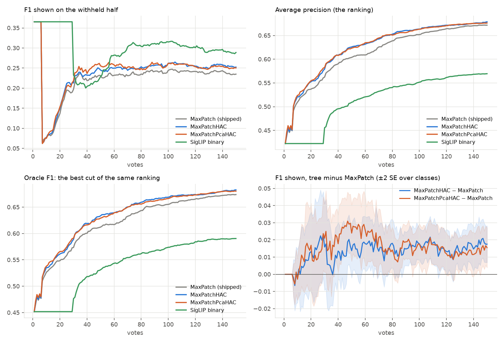
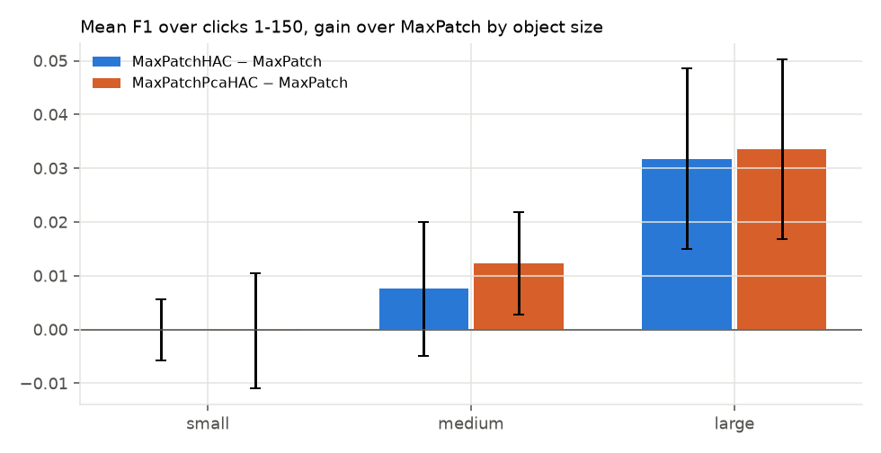

# Raw-patch HAC trees against MaxPatch on Region Photo, re-measured on today's app: the trees now win, on large objects (issue #4711)

**Status (2026-10-25): closed loop on Region Photo at beta 1. The arms are today's shipped geometry (`max_patch`)
and the two raw-patch-leaf trees (`max_patch_hac`, `max_patch_pca_hac`), on all 144 class x band cells, seed 0,
paired by cell. SigLIP Binary on the same grid and seed is the reference. Nothing ships from this PR: whether a
tree is worth its cost is the owner's call. The cost section below separates what the tree inherently costs from
what this harness made it cost.**

**On today's app both trees beat MaxPatch, and the whole gain is on large objects.** In July (#2886,
`docs/experiments/2026-07-29-max-patch/REPORT.md`) the raw-patch tree ranked best of every arm but lost at the
operating point: pooling a max over ~392 nodes gave it the heaviest false-positive tail. Since then the threshold
stack has been rebuilt, and the issue asked for the trees to be compared again on it. Re-measured on COCO Better
as #5191 rebuilt it:

1. **Both trees win.** Over votes 1 to 150 the F1 the app shows is **+0.013 (± 0.004) for `max_patch_hac`** and
   **+0.016 (± 0.004) for `max_patch_pca_hac`**, on a MaxPatch mean of 0.224. That is about 6-7% higher. At vote
   150 the gains are +0.018 and +0.016. The tree is ahead in 71% and 80% of the 49 classes respectively.
2. **The gain is all on large objects.** Mean F1 over votes 1 to 150: large +0.032 / +0.034, medium +0.008 / +0.012,
   small 0.000 / 0.000. This is the July mechanism. A merged node can cover an object that no single patch does,
   and MaxPatch's whole-image row only covers it when the object fills the frame.
3. **The line now turns the trees' better ranking into F1.** The July loss is gone. At vote 150 each tree's line
   sits slightly closer to its own oracle than MaxPatch's does (gap -0.009 for both trees, ± 0.006). On top of
   that, each tree ranks a little better (AP +0.007 / +0.005, oracle F1 +0.009 / +0.007). The trees also find about
   1.4 more Goods by vote 50 (13.7 -> 15.1 / 15.2), and that is where their early lead comes from.
4. **PCA is still a no-op.** `max_patch_pca_hac` minus `max_patch_hac` is +0.002 (± 0.003) in mean F1 and -0.003
   (± 0.002) in AP at vote 150. PCA is ahead in 57% of classes. The two trees are the same arm within noise, as in
   July. An image scores by the max over every node, so the order of the merges cannot matter much. If a tree
   ships, it should be `max_patch_hac`, the simpler of the two.

| Region Photo, beta 1, seed 0, tree minus MaxPatch (± one SE over classes) | all (144) | small (46) | medium (49) | large (49) |
|---|---|---|---|---|
| MaxPatch's own F1 shown, mean over votes 1-150 | 0.224 | 0.101 | 0.195 | 0.369 |
| **F1 shown, mean over votes 1-150, `max_patch_hac`** | **+0.013 (± 0.004)** | 0.000 (± 0.003) | +0.008 (± 0.006) | +0.032 (± 0.008) |
| **F1 shown, mean over votes 1-150, `max_patch_pca_hac`** | **+0.016 (± 0.004)** | 0.000 (± 0.005) | +0.012 (± 0.005) | +0.034 (± 0.008) |
| F1 shown, mean over votes 1-50 (hac / pca) | +0.009 / +0.014 | -0.004 / -0.003 | +0.005 / +0.013 | +0.025 / +0.030 |
| F1 at vote 150 (hac / pca) | +0.018 / +0.016 | +0.005 / +0.003 | +0.008 / +0.007 | +0.039 / +0.036 |
| AP at vote 150 (hac / pca) | +0.007 / +0.005 | 0.000 / -0.010 | +0.006 / +0.008 | +0.016 / +0.015 |
| Oracle F1 at vote 150, the ranking's best cut (hac / pca) | +0.009 / +0.007 | +0.000 / -0.007 | +0.006 / +0.009 | +0.020 / +0.016 |
| Line's gap below its own oracle at vote 150 (MaxPatch: 0.44) (hac / pca) | -0.009 / -0.009 | -0.005 / -0.010 | -0.001 / +0.002 | -0.020 / -0.019 |
| Goods found by vote 50 (MaxPatch -> hac / pca) | 13.7 -> 15.1 / 15.2 | 7.2 -> 7.2 / 7.1 | 15.1 -> 17.1 / 17.1 | 18.4 -> 20.6 / 20.9 |
| Goods found by vote 150 (MaxPatch -> hac / pca) | 27.9 -> 29.1 / 28.1 | 20.1 -> 20.3 / 19.4 | 32.0 -> 33.6 / 32.6 | 31.0 -> 32.9 / 31.7 |

*Bands are the grid's object-size bands. Small has 46 cells, not 49, because three classes have no small band.
Means are over sessions. SEs are over classes, because one class's bands are not independent. Every number is in
`tables/rs4711_summary.csv`, per session in `tables/rs4711_per_run.csv`, per vote in `tables/rs4711_curves.csv`.*





## The question

#4711 asked for a Region-voting comparison on COCO Better: DINOv3 MaxPatch vs MaxHAC vs MaxPatchHAC vs SigLIP. The
owner narrowed it on 2026-10-23:

- **MaxHAC is not an arm.** It was the production tree, built from k-means-pooled leaves. #2886 deleted it in
  August and it was not re-implemented.
- **#2895 was closed into this issue.** It asked whether the trees compose with today's threshold stack.
- **The scale is both trees, one seed, all 144 Region cells.** This was decided after a smoke run, which showed
  tree cells taking 3.5-5 h each.

The July study is the context. The corrected harness ranked MaxPatch first on ErrorCost = FPR + FNR, at 0.40
against MaxPatchHAC's 0.44. MaxPatchHAC had the best AP of any arm, with more large-object recall but more false
positives. The report's own read was: "a ranking that good should be convertible into a better operating point."
Since July the operating point has been rebuilt:

- the labels line is drawn at the class model's best F-beta (#3546, #4452, #5040, #5084);
- the head is the SVM started from the Goods' centroid (#4785);
- the objective is the withheld half's F-beta.

The question is whether the tree's ranking now pays.

## Setup

- **Arms** (`scripts/experiments/state_of_app/region_styles_4711.sh`, via `SOTA_PATCH_STYLES`):
  - `mp`, `max_patch`, the shipped geometry. A Good trains on the raw patch nearest the box. A Bad floods the
    whole-image row plus all 196 patches. An image scores by the max over those 197 rows.
  - `hac`, `max_patch_hac`. A HAC tree whose leaves are the raw patches, merged into 2N-1 = 391 nodes. A Good snaps
    to the best-matching node, a Bad floods every node, and an image scores by the max over all nodes.
  - `pca`, `max_patch_pca_hac`. The same tree, with the merge order decided in a 32-dim per-image PCA space.

  Every style goes through the same `_style_train_and_calibrate` and `node_scores` path, so every arm runs today's
  stack to vote 150 and differs only in region geometry. Preflight passed every arm, each declaring `patch_style`
  as its only divergence.
- **Bench:** Region Photo on COCO Better as rebuilt by #5191, on a grid prepared for this study
  (`state-of-the-app/2026-10-23-regstyles4711-grid`, 24,507 images). Each cell opens on SigLIP's text sort for its
  class. There are 144 class x band cells at 0.44% prevalence, run at beta 1 for 150 votes plus the closing check,
  as a trajectory pass. Seed 0 only, paired by cell.
- **Reference:** SigLIP Binary, meaning the same grid's 144 Binary cells at seed 0, run with the `mp` arm. Binary
  votes on whole images, so it is a different task on the same classes, not a fourth arm.
- **Read** (`scripts/experiments/state_of_app/region_styles_4711.py`), per vote:
  - the F1 the app shows: the typed query's set until a detector is on screen, then the detector's line, scored as
    in `early_check_4664.py`;
  - AP;
  - the oracle's F1 (the best cut on the same scores);
  - the line's gap below that oracle;
  - Goods found.

## Why the trees win now

The July mechanism has not changed, but the operating point has. On large objects the merged nodes give a Good
vote a candidate that covers the object, and they give a positive image a node that scores high. The result is a
better ranking (oracle F1 +0.020 at vote 150 on large objects) and faster early finds (+2.1 / +2.5 Goods by vote
50). Today's line is drawn from the class model's best F-beta, not from an FPR + FNR cut that the max-over-392 tail
inflated. It does not loosen on the tree's scores: the gap to the oracle shrinks a little (-0.020 on large
objects). So the ranking gain reaches the F1 the user sees. At vote 150 the F1 gain (+0.018 for `hac`) is about twice the
oracle gain (+0.009); the rest is the line sitting slightly closer to the oracle.

On small objects the tree adds nothing, as in July. A single raw patch is already the right candidate, and every
node above it mixes in background. Medium objects sit in between.

## SigLIP Binary as the reference

| seed 0, 144 cells, SigLIP Binary minus Region MaxPatch (± SE over classes) | all | small | medium | large |
|---|---|---|---|---|
| F1 shown, mean over votes 1-150 | +0.074 (± 0.017) | +0.046 | +0.092 | +0.084 |
| F1 at vote 150 | +0.054 (± 0.017) | +0.058 | +0.072 | +0.032 |
| AP at vote 150 | -0.10 (± 0.016) | -0.092 | -0.16 | -0.052 |
| Oracle F1 at vote 150 | -0.083 (± 0.014) | -0.085 | -0.13 | -0.037 |

Region ranks far better than Binary: AP 0.67 against 0.57 at vote 150. Yet Binary shows the higher F1, because its
line keeps more of its ranking. At vote 150 Binary's line sits 0.30 below its oracle and Region MaxPatch's sits
0.44 below. The trees close that gap by 0.009, so the Region line is still where the larger money is. #4937 and
#5084 worked that line (Region's head counts 2.6x its positives).

Part of Binary's lead over votes 1 to 50 is the opening. Both paths show the typed query's set (F1 0.37) until a
detector is on screen. Region puts its first detector up at vote 7, right after three Goods, and that detector's
line scores F1 0.06. Region MaxPatch is back to about 0.23 by vote 40 and stays near 0.24 from then on. Binary keeps
the typed set until about vote 29. This study did not examine that, and it is the same for every Region arm, so it does not touch the
comparison. It is filed as a follow-up.

## What the trees cost

Three costs are inherent to a tree. They would follow it into the app:

- **Scoring:** about twice the rows. 391 nodes an image against 197 rows, so about twice the work to score the
  pool after each retrain.
- **Ingest:** a HAC build per image over 196 patches. MaxPatch has no build step. #2886 removed the old tree build
  from ingest.
- **Storage:** about twice the patch-side rows per image.

One cost belongs to this harness, and it is most of what the run measured. On the smoke cells, run on the same V100
nodes, scoring the pool after a vote took a median of **2.9 s for MaxPatch against about 40 s for each tree** (13x).
Training took 1.0 s against 2.0 s. A tree cell took 3.5-4.3 h against MaxPatch's 0.6-1.8 h, and two pca smoke
cells hit the 5 h limit. The 13x is not the inherent 2x. The cause is the harness's flattened-matrix memo, an LRU
in `_FlattenedStyle` (`vtscore/eval/patch_styles.py`) capped at `_MATRIX_CACHE_BYTES = 12 GiB`, which is sized for
MaxPatch:

- MaxPatch's two stable row sets are about 3.5 GB each.
- A tree's are about 7 GB each (twice the rows), so the pair overflows the cap.
- The memo then evicts every step and re-flattens the trees with a Python loop over about 4.5 million nodes.

Memory followed the same pattern: about 58-60 GB per tree cell against a median of 16 GB per MaxPatch cell. A tree
study at larger scale should raise or style-scale that cap first. That is filed as a follow-up. It changes run
time, not results.

The app does not use this harness's memo, so its cost for a tree is the inherent part. That part was measured
separately (`scripts/experiments/state_of_app/region_styles_4711_bench.py`, cpu node, AMD EPYC 7713). Timings
depend on array shapes, not values, so the benchmark used synthetic 14x14x768 grids.

| app-side cost | `max_patch` (shipped) | `max_patch_hac` | `max_patch_pca_hac` |
|---|---|---|---|
| Ingest: tree build per image (1 / 8 threads) | none | 41 / 21 ms | 442 / 479 ms |
| Ingest: tree build for coco_better's 24,507 images (1 / 8 threads) | none | 17 / 8 min | 3.0 / 3.3 h |
| Scoring after each retrain, 24,507 images (1 / 8 threads) | 2.3 / 1.4 s | 4.5 / 2.7 s | as `hac` |
| Scoring ratio over `max_patch` | 1x | 2.0x | 2.0x |
| Patch-side rows stored per image (fp16) | 197 rows, 0.30 MB | 391 rows, 0.60 MB | as `hac` |

Scoring scales linearly in rows, at exactly 2x. The build adds 21-41 ms an image to ingest, on top of the DINOv3
pass. The PCA variant's per-image PCA makes its build 10-20x slower, which is another reason to prefer `hac`.

## Checks

- **Pairing.** The opening reads no region geometry: three Goods off the typed query's top, then the Bad phase on
  its sort. So every arm must make the same picks until the first trained one. They do. 0 of 144 sessions differ
  in either tree arm before the first trained vote, which is vote 7 in 139 sessions.
- **Never-trained sessions.** Five small-object sessions never found three Goods and never got a detector (bag or
  luggage, bowl, chair, knife, spoon). They are identical in every arm and count as zero gain. They are the 3.5% of
  sessions that tie.
- **Completeness.** 144 of 144 Region cells in every arm, and 144 Binary reference cells. No failed, empty or
  duplicated cell. The FAILED lines in the first packs' logs are cells I killed to stop swap thrash (pca 158-170;
  hac 163, 167 and 171), and every one was re-run to completion on the relaunched packs.
- **Where cells ran.** `mp` ran as a cpu array (Xeon Silver 4114). The tree arms ran as packs on V100 nodes
  (Xeon E5-2698 v4) with the GPU hidden. Every cell runs with the CPU-kernel pins (#4110), so its output does not
  depend on the node. #4278 verified that on a re-run at tolerance 0. The two numactl and CPU knobs added mid-run
  (below) change placement only, not the threads a cell computes with.
- **One seed.** The design is one seed by the owner's ruling, so every SE is over the 49 classes' sessions. The
  headline gains are 3.7 and 4.0 SEs from zero, and the large-band gains are each about 4 SEs.

## Provenance and ops

- **Code:**
  - Branch `claude/region-styles-4711` off `dev` `11630be6e`.
  - The `mp` arm ran from frozen worktree `vts-4711-run` at `ecc2075aa`.
  - The relaunched tree packs ran from `vts-4711-run2` at `430dce0bd`. It has the same Python and adds only the two
    launcher knobs.
  - App venv `/expscratch/sgreenberg/vtsearch-venv`.
  - Results in `/expscratch/sgreenberg/state-of-the-app/2026-10-23-regstyles4711-{mp,hac,pca}-region-b1`.
- **Launched** 2026-10-23 16:05:
  - `mp`: a cpu array (Region plus the Binary reference), done by 08:40 on 10-24.
  - Each tree arm: two packs of 14 cells on V100 nodes, outside the cpu cap.
- **The packs ran 3-10x slow, for two stacked reasons.**
  - **Hyperthreading.** 14 CPUs on these nodes were 7 cores, so two cells shared each core.
  - **NUMA balancing.** Each pack's cpuset sat on one socket. `kernel.numa_balancing` pulled every cell's ~58 GB
    onto that socket's node, and nodes with swap thrashed: 24 h of system time against 3 h of user time per cell.
  - **Fix, mid-run:**
    - Paused each pack's `xargs` (SIGSTOP).
    - Drained the in-flight cells.
    - Relaunched the rest with `CALIB_PACK_CPUS` (a core per cell) and `CALIB_PACK_INTERLEAVE=1`
      (`numactl --interleave=all`).

    Cells then took 3-4 h, as in the smoke run.
  - The last cell finished 2026-10-25 14:46.
  - Lesson: `scripts/experiments/lessons/2026-10-24-pack-numa-balancing-swaps-region-cells.md`. It also suggests
    #4278's DGX "memory bandwidth" half speed had the same cause.
- **Smoke** (cells 190, 194, 213; `2026-10-23-regstyles4711smoke-*`): styles logged right, the analyzer pipeline
  ran, and the cost figures above come from it.

## Reproduce

```bash
cd /expscratch/$USER/worktrees/vts-4711-run2 && source gridenv.sh
L=scripts/experiments/state_of_app/region_styles_4711.sh
G=/expscratch/$USER/state-of-the-app/2026-10-23-regstyles4711-grid
RS4711_SEEDS=1 bash $L grid                      # once, from a compute node (prepare runs band checks inline)
python scripts/experiments/calibration/text_baseline.py --results $G/results --out $G/text_baseline.csv  # compute node
RS4711_SEEDS=1 bash $L dirs
RS4711_SEEDS=1 bash $L launch mp "$(bash $L binidx 1),$(bash $L idx 1)"   # Region + the Binary reference
for arm in hac pca; do   # a V100 pack each; split IDX over two packs for 4 GPUs
  RS4711_SEEDS=1 CALIB_MEM=64G CALIB_PACK_PAR=14 CALIB_PACK_TIME=40:00:00 bash $L gpack $arm "$(bash $L idx 1)"
done
python scripts/experiments/state_of_app/region_styles_4711.py --root /expscratch/$USER/state-of-the-app --seeds 1 \
    --baseline $G/text_baseline.csv \
    --out <dir> --docs docs/experiments/2026-10-25-region-styles-4711/tables --procs 32
```
