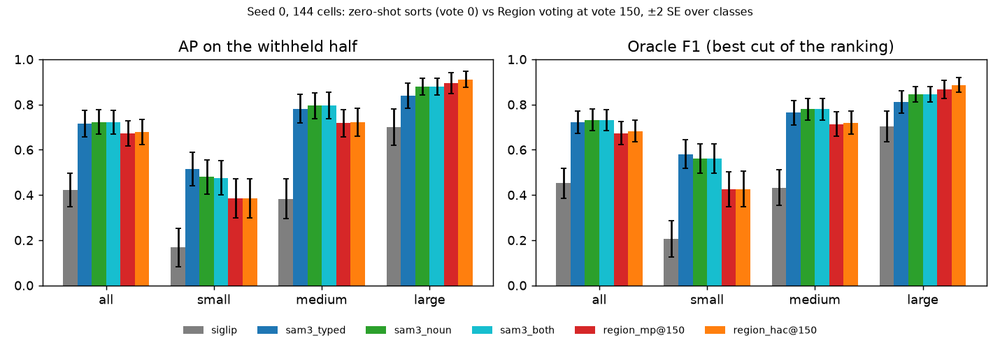
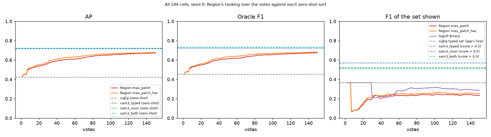
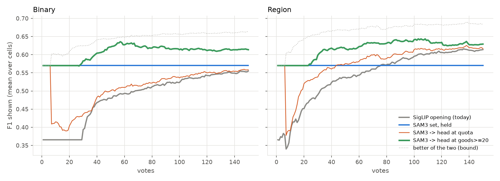

# SAM3's zero-shot text prompt on Region Photo: it out-ranks SigLIP's typed sort and 150 Region votes (issue #5213)

**Status (2026-10-25): zero-shot only. SAM3 (`facebook/sam3`) is given each class's text and nothing else, and
scores every image of #4711's grid (COCO Better as #5191 rebuilt it, 24,507 images, 144 class x band cells). Each
cell is scored on its own pool and withheld half, exactly as SigLIP's typed sort is in `text_baseline.csv`, and set
against #4711's Region arms. Nothing ships from this PR. The follow-ups at the end are filed as issues.**

**SAM3 with no votes ranks better than Region voting does after 150 votes.**

1. **Against SigLIP's typed sort, the opening every cell starts from:** AP **0.72 vs 0.42** (+0.30 ± 0.03, ahead
   in 47 of 49 classes). The best cut of the ranking (oracle F1) is 0.73 vs 0.45.
2. **Against Region after 150 votes (seed 0, paired by cell):** SAM3's noun prompt is AP **+0.051 ± 0.017** over
   `max_patch` (0.72 vs 0.67) and +0.044 over the HAC tree, ahead in 73% of classes. Region never catches it on
   small or medium objects. On large objects it does: the tree passes SAM3 at vote 40, `max_patch` at vote 109.
3. **What the user would see:** SAM3's own operating point (keep an image if a detection scores over 0.5) gives
   **F1 0.57** (precision 0.47, recall 0.86), against **0.37** for SigLIP's typed set and **0.23** for Region's
   line at vote 150. At 0.5, SAM3 sits 0.15 below its own oracle; Region's line sits 0.44 below its oracle.
4. **The gain is biggest where SigLIP is weakest.** Small objects: AP 0.17 -> 0.52 (Region at 150: 0.39). Clutter
   classes SigLIP cannot rank at all (chair 0.06, bowl 0.05, knife 0.07, person 0.10) go to 0.42-0.67.
5. **SAM3 wants short noun phrases.** The typed queries were written for SigLIP. "a person wearing a necktie"
   scores AP 0.48 and "necktie" 0.91. "a car or truck" scores 0.54, and the better of "car" and "truck" 0.71. "a
   television screen" scores 0.45 and "television" 0.68. Over all classes the two prompt sets tie (0.72), because
   one noun loses: "skis" 0.50 vs "a pair of skis" 0.72.
6. **It is expensive, and the app's text line does not fit it.** Scoring one query over the pool costs a full
   backbone pass per image unless ~65 GB of features are cached (see Cost). The app's text-sort line, drawn on
   SAM3's scores, cuts at ~0.002 and keeps nearly everything (F1 0.04). SAM3 needs its own line.

**Training overlap: checked (#5240), and it does not explain the lead.** The pool is COCO train2017. SAM3's training
sets (paper Table 26) name no COCO, but SA-Co/EXT holds Visual Genome, whose images are COCO images: 41.5% of this
pool (10,161 of 24,507). Graded apart, SAM3 does no better on the images it trained on: AP 0.72 on them vs 0.73 on
the rest (noun prompts), and its lead over SigLIP is +0.30 on the images it never had labels for. See
[Training overlap](#training-overlap-5240).

**SAM3 as the opening: measured (#5241), as an opt-in path beside SigLIP's (SigLIP stays the default: it is fast).**
A session that opens on SAM3's set at 0.5 and hands Test to the detector at the 20th Good shows F1 +0.12 (± 0.015)
over votes 1-150 on Binary and +0.07 (± 0.016) on Region, against today. Handing over at the label quota, as SigLIP's
opening does, keeps only +0.02-0.03. See [SAM3 as the opening](#sam3-as-the-opening-5241).

| seed 0, mean over cells (± SE over classes) | all (144) | small (46) | medium (49) | large (49) |
|---|---|---|---|---|
| **AP**, SigLIP typed sort (vote 0) | 0.42 (± 0.04) | 0.17 | 0.38 | 0.70 |
| **AP**, SAM3 typed prompt (vote 0) | **0.72** (± 0.03) | **0.52** | 0.78 | 0.84 |
| **AP**, SAM3 noun prompt (vote 0) | **0.72** (± 0.03) | 0.48 | **0.79** | 0.88 |
| AP, Region `max_patch` at vote 150 | 0.67 (± 0.03) | 0.39 | 0.72 | 0.90 |
| AP, Region `max_patch_hac` at vote 150 | 0.68 (± 0.03) | 0.38 | 0.72 | **0.91** |
| Oracle F1, SigLIP / SAM3 typed / SAM3 noun | 0.45 / 0.72 / 0.73 | 0.21 / 0.58 / 0.56 | 0.43 / 0.76 / 0.78 | 0.70 / 0.81 / 0.85 |
| Oracle F1, Region `max_patch` / `hac` at vote 150 | 0.67 / 0.68 | 0.43 / 0.43 | 0.71 / 0.72 | 0.87 / 0.89 |
| **F1 shown**, SigLIP typed set (app's line) | 0.37 | 0.16 | 0.35 | 0.58 |
| **F1 shown**, SAM3 typed / noun, score > 0.5 | **0.57** / 0.52 | 0.51 / 0.47 | 0.59 / 0.54 | 0.60 / 0.55 |
| F1 shown, Region `max_patch` / `hac` at vote 150 | 0.23 / 0.25 | | | |
| Vote at which Region's AP reaches SAM3 noun's (`mp` / `hac`) | never / never | never | never | 109 / 40 |

*Zero-shot rows are seed 0, to pair with #4711's Region arms (seed 0 only). Over seeds 0-2 the zero-shot means move
by under 0.01: the scores do not depend on the seed, only which images land in the withheld half does. Paired gains
are in `tables/sam3_5213_paired.csv`, every cell in `tables/sam3_5213_per_cell.csv`, per class in
`tables/sam3_5213_per_class_AP.csv`. Region's F1 by band is in #4711's report.*

## The question

#5213 asked for #4711's Region-voting comparison with SAM3 in it, zero-shot text queries first, plus a cost
estimate and a look at how SAM3 could enter the vote loop. The owner scoped the first pass on 2026-10-25: zero-shot
SAM3 on all 144 cells, measured cost, and a memo of follow-ups filed as issues.

## Setup

- **Model:** `facebook/sam3` through transformers 5.19 (`Sam3Model`), image input 1008 x 1008. An image's score
  for a prompt is its best detection: the max over SAM3's 200 object queries of sigmoid(query logit) x
  sigmoid(presence logit). This is the product SAM3's own `post_process_object_detection` thresholds.
- **Prompts:**
  - `typed` is the text every cell opened on (`seed_query_text`, the same string SigLIP embedded).
  - `noun` is a short SAM3-style phrase ("necktie", "television", "computer mouse"). A merged class gets one phrase
    per member, and the image takes the max: "car"/"truck", "cup"/"glass", "bag"/"suitcase", "vase"/"potted plant".
  - `both` takes the max over the two sets. It matches `noun` to within 0.002 everywhere, so it is not discussed.
- **Pool and scoring:** `text_baseline.py --sam3` swaps SigLIP's similarities for SAM3's scores and changes
  nothing else: same `evaluable_pool` (a wrong-band image is excluded, so a class-level score is the whole task),
  same seeded split, same columns. The SAM3 rows' test sets and positive counts were checked identical to
  SigLIP's, cell by cell (432 of 432).
- **Region:** #4711's committed tables (`max_patch` and `max_patch_hac`, seed 0, 150 votes on today's stack).
- **Runs:** 12 shards on V100 at fp16 (`state_of_app/sam3_5213.sh score 12`), ~63 min each, no failures.
  fp16 vs fp32 on 200 images x 102 prompts: Spearman >= 0.999 for every prompt, and the 0.5 cut agrees on 100% of
  image-prompt pairs. The mask head is skipped (`--masks` turns it back on); with it on, the scores are
  bit-identical.

## Reading the result

**Ranking.** SAM3 is a detector trained for "find every instance of this noun phrase". Its score answers "is there
one in this image", which is the Region question. SigLIP's typed sort compares a caption-like text with the whole
image, and is weakest exactly where the object is a small part of a busy scene. The per-class table shows it.
SigLIP's worst classes are tableware, furniture and people in clutter (bowl 0.05, chair 0.06, knife 0.07, spoon
0.08, person 0.10). Those are SAM3's largest gains, +0.36 to +0.54. Where SigLIP is already good (tennis racket
0.96, surfboard 0.88), SAM3 ties.

**Against voting.** Region's 150 votes buy AP 0.42 -> 0.67. SAM3 starts at 0.72. The votes' advantage is a
user-specific concept and the band. SAM3 knows neither, and on large objects the votes still win, from vote 40
(the tree) or 109 (`max_patch`). On small objects the vote loop never reaches SAM3: at vote 150 Region is at 0.39
and SAM3 at 0.48-0.52.

**The line.** SAM3's scores are near-calibrated probabilities. At 0.5 it keeps 146 images per withheld half
(typed), for ~50 positives. That is precision 0.47 and recall 0.86, F1 0.57: 0.15 below the best cut of the same
ranking. Today's lines are fitted to cosine similarities and to the class model, and do not transfer. The text
route's line on SAM3's scores cuts at a median of 0.002 and returns nearly the whole pool (F1 0.04). Using SAM3 in
the app means using its own cut, or fitting a line to its scores.

**Prompt wording.** SAM3 reads a prompt as one noun phrase. A relative clause ("a person wearing a necktie") or a
disjunction ("a car or truck") reads as a different and rarer concept. Splitting a disjunction into one prompt per
member and taking the max recovers it: car/truck +0.16, vase/potted plant +0.24. One noun went the other way:
"skis" (0.50) loses to "a pair of skis" (0.72). "A pair of" is a count phrase SAM3 evidently knows for skis.

## Cost

Measured on 200 images x 102 prompts (`state_of_app/sam3_5213.sh smoke`):

| | V100 fp16 | L40S bf16 | L40S fp32 |
|---|---|---|---|
| Backbone, per image (once, shared by every prompt) | 126 ms | 77 ms | 240 ms |
| Per prompt per image, mask head skipped | 16.7 ms | 4.7 ms | 22.6 ms |
| Images/s at 102 prompts | 0.55 | 1.77 | 0.39 |
| The whole 24.5k pool at 102 prompts | ~12 GPU-h | ~3.8 GPU-h | |

SigLIP's typed sort, for comparison, is one dot product per image against a vector embedded at ingest. For the app
the question is the cost of a new query:

- **Without a cache,** every query pays the backbone: 24.5k x (77 + 4.7) ms = **~33 min on one L40S**.
- **With the backbone's detector-level features cached,** a query pays only the prompt step: **~2 min on one
  L40S** (~7 min on V100). The detector reads one 256 x 72 x 72 level, 2.65 MB an image at fp16: **~65 GB** for
  this pool, against ~0.3 MB a `max_patch` image today (#4711's bench).
- **Ingest** adds 77 ms an image on L40S (126 ms V100) for the backbone, on a GPU. The model is ~850M parameters.
- Lighter variants exist but were not measured: EfficientSAM3 (~90M, replaces both encoders), SAM3-LiteText
  (smaller text encoder only, so the same image cost). SAM 3.1 changes video only.

## How SAM3 could enter the vote loop: what is known

From a literature pass (sources in `research_notes.md` beside this report):

- **Exemplar prompts, positive and negative,** are native to SAM3: a box with a label, pooled from the image and
  concatenated with the text tokens. **But an exemplar must be in the image being searched.** The paper's exemplar
  results take the box from the target image itself. Cross-image exemplars are an open request
  (facebookresearch/sam3 issue 426). The workaround pastes the reference and the target on one canvas, about 2x
  the backbone per pool image per exemplar set. One paper (arXiv 2604.05433) reports that negative exemplars often
  hurt in few-shot use. So a Good vote's box cannot simply be handed to SAM3 for the rest of the pool.
- **Fine-tuning** pays in the paper's few-shot detection: ODinW13 box AP 61.0 zero-shot -> 66.1 / 69.1 / 71.8 at 1 /
  3 / 10 shots (full fine-tune, 40 epochs). That costs a training run per detector, far heavier than today's SVM.
  LoRA variants exist (text encoder kept frozen). **No light head on frozen SAM3 features was found**; that would be
  new.
- **SAM masks + DINO features:** "No Time to Train" (arXiv 2507.02798) pools DINOv2 inside SAM2 masks and matches to
  few-shot prototypes. It gets COCO 10-shot nAP 36.6 without training, ahead of fine-tuned few-shot detectors. In
  that paper **DINOv3 did worse than DINOv2** (32.8-33.8 vs 35.7). No head-to-head of mask pooling against a
  max-over-patches ranking was found.

## Training overlap (#5240)

**Question.** Is SAM3's lead memorisation of COCO? The paper's training-set table (Table 26) names no COCO and calls
COCO and LVIS zero-shot. But SA-Co/EXT holds Visual Genome, and VG's 108,077 images include 51,208 COCO 2014 images
(VG's `coco_id`). SAM3 saw those with VG's dense object labels, mapped to its ontology.

**Design.** That splits this pool, inside the same cells, into **seen** (in VG: 10,161 images, 41.5%) and **unseen**
(14,346). `text_baseline.py --keep-ids` grades each test half's seen and unseen images apart; the pool, split and
cuts stay the whole cell's. So the two slices partition #5213's rows item for item. Every arm (SigLIP typed, SAM3
typed, SAM3 noun) is graded on the same items. All 144 cells x 3 seeds are paired (none dropped). Prevalence is
0.43% on the seen slice and 0.46% on the unseen slice (8,680 and 13,096 test positives). SigLIP is the control: it
had no VG labels, so any difference between the slices themselves shows up in it too. The "all" run reproduces
#5213's CSVs (SAM3 exactly; SigLIP to 6e-5, text-tower float noise). Means here are over 3 seeds, not seed 0 alone.

| AP, mean over cells (± SE over classes) | seen (in VG) | unseen | seen - unseen |
|---|---|---|---|
| SigLIP typed sort | 0.42 | 0.42 | -0.001 |
| SAM3 typed | 0.71 | 0.72 | -0.009 (± 0.009) |
| SAM3 noun | 0.72 | 0.73 | -0.013 (± 0.009) |
| **SAM3 noun lead over SigLIP** | +0.30 | **+0.31** (± 0.02) | **-0.012 (± 0.010)** |

- **No lift on seen images.** If SAM3 remembered COCO it would rank seen images better. It ranks them slightly worse
  (difference-in-difference -0.012 ± 0.010 noun, -0.007 ± 0.010 typed). This holds in every band: small -0.015 ±
  0.019, medium -0.010 ± 0.015, large -0.011 ± 0.013 (noun). AUROC: -0.004 ± 0.003. Best-cut F1: +0.001 ± 0.009.
- **No class hides an effect.** Per class the difference-in-difference is spread both ways: 22 of 49 classes above 0
  (noun). The largest are knife +0.12 and bird +0.11; the smallest are bicycle -0.17 and traffic light -0.15. That is
  the spread of noise at a class's positive count, not a tail.
- **The unseen slice is the clean number for #5213's headline:** AP 0.73 (noun) vs SigLIP 0.42, lead +0.31.

**What this does not rule out.** Unseen means "never given labels for". SAM3's image encoder was pretrained on web
images (MetaCLIP is CommonCrawl), and COCO images are on Flickr, so some may have been crawled without labels. SigLIP's
WebLI has the same exposure, so the comparison stays even. Labelled exposure is the strong form, and it bought
nothing here. A corpus collected after SAM3 was trained would close the gap fully; none with COCO-style labels is on
the GRID.

Tables: `tables/sam3_5240_summary.csv` (every metric x band x arm x slice, with leads and differences),
`tables/sam3_5240_per_class.csv`, `tables/sam3_5240_counts.json`.
Reproduce: `sam3_5213.sh overlap DIR` (one CPU job, ~15 min).

## SAM3 as the opening (#5241)

**Status (2026-10-26): measured on seed 0, beta 1, both paths. SAM3 is an opt-in alternative to SigLIP's typed
sort, not a replacement: SigLIP stays the default because it is fast (see [Cost](#cost)). Nothing ships from this
PR. The run adds the knobs that open a session on SAM3, and prices takeover rules on the sessions it ran.**

**Question.** SAM3's set at its own 0.5 cut shows F1 0.57, against 0.37 for SigLIP's typed set. If a session opens on
SAM3, what does the user see over votes 1-150? When does the detector beat SAM3's set? And which rule should decide
when the detector takes over Test, now that the bar is 0.57 and not 0.37?

**Design.** Three arms on #4711's grid (COCO Better, 144 cells a path, seed 0, beta 1, 150 votes, trajectory pass):

- **`sig`:** today's app. SigLIP's typed sort opens; its set is shown until the label quota (Binary: the query hold
  and the hand-over), and then the head.
- **`sam3`:** SAM3's typed-prompt scores order the opening's picks (`CALIB_SEED_SAM3`). Its set at 0.5 is what Test
  shows at every vote on both paths (`CALIB_QUERY_LINE=fixed:0.5`, `CALIB_QUERY_HOLD` past any session,
  `CALIB_QUERY_HOLD_PATCH=1`, no query miss). The head still trains on every vote and is scored on the same withheld
  half, in rows tagged `hold:head`. Picks never depend on what Test shows, so **every takeover rule is a choice,
  vote by vote, between two rows of the same session.** Rules are priced afterwards; nothing is re-run.
- **`sam3gmm`:** SAM3's set at the GMM midpoint of its scores instead of 0.5 (one vote per Binary cell: the set
  does not change with the votes).

The query row of the `sam3` arm reproduces #5213's `text_native` row exactly (for example dining table@large: P 0.112,
R 0.889, F1 0.199). Means are over the 144 cells, ± SE over the 49 classes.

| F1 shown, mean over votes (± SE) | Binary 1-50 | Binary 1-150 | vs today, 1-150 | Region 1-50 | Region 1-150 | vs today, 1-150 |
|---|---|---|---|---|---|---|
| SigLIP opening (today) | 0.40 | 0.49 | | 0.46 | 0.55 | |
| SAM3's set at 0.5, never handed over | 0.57 | 0.57 | +0.085 (± 0.023) | 0.57 | 0.57 | +0.024 (± 0.025) |
| SAM3, head from the quota (today's hand-over) | 0.45 | 0.51 | +0.024 (± 0.005) | 0.52 | 0.58 | +0.032 (± 0.008) |
| **SAM3, head from the 20th Good** | **0.58** | **0.61** | **+0.122 (± 0.015)** | **0.59** | **0.62** | **+0.072 (± 0.016)** |
| SAM3, head once held-out Goods rank better under it (#4776 judge, log rank, sticky) | 0.58 | 0.60 | +0.114 (± 0.017) | | | |
| The better of the two at each vote (a bound, not a rule) | 0.62 | 0.64 | +0.158 (± 0.015) | 0.64 | 0.67 | +0.120 (± 0.015) |
| SAM3's set at its GMM line | 0.18 | 0.18 | -0.30 | 0.18 | 0.18 | -0.36 |

**1. Opening on SAM3 pays, on both paths, if the hand-over waits.** With the head taking over at the 20th Good,
F1 shown over votes 1-150 is +0.12 on Binary and +0.07 on Region. Over votes 1-50 it is +0.18 and +0.13. Handing over
at the quota, as today, throws most of that away: about vote 7, the head is far below 0.57 (Binary +0.024, Region
+0.032).

**2. When the detector beats SAM3's set.**

- **Binary: on average, never within 150 votes.** The head's mean F1 is 0.56 at vote 150, against SAM3's 0.57. Per
  cell, the head is ahead in 25% of cells at vote 25, 36% at 50, 39% at 100 and 44% at 150.
- **Region: at vote 43 on average.** Per cell, 44% at vote 25, 48% at 50, 57% at 100 and 55% at 150.
- **It depends on object size, as #5213 found for AP.** Small objects: the head never catches SAM3 (Binary's bound
  is only +0.011 over holding SAM3). Large objects: the head wins early and by a lot (holding SAM3 costs -0.13
  Binary, -0.14 Region against today).

**3. Gating: hand over at the 20th Good.** The rule may only use the labels. Two families were priced:

- **A Goods count** (`goods>=N`, check votes included). Against holding SAM3, over votes 1-150:

  | N | 4 | 8 | 12 | 16 | **20** | 24 | 32 |
  |---|---|---|---|---|---|---|---|
  | Binary | -0.046 | -0.006 | +0.019 | +0.030 | **+0.037** (± 0.012) | +0.035 | +0.016 |
  | Region | +0.018 | +0.028 | +0.040 | +0.045 | **+0.047** (± 0.011) | +0.035 | +0.013 |

  Both paths peak at 16-24, and the top is flat. A session has 29 Goods at vote 150 (median). The count works as a
  stand-in for object size and prevalence: a class whose Goods arrive fast is one the head learns fast.
- **#4776's judge, with SAM3 in the centroid's place.** Each labelled Good is held out, the head is refitted on the
  rest, and the Good's rank in the unvoted pool under the head is set beside its rank under SAM3 (SAM3 is not fitted
  on the labels, so its rank is read straight off the pool). Binary only: the judge's rows exist on single-vector
  cells. The best variant (mean log rank, once it prefers the head it keeps it) gives +0.028 (± 0.010) against
  holding SAM3, level with the count. The plain variants give -0.002 to +0.011. **It buys nothing over the count and
  needs a refit per Good, so the count is the rule.**

By band, the 20th-Good rule against today (votes 1-150):

| | small | medium | large |
|---|---|---|---|
| Binary | +0.26 (± 0.03) | +0.11 (± 0.02) | +0.002 (± 0.010) |
| Region | +0.19 (± 0.03) | +0.05 (± 0.02) | -0.016 (± 0.027) |

The gain is all on small and medium objects. On large objects the rule ends level with today, within 1 SE on both
paths: those sessions reach 20 Goods early, so they spend most votes on the same head as today.

**4. The head itself is better after a SAM3 opening, early on.** At the same vote, the head trained after SAM3's
picks against the head after SigLIP's: Binary +0.020 (± 0.009) at vote 50, +0.012 (± 0.007) at 100, +0.003 (± 0.005)
at 150; Region +0.038 (± 0.012), +0.020 (± 0.009), +0.003 (± 0.009). SAM3's picks find more Goods early, and the
difference washes out by vote 150.

**5. SAM3 needs its own line, and 0.5 is it.** At the GMM midpoint of its scores, SAM3's set is F1 0.18: the scores
pile up near 0, the midpoint falls inside that pile, and the set keeps most of the pool.

**Caveats.**

- **The count of 20 is chosen on the data it is scored on.** The top is flat from 16 to 24 on both paths, so the
  choice is not a fine-tuned point, but it needs a fresh seed to confirm (#5311).
- **Seed 0 and beta 1 only.** The other presets move the head's line, and with it where the hand-over pays.
- **Cost is #5213's.** SAM3 scores a new query in ~2 min on one L40S with cached backbone features (~65 GB for this
  pool), or ~33 min without. That is why this is an opt-in path and SigLIP stays the default.

Tables: `tables/sam3_5241_summary.csv` (every shown rule x path x band: areas, gaps to today, F1 at votes 10, 50, 100,
150), `tables/sam3_5241_gate.csv` (every takeover rule x path x band, against holding SAM3 and against today),
`tables/sam3_5241_per_click.csv`, `tables/sam3_5241_gate_per_click.csv`, `tables/sam3_5241_cells.csv` (per cell:
SAM3's F1, the head's, and the first vote the head beats SAM3), `tables/sam3_5241_info.json`.
Reproduce: `sam3_opening_5241.sh launch {sig,sam3,sam3gmm}` from a frozen worktree (288 cells a path; Binary ~10 min
a cell, Region ~1 h), then `sam3_opening_5241.py --out DIR` and `sam3_gate_5241.py {collect,price} --out DIR`.

## Follow-ups (filed)

- **SAM3 as the opening (#5241), done:** see [SAM3 as the opening](#sam3-as-the-opening-5241). As an opt-in path,
  with the head taking over at the 20th Good: +0.12 F1 shown over votes 1-150 on Binary, +0.07 on Region.
- **Confirm the 20th-Good hand-over out of sample (#5311):** fresh seeds and beta 0.5 / 2, with N fixed beforehand.
- **SAM3 as an opt-in opening in the app (#5312):** the route, the feature cache, the 0.5 line and the hand-over.
  SigLIP stays the default.
- **A light head on SAM3's object queries (#5242):** each image's 200 decoder queries are region embeddings that come with
  boxes. A Good box picks its query, a Bad floods them, and the SVM trains on them: #4711's Region loop with SAM3's
  regions in place of DINOv3 patches. This is the "learnable head" question, and it would keep SAM3's prior.
- **SAM3 masks as Region geometry for DINOv3 (#5243):** mask-pooled patch features and a HAC over SAM3's objects, against
  `max_patch`, the "DINO on SAM3 masks" question.
- **Cross-image exemplars from votes (#5244):** the canvas trick with a cell's Good (and Bad) boxes, scored on the
  withheld half, against zero-shot. Includes whether negatives help or hurt.
- **Training overlap (#5240), done:** see [Training overlap](#training-overlap-5240). Labelled exposure buys SAM3 nothing,
  so the follow-ups above can be built on #5213's numbers.

## Files

- `scripts/experiments/calibration/sam3_score_5213.py`: the GPU half (prompts, scores, timing).
- `scripts/experiments/calibration/text_baseline.py`: `--sam3 DIR --sam3-prompts typed|noun|both`.
- `scripts/experiments/state_of_app/sam3_5213.sh`: `smoke GPU`, `score N`, `baseline`.
- `scripts/experiments/state_of_app/sam3_analyze_5213.py`: tables and figures here.
- `scripts/experiments/state_of_app/sam3_overlap_5240.py`: #5240's id split (`ids`) and analysis (`analyze`);
  `text_baseline.py --keep-ids`; `sam3_5213.sh overlap DIR` runs both.
- `scripts/experiments/state_of_app/sam3_opening_5241.sh` (#5241's three arms), `sam3_opening_5241.py` (F1 shown
  by rule, path and band), `sam3_gate_5241.py` (takeover rules: `collect` the judge's evidence, `price` the rules).
  Knobs: `CALIB_SEED_SAM3`, `CALIB_SEED_SAM3_PROMPTS`, `CALIB_QUERY_LINE`, `CALIB_QUERY_HOLD_PATCH`;
  `calibration/sam3_scores.py` reads the shards for both `text_baseline.py` and `run_cells.py`.
- Raw scores (12 `.npz` shards, 24,507 x 102 x {top1, top2, n>0.5}) and the three `text_baseline` CSVs live in the
  study's results directory on the GRID, `sam3-5213/` under the owner's `/expscratch`.
