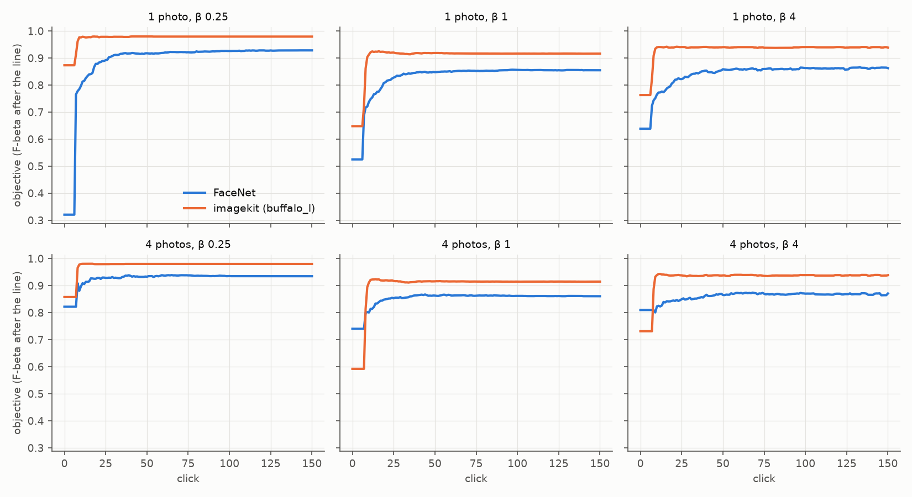
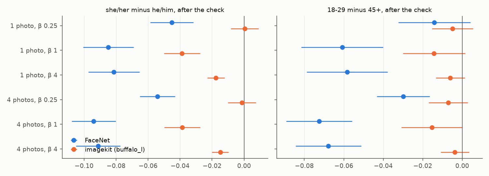

# The face review on the imagekit provider — 2026-10-26 (#5321)

**The imagekit provider beats FaceNet in every cell of the face review, and closes most of FaceNet's
gaps between people.** This run measures the provider with **InsightFace `buffalo_l`**: SCRFD `det_10g`
finds the faces and ArcFace `w600k_r50` embeds them. The owner chose these weights while gate 2 of #5320
is still open; `buffalo_l`'s licence is non-commercial research. If gate 2 picks other weights, this run
is repeated on them.

The FHIBE face cells were rebuilt through `image2face`'s `imagekit` provider (`fhibe_faces_ik_{1024,640}`).
The review then ran on both arms: 562 people, 1 and 4 starting photos, 1024 and 640 px, presets β ¼ / 1 / 4.
Both arms ran on one commit (`e7bc6fc1b`), paired session for session against the shipped FaceNet path
(MTCNN boxes, upright crops; `fhibe_faces_roll_*`).

The table below is from one photo at 1024 px, β 1. The FaceNet-era values are #4780's (same bench, β 1,
1024 px, at `bcb425042`). Its ArcFace arm put `w600k_r50` on MTCNN's boxes and landmarks.

| one photo, 1024 px, β 1 | FaceNet today | **imagekit** | paired change | #4780 FaceNet | #4780 ArcFace on MTCNN |
|---|---:|---:|---:|---:|---:|
| after the check (the objective) | 0.85 | **0.91** | +0.059 ± 0.010 | 0.82 | 0.94 |
| mean over clicks 1–150 | 0.83 | **0.90** | **+0.076** ± 0.009 | 0.79 | 0.93 |
| she/her − he/him, after the check | −0.085 ± 0.016 | **−0.039** ± 0.011 | +0.046 ± 0.018 | −0.11 ± 0.02 | −0.023 ± 0.013 |
| 18–29 − 45+, after the check | −0.061 ± 0.021 | **−0.014** ± 0.016 | +0.046 ± 0.024 | −0.077 | −0.003 |
| failed one-photo sessions | 7 | **0** | | 7 | 9 |
| click 0 (example sort at its line) | 0.53 | **0.65** | | 0.53 | 0.57 |
| embed cost per face (CPU, 8 threads) | 19 ms | **40 ms** | | 19 ms | 40 ms |
| detect + embed per face, whole path | 180 ms | **330 ms** | | | |

- **Every cell gains:** session mean +0.047 to +0.11 across K × size × β, each 6–15 SE.
- **At β ¼ and β 4 the pronoun gap closes** to −0.003 to −0.019. At β 1 a −0.039 gap stays, and it is
  in the line, not the ranking (below).
- **No one-photo session fails** in any of the 12 cells, against FaceNet's 7. The provider's own
  landmarks also fix the failures from turned views that ArcFace on MTCNN's landmarks added in #4780.
- **The gain is smaller than #4780's +0.13 because the control moved, not the embedder.** Today's FaceNet
  sits 0.04–0.05 above #4780's: the app's head, line and chances changed between the two commits. In
  absolute terms imagekit lands 0.02–0.03 below #4780's ArcFace. It ranks at least as well as that arm
  (ceiling AP 0.99 against 0.98), and its β 1 line over-returns. **Nothing here points at the detector.**
- **The cost is CPU time.** SCRFD at 640 × 640 plus ArcFace takes 330 ms per face, flat across photo
  sizes, against 180 / 100 ms for MTCNN + FaceNet at 1024 / 640.



*Figure 1. The objective at every click, at 1024 px, from 1 and from 4 photos, for β ¼ / 1 / 4. Each
point is the mean over 562 sessions (561 for imagekit at 640 px with 4 photos). Click 0 is the example
sort at its own line. Both arms jump at the label quota (vote 7 from one photo, 8 from four). Imagekit
levels off within 10 votes, while FaceNet climbs for 30–50.*

## The bench

**Two cells per size, one commit.** Both arms keep #4699's rule for labels. The subject is the box that
best overlaps FHIBE's annotated face (IoU ≥ 0.5). Other faces become negatives only below IoU 0.1, and a
photo is dropped when the best match is ambiguous.

| | 1024 px, imagekit | 1024 px, MTCNN | 640 px, imagekit | 640 px, MTCNN |
|---|---:|---:|---:|---:|
| subject found, of 10,278 one-person photos | **10,200** | 9,768 | **9,919** | 9,399 |
| other faces kept as negatives | 101 | 1,111 | 69 | 656 |
| photos dropped as ambiguous | 18 | | 16 | |
| faces in the pool | 10,301 | 10,879 | 9,988 | 10,055 |
| `image2face` time for the cell (imagekit: AMD, 16 threads; FaceNet: a V100) | 46 min | 16 min | 57 min | |

- **SCRFD finds 4–5% more subject photos than MTCNN.** In the 40-photo smoke test it found the subject
  in 40 of 40 photos, MTCNN in 37.
- **It keeps a tenth as many other faces.** At confidence 0.5 it passes over the small background
  faces that MTCNN boxes.
- **The two pools differ, and that is part of what is measured.** Imagekit's pool has more of each
  person's own photos, including some MTCNN missed. It also has fewer look-alike negatives.
- **The ceiling separates the two arms.** The ceiling is AP on full labels. Imagekit's is 0.99 at both
  sizes, against FaceNet's 0.92 / 0.90 and 0.98 for #4780's ArcFace on MTCNN's pool. So most of the lift
  is the embedder: ArcFace already reached 0.98 on the harder pool.

**The sessions:** 2 arms × 2 starting counts × 2 sizes × 3 presets × 562 people = 13,488 sessions of
150 votes, one seed. They are scored on each person's withheld photos, split by photo id, so a person's
withheld half is the same photos in both arms.

One person (`348e3127`) has only 6 subject crops in imagekit's 640 px cell. A 4-photo session needs at
least 4 positives beyond the start, so the session fails preflight. Their three 640 px 4-photo
sessions were dropped from the imagekit arm and are unpaired (561 pairs there, 562 elsewhere).

## Every cell, paired

Session mean is the mean over clicks 1–150. "After" is the objective after the check. Each change is
imagekit minus FaceNet, ± its SE over people.

| K | px | β | session mean FN → ik | change | after the check FN → ik | click 0 FN → ik | fails FN / ik |
|---|---|---|---|---:|---|---|---|
| 1 | 1024 | ¼ | 0.89 → **0.97** | +0.086 ± 0.007 | 0.93 → 0.98 | 0.32 → 0.87 | 7 / 0 |
| 1 | 1024 | 1 | 0.83 → **0.90** | +0.076 ± 0.009 | 0.85 → 0.91 | 0.53 → 0.65 | 7 / 0 |
| 1 | 1024 | 4 | 0.84 → **0.93** | +0.092 ± 0.008 | 0.86 → 0.94 | 0.64 → 0.76 | 7 / 0 |
| 1 | 640 | ¼ | 0.87 → **0.98** | +0.11 ± 0.01 | 0.91 → 0.98 | 0.29 → 0.86 | 7 / 0 |
| 1 | 640 | 1 | 0.81 → **0.89** | +0.084 ± 0.009 | 0.83 → 0.90 | 0.49 → 0.65 | 7 / 0 |
| 1 | 640 | 4 | 0.82 → **0.93** | +0.10 ± 0.01 | 0.84 → 0.93 | 0.60 → 0.76 | 7 / 0 |
| 4 | 1024 | ¼ | 0.93 → **0.97** | +0.047 ± 0.005 | 0.94 → 0.98 | 0.82 → 0.86 | 0 / 0 |
| 4 | 1024 | 1 | 0.85 → **0.90** | +0.047 ± 0.008 | 0.86 → 0.91 | 0.74 → **0.59** | 0 / 0 |
| 4 | 1024 | 4 | 0.86 → **0.93** | +0.067 ± 0.007 | 0.87 → 0.94 | 0.81 → **0.73** | 0 / 0 |
| 4 | 640 | ¼ | 0.91 → **0.97** | +0.066 ± 0.006 | 0.92 → 0.98 | 0.77 → 0.84 | 0 / 0 |
| 4 | 640 | 1 | 0.83 → **0.89** | +0.055 ± 0.009 | 0.84 → 0.90 | 0.69 → **0.58** | 0 / 0 |
| 4 | 640 | 4 | 0.85 → **0.92** | +0.074 ± 0.007 | 0.85 → 0.93 | 0.79 → **0.72** | 0 / 0 |

Final AP (the ranking after 150 votes, the same at every β): FaceNet 0.91 / 0.89 from one photo at 1024 / 640 px and 0.92 / 0.90 from four; imagekit 0.99 throughout. Ceiling AP: FaceNet 0.92 / 0.90, imagekit 0.99 at both (`paired.csv`).

- **640 px costs imagekit nothing.** The session mean moves by at most 0.015 between sizes, against
  FaceNet's 0.014–0.023. SCRFD letterboxes every photo to 640 × 640, so it sees the same pixels at both
  sizes.
- **Four starting photos help FaceNet (+0.02 to +0.04) and not imagekit.** From one photo imagekit
  already leads by ten votes in.
- **Click 0 from four photos is worse under imagekit at β 1 and 4: 0.59 against 0.74 and 0.73 against
  0.81.** This is the same pattern #4780 saw (ArcFace 0.53 against FaceNet 0.74). The example sort's
  line is `FACE_TEMPLATE`, fitted on FaceNet's scores. On ArcFace's scores it cuts in the wrong place.
  From one photo the template's cut happens to land better, and imagekit leads at click 0 in every cell.
  By the label quota, imagekit leads everywhere.

## The gaps, beside FaceNet's

After the check, from one photo, at 1024 px:

| | β ¼ FN | β ¼ ik | β 1 FN | β 1 ik | β 4 FN | β 4 ik | #4780 FN / ArcFace (β 1) |
|---|---:|---:|---:|---:|---:|---:|---:|
| she/her − he/him, after the check | −0.045 | **+0.000** | −0.085 | **−0.039** | −0.081 | **−0.018** | −0.11 / −0.023 |
| she/her − he/him, mean over clicks | −0.066 | **−0.003** | −0.10 | **−0.034** | −0.092 | **−0.013** | −0.13 / −0.026 |
| 18–29 − 45+, after the check | −0.014 | **−0.005** | −0.061 | **−0.014** | −0.058 | **−0.006** | −0.077 / −0.003 |
| 18–29 − 45+, mean over clicks | −0.031 | **−0.005** | −0.063 | **−0.022** | −0.059 | **−0.008** | |

SEs: FaceNet 0.013–0.021, imagekit 0.005–0.017. The paired change in each gap, person for person, is
+0.009 to +0.084, with SE 0.010–0.025 (`gaps.csv`). From four photos and at 640 px the gaps read the
same: imagekit's she/her − he/him gap after the check is −0.000 to −0.025 at β ¼ and β 4, and
−0.039 to −0.045 at β 1.



*Figure 2. The gaps after the check, ±1 SE, at 1024 px. Left: she/her minus he/him (283 and 278
people). Right: 18–29 minus 45+ (287 and 106; 45–59 and 60+ pooled).*

**At β 1, imagekit's residual pronoun gap is the line.** Imagekit's she/her − he/him gap in final AP is
−0.012 (−0.010 from four photos), and its ceiling's gap is −0.011. FaceNet's are −0.054 and −0.065.
After the check the gap is −0.039, so about 0.03 of it is added where the session sets its line.

At β 1 the line keeps too many faces on imagekit's scores. Across one-photo sessions it returns 4.6
faces on average, against 3.3 for FaceNet. Its precision is 0.88 (FaceNet 0.94) and its recall 0.98
(FaceNet 0.81). In 51 of imagekit's 562 one-photo β 1 sessions the ranking is near perfect (final AP ≥
0.95) but F after the check is below 0.7. Those 51 sessions return a mean of 7.5 faces for about 4
withheld photos (precision 0.46, recall 1.00); FaceNet has 18 such sessions. At β ¼ and β 4 imagekit has
7 and 4. The app's lines (the head's count, #5039 and #5084; the class model's chances, #5040) were tuned
with FaceNet as the face embedder, and at β 1 they over-reach on ArcFace's score scale. she/her people are hit harder: their photos still
sit a little closer to the impostors (#4780).

## Against #4780's ArcFace

The issue's test: if imagekit's lift were far from #4780's ArcFace +0.13, that would point at the
detector, not the embedder. The lift is +0.076 (one photo) and +0.047 (four) at β 1, 1024 px. It is
smaller, but the two deltas are against different controls:

| β 1, 1024 px, session mean | #4780 (`bcb425042`) | today (`e7bc6fc1b`) |
|---|---:|---:|
| FaceNet, 1 photo / 4 photos | 0.79 / 0.80 | 0.83 / 0.85 |
| ArcFace on MTCNN (#4780) / imagekit (today), 1 photo | 0.93 | 0.90 |
| ArcFace on MTCNN / imagekit, 4 photos | 0.93 | 0.90 |
| ceiling AP, ArcFace on MTCNN / imagekit | 0.98 | 0.99 |

- **About two thirds of the difference is the control.** FaceNet rose by 0.04–0.05 between the two
  commits. In between, the head's count, the class model's chances and the bulk tail all moved.
- **The rest, 0.02–0.03, is not the ranking.** Imagekit's ceiling is as high as ArcFace-on-MTCNN's, and
  its final AP is 0.99. The shortfall is at the β 1 line (above). #4780's line came before
  #5039–#5084, so the two commits' lines are not the same rule.
- **The detector helps where #4780's ArcFace was weak.** ArcFace on MTCNN's landmarks failed 9
  one-photo sessions, four of them new against FaceNet and three of those from turned views. Under
  imagekit none fail:
  - `a99c00ee`: F 0.67, final AP 1.00;
  - `b2e04b02`: 0.77, 1.00;
  - `49b8483a`: 0.67, 0.50;
  - `6f5a62a1`: 1.00, 1.00.

  FaceNet's 7 failures all succeed too. For example, `0cdec9c8` has F 0.00 under FaceNet and 1.00 under
  imagekit, and `4e5dabe1` goes from 0.00 to 1.00.

So the result is not very different from #4780's: the embedder carries the lift, as #4780 found. The
provider's own detector adds subject recall and removes the failures from hard starting views, at no
cost to the ranking.

## Examples

All from one photo, 1024 px, β 1. Subject ids are the first 8 characters of FHIBE's category ids; the
images stay out.

- **`1149db92`** (she/her, 18–29), #4780's hairstyle case: FaceNet F 0.57 (final AP 0.38), imagekit
  0.89 (AP 1.00).
- **`f3bb556f`** (she/her, 18–29): FaceNet F 0.33 (AP 0.22, ceiling 0.22), imagekit 1.00 (AP 1.00,
  ceiling 1.00). On imagekit's pool and vectors, even full labels rank her photos perfectly.
- **`11cae430`** (she/her, 45–59): one of FaceNet's 7 failures (F 0.00, AP 0.00). Imagekit F 1.00.
- **The β 1 line:** `5feabee3` (she/her, 18–29) and `9279c613` (he/him, 18–29) both have F 1.00 under
  FaceNet and 0.50 under imagekit. Their final AP is 1.00 in both arms, so imagekit ranks them perfectly
  and its line keeps twice the photos.
- **What imagekit still misses:** `056355aa` (she/her, 30–44), whom #4780 found failing under both arms.
  Imagekit F 0.43, final AP 0.27, ceiling 0.28. Even full labels do not rank her photos together.

## Cost

Measured on 200 photos on AMD EPYC 7713 (`rack7n11`), 8 threads, CPU only. The app's onnxruntime 1.30
has no GPU provider.

| per face | 1024 px | 640 px |
|---|---:|---:|
| MTCNN + FaceNet, whole path | 180 ms | 100 ms |
| … of which the FaceNet embed | 19 ms | 17 ms |
| imagekit (SCRFD + ArcFace), whole path | 330 ms | 340 ms |
| … ArcFace `w600k_r50` alone, one 112 × 112 crop | 40 ms | 40 ms |
| … SCRFD `det_10g` alone, one 640 × 640 letterbox (per photo) | 87 ms | 87 ms |

The embed is twice FaceNet's. The whole path is 1.8× to 3.4× slower and does not get cheaper at
640 px. The provider does detection and embedding in one call, so the build log shows "embed 0s": the
vectors come with the faces. Neither model's time accounts for the rest, about 200 ms per photo. That
remainder is decoding, letterbox, alignment and per-face overhead, and is not broken down here. At
these rates a 10,000-photo corpus takes about 55 min on 8 CPU threads, against 30 min for MTCNN +
FaceNet at 1024 px.

## What follows

- **#5320's choice of weights.** This run measures `buffalo_l`. If gate 2 picks other weights, the cells
  are rebuilt and this review repeated on them (one config file; the commands are below).
- **Refit or drop `FACE_TEMPLATE` for imagekit's scores.** Click 0 from four photos loses 0.08–0.15 to
  FaceNet's template.
- **The β 1 line on imagekit's scores.** It over-returns in 9% of one-photo sessions with near-perfect
  rankings. It costs about 0.03 of the session mean and most of the residual pronoun gap.
- **The eval default arm can follow the app.** On this bench the imagekit cells are the better face
  path in every cell. `CALIB_FHIBE_IK_EMBEDDERS` and the `fhibe_faces_ik_*` roster are in place.

## Reproduce

From a frozen worktree at `e7bc6fc1b`, in the app venv, with
`IMAGEKIT_FACE_PROVIDER=oss IMAGEKIT_FACE_CONFIG=<buffalo_l.json>`. The config is SCRFD `det_10g` at
confidence 0.5 and ArcFace `w600k_r50`. Results are owner-only, under `<release>-derived/runs/`. Cells
are private, under `<release>-derived/cells`.

```bash
# the cells (cpu, 16 threads; each ~1 h), from scripts/experiments/pile after pile_env.sh
python build_pile.py --datasets fhibe_faces_ik_1024 --embedders imagekit_face
python build_pile.py --datasets fhibe_faces_ik_640 --embedders imagekit_face
# the review, both arms on one commit (roll = FaceNet, ik = imagekit); each arm its own claims pool
export SOTA_FACE_TAG=5321 SOTA_FACE_DATE=2026-10-26
for arm in roll ik; do
  export SOTA_FACE_ARM=$arm SOTA_FACE_TASKS=<runs>/2026-10-26-5321-$arm-tasks.txt
  scripts/experiments/fhibe/sota_face.sh prepare && scripts/experiments/fhibe/sota_face.sh dirs
  scripts/experiments/fhibe/sota_face.sh tasks
  scripts/experiments/fhibe/sota_face.sh pack 4                                       # V100s
  SOTA_FACE_CLAIMS_DIR=<that pool> CALIB_PARTITION=cpu scripts/experiments/fhibe/sota_face.sh pack 2
  scripts/experiments/fhibe/sota_face.sh baseline   # then, on a compute node:
  scripts/experiments/fhibe/sota_face_analyze.sh <runs>/2026-10-26-5321-$arm-analysis
done
cd scripts/experiments/fhibe
python ik_compare_5321.py --roll <runs>/2026-10-26-5321-roll-analysis,<runs>/2026-10-26-5321-roll-baseline \
  --ik <runs>/2026-10-26-5321-ik-analysis,<runs>/2026-10-26-5321-ik-baseline \
  --strata <runs>/2026-10-26-5321-compare/person_strata.csv --out <runs>/2026-10-26-5321-compare
python ik_figures_5321.py --roll <runs>/2026-10-26-5321-roll-analysis --ik <runs>/2026-10-26-5321-ik-analysis \
  --compare <runs>/2026-10-26-5321-compare --out docs/experiments/2026-10-26-imagekit-face-bench-5321
```

`person_strata.csv` comes from `person_strata.py`. `runs.csv` (per session, by subject id) stays
owner-only. The cells were built on `rack7n11` (AMD). Each arm's sessions ran in four V100 packs (CUDA
hidden) and two cpu packs from one claims pool: FaceNet's cpu packs on `rack7n11` (AMD), imagekit's on
`rack7n11` and `rack8n09` (Intel). The imagekit arm's 640 px 4-photo task for `348e3127` was
removed from its task list before packing. #4481's float drift between vendors is far
below every difference reported here.
