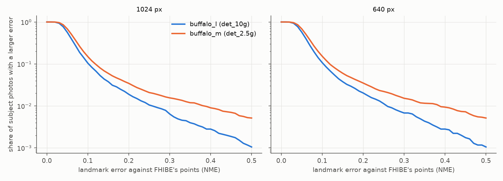
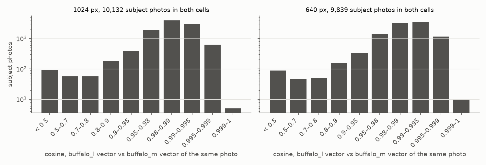

# buffalo_m against buffalo_l on FHIBE's face cells — 2026-10-27 (#5330)

**buffalo_m saves about a quarter of the CPU time per face, and in exchange ranks faces slightly worse:
leave-one-out AP drops 0.009 ± 0.0014 per person.** The two InsightFace packs ship the same ArcFace
`w600k_r50.onnx`, byte for byte. Only the detector differs: SCRFD `det_10g` in buffalo_l and `det_2.5g` in
buffalo_m. The whole AP loss traces to the smaller detector's landmarks. When the two detectors put the
eyes in different places, the face is aligned differently and gets a different vector, and buffalo_l's
points are the ones closer to FHIBE's annotated points four times in five. Using buffalo_m is a
config-only change: the same `oss` provider, the same packaged SCRFD decode config, and the same compat tag
(`oss-arcface-r50:1`).

**Owner's decision (2026-10-27): buffalo_m.** The owner takes the CPU saving and accepts the static AP
loss, without a session review. The owner kept that choice after the GPU timing below. #5328 rebuilds
the real FHIBE cells on buffalo_m.

| | buffalo_l | **buffalo_m** | change |
|---|---:|---:|---:|
| detect + embed per face, whole `image2face` path, 1024 px | 250 ms | **190 ms** | −23% |
| the same at 640 px | 260 ms | **190 ms** | −27% |
| detector alone, per photo (median, same process) | 130 ms | **79 ms** | ×0.59 |
| the whole path on a V100 (onnxruntime-gpu), 1024 / 640 px | 59 / 30 ms | **58 / 29 ms** | −2% / −3% |
| subject found, 1024 px cell (of 10,278 one-person photos) | 10,200 | **10,146** | −54 |
| subject found, 640 px cell | 9,919 | **9,861** | −58 |
| landmark error against FHIBE's points, median (NME) | 0.054 | **0.061** | |
| landmark error above 0.25 (of 8,537 photos) | 90 | **178** | ×2 |
| leave-one-out AP per person, 1024 px | 0.74 | **0.73** | −0.0093 ± 0.0014 |
| leave-one-out AP per person, 640 px | 0.72 | **0.71** | −0.0088 ± 0.0015 |
| she/her − he/him in that AP, 1024 px | −0.011 ± 0.007 | **−0.010** ± 0.008 | +0.001 ± 0.004 |
| 18–29 − 45+ in that AP, 1024 px | −0.004 ± 0.008 | **+0.002** ± 0.009 | +0.006 ± 0.006 |

- **The loss is concentrated, not spread.** 339 of 1,774 people (19%) have at least one photo whose two
  vectors part (cosine below 0.9). Those people lose 0.050 on average, and the other 81% move by
  +0.0003 ± 0.0007. Per person, 116 people lose more than 0.05 and 54 gain more than 0.05.
- **The gaps between people do not move.** The paired change in the pronoun and age gaps is within one SE
  of zero at both sizes.
- **The faces buffalo_m misses are small.** At 1024 px it misses 68 of buffalo_l's subjects and finds 14
  that buffalo_l misses. The faces it misses have a median height of 59 px, against 110 px for all
  subjects.
- **The saving is CPU time only.** ArcFace and the alignment cost the same in both packs, so cutting the
  detector's time by 40% saves a quarter of the whole. buffalo_m's 190 ms per face is still slower than the FaceNet
  path's 180 / 100 ms at 1024 / 640 px measured in #5321.
- **On a GPU the saving is gone.** On a V100 both packs take 59 / 30 ms per face at 1024 / 640 px.
  The time scales with the photo, not the detector, so the CPU work around the networks (decoding,
  resizing, cropping) dominates. The venv ships the CPU build of onnxruntime, so the app runs this
  path on CPU today. onnxruntime-gpu 1.31 fails on the V100s ("architectural feature absent"), and 1.22
  runs on them.
- **No licence difference.** Both packs are InsightFace's model zoo under the same non-commercial
  research terms, so buffalo_m does not help with #5320's gate 2.

## The bench

**Two arms, built on one commit, into private roots.** Both arms' cells were built at `8daf7f978` (dev,
with #5327's `face` embedder name) by `build_pile.py --datasets fhibe_faces_ik_{1024,640} --embedders face`.
Each arm had its own `VTS_PILE` and `VTS_FHIBE_ROOT`, so the real FHIBE cells, which #5328 rebuilds,
were not touched. Every cell passed `--verify`. The arms differ only in `IMAGEKIT_FACE_CONFIG`.
buffalo_m's config is buffalo_l's with `det_10g.onnx` swapped for `det_2.5g.onnx`. `det_2.5g` has the same
nine-output SCRFD head (strides 8/16/32, two anchors, keypoints), so imagekit's packaged
`scrfd_10g_gnkps.json` decodes it unchanged. Labels keep #4699's rule. The subject is the box that best
overlaps FHIBE's annotated face (IoU ≥ 0.5). Other faces become negatives below IoU 0.1, and a photo is
dropped when the best match is ambiguous.

| | 1024 px, buffalo_l | 1024 px, buffalo_m | 640 px, buffalo_l | 640 px, buffalo_m |
|---|---:|---:|---:|---:|
| subject found | 10,200 | 10,146 | 9,919 | 9,861 |
| subject missed | 78 | 132 | 359 | 417 |
| other faces kept as negatives | 101 | 103 | 69 | 67 |
| photos dropped as ambiguous | 18 | 18 | 16 | 16 |
| faces in the pool | 10,301 | 10,249 | 9,988 | 9,928 |
| `image2face` time for the cell (all four at once on one AMD node, 60 threads each) | 55 min | 44 min | 61 min | 46 min |

**A detection pass beside the cells.** `buffalo_m_detect_5330.py` ran both detectors on every one-person
photo at both sizes, in one process, in 16 shards. It recorded every box, the five landmarks, the
confidence and the detect time. This pass gives the detector-level numbers: subject found, box and
landmark agreement, and error against FHIBE's own keypoints. FHIBE annotates the same five points SCRFD
predicts: both eyes, the nose, and both mouth corners. The landmark error is the mean distance over the
annotated points, divided by the annotated distance between the eyes (NME). It covers the 8,537 photos
where both detectors find the subject and both eyes are annotated.

**Cost on one node, back to back.** `buffalo_m_cost_5330.py` ran `image2face`'s whole path (detect, align,
embed) on the same 200 photos at 8 threads on the AMD node (rack7n11), after a 5-photo warm-up. It ran
each config twice, and the two repeats agree within 1%. This job puts buffalo_l at 250 ms per face, below
#5321's 330 ms. Only the ratio inside this job is the comparison here.

**And on a GPU.** `buffalo_m_cost_gpu_5330.py` repeats the same timing on a V100 (rack8n04, Xeon Gold
5218R host), with `VTSEARCH_DEVICE=cuda`. It loads onnxruntime-gpu 1.22.0 from a private directory ahead
of the venv's CPU build, and both sessions report `CUDAExecutionProvider`. The two repeats agree within
1 ms.

| per face, V100 | buffalo_l | buffalo_m |
|---|---:|---:|
| 1024 px | 59 ms | 58 ms |
| 640 px | 30 ms | 29 ms |

## The detectors

| | 1024 px, buffalo_l | 1024 px, buffalo_m | 640 px, buffalo_l | 640 px, buffalo_m |
|---|---:|---:|---:|---:|
| subject found (detector alone) | 10,224 | 10,174 | 10,224 | 10,163 |
| found by this detector only | 61 | 11 | 69 | 8 |
| subject confidence, median | 0.87 | 0.83 | 0.87 | 0.83 |
| subject confidence below 0.6 | 33 | 144 | 33 | 143 |
| box IoU between the two detectors, median | 0.95 | | 0.95 | |
| landmark error against FHIBE, median | 0.054 | 0.061 | 0.054 | 0.061 |
| landmark error above 0.25 | 90 | 178 | 97 | 189 |
| other faces reported | 142 | 126 | 134 | 119 |
| detect time per photo, median | 130 ms | 79 ms | 140 ms | 77 ms |

**The two detectors agree on most faces and part on the hard ones.** Their boxes overlap at a median IoU of
0.95. Their landmarks sit a median 0.042 inter-ocular distances apart. In 1,323 subject photos at 1024 px
(13%), the two detectors' landmarks are more than 0.1 inter-ocular distances apart. 531 of those photos
have both eyes annotated. In 422 of them (79%), buffalo_l's points are the closer ones, at a median NME of
0.14 against buffalo_m's 0.19. Figure 1 shows the whole distribution. The two curves overlap for most
photos, and buffalo_m's tail is about twice as heavy from an error of 0.2 on.



*Figure 1. The share of subject photos whose landmark error against FHIBE's five annotated points is
above a given value (log scale), at 1024 and 640 px. The sample is the 8,537 photos where both
detectors find the subject and both eyes are annotated. An error of 0.1 is a tenth of the distance
between the eyes.*

## The vectors

**Most faces get nearly the same vector; a few get a different one.** The median cosine between the two
vectors of one subject photo is 0.987 at 1024 px and 0.990 at 640 px. 3.8% of photos fall below 0.9, 1.5%
below 0.7, and 92 photos fall below 0.5. Where the vectors part, the landmarks parted first. The cosine
and the distance between the two detectors' landmarks have a Spearman correlation of −0.77. The photos
below 0.5 have their two landmark sets a median 0.80 inter-ocular distances apart, and their box IoU is
still 0.78. They are the same face, aligned differently. In the photos with a cosine of 0.98 and above,
the median is 0.036.



*Figure 2. The cosine between buffalo_l's and buffalo_m's vector of the same subject photo, binned (log
scale). The sample is every subject photo that both cells keep: 10,132 at 1024 px and 9,839 at 640 px.
The bins narrow toward 1.*

## Ranking, without a session

**Each arm is ranked in its own pool.** Every subject photo queries every other face in its own arm's
cell, subjects and kept negatives alike. Its AP counts the person's other photos as the relevant ones.
The AP is averaged per person, and the two arms are paired person by person (1,774 people at 1024 px,
1,771 at 640 px).

| | 1024 px | 640 px |
|---|---:|---:|
| AP, buffalo_l | 0.74 | 0.72 |
| AP, buffalo_m | 0.73 | 0.71 |
| paired change | −0.0093 ± 0.0014 | −0.0088 ± 0.0015 |
| people with a photo below cosine 0.9 | 339 | 304 |
| their change | −0.050 | −0.058 |
| everyone else's change | +0.0003 ± 0.0007 | +0.0014 ± 0.0010 |
| she/her − he/him, change | +0.001 ± 0.004 | +0.000 ± 0.004 |
| 18–29 − 45+, change | +0.006 ± 0.006 | +0.003 ± 0.005 |

The split by cosine uses the pair of vectors, not one arm's outcome, so it does not create a paired gain
by itself. The static AP is a proxy for the review: #5321's session gain over FaceNet was +0.076, and this
loss is about an eighth of that. The read does not say how the line and the check absorb it. That would
need the session review, which this issue held back unless the cells differed materially.

## Reproduce

Scripts are in `scripts/experiments/fhibe/`. The cells, shards and per-person table stay on the GRID,
under `/expscratch/sgreenberg/fhibe/ik-buffalo_m/`, owner-only. The committed CSVs are aggregates.

```bash
sbatch buffalo_m_build_5330.sh m 1024    # and m 640, l 1024, l 640: private roots, --verify after
sbatch buffalo_m_detect_5330.sh          # 16 shards -> detect/shard-*.csv
sbatch buffalo_m_cost_5330.sh            # after the builds, same node
python buffalo_m_compare_5330.py --cells-l <l cells> --cells-m <m cells> --detect <detect> \
    --strata <#5321 person_strata.csv> --repo <worktree> --out <compare>
python buffalo_m_figures_5330.py --compare <compare> --out <this dir>
```

`summary.csv` holds every number above per size. `cosine_hist.csv` and `nme_cdf.csv` feed the two figures.
