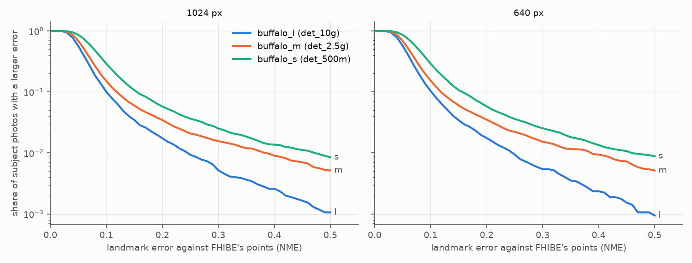

# buffalo_s as the GRID's default face pack, against buffalo_l and buffalo_m — 2026-10-27 (#5341)

**buffalo_s halves the CPU cost of a face against buffalo_l and ranks faces markedly worse: leave-one-out
AP drops 0.073 ± 0.003 per person, eight times buffalo_m's loss, and the she/her − he/him gap in that AP
widens by 0.053 ± 0.008.** The owner chose it as the GRID's default on those numbers (2026-10-27).
InsightFace `buffalo_s` swaps both models: SCRFD `det_500m` for the detector and MobileFaceNet `w600k_mbf`
for the recogniser. It runs through imagekit's own contract, so a server can replace the `oss` provider with
its own implementation and change nothing else. The detector decodes with the packaged SCRFD config. The
recogniser takes the ArcFace contract (112 × 112 aligned, 512-d) under a new packaged config,
`imagekit/face/extraction/arcface_mbf.json`. Because the recogniser changes, so does the embedding space:
the compat tag is `oss-arcface-mbf:1`, not buffalo_l's and buffalo_m's `oss-arcface-r50:1`, and every face
dataset built on those must be re-imported.

| 1024 px | buffalo_l | buffalo_m (#5330) | **buffalo_s** |
|---|---:|---:|---:|
| detect + embed per face, CPU (AMD, 8 threads) | 260 ms | 210 ms | **120 ms** |
| the same at 640 px | 280 ms | 220 ms | **110 ms** |
| detector alone per photo, median | 130 ms | 79 ms | **39 ms** |
| subject found (of 10,278 one-person photos), in the cell | 10,200 | 10,146 | **10,027** |
| subject found at 640 px | 9,919 | 9,861 | **9,734** |
| subject confidence below 0.6 | 33 | 144 | **234** |
| landmark error against FHIBE's points, median (NME) | 0.053 | 0.061 | **0.078** |
| landmark error above 0.25 | 79 | 178 | **310** |
| leave-one-out AP per person | 0.74 | 0.73 | **0.67** |
| change against buffalo_l | | −0.0093 ± 0.0014 | **−0.073 ± 0.0029** |
| she/her − he/him in that AP | −0.011 ± 0.007 | −0.010 ± 0.008 | **−0.064 ± 0.010** |
| 18–29 − 45+ in that AP | −0.004 ± 0.008 | +0.002 ± 0.009 | **−0.009 ± 0.014** |
| people who cannot open from four photos (1024 / 640 px) | 0 / 1 | 1 / 3 | **3 / 4** |

At 640 px the AP change is −0.079 ± 0.0031 and the pronoun gap widens by 0.056 ± 0.0085.

- **The loss is spread across people, not concentrated.** 603 of 1,772 people lose more than 0.05 of AP and
  28 gain that much. buffalo_m's loss sat in the 19% of people with a misaligned photo, and the rest moved
  by +0.0003. buffalo_s changes the recogniser too, so every face moves.
- **This read does not separate the two models.** Both the landmarks (worse, Figure 1) and the recogniser
  (MobileFaceNet against ResNet-50) change at once. A cross arm, `det_10g` + `w600k_mbf` or `det_500m` +
  `w600k_r50`, would split the AP loss between them.
- **The pronoun gap widens; the age gap does not move** (the paired age change is −0.0044 ± 0.011).
- **The saving is CPU time.** #5330 found the packs cost the same on a V100 (59 / 30 ms per face for
  buffalo_l and buffalo_m), where the work around the networks dominates; buffalo_s was not timed on GPU.
- **No session review yet.** The static AP is a proxy. #5336 found buffalo_m's −0.009 static AP became
  about −0.01 of the session mean, but buffalo_s's loss is eight times larger and broader, and the lines
  (#5325) were tuned on ResNet-50 cosines.



*Figure 1. The share of subject photos whose landmark error against FHIBE's five annotated points is above a
given value (log scale). The sample is the photos where both the detector and buffalo_l's find the subject
and both eyes are annotated: 8,537 for buffalo_m (#5330) and 8,489 for buffalo_s, at 1024 px.*

## What makes it the GRID default

- **One models directory**, `imagekit/` holding `face.json`, `det_500m.onnx`, `w600k_mbf.onnx`,
  `arcface_mbf.json` and checksums, linked into the pile's models directory (`$VTS_PILE/models`) and the GRID
  app's (`$VTSEARCH_DATA_DIR/models`). The bridge finds the `face.json` in that `imagekit` folder there when
  `IMAGEKIT_FACE_CONFIG` is unset, so no build, review or app start sets anything by hand.
- **The pile's FHIBE face cells** (`fhibe_faces_ik_{1024,640}__face`) were rebuilt on it with no
  `IMAGEKIT_FACE_*` set, and pass `--verify`; every face carries `Face Compat: oss-arcface-mbf:1`. The review
  grids are `2026-10-27-prep-ik-bs-k{1,4}`. A 12-session smoke (3 people, both sizes, K 1 and 4, β 1) ran
  with no failures. buffalo_m's cells are kept beside them.
- **The tests** read the pack from `face.json` when `IMAGEKIT_TEST_MODEL_DIR` holds one, and check the compat
  its embedder config promises; the GRID's shell points that variable at the default directory. All six
  real-weights tests pass on buffalo_s and on buffalo_l.

## The bench

**The static read.** `buffalo_m_compare_5330.py` read buffalo_l's private cells from #5330 against the real
buffalo_s cells, with a detection pass of `det_500m` (`buffalo_s_detect_5341.py`, 16 shards) beside #5330's
`det_10g` pass. That script names its two arms `l` and `m`; buffalo_s ran as its second arm, and
`summary.csv` here renames those columns to `s`. Its cosine and misalignment reads are left out: the two
packs embed in different spaces, so a cosine between their vectors means nothing. The buffalo_m column
above is #5330's report.

**Cost.** `buffalo_s_cost_5341.sh` ran the whole `image2face` path (detect, align, embed) for all three
packs on the same 200 photos on one AMD node (rack7n11), after the detection pass ended, twice each;
buffalo_s on the GRID default with no config set. The repeats agree within 10% (`cost.csv`).

## Files and reproduce

`summary.csv` (per size, buffalo_l against buffalo_s), `cost.csv`, `nme_cdf.csv` (the figure's three
curves; buffalo_m's from #5330). The per-person table names FHIBE subject ids and stays on the GRID.

```bash
sbatch buffalo_s_detect_5341.sh                # 16 shards -> detect/shard-s-*.csv
sbatch buffalo_s_cost_5341.sh                  # after the detection pass, same node as #5330
python buffalo_m_compare_5330.py --cells-l <#5330's buffalo_l cells> --cells-m <buffalo_s cells> \
    --detect <#5330's l rows + the s rows as m> --strata <#5321 person_strata.csv> --repo <worktree> --out <dir>
python buffalo_s_figures_5341.py --nme nme_cdf.csv --out .
```
