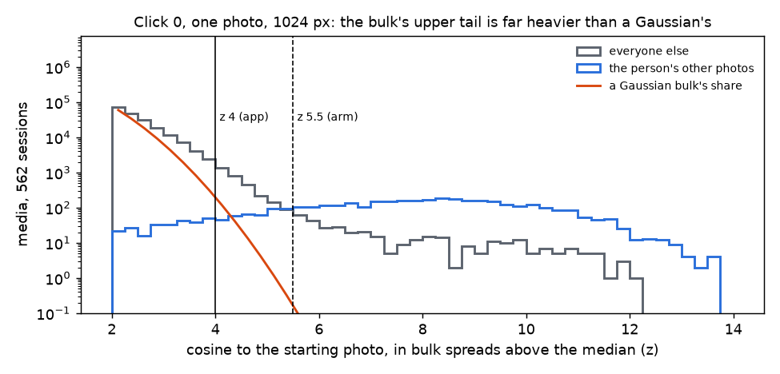
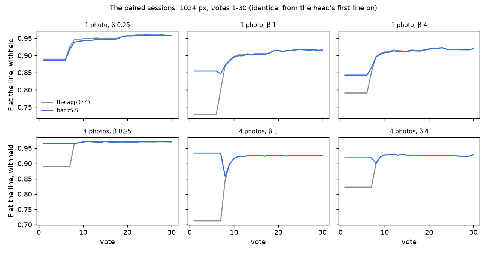
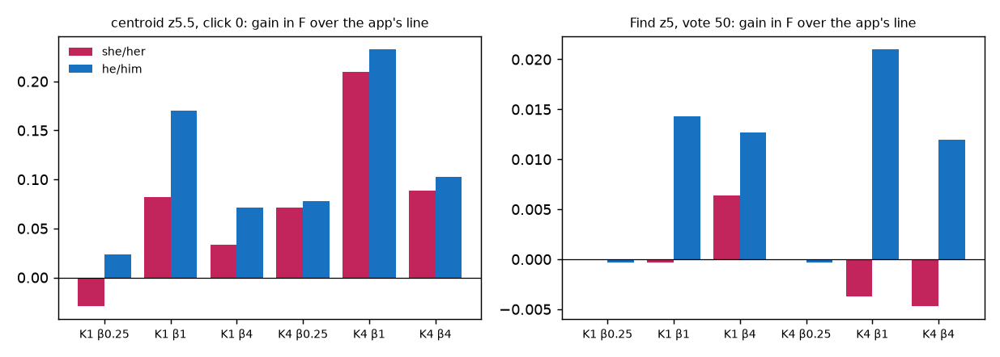

# The face lines on imagekit's cosines, re-measured on buffalo_s — 2026-10-27 (#5325)

**On buffalo_s, the line that over-returns is the centroid's count line at click 0, not Find's line at
β 1.** At click 0, from one photo at β 1, the example sort's line keeps 6.4 faces for the 3.8 withheld
photos of the person, so F is 0.73. About 6 look-alikes per session stand more than 4 bulk spreads above
the median, where a Gaussian bulk puts 0.3, and the count reads them as the person. Reading the count at
z 5.5 instead of z 4 keeps 3.5, and F is 0.85. Paired run for run on the face bench, that refit gains
+0.0052 ± 0.0004 of the session mean (votes 1–150) from one photo at β 1, and +0.010 ± 0.0004 from four
photos. Every vote after the head draws its first line is identical.

Find's line at β 1 keeps 3.9 faces for 3.8 withheld (F 0.92 at 50 votes) and needs no change. A higher
bar on its count gains about 0.01 offline, but nearly all of that goes to he/him people.

The refit cannot be shared with the photo benches. On COCO Better at click 0, the same bar cuts F from
0.17 to 0.084 (one photo, β 1). There a category has 50 withheld positives, and the bar keeps a fifth of
what the app keeps. Shipped, it is a face-only centroid rule.

**Shipped (owner, 2026-10-28): face crops draw the centroid's line at z 5.5, at every β**
(`centroid_line_rule`, `CENTROID_LINE_RULE_BY_MEDIA_TYPE`). The app's example sort, its centroid head and
the eval harness's default all read it; other media types and Find's line are unchanged. From a frozen
tree with no `CALIB_CENTROID_LINE` set, 18 face cells (3 people × K × β) matched the arm's in every value.

| one photo, 1024 px | β ¼ | β 1 | β 4 |
|---|---:|---:|---:|
| click 0, F: the app → bar z5.5 | 0.89 → 0.89 | 0.73 → 0.85 | 0.79 → 0.84 |
| click 0, faces kept for 3.8 withheld: the app → bar z5.5 | 3.3 → 2.8 | 6.4 → 3.5 | 16 → 8.9 |
| session mean F, votes 1–25, change | −0.0033 ± 0.0026 | +0.031 ± 0.0026 | +0.012 ± 0.0015 |
| session mean F, votes 1–150, change | −0.0005 ± 0.0004 | +0.0052 ± 0.0004 | +0.0020 ± 0.0002 |
| F at 50 votes and after the check, change | 0 | 0 | 0 |

## The sets

The face bench is FHIBE's 562 people as imagekit face crops: `fhibe_faces_ik_1024` and
`fhibe_faces_ik_640` on buffalo_s (`oss-arcface-mbf:1`, the GRID default since #5341). Each person gets
one seed and 150 votes, from one and from four starting photos, at β ¼, 1 and 4. The grids are
`2026-10-27-prep-ik-bs-k{1,4}`. Seven four-photo tasks cannot be opened (three people at 1024 px, four at
640 px), so K = 4 pairs 559 / 558 people.

- **Control** (`2026-10-27-5325ctl-ik`): the app at `412a6554b` (dev), with line counts and the withheld
  half's scores saved at votes 8, 10, 15, 20, 30, 50 and 100, at the last vote and after the check.
- **Arm** (`2026-10-27-5325z55-ik`): the same tasks at `5e50355ac`, which adds the bar rules to
  `centroid_head.py` without changing the app's default. The arm runs with
  `CALIB_CENTROID_LINE=count_gap_floor_skip25_b1_z5.5`.

The centroid never picks, so the two sets cast the same votes. The drift check agrees: every pair's picks
match to vote 150, at both sizes, from one and four photos.

Six one-photo sessions fail at every β (final AP below 0.1 while the person's full-label ceiling reaches
0.5, #4777's bar). The starting photo's vector misses the person, which no line can mend. They are the
same six in both sets. They stay in the paired means, and the over-return counts below leave them out.

## Line 1: the centroid's count at click 0

Before the first vote, Find shows the example sort: unvoted media ranked by cosine to the starting
photos, cut by `CENTROID_LINE_RULE` (`count_gap_floor_skip25_b1`). The line keeps
`round(β^0.708 · max(n̂, drop))`, never fewer than the drop. Here n̂ is #4603's count: the cosines above
median + 4 bulk spreads (1.4826 · MAD), less a Gaussian bulk's share there. That count assumes the bulk's
upper tail is Gaussian. On imagekit's face cosines it is not.



*Figure 1. One photo, 1024 px, 562 sessions: unvoted media more than 2 bulk spreads above the median.
Grey: everyone but the person. Blue: the person's other photos. Orange: a Gaussian bulk's share. Above
z 4 the 562 sessions hold 3,400 look-alikes (6.1 per session), where a Gaussian puts 180 (0.32 per
session); above z 5.5 they hold 0.64 per session. The person's photos sit at a median z of 8.0, so a bar at
z 5.5 drops most look-alikes and few of the person's photos.*

One session from one photo at β 1 at 1024 px reads like this. The person (shown as an index; FHIBE ids
stay on the GRID) has 8 other photos among 10,101 unvoted faces. The median cosine is −0.003 and the bulk
spread is 0.068.

| rank | cosine | z | |
|---:|---:|---:|---|
| 1–8 | 0.66 … 0.53 | 9.8 … 7.8 | the person (4 withheld, 4 in the voting half) |
| 9 | 0.32 | 4.7 | a look-alike, withheld |
| 10–16 | 0.31 … 0.27 | 4.6 … 4.0 | look-alikes |

The count at z 4 reads 14 (14 above the bar, less a Gaussian's 0.32). The drop after rank 8 would keep 8,
but the rule keeps the larger, so the line keeps 14. Among the withheld it keeps 4 of the person and 4
look-alikes: precision 0.5, F 0.67. Read at z 5.5, the count is 8.0 and the line keeps the 8: F 1.0.

Priced offline on every session (`face_lines_5325_click0.py`, which draws the app's rule through the
library and must agree with it on every cell):

| click 0, F (faces kept) | K | β | the app | bar z5 | bar z5.5 | bar z6 | drop alone |
|---|---:|---:|---:|---:|---:|---:|---:|
| 1024 px | 1 | ¼ | 0.89 (3.3) | 0.89 (2.9) | 0.89 (2.8) | 0.88 (2.8) | 0.87 (2.7) |
| | 1 | 1 | 0.73 (6.4) | 0.86 (3.8) | 0.85 (3.5) | 0.84 (3.3) | 0.82 (3.0) |
| | 1 | 4 | 0.79 (16) | 0.84 (9.7) | 0.84 (8.9) | 0.84 (8.4) | 0.77 (3.0) |
| | 4 | ¼ | 0.89 (4.1) | 0.96 (3.4) | 0.97 (3.4) | 0.97 (3.4) | 0.97 (3.3) |
| | 4 | 1 | 0.71 (7.5) | 0.92 (4.1) | 0.93 (3.9) | 0.93 (3.7) | 0.92 (3.4) |
| | 4 | 4 | 0.82 (17) | 0.91 (8.3) | 0.92 (7.5) | 0.92 (7.2) | 0.89 (3.4) |
| 640 px | 1 | 1 | 0.71 (6.3) | 0.84 (3.7) | 0.83 (3.4) | 0.82 (3.2) | 0.80 (2.9) |
| | 4 | 1 | 0.70 (7.6) | 0.91 (4.1) | 0.92 (3.8) | 0.92 (3.6) | 0.91 (3.3) |
| COCO Better | 1 | 1 | 0.17 (56) | 0.11 (18) | 0.084 (10) | 0.061 (5.6) | 0.027 (1.8) |
| | 4 | 1 | 0.22 (41) | 0.15 (13) | 0.11 (7.0) | 0.081 (4.3) | 0.040 (1.9) |

Bars from z 5 to z 6 are flat on faces (mean over the 12 face groups: 0.89 for all three, against 0.80
for the app). z 5.5 sits in the middle. COCO Better (SigLIP, 144 Binary categories × 4 seeds) loses at
every bar and β (`click0.csv`), so the rule must stay off the photo path.

### Paired on the face bench



*Figure 2. The objective at every vote, 1024 px. The centroid's line is what Find shows until the head
draws its first line: through vote 7 from four photos, and in some one-photo sessions to vote 23. From
then on the two sets are the same sessions.*

| session mean F, arm − control | K | β ¼ | β 1 | β 4 |
|---|---:|---:|---:|---:|
| votes 1–25, 1024 px | 1 | −0.0033 ± 0.0026 | +0.031 ± 0.0026 | +0.012 ± 0.0015 |
| | 4 | +0.021 ± 0.0019 | +0.062 ± 0.0023 | +0.027 ± 0.0012 |
| votes 1–150, 1024 px | 1 | −0.0005 ± 0.0004 | +0.0052 ± 0.0004 | +0.0020 ± 0.0002 |
| | 4 | +0.0035 ± 0.0003 | +0.010 ± 0.0004 | +0.0045 ± 0.0002 |
| votes 1–150, 640 px | 1 | −0.0008 ± 0.0004 | +0.0052 ± 0.0004 | +0.0020 ± 0.0003 |
| | 4 | +0.0039 ± 0.0004 | +0.010 ± 0.0004 | +0.0046 ± 0.0002 |
| people who gain / lose, votes 1–150, 1024 px | 1 | 10% / 11% | 60% / 17% | 78% / 6.6% |
| | 4 | 25% / 7.7% | 76% / 6.8% | 86% / 2.3% |

Final AP, Goods found, the set at 50 votes and F after the check are identical between the sets.

### Who gains



*Figure 3. Left: the bar's gain at click 0, by pronoun (283 she/her, 278 he/him). Right: the gain a bar
at z 5 would give Find's line at vote 50 (offline, below).*

Both pronoun groups gain at β 1 and β 4. he/him people gain more, because she/her people's own photos sit
lower above the bulk. At click 0 from one photo at 1024 px, the median session puts their photos at z 7.1
(he/him 8.7), and their lowest at z 4.8 (he/him 6.6). A higher bar cuts their weakest photos first. From one photo at
β 1 at 1024 px:

- At click 0, she/her gains +0.082 and he/him +0.17, so the gap widens by 0.088 ± 0.018.
- Over votes 1–150, the gap widens by 0.0043 ± 0.0008.

From one photo at β ¼, she/her loses 0.029 at click 0 and 0.0020 over votes 1–150, while he/him gains
+0.024 and +0.0009. From four photos the two groups gain within 0.002 of each other over votes 1–150
(`pronoun.csv`).

A bar applied only from β 1 up keeps the app's line at β ¼. Priced on these two sets, β ¼ sessions are
then the control's, and nobody in either group loses. The cost is the four-photo β ¼ gain
(+0.0035 ± 0.0003).

## Line 2: Find's line at β 1

A face session's class model never holds 6 held-out Goods, so Find's line all session is the head's
count line (`head_count_cut`): #4603's count on the head's logits, times 0.71 at β ≤ 1 (#5084), or the
recall exponent and z 2.75 above β 1 (#5039). `face_lines_5325_find.py` replays it on every saved
snapshot of the control (67,230), and matches the app's own count on all 60,507 snapshots that have a
line-count record.

On buffalo_s the line keeps about what it should (`find.csv`):

| Find's line, K = 1 | β ¼ | β 1 | β 4 |
|---|---:|---:|---:|
| 1024 px, vote 50: faces kept / withheld | 3.4 / 3.8 | 3.9 / 3.8 | 6.8 / 3.8 |
| F | 0.96 | 0.92 | 0.92 |
| sessions near-perfect but over-returned after the check (AP ≥ 0.95, F < 0.7, more kept than withheld) | 5 of 556 | 17 of 556 | 4 of 556 |
| 640 px, sessions over-returned after the check | 3 of 556 | 15 of 556 | 5 of 556 |

#5321 counted 51 such sessions at β 1 on the earlier pack; on buffalo_s it is 17. The head's logits
also carry fewer look-alikes than the click-0 cosines: 1.4 per session above z 4, against a Gaussian's
0.16.

A higher bar on the head's count does help a little. At z 5 it gains, at vote 50, +0.0069 ± 0.0035 (one
photo) and +0.0085 ± 0.0036 (four photos) at β 1, 1024 px. At β 4 it gains +0.0095 ± 0.0020 and
+0.0035 ± 0.0026, and at β ¼ nothing. Smaller multipliers (0.5, 0.35) and z 4.5–7 give the same
+0.004–0.016. But the gain is he/him's, for the same reason as at click 0: on the head's logits at vote 50, she/her
people's photos sit at a median z of 8.4 (he/him 10). At vote 50, from one photo at β 1, he/him gains +0.014 and she/her
−0.0004 (gap change −0.015 ± 0.0070). From four photos it is +0.021 and −0.0037 (−0.025 ± 0.0072).

**Find's line: no change.** The head's count does not over-return on buffalo_s. A bar that would trim it
only moves F for he/him people, by about 0.01. The after-the-check column of `find.csv` replays the head's
count on the final scores. The app's line after the check is the check's own walk, which starts from the
head's set, so a changed Find line would change the check's votes too. The per-vote columns are exact,
because Find's line does not choose what the session votes on.

## The set at 50 votes and after the check (#5336)

The control's sessions, 1024 px. The arm's are identical.

| | K | β | F | precision | recall | faces returned |
|---|---:|---:|---:|---:|---:|---:|
| 50 votes | 1 | ¼ | 0.96 | 0.97 | 0.87 | 3.4 |
| | 1 | 1 | 0.92 | 0.93 | 0.93 | 3.9 |
| | 1 | 4 | 0.92 | 0.63 | 0.96 | 6.6 |
| after the check | 1 | ¼ | 0.96 | 0.97 | 0.88 | 3.4 |
| | 1 | 1 | 0.92 | 0.93 | 0.93 | 3.9 |
| | 1 | 4 | 0.92 | 0.62 | 0.97 | 7.2 |
| 50 votes | 4 | ¼ | 0.97 | 0.98 | 0.88 | 3.4 |
| | 4 | 1 | 0.93 | 0.94 | 0.94 | 3.9 |
| | 4 | 4 | 0.93 | 0.61 | 0.98 | 7.7 |
| after the check | 4 | ¼ | 0.97 | 0.98 | 0.89 | 3.4 |
| | 4 | 1 | 0.93 | 0.94 | 0.94 | 3.9 |
| | 4 | 4 | 0.93 | 0.61 | 0.98 | 7.7 |

`k1-1024-objective_by_click.csv` is the arm's objective at every vote (one photo, 1024 px, β ¼ / 1 / 4).
`k1-1024-objective_by_click-control.csv` is the app's. They differ only before the head's first line.

## A fix on the way: the click-0 baseline

`example_baseline.py`, which writes the SotA click 0 for the face bench, still drew the example sort's
line over the whole pool, the starting photos included. That was the app's line before #4779. It now
draws it over the unvoted media, by `CALIB_CENTROID_LINE` (the app's rule when unset), and matches the
offline pricer on every cell. On buffalo_s it moves one-photo β ¼ at click 0 from 0.82 to 0.89. β 1 and
β 4 barely move. Both sets here used the fixed baseline.

## Files and reproduce

Aggregates only; the per-run tables name FHIBE subject ids and stay on the GRID
(`<runs>/2026-10-27-5325-compare-{1024,640}/per_run.csv`, the study's work dir
`/expscratch/sgreenberg/fhibe/lines-5325/`).

- `ab.csv`, `curves.csv`: the paired compare at 1024 px (`weak_check_4778.py`; `control` = the app, `arm`
  = bar z5.5).
- `click0.csv`: click 0 per rule, FHIBE and COCO Better. `pronoun.csv`: the gains by pronoun.
- `find.csv`: Find's line per candidate, paired, with the pronoun gaps.
- `set.csv`: the set at 50 votes and after the check.
- `k1-1024-objective_by_click*.csv`: the per-vote curves.

```bash
# control and arm: one claims pool each; per-beta dirs (a K=4 preflight FAIL stops `dirs` under set -e)
export SOTA_FACE_ARM=ik SOTA_FACE_DATE=2026-10-27 SOTA_FACE_BASE=2026-10-27-prep-ik-bs
SOTA_FACE_TAG=5325ctl CALIB_LINE_COUNTS=1 CALIB_SAVE_TEST_SCORES=1 \
  CALIB_SAVE_TEST_SCORES_AT=8,10,15,20,30,50,100 sota_face.sh dirs|tasks|pack   # at 412a6554b
SOTA_FACE_TAG=5325z55 CALIB_LINE_COUNTS=1 \
  CALIB_CENTROID_LINE=count_gap_floor_skip25_b1_z5.5 sota_face.sh dirs|tasks|pack # at 5e50355ac
sota_face.sh baseline; sota_face_analyze.sh <runs>/<set>-analysis               # each set
python weak_check_4778.py --runs <runs> --faces fhibe_faces_ik --size 1024 --out <dir> \
    --control 2026-10-27-5325ctl-ik::<runs>/2026-10-27-5325ctl-ik-analysis \
    --arm 2026-10-27-5325z55-ik::<runs>/2026-10-27-5325z55-ik-analysis          # and --size 640
python face_lines_5325_click0.py dump --results <runs>/2026-10-27-prep-ik-bs-k4/results --out <click0>
python face_lines_5325_click0.py dump --results <SigLIP COCO Better grid>/results --out <click0-coco>
python face_lines_5325_click0.py price --out <click0>                            # and <click0-coco>
python face_lines_5325_find.py price --runs <runs>/2026-10-27-5325ctl-ik-k{1,4}-b{025,1,4} --out <find>/control.csv.gz
python face_lines_5325_find.py report --priced <find>/control.csv.gz --runs-root <runs> \
    --strata <#5321 person_strata.csv> --out <find>/report.csv
python face_lines_5325_report.py --runs <runs> --work <work> --strata <#5321 person_strata.csv> --out <this dir>
```

The COCO Better click 0 reads the SigLIP grid `state-of-the-app/2026-10-26-sam3open5241-sig-b1`, with
`VTSEARCH_DATA_DIR` set to the cached data dir that holds `coco_better__siglip.pkl`.
