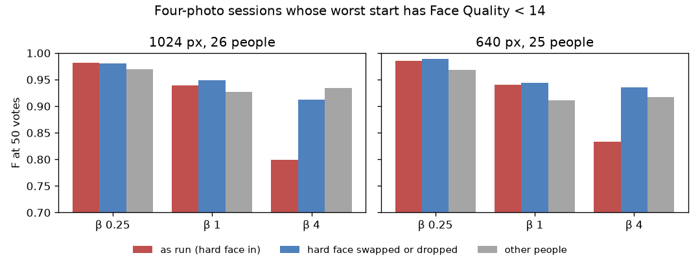

# One hard starting face in four: the face, not the person — 2026-10-28 (#5376)

**Four-photo face sessions are worse at β 4 when one starting face is a hard view (Face Quality under 14,
#5372). The cause is the face, not the person. Run the same sessions with that face swapped for another
photo of the person, or left out, and F at 50 votes rises +0.11 (1024 px) and +0.10 (640 px), back to the
other people's level. Recall does not change. The hard face makes the β 4 line return about twice as
much, so precision halves.** β ¼ and β 1 do not move.



| K = 4, F at 50 votes | 1024 px, 26 people | 640 px, 25 people |
|---|---:|---:|
| β 4, as run (hard face in) | 0.80 | 0.83 |
| β 4, hard face swapped or dropped | 0.91 | 0.94 |
| swap − as run, paired (95% CI) | **+0.11** (+0.05, +0.17) | **+0.10** (+0.06, +0.15) |
| β 4, the other people (as run) | 0.93 | 0.92 |
| β 1, swap − as run | +0.01 (−0.01, +0.03) | +0.00 (−0.02, +0.03) |
| β ¼, swap − as run | −0.00 (−0.01, +0.00) | +0.00 (−0.01, +0.01) |
| β 4, after the session (150 votes), swap − as run | +0.05 (+0.00, +0.10) | +0.03 (−0.02, +0.09) |

At β 4, removing the hard face helps 14 of the 26 people by more than 0.05 at 1024 px and hurts 2. At 640 px
it helps 13 of 25 and hurts 1.

## Two tests, one answer

**1. The same people from one clear photo, with no new runs.** The example draw is nested in K, so a
person's one-photo session starts from the first of their four photos. For 19 of the 26 flagged people
(18 of 25 at 640 px), that photo is clear. From that one clear photo they reach F 0.91 at 50 votes at β 4
(640 px: 0.94), which is level with everyone else (0.93 / 0.92). So they are not hard people to find.
Adding the other three photos, the hard one among them, costs them −0.14 at β 4 (640 px: −0.11), while
for everyone else it costs nothing (+0.00 / −0.01). The difference of the two is −0.14 (−0.19, −0.09) at
1024 px and −0.10 (−0.15, −0.05) at 640 px (`k1.csv`).

**2. The swap.** This reran each flagged session at every β with each hard face replaced by the next clear
photo of the person in the draw's own order (`scripts/experiments/fhibe/hard_face_5376.py`). The control
reran the same cells unchanged at the same commit. Most flagged people have only four photos in the voting
half, so there is no fifth to swap in, and the hard face was dropped instead (a three-photo start):

| at β 4 | swapped | dropped |
|---|---:|---:|
| 1024 px: people, gain at 50 votes | 9, +0.11 (+0.05, +0.17) | 17, +0.12 (+0.04, +0.20) |
| 640 px: people, gain at 50 votes | 6, +0.07 (−0.00, +0.16) | 19, +0.11 (+0.06, +0.17) |

Both ways give the same answer. Two of the 1024 px people had two hard faces, and both were replaced.

The control reproduces #5325's shipped arm (`2026-10-27-5325z55-ik`) in every session's F-beta and AP.
`cells_identical.py` still reports differences. They come from three files: the line-count frames (on in
the arm, off here), and the pick and sweep logs, where a few detector scores and thresholds differ in the
last digits (CPU drift; this ran on rack8n09). None of these moves a session's outcome.

## What the hard face does at β 4

| β 4, at 50 votes, mean | as run | hard face out |
|---|---:|---:|
| 1024 px: returned / precision / recall | 21 / 0.31 / 0.98 | 9.4 / 0.60 / 0.98 |
| 640 px: returned / precision / recall | 15 / 0.37 / 0.97 | 5.7 / 0.69 / 0.96 |

The withheld half holds about three photos of the person. With the hard face in, the β 4 line returns
about 21 faces, and two thirds of them are other people. The recall it buys is nothing: the person's other
photos were already above the line. The mechanism is likely #5039's β > 1 reach, which lowers the line to
take in a Good that sits below it. That was not tested here. The hard face is a Good with a low score, so
the line comes down to it. At β ≤ 1 the line does not reach for it, which is why the gap shows only at β 4.

## What it means for the app

#5372's warning keys on the best of the starting faces, and that stays right: no four-photo session fails.
But a single hard face among clear ones is not harmless at β 4. It halves precision at 50 votes. The
evidence above shows only that leaving the face out, from both the centroid and the line, recovers the
loss at β 4 and costs nothing at β ¼ or β 1. Leaving it out of the line alone, or down-weighting it in
the centroid only, was not tested.

## Files and reproduce

- `summary.csv`: per size, β, kind (`all`, `swapped`, `dropped`) and metric (`thr_fbeta_50`,
  `thr_fbeta_final`). It holds the means as run and swapped, the paired difference with its bootstrap 95%
  interval, `ctl_equals_arm`, and the other people's mean.
- `paired.csv`: one row per person (the first 8 characters of the id), size and β, with both arms, the arm's
  K = 4 and K = 1 values, and what the swap did.
- `k1.csv`: test 1, the one-photo check.
- `f50.webp`: the figure above.

The runs, on a compute node with the app venv, from a frozen worktree:

```
# run dirs (per β: the K4 preflight FAILs on 7 six-photo people, as in #5325)
for t in 5376ctl 5376swap; do for b in 0.25 1 4; do
  SOTA_FACE_DATE=2026-10-28 SOTA_FACE_TAG=$t SOTA_FACE_BASE=2026-10-27-prep-ik-bs SOTA_FACE_BETAS=$b \
    bash scripts/experiments/fhibe/sota_face.sh dirs; done; done
# one cell: TAG SWAP K BETA INDEX (306 tasks: 51 flagged person-sizes x 3 β x 2 arms, one CPU pack, 48 min)
SOTA_FACE_DATE=2026-10-28 SOTA_FACE_TAG=5376swap SOTA_FACE_BASE=2026-10-27-prep-ik-bs HARD_FACE_SWAP=on \
  SOTA_FACE_RUNNER=$PWD/scripts/experiments/fhibe/hard_face_5376.py \
  bash scripts/experiments/fhibe/sota_face.sh cell 4 4 <index>
# analysis
SOTA_FACE_DATE=2026-10-28 SOTA_FACE_TAG=5376ctl bash scripts/experiments/fhibe/sota_face_analyze.sh <runs>/2026-10-28-5376ctl-ik-analysis 4
SOTA_FACE_DATE=2026-10-28 SOTA_FACE_TAG=5376swap bash scripts/experiments/fhibe/sota_face_analyze.sh <runs>/2026-10-28-5376swap-ik-analysis 4
python scripts/experiments/fhibe/hard_face_5376_compare.py --ctl <runs>/2026-10-28-5376ctl-ik-analysis \
  --swap <runs>/2026-10-28-5376swap-ik-analysis --ref <runs>/2026-10-27-5325z55-ik-analysis \
  --swap-logs '<runs>/2026-10-28-5376swap-ik-k4-b{beta}/logs' --out docs/experiments/2026-10-28-hard-face-5376
```

The flagged people are K = 4, β 1 sessions of the arm whose worst starting face is under 14 (#5372's
`sessions.csv`). The analysis links the arm's click-0 baseline, which F at 50 votes does not read. Work dir:
`/expscratch/sgreenberg/fhibe/hardface-5376/` (owner-only: `tasks.txt`, `cell.sh`, `pack.sbatch`, ops.log).
