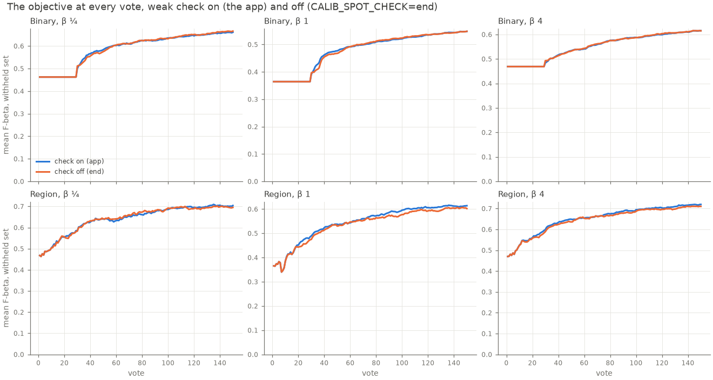
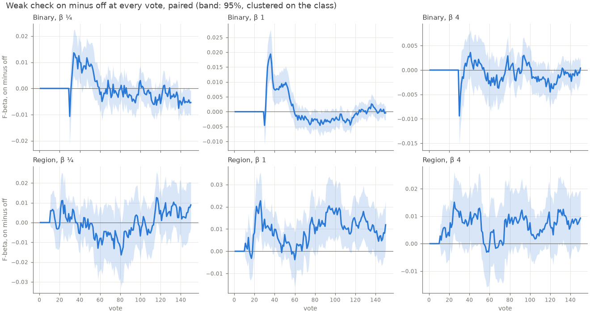
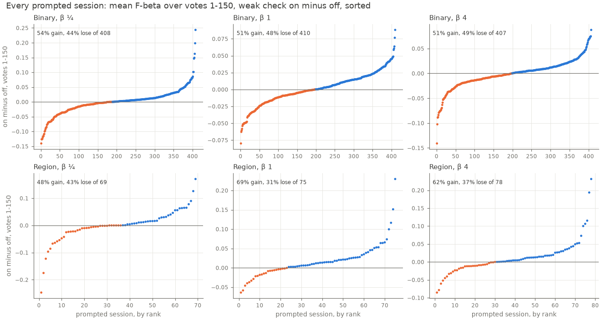

# The weak-separation check on COCO at today's head — 2026-10-28 (#4797)

**On the Region path the weak-separation check pays: it adds Goods and raises the objective at β 1 and 4. On the
Binary path it is a wash at today's head: a small early gain that the query hold delays and the Goods it costs
take back. Neither path gives a reason to turn it off, and the generic "positives left to find" gate that #4778
proposed has nothing to win on COCO.** Today's app and the same app with only the end-of-run check
(`CALIB_SPOT_CHECK=end`) were run as paired sessions at one commit. Binary had 720 sessions per β (144 cells, 5 seeds)
and Region had 144 (1 seed):

- **Region, check on minus off: +0.0067 ± 0.0019 (β 1) and +0.0066 ± 0.0024 (β 4) over votes 1–50, and +0.0090 ±
  0.0027 / +0.0062 ± 0.0029 over votes 1–150.** At vote 150 the gain is +0.012 / +0.0093. At β ¼ the effect is nil:
  +0.0014 ± 0.0020 over 1–50 and −0.0003 ± 0.0034 over 1–150.
- **Binary, check on minus off: +0.0033 ± 0.0014 / +0.0040 ± 0.0010 / +0.0001 ± 0.0008 over votes 1–50 (β ¼ / 1 /
  4), and −0.0002 / +0.0007 / −0.0006 (± 0.0007–0.0013) over votes 1–150.** At β ¼ vote 150 is −0.0054 ± 0.0024;
  at β 1 and 4 it is level.
- **The mechanism is Goods found.** A prompted Region session ends vote 150 with +1.1 Goods with the check than
  without it at β 1 (+0.94 at β ¼, +1.7 at β 4). A prompted Binary session ends with −0.71 to −0.79 Goods. This is
  #4778's "are there positives left to find" lever, read directly: on Region the check's band picks find Goods that
  acquisition would not, and on Binary they take votes away from acquisition, which finds Goods faster.
- **On Binary the early gain is hidden behind the query hold.** The check starts at vote 14 (median), but Binary's
  typed-query detector keeps giving the query's own set until 30 labels (#4736). Both arms show the same objective
  from vote 6 through vote 29, and the check's training votes reach the objective only at vote 30. There they lead
  by up to +0.019 (β 1) for ~20 votes, and then trail by ~0.003 over votes 55–120.
- **Where the check pays, by #4778's strata.** On Region at β 1, it pays most when the first check starts with 4–5
  Goods (+0.021 ± 0.0057 over votes 1–150) and when it starts at votes 11–29 (+0.017 ± 0.0075). On Binary, sessions
  that start the check with fewer than 4 Goods lose (−0.0045 ± 0.0015 at β 1), and those with 6–9 Goods gain
  (+0.0093 ± 0.0025). Region's checks start with few Goods (94–100% under 6), so a minimum Good count would remove
  them. #4778's rejection of that gate holds.

The pricing changes nothing in the app. The recommendation is to keep the check as shipped on both COCO paths (see
Options).

## What was priced

The weak-separation check (#4496) prompts a spot check when the labels line separates Goods from Bads by fewer than
1.5 spreads (d' < 1.5), from vote 10 on. Since #4909 it runs once a session, and since #4799 it is off on face crops.
A check is rounds of 5 picks drawn evenly across the line's bands. Those picks are votes: they count against the
session's votes and train the head.

#4778 found that it costs face sessions, which hold all their Goods by the first check. It asked whether the COCO
paths still pay at today's head:

- Binary was last priced on 10-15 (#4909's "no weak check" arm: −0.0025 ± 0.0007 / −0.0010 ± 0.0008 over votes
  0–50 at β 1 / 4, relative to the app). Since then the head has moved (#5039, #5040, #5084).
- Region had never been priced.

**The arm** turns the prompted check off and keeps the Done check and the closing check (`CALIB_SPOT_CHECK=end`).
**The control** is today's app. Every difference here is control minus arm (check on minus check off), so a
positive number means the check pays.

## The bench, and the control

- **The grid #4711 prepared after #5191** (`2026-10-23-regstyles4711-grid`). It has COCO Better's 144 classes ×
  sizes. The Binary Photo path is SigLIP. The Region Photo path is SigLIP + DINOv3 patches. Sessions run 150 votes
  and the closing check, trajectory pass, at β ¼, 1 and 4.
- **Seeds:**
  - Binary: 5 seeds, 720 sessions per β per arm.
  - Region: 1 seed, 144 sessions per β per arm. A Region cell needs ~17 GB and ~1 h on a CPU node, so Region b1 ran
    on the four V100 nodes, with the GPU hidden.
- **Both arms ran at one commit**, `8a819def0` (dev `fd417b9f0` plus this study's launcher), from a frozen worktree.
  No earlier run is reused as the control.
- **Paired by cell and seed.** A session and its pair are the same session until the app's first weak check. That
  holds exactly: in all 6 path × β sets, no pair's picks differ before the app's first weak check (0 early
  departures in 2,592 pairs), and the 43–52% of sessions the check never prompts are identical through vote 150.
  The `OPENBLAS_CORETYPE` pin (#4481) leaves no drift between the Intel and AMD nodes.

The objective is F-beta of the withheld set above Find's line at the session's own β, read as #4778 read it
(`prior_4776.read_runs`): Test's untagged rows at every vote, the closing check's rows left out, carried between
rows, 0 before the first. Its **session mean** over votes 1–50 and 1–150 is the single number. Votes 51–150 and
vote 150 are given too. SEs are clustered on the class (the spread of the per-class mean differences).

## Results

| path, β | sessions | prompted | first check at vote (median) | Goods then (median, share < 6) | votes 1–50 | votes 1–150 | vote 150 |
|---|---|---|---|---|---|---|---|
| Binary, ¼ | 720 | 57% | 14 | 4 (87%) | +0.0033 ± 0.0014 | −0.0002 ± 0.0013 | −0.0054 ± 0.0024 |
| Binary, 1 | 720 | 57% | 14 | 4 (85%) | +0.0040 ± 0.0010 | +0.0007 ± 0.0007 | −0.0004 ± 0.0012 |
| Binary, 4 | 720 | 57% | 14 | 4 (86%) | +0.0001 ± 0.0008 | −0.0006 ± 0.0008 | +0.0004 ± 0.0011 |
| Region, ¼ | 144 | 48% | 22 | 3 (100%) | +0.0014 ± 0.0020 | −0.0003 ± 0.0034 | +0.0089 ± 0.0060 |
| Region, 1 | 144 | 52% | 22 | 3 (96%) | +0.0067 ± 0.0019 | +0.0090 ± 0.0027 | +0.012 ± 0.0054 |
| Region, 4 | 144 | 54% | 21 | 3.5 (94%) | +0.0066 ± 0.0024 | +0.0062 ± 0.0029 | +0.0093 ± 0.0051 |

The differences are averaged over every session, prompted or not (#4631), because a session the check never
prompts adds an exact 0. For scale, check-off sessions average 0.48–0.59 over votes 1–150 on Binary and 0.54–0.65
on Region. A prompted session spends 22–23 votes on the check at β ¼ and 1, and 31 at β 4.





**Binary's curve** sits at exactly 0 until vote 29, dips at vote 30, and leads from vote 31 to vote ~55 (by up to
+0.019 at β 1 and +0.014 at β ¼). It then trails slightly (about −0.003 at β 1 over votes 55–120) and comes back
level by vote 150, except at β ¼, which ends −0.0054. The flat start comes from the query hold: until a Binary
session holds 30 labels, Find gives the typed query's own set, so the check's votes cannot show in the objective.

**Region's curve** leaves 0 at the first checks (vote ~11). It leads +0.01 to +0.02 through vote 40 at β 1 and 4,
nears zero around vote 55–60, then leads again +0.01 to +0.02 from vote 80 on. That second rise is the Goods the
check found reaching the head. β ¼ has the same shape but dips below zero over votes 55–100.

### Goods by vote 150

| path, β | all sessions, on − off | prompted sessions, on − off |
|---|---|---|
| Binary, ¼ / 1 / 4 | −0.45 / −0.40 / −0.44 | −0.79 / −0.71 / −0.77 |
| Region, ¼ / 1 / 4 | +0.45 / +0.58 / +0.90 | +0.94 / +1.1 / +1.7 |

On Binary, acquisition finds Goods faster than the check's band picks, so the check's ~22 votes cost about ¾ of a
Good. On Region the check finds Goods that acquisition misses. In the best example below, the check-off session
never finds them at all.

### Split by Goods in hand and by vote, at the first check

Check on minus off over votes 1–150 (votes 1–50 in `tables/weak_4797_splits.csv`). Sessions the check never
prompted are 0 by construction and are left out here.

| path, β | < 4 Goods | 4–5 Goods | 6–9 Goods | first at votes 11–29 | 30–49 | 50–79 | ≥ 80 |
|---|---|---|---|---|---|---|---|
| Binary, ¼ | −0.0059 ± 0.0050 (198) | +0.0032 ± 0.0027 (155) | +0.010 ± 0.0020 (55) | +0.0029 ± 0.0023 (291) | −0.0080 ± 0.0060 (60) | −0.014 ± 0.0053 (34) | +0.0001 ± 0.0062 (23) |
| Binary, 1 | −0.0045 ± 0.0015 (198) | +0.0053 ± 0.0021 (149) | +0.0093 ± 0.0025 (63) | +0.0026 ± 0.0016 (292) | −0.0041 ± 0.0038 (61) | −0.0030 ± 0.0029 (34) | +0.0023 ± 0.0041 (23) |
| Binary, 4 | −0.0058 ± 0.0024 (194) | +0.0035 ± 0.0022 (155) | +0.0023 ± 0.0022 (58) | +0.0009 ± 0.0016 (293) | −0.0047 ± 0.0055 (61) | −0.010 ± 0.0053 (35) | −0.0032 ± 0.0048 (18) |
| Region, ¼ | −0.0007 ± 0.012 (40) | −0.0004 ± 0.0060 (29) | — | −0.0033 ± 0.0072 (37) | −0.018 ± 0.028 (14) | +0.024 ± 0.0099 (10) | +0.011 ± 0.0099 (8) |
| Region, 1 | +0.015 ± 0.0082 (40) | +0.021 ± 0.0057 (32) | +0.0077 ± 0.0029 (3) | +0.017 ± 0.0075 (42) | +0.011 ± 0.012 (14) | +0.028 ± 0.0096 (11) | +0.015 ± 0.0095 (8) |
| Region, 4 | +0.0061 ± 0.0087 (39) | +0.017 ± 0.0069 (34) | +0.017 ± 0.019 (4) | +0.015 ± 0.0078 (45) | −0.0006 ± 0.013 (15) | +0.019 ± 0.011 (11) | +0.0046 ± 0.0055 (7) |

(Session counts in parentheses. Region β 4 has one session with 10–19 Goods, +0.0050.)

- **On Binary, Goods in hand decide the sign.** With fewer than 4 Goods the check loses at every β. With 4 or more
  it gains. #4496's sign, found then over all sessions, now holds only in the upper strata. Late first checks (votes
  30–79) lose, because their votes replace acquisition votes that the query hold no longer protects.
- **On Region the check gains in nearly every stratum at β 1 and 4**, most at 4–5 Goods and at the earliest checks.
  The cells are small (≤ 45 sessions), so only the 4–5 Goods and 11–29 strata are clearly above 0.



Per prompted session, the check helps more often than it hurts on Region at β 1 (69% gain, 31% lose) and β 4 (62% /
37%). On Binary the split is even (51–54% gain, 44–49% lose).

### Example sessions (β 1)

Check on minus off over votes 1–150. "Goods" means Goods held by vote 150 in each arm.

| path | session | first check | effect | Goods on / off | F-beta at vote 150, on / off |
|---|---|---|---|---|---|
| Region | sink@medium | vote 22, 3 Goods | **+0.23** | 32 / 5 | 0.64 / 0.16 |
| Region | keyboard@medium | vote 16, 4 Goods | +0.15 | 52 / 29 | 0.63 / 0.37 |
| Region | remote@small | vote 41, 3 Goods | +0.12 | 28 / 9 | 0.28 / 0.11 |
| Region | bowl@large | vote 11, 3 Goods | −0.046 | 16 / 24 | 0.22 / 0.38 |
| Region | bag or luggage@medium | vote 11, 3 Goods | −0.058 | 23 / 22 | 0.42 / 0.48 |
| Region | enclosed road vehicle@medium | vote 43, 3 Goods | −0.064 | 36 / 37 | 0.67 / 0.56 |
| Binary | snowboard@small, seed 1 | vote 12, 5 Goods | +0.088 | 41 / 41 | 0.70 / 0.69 |
| Binary | microwave@large, seed 4 | vote 22, 7 Goods | +0.077 | 43 / 43 | 0.70 / 0.68 |
| Binary | bird@small, seed 2 | vote 25, 3 Goods | −0.080 | 19 / 20 | 0.34 / 0.38 |
| Binary | fork@medium, seed 1 | vote 32, 3 Goods | −0.063 | 17 / 19 | 0.23 / 0.36 |

Region's big gains are sessions that, without the check, stall at a handful of Goods (sink: 5 Goods in 150 votes).
The check's band picks get them out of the stall. Region's losses are sessions where the check's votes displaced
acquisition that was finding Goods (bowl: 16 against 24). On Binary the Goods counts barely move, and the effect is
the head's training: a better line in the snowboard session, a worse one in the fork session.

## How this fits #4496, #4909 and #4778

- **#4496** priced the check on Binary at its launch and found it paid, most where few Goods were in hand. Today,
  with the query hold (#4736) and the newer head (#5039, #5040, #5084), Binary's gain over votes 1–150 is gone (+0.0007
  ± 0.0007 at β 1), and the few-Goods sessions now lose.
- **#4909** (10-15) had check off at −0.0025 ± 0.0007 / −0.0010 ± 0.0008 over votes 0–50 at β 1 / 4, and level over
  0–150. Today's +0.0040 / +0.0001 agree in sign and size.
- **#4778** found the check costs faces (+0.007 to +0.018 over votes 1–50 with it off), because a face session has
  found all its positives by the first check. Region is the opposite case: positives remain, the check finds them,
  and it pays. Binary sits between the two. The ordering faces < Binary < Region follows how much is left to find
  when the check starts. That supports #4778's reading, but it also shows that COCO's paths already sit on the
  paying side of any such gate.

## Options

The pricing does not change the app. The ship form is the owner's call.

1. **Keep the check as shipped on both COCO paths, and off on faces** (recommended). Region gains +0.0062 to +0.0090
   over votes 1–150 at β 1 and 4. Binary is level (−0.0006 to +0.0007). Nothing needs building.
2. **Turn the check off on Binary only.** This would gain at most the −0.0054 ± 0.0024 at vote 150 at β ¼, against
   the early +0.0033 to +0.0040 it would give up, and it adds a per-path rule. Not supported.
3. **The generic "positives left to find" gate (#4778's option 3).** On COCO it would leave Region's and Binary's
   checks running, because both have positives left. Its only gain is on faces, which already have the check off by
   media type (#4799). Not worth building now.
4. **A Goods floor on Binary** (no check with fewer than 4 Goods in hand). On Binary, the < 4 stratum loses −0.0045
   to −0.0059 over votes 1–150 in ~28% of sessions. But on Region the same stratum gains (+0.015 at β 1), so this too
   would be a per-path rule, and it is unpriced as an arm (the strata are read on today's sessions, not run). It is
   an option, not a recommendation.

## Reproduce

From a frozen worktree at `8a819def0`:

```bash
bash scripts/experiments/state_of_app/weak_check_4797.sh dirs
# Binary: cpu packs per arm and beta (5 seeds); Region: V100 packs or cpu packs with CALIB_MEM=20G
bash scripts/experiments/state_of_app/weak_check_4797.sh cpack app binary 1      # ARM app|end, BETA 0.25|1|4
bash scripts/experiments/state_of_app/weak_check_4797.sh gpack end region 1
python scripts/experiments/state_of_app/weak_check_4797.py --root <state-of-the-app> --date 2026-10-28 \
    --out <dir> --docs docs/experiments/2026-10-28-weak-check-coco-4797/tables
python scripts/experiments/state_of_app/weak_check_4797_figures.py \
    --tables docs/experiments/2026-10-28-weak-check-coco-4797/tables \
    --out docs/experiments/2026-10-28-weak-check-coco-4797/figures
```

Files here:

- `tables/weak_4797_summary.csv`: per path and β.
- `tables/weak_4797_splits.csv`: the strata.
- `tables/weak_4797_curves.csv`: both arms and the difference at every vote.
- `tables/weak_4797_per_run.csv`: every pair.
- The three figures.

The runs are under `/expscratch/sgreenberg/state-of-the-app/2026-10-28-weak4797-{app,end}-{binary,region}-b{025,1,4}`.
