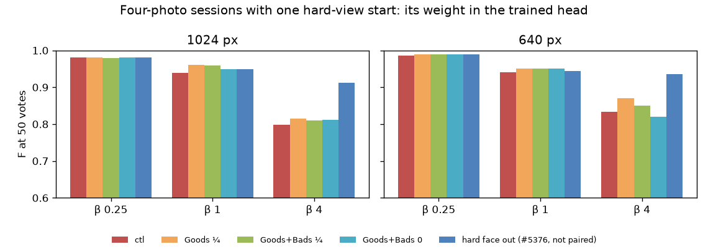

# Hard-view faces weighted in the trained head — 2026-10-29 (#5413)

**Weighing a hard-view Good (Face Quality under 14, #5372) at ¼ in the trained head's fit recovers part of
#5376's β 4 loss. F at 50 votes rises +0.04 (640 px) and +0.02 (1024 px) at β 4, and +0.01 / +0.02 at β 1.
The line returns 2 to 3 fewer faces, and precision rises 0.06 to 0.08. Nothing gets worse at any β, and
sessions with no hard Good are untouched.** That is about a third of what leaving the face out of the
session recovered (+0.10 / +0.11). Weighting hard Bads as well adds nothing, and weight 0 is no better than ¼.



| K = 4, flagged sessions, F at 50 votes, arm − control (95% CI) | 1024 px, 26 people | 640 px, 25 people |
|---|---:|---:|
| β 4, control | 0.80 | 0.83 |
| β 4, hard Goods ¼ | **+0.02** (−0.00, +0.04) | **+0.04** (+0.02, +0.06) |
| β 4, hard Goods 0.1 | +0.03 (+0.00, +0.06) | +0.03 (+0.01, +0.06) |
| β 4, hard Goods 0 | +0.01 (−0.03, +0.06) | −0.01 (−0.07, +0.05) |
| β 4, hard Goods and Bads ¼ | +0.01 (−0.00, +0.03) | +0.02 (−0.01, +0.05) |
| β 4, hard Goods and Bads 0 | +0.01 (−0.03, +0.05) | −0.01 (−0.07, +0.04) |
| β 4, hard face out of the session (#5376, not paired) | 0.91 | 0.94 |
| β 1, hard Goods ¼ | +0.02 (+0.00, +0.04) | +0.01 (+0.00, +0.03) |
| β ¼, hard Goods ¼ | −0.00 | +0.00 |
| after the session (150 votes), β 4, hard Goods ¼ | +0.01 (+0.00, +0.03) | +0.01 (+0.00, +0.02) |

| β 4, at 50 votes, mean | control | hard Goods ¼ | hard face out (#5376) |
|---|---:|---:|---:|
| 1024 px: returned / precision | 21 / 0.31 | 18 / 0.37 | 9.4 / 0.60 |
| 640 px: returned / precision | 15 / 0.37 | 12 / 0.45 | 5.7 / 0.69 |

Recall does not move (within 0.01 at every β).

## What the weight does

The detector from vote 10 on is the linear SVM started from the Goods' centroid
(`vtscore.training.svm_prior.centroid_prior_direction`): squared hinge, C = 1, balanced classes. Each row
pays C times its squared shortfall from the margin. A sample weight scales that one row's C, so a hard
Good at ¼ can sit about four times deeper inside the margin before it pulls the boundary as hard as a
clear one. Here the weight goes in two places. It multiplies each row's balanced class weight,
renormalised so each class keeps the total `class_weight="balanced"` gives it. It also weights the
Goods' centroid that the head starts from. Without that, the hard face would still steer the start.

The margin is wide: refitting #5389's control sessions on their first 50 votes, about 42 of 50 votes sit
inside it (none on the wrong side). So nearly every vote shapes the boundary, not a few support vectors.
The hard Good sits at 0.87 of the margin against 1.04 for the clear Goods. The same refits show that
sessions that start with a hard face go on to vote 4.8 hard-view Bads by vote 50, against 0.8 in clear
sessions. The hard Good pulls the head toward hard views of other people, and the session then spends
votes turning those down.

## Why ¼, and what it leaves

- **¼ over 0.1:** they are level (+0.04 / +0.02 against +0.03 / +0.03 at β 4). ¼ keeps more of the face
  as evidence for the same result, and its β 1 gain is surer.
- **Not 0:** a weight of 0 takes the face out of the fit, yet it is no better and much noisier (intervals
  ±0.05). The face still counts as a Good vote, so it stays in the session's counts and the calibration
  folds. Leaving it out of the fit alone does not reproduce leaving it out of the session.
- **Not the Bads:** weighting hard Bads too gives less at β 4 than the Goods alone. The hard-view Bads are
  the session's corrections of the head's pull toward hard views, and they are worth their full weight.

Most of #5376's gain is still unexplained: ¼ returns 18 / 12 faces where leaving the face out returns 9.4 /
5.7. The remaining cost comes through something the fit's weight does not reach. The opening sort is
ruled out (#5389). That leaves the hard face as a Good in the line's calibration and in the session's
counts, which is #5409.

## No-op checks

- Clear sessions (60 person-sizes, 30 a size, every starting face 14 or over, seed 5413): no session ever
  votes a hard Good by vote 50, so hard Goods ¼ is identical to the control in every metric at every β.
  The arms that also weight Bads move them by at most 0.001 in F.
- The control was rerun with the Goods-only 0 and 0.1 arms (pack B). It is identical to pack A's control
  in every session, so the two packs pair against one control.
- A fit with no weighted row calls the shipped head unchanged. The runner's own refit matches the
  shipped head's direction at weight 1 (cosine 1.0000) and a dropped row at weight 0 (0.99998).

## Files and reproduce

- `summary.csv`, `paired.csv`, `f50.png`: pack A (control, hard Goods ¼, hard Goods and Bads ¼ and 0)
  on the 51 flagged and 60 clear person-sizes.
- `summary_b.csv`, `paired_b.csv`: pack B on the flagged ones (hard Goods 0 and 0.1, the rerun control as
  `ctl`, and pack A's control and hard Goods ¼ as `ctlA` and `g0.25A`).

Runner: `scripts/experiments/fhibe/hard_face_train_weight_5413.py` patches
`svm_prior.centroid_prior_direction` for one cell, matching each training row to its face by vector (a row
that matches none fails the cell). Every row of all 1,791 cells matched. Pack A: 1,332 cells in 11 CPU
jobs, 22 min. Pack B: 459 cells in 10, 13 min. Both ran at 89b9972dd, sharded by person so each person's
arms share a node.

```
# run dirs (per β: the K4 preflight FAILs on 7 six-photo people, as in #5325)
for t in 5413ctl 5413g025 5413a025 5413a0 5413ctlb 5413g0 5413g01; do for b in 0.25 1 4; do
  SOTA_FACE_DATE=2026-10-29 SOTA_FACE_TAG=$t SOTA_FACE_BASE=2026-10-27-prep-ik-bs SOTA_FACE_BETAS=$b \
    bash scripts/experiments/fhibe/sota_face.sh dirs; done; done
# one cell: K BETA INDEX at a weight (1 = the control), on the Goods or on every row
SOTA_FACE_DATE=2026-10-29 SOTA_FACE_TAG=5413g025 SOTA_FACE_BASE=2026-10-27-prep-ik-bs \
  HARD_FACE_WEIGHT=0.25 HARD_FACE_ON=goods SOTA_FACE_RUNNER=$PWD/scripts/experiments/fhibe/hard_face_train_weight_5413.py \
  bash scripts/experiments/fhibe/sota_face.sh cell 4 4 <index>
# analysis (each run dir's click-0 baseline links the arm's, which F at 50 votes does not read)
SOTA_FACE_DATE=2026-10-29 SOTA_FACE_TAG=<tag> bash scripts/experiments/fhibe/sota_face_analyze.sh <runs>/2026-10-29-<tag>-ik-analysis 4
python scripts/experiments/fhibe/hard_face_weight_5389_compare.py --people people.csv --arm ctl=<a> --arm 'Goods ¼'=<a> ... \
  --swap <runs>/2026-10-28-5376swap-ik-analysis --title '...' --out <dir>
```

Work dir: `/expscratch/sgreenberg/fhibe/trainweight-5413/` (owner-only: `tasks.py`, `people.csv`, `cell.sh`,
`pack*.sbatch`, shards, `analyze*.sh`, ops.log).
