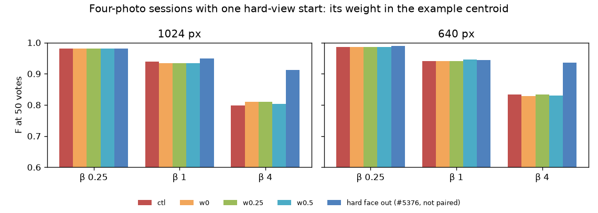

# A hard starting face, down-weighted in the example centroid: no help — 2026-10-29 (#5389)

**Weighing a hard-view starting face (Face Quality under 14, #5372) less in the example centroid does not
recover #5376's β 4 loss. At weights 0, ¼ and ½, F at 50 votes moves at most +0.01 at 1024 px and 0.00 at
640 px, and every interval spans zero. Leaving the face out of the session entirely recovered +0.11 and +0.10.
The β 4 line still returns about 20 faces where leaving the face out returns 9, so precision stays near 0.3.
The app keeps its plain mean.** Clear sessions are unchanged, as they must be.



| K = 4, flagged sessions, F at 50 votes | 1024 px, 26 people | 640 px, 25 people |
|---|---:|---:|
| β 4, control (plain mean) | 0.80 | 0.83 |
| β 4, weight 0 − control, paired (95% CI) | +0.01 (−0.01, +0.04) | −0.01 (−0.02, +0.00) |
| β 4, weight ¼ − control | +0.01 (−0.00, +0.04) | −0.00 (−0.00, +0.00) |
| β 4, weight ½ − control | +0.00 (−0.02, +0.03) | −0.00 (−0.01, +0.00) |
| β 4, hard face out of the session (#5376, other commit, not paired) | 0.91 | 0.94 |
| β 1, any weight − control | −0.01 (−0.02, +0.00) | +0.00 to +0.01 |
| β ¼, any weight − control | −0.00 | +0.00 |
| after the session (150 votes), any β, any weight − control | 0.00, every session identical | 0.00, every session identical |

## What the weight changes, and what it leaves

| β 4, at 50 votes, mean | control | weight ¼ | hard face out (#5376) |
|---|---:|---:|---:|
| 1024 px: returned / precision / recall | 21 / 0.31 / 0.98 | 20 / 0.35 / 0.98 | 9.4 / 0.60 / 0.98 |
| 640 px: returned / precision / recall | 15 / 0.37 / 0.97 | 15 / 0.37 / 0.97 | 5.7 / 0.69 / 0.96 |

The weight changes only the opening: the example sort the session walks before its first trained head.
The hard face is still voted Good, and it is still one of the four or so Goods the trained head fits on.
By vote 10, every flagged session at β 4 has a trained head (51 of 51 in #5376's control). So the line at
50 votes is drawn by a head that has the hard face among its Goods, whatever the opening did.

The weight changed anything at all in only 3 to 8 of the 25 or 26 sessions per size and β (`paired.csv`).
One of them is the whole effect at 1024 px: person `4afc6446` goes from 35 returned and F 0.69 to 5
returned and F 0.99 at weight ¼. Others move the other way (`802df938`: 40 → 44 returned, F 0.65 → 0.63).

So the cost does not come from the centroid. It comes from the hard face as a Good. Its low score is
likely what pulls the β 4 line down (#5039's β > 1 reach). That reach is still untested, and it is the
next step: leave the hard face out of the line's reach while it stays a Good.

## The weight that was to ship

The issue asked for a weight with a reason. ¼ was the candidate: it keeps the face as a little evidence
and gives the clear faces the centroid. Weight ¼ is the best of the three at 1024 px, and it is the most
level of the three at 640 px. But +0.01 with an interval from −0.00 to +0.04 is not a reason to add a second
face pass to every multi-photo example sort in the app. So nothing ships to the app. The study runner
applies the weight to the harness's example sort alone.

## Clear sessions: a no-op

The 30 unflagged sessions (15 per size, every starting face at 14 or over, drawn with seed 5389) ran at
weight 0 and as the control. All 30 are identical to the control in every metric at every β
(`summary.csv`, `kind = clear`, `identical`). The runner never weights a session with no hard face.

The control matches #5376's control in the flagged sessions' means (β 4: 0.80 and 0.83).

## Files and reproduce

- `summary.csv`: per size, β, kind (`flagged`, `clear`), arm and metric (F, precision, recall, returned and
  AP at 50 votes; F and AP after the session). It holds the control and arm means, the paired difference
  with a bootstrap 95% interval over people, and `identical`. It also holds the control's and #5376's
  leave-it-out level on the flagged sessions (`arm` = `ctl`, `swap`).
- `paired.csv`: one row per person (the first 8 characters of the id), size, β and arm, with both values.
- `f50.png`: the figure above.

The runs: 792 cells (51 flagged person-sizes × 3 β × 4 arms, plus 30 clear × 3 β × 2 arms). They ran as
10 CPU packs of 16 cells at a time, sharded by person so each person's arms share a node. That took 17
minutes on rack8n09 and rack8n10, at commit 80c07e80f, which put the weight in the app's centroid helper. The
runner here patches the harness instead (a152e075b). It reproduces a changed cell (`4afc6446`, 1024 px, β 4,
weight ¼) row for row.

```
# run dirs (per β: the K4 preflight FAILs on 7 six-photo people, as in #5325)
for t in 5389ctl 5389w0 5389w025 5389w05; do for b in 0.25 1 4; do
  SOTA_FACE_DATE=2026-10-29 SOTA_FACE_TAG=$t SOTA_FACE_BASE=2026-10-27-prep-ik-bs SOTA_FACE_BETAS=$b \
    bash scripts/experiments/fhibe/sota_face.sh dirs; done; done
# one cell: K BETA INDEX at a weight (1 = the control)
SOTA_FACE_DATE=2026-10-29 SOTA_FACE_TAG=5389w025 SOTA_FACE_BASE=2026-10-27-prep-ik-bs HARD_FACE_WEIGHT=0.25 \
  SOTA_FACE_RUNNER=$PWD/scripts/experiments/fhibe/hard_face_weight_5389.py \
  bash scripts/experiments/fhibe/sota_face.sh cell 4 4 <index>
# analysis (each run dir's click-0 baseline links the arm's, which F at 50 votes does not read)
for t in 5389ctl 5389w0 5389w025 5389w05; do
  SOTA_FACE_DATE=2026-10-29 SOTA_FACE_TAG=$t bash scripts/experiments/fhibe/sota_face_analyze.sh <runs>/2026-10-29-$t-ik-analysis 4; done
python scripts/experiments/fhibe/hard_face_weight_5389_compare.py --people people.csv \
  --arm ctl=<runs>/2026-10-29-5389ctl-ik-analysis --arm w0=<runs>/2026-10-29-5389w0-ik-analysis \
  --arm w0.25=<runs>/2026-10-29-5389w025-ik-analysis --arm w0.5=<runs>/2026-10-29-5389w05-ik-analysis \
  --swap <runs>/2026-10-28-5376swap-ik-analysis --out docs/experiments/2026-10-29-hard-face-weight-5389
```

The flagged sessions are #5376's: K = 4, β 1 sessions of #5325's shipped arm whose worst starting face is
under 14. Work dir: `/expscratch/sgreenberg/fhibe/hardweight-5389/` (owner-only: `tasks.py`, `people.csv`,
`cell.sh`, `pack.sbatch`, shards, ops.log).
