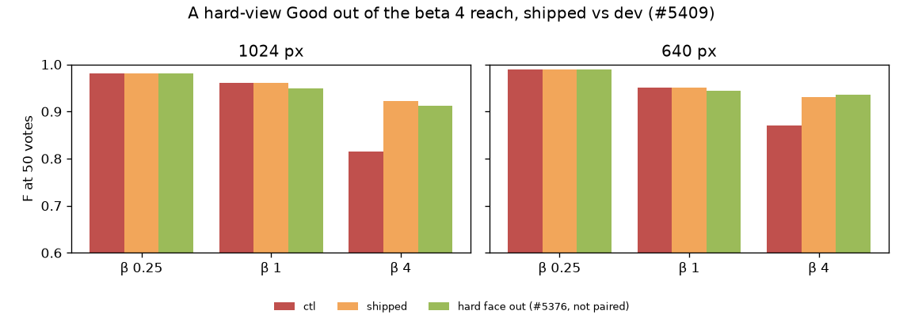

# A hard-view Good kept out of the β 4 line's reach — 2026-10-29 (#5409)

**The rest of #5376's β 4 loss came from the line's reach (#5039). Keeping a hard-view Good out of it recovers
the loss. Hard-view means Face Quality under 14 (#5372). When the calibration folds hold such a face out, it
scores low and ranks below what stands out. Above β 1, the head's count line then reaches down the excess curve.
With the face skipped there, F at 50 votes rises +0.11 (1024 px) and +0.06 (640 px) at β 4. The line returns
8.8 / 5.8 faces instead of 18.5 / 11.9, the same as leaving the face out of the session (9.4 / 5.7).
Precision rises +0.26 and recall does not move. Nothing changes at β ¼ or β 1, or in any session without a
hard Good.** It ships: the face stays a Good everywhere else, in the fit, the class model and the counts.



| K = 4, flagged sessions, at 50 votes, shipped − dev (95% CI) | 1024 px, 26 people | 640 px, 25 people |
|---|---:|---:|
| β 4, F: dev | 0.82 | 0.87 |
| β 4, F: shipped − dev | **+0.11** (+0.06, +0.16) | **+0.06** (+0.03, +0.10) |
| β 4, precision: dev → shipped | 0.37 → 0.63 | 0.45 → 0.72 |
| β 4, recall: dev → shipped | 0.98 → 0.98 | 0.97 → 0.96 |
| β 4, returned: dev → shipped | 18.5 → 8.8 | 11.9 → 5.8 |
| β 4, F after the session (150 votes): shipped − dev | +0.05 (+0.01, +0.09) | +0.03 (+0.00, +0.06) |
| β 4, AP at 50 votes | identical | identical |
| β 4, hard face out of the session (#5376, not paired) | F 0.91, returned 9.4 | F 0.94, returned 5.7 |
| β 1 and β ¼, every metric | identical in every session | identical in every session |

"Dev" already weighs a hard Good at ¼ in the trained head (#5413). So this result sits on top of #5413's
+0.02 / +0.04, and the two together recover all of #5376's +0.11 / +0.10.

At β 4, 25 of the 51 flagged person-sizes gain, 25 are identical, and one loses: `d413192f` at 640 px
(−0.14). There the reach was finding deep positives: the line drops from 12 faces to 4, and recall falls.
The 30 clear person-sizes a size are identical in every metric at every β.

## The mechanism

Faces are on the head's count line all session (fewer than 6 held-out Goods). Above β 1 that line
(`labels_line.head_count_cut`) keeps 1.3× what stands out. #5039 added a reach on top: when the lowest of
the class model's held-out Goods (`ClassScoreModel.pos_logits`) ranks below the β 1 count, the line keeps at
least as deep as the head's excess curve peaks. A hard starting face is one of the session's ~4 Goods. Each
calibration fold holds out about half the Goods, so the face is often held out. It then scores far down the
corpus, deep below what stands out.

A runner (`hard_good_line_5409.py`) logged every β 4 cut on the control and tagged each held-out Good with
its face. At 50 labels (`mechanism.csv`):

| β 4, at 50 labels | flagged, 1024 | flagged, 640 | clear, 1024 | clear, 640 |
|---|---:|---:|---:|---:|
| hard Good among the held-out Goods | 60% | 63% | 0% | 0% |
| reach fires on the measured line | 55% | 58% | 5% | 4% |
| reach fires only because of the hard Good | 45% | 58% | 0% | 0% |
| measured line keeps: no reach / today / hard Good skipped | 5.5 / 17.5 / 7.6 | 5.1 / 11.7 / 5.1 | 5.8 / 7.0 / 7.0 | 6.6 / 8.3 / 8.3 |
| reach fires on the session's own line | 5% | 0% | 0% | 0% |

The measured line is the one F at 50 votes reads: the session's class model, cut on the withheld half, where
the person's other photos still sit unvoted. On the session's own corpus the found photos are already voted,
so the excess curve has little left to reach for and the reach rarely fires. That is why votes, AP and the
session's picks are untouched, and only the line moves.

The issue asked for this check on #5389's control cells with no new runs. Those cells do not record the
held-out Goods' scores, so the check needed a logging rerun of the control.

## Shipped

`labels_line.REACH_SKIPS_HARD_VIEWS = True`. The calibration folds tag each held-out row that is a hard-view
face (`conformal.FoldOrdering.hard_views`, from `svm_prior.hard_view_mask`, the same rows #5413 weighs).
The class model then builds `pos_logits`, which only the reach reads, from the clear held-out Goods. If every
held-out Good is hard, nothing reaches. The hard Good still counts in the class model's mean, spread and
Good count, and it is still fitted on at #5413's ¼. On a dataset with no Face Quality verdicts nothing is
tagged and the line is as before. The tag rides on the fold orderings, so a balance change that re-cuts a
parked line keeps it. Only the row-wise fold path tags, which is every face path. `False` is the line before
#5409.

## How it was priced

The numbers above are the plain pair: dev at 6b8cc2612 (`5409dev`, the default runner) against the shipped
code at 8b8fb1194 (`5409ship`). Both ran the same 666 cells: 51 flagged and 60 clear person-sizes (#5413's,
`people.csv`) × β ¼, 1, 4, sharded by person so each person's two arms share a node.

The logging runner ran first as its own pair (control vs hard Goods skipped, 666 cells) and gave the same
means to three decimals. It is not the shipped check, though. Its extra imports move the session's scores
by float rounding from vote 1 (only the honest oracle's digest-seeded columns differ at first), so its
control is not dev cell for cell. The shipped code is: a clear session (1108) matches dev in every row, and
a flagged one (232) differs in exactly the 29 rows the runner pair moved.

## Files and reproduce

- `summary.csv`, `paired.csv`, `f50.webp`: the plain pair (`arm` = `shipped`, control = dev), with #5376's
  leave-it-out level as `swap`.
- `mechanism.csv`: the table above, from the runner's logs.

```
# run dirs (per β: the K4 preflight FAILs on 7 six-photo people, as in #5325; the branch must be on origin)
for t in 5409dev 5409ship; do for b in 0.25 1 4; do
  SOTA_FACE_DATE=2026-10-29 SOTA_FACE_TAG=$t SOTA_FACE_BASE=2026-10-27-prep-ik-bs SOTA_FACE_BETAS=$b \
    bash scripts/experiments/fhibe/sota_face.sh dirs; done; done
# one cell: K BETA INDEX, from the tree at that arm's commit
SOTA_FACE_DATE=2026-10-29 SOTA_FACE_TAG=5409ship SOTA_FACE_BASE=2026-10-27-prep-ik-bs \
  bash scripts/experiments/fhibe/sota_face.sh cell 4 4 <index>
# the mechanism log: the runner on the control, a JSON line per beta > 1 cut
SOTA_FACE_DATE=2026-10-29 SOTA_FACE_TAG=5409ctl SOTA_FACE_BASE=2026-10-27-prep-ik-bs HARD_GOOD_LINE=off \
  HARD_GOOD_LOG=<log>.jsonl SOTA_FACE_RUNNER=$PWD/scripts/experiments/fhibe/hard_good_line_5409.py \
  bash scripts/experiments/fhibe/sota_face.sh cell 4 4 <index>
# analysis (each run dir's click-0 baseline links 2026-10-27-5325z55-ik-baseline, which F at 50 votes does not read)
SOTA_FACE_DATE=2026-10-29 SOTA_FACE_TAG=<tag> bash scripts/experiments/fhibe/sota_face_analyze.sh <runs>/2026-10-29-<tag>-ik-analysis 4
python scripts/experiments/fhibe/hard_face_weight_5389_compare.py --people people.csv \
  --arm ctl=<runs>/2026-10-29-5409dev-ik-analysis --arm shipped=<runs>/2026-10-29-5409ship-ik-analysis \
  --swap <runs>/2026-10-28-5376swap-ik-analysis --title '...' --out <dir>
```

Work dir: `/expscratch/sgreenberg/fhibe/hardline-5409/` (owner-only: `people.csv`, `cell.sh` / `cell2.sh`,
`pack*.sbatch`, shards, `glog/` (the runner's JSON lines), `mech.py`, `analyze*.sh`, ops.log).
