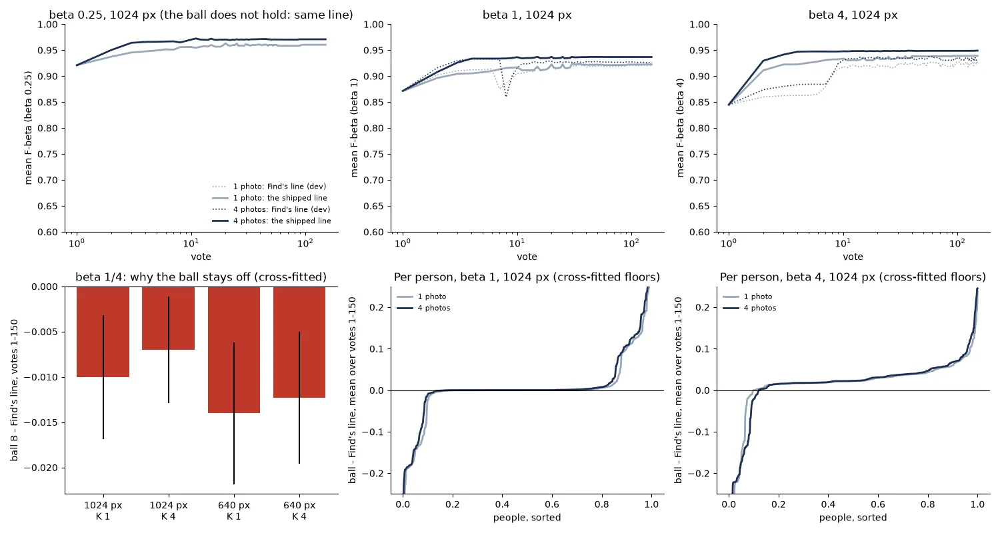

# Face ball line: the Goods' centroid and a cosine floor as Find's line on faces (#5478)

**Status (2026-10-30): shipped in this PR.** The owner's call was to ship the gated form. On face crops, from β 1 up and
once there are two Goods, Find and Test give the Goods' centroid cut at a cosine floor (a "ball"). That replaces the
trained head's line. Below β 1, or with one Good, the face line is #5325's as before. Over a 150-vote session the
ball scores **+0.010 / +0.013 F-beta at β 1** (four starting photos, 1024 / 640 px) and **+0.018 / +0.020 at β 4**.
From one starting photo it scores +0.003 / +0.009 at β 1 and +0.017 / +0.015 at β 4 (paired by person, SE about
0.004). The gain is smaller for she/her people than for he/him at β 1: +0.007 against +0.014 from four photos at
1024 px, and −0.002 against +0.008 from one photo. What Autopilot asks does not change.



*Top: mean F-beta at every vote, 1024 px. Dotted is Find's line on dev, solid is the shipped line. At β ¼ the ball
does not hold, so the two are the same line. Bottom left: why: at β ¼ the ball loses to Find's line in every set.
Bottom middle and right: each person's mean difference over votes 1-150, sorted. At β 1, about a quarter of people
gain, one in eight loses, and the rest are within 0.005.*

## The question

#5474 found, from vectors alone, that the centroid of a person's four starting photos and one cosine floor per balance
scored level with the whole 150-vote session. That ball was never the session's line. #5478 asks what the ball gives
when it *is* the line: centred on the Goods voted so far, at every click, on the same sessions.

## How it was measured: a shadow on the shipped sessions, then the shipped code

The owner chose a shadow arm. The β line does not decide what Autopilot asks: it asks where the head's class model
puts P at 0.5 (`ACQUISITION_TARGET_PRECISION`), which does not read the line. So a ball line leaves every vote as it
is. No session was rerun for the measurement. Each cell of the dev review (#5473's `2026-10-30-5473nodiv-ik`,
which is dev today: 562 people × 2 sizes × K 1/4 × β ¼/1/4, 6,723 sessions) holds its picks. The review's split
(`stratified_split` at the cell's seed) gives the withheld half. At every click, the ball is the unit centroid of the
Goods voted so far, the starting photos included. It keeps the withheld faces whose cosine to it is at least its
floor.

- **Check:** at the 47,100 clicks where Test gives the centroid, the app's own centroid line redrawn this way
  reproduces the cell's F exactly (47,100 of 47,100), and the Goods counted agree at every click.
- **The floors** come from #5474's dumps. A is one floor per β (#5474's `global_one`). B is that floor moved by 0.25 ×
  (spread − 0.637), where the spread is each Good's cosine to the centroid of the others, averaged. That is #5474's
  `adaptive`, fitted over both sizes and two Goods or more. Each person is scored by floors fitted on the other half
  of the people (the cross-fitted numbers below). The pooled fit is what ships: β 1 0.4425, β 4 0.385, slope 0.25,
  centre 0.6371. It is in-sample by three numbers per β, and reads within 0.002 of the cross-fitted fit.
- **The shipped code** (`2fb3b04d3`, frozen tree) ran every session end to end (set `2026-10-30-5478ship-ik`).
  Its picks are dev's in 6,723 of 6,723 sessions, and its F is the replay's at every one of the 1,020,024 clicks
  (`face_ball_line_5478.py ship`). Where the ball keeps no face, the cell writes F with precision blank.

## A and B, against Find's line

Ball − Find's line on dev, cross-fitted, at vote 150, 95% CI in brackets.

| vote 150 | β ¼ A | β ¼ B | β 1 A | β 1 B | β 4 A | β 4 B |
|---|---:|---:|---:|---:|---:|---:|
| 1024 px, K 4 | −0.019 [−.028, −.010] | −0.007 [−.013, −.000] | +0.001 [−.007, +.009] | **+0.010** [+.003, +.018] | +0.004 [−.003, +.011] | **+0.014** [+.007, +.021] |
| 640 px, K 4 | −0.023 [−.032, −.013] | −0.012 [−.020, −.005] | +0.005 [−.004, +.014] | **+0.013** [+.004, +.022] | +0.006 [−.002, +.014] | **+0.015** [+.007, +.023] |
| 1024 px, K 1 | −0.019 [−.029, −.010] | −0.009 [−.016, −.002] | −0.005 [−.013, +.003] | +0.002 [−.006, +.010] | +0.003 [−.003, +.010] | **+0.014** [+.007, +.021] |
| 640 px, K 1 | −0.023 [−.033, −.013] | −0.012 [−.019, −.004] | −0.000 [−.009, +.009] | **+0.011** [+.002, +.020] | +0.003 [−.004, +.010] | **+0.012** [+.005, +.020] |

B, the spread-moved floor, beats one floor everywhere, by about 0.01. That is #5474's static finding, held up in the
session. Neither ball pays at β ¼: there the trained head's line keeps fewer and surer faces than any floor does.

At the opening, one photo is a poor centre. At click 1, A and B are 0.05 to 0.11 below Find's line at β ¼ and 1, and
level to 0.04 below at β 4. This is #5474's K = 1 caveat. With one Good, B has no spread and is A.

## The shipped form

The ball holds from β 1 up once there are two Goods. Otherwise Find's line is dev's. Pooled floors, as shipped:

| shipped − dev | K | β 1, 1024 | β 1, 640 | β 4, 1024 | β 4, 640 |
|---|---:|---:|---:|---:|---:|
| opening (click K) | 4 | +0.001 | +0.000 | **+0.064** | **+0.057** |
| vote 25 | 4 | +0.011 | +0.009 | +0.015 | +0.020 |
| vote 50 | 4 | +0.009 | +0.013 | +0.014 | +0.018 |
| vote 150 | 4 | +0.011 | +0.014 | +0.016 | +0.016 |
| **mean over votes 1-150** | 4 | **+0.010** | **+0.013** | **+0.018** | **+0.020** |
| vote 25 | 1 | +0.001 | +0.006 | +0.017 | +0.015 |
| vote 150 | 1 | +0.002 | +0.011 | +0.016 | +0.014 |
| **mean over votes 1-150** | 1 | **+0.003** | **+0.009** | **+0.017** | **+0.015** |
| people who gain / lose (> 0.005), mean 1-150 | 4 | 24% / 12% | 24% / 13% | 86% / 11% | 85% / 11% |

The SE is 0.003 to 0.005 throughout. Dev's mean F over votes 1-150 is 0.90 to 0.93. The ball keeps a median of 4
faces at vote 150. Its floor sits at a median of 0.45 at β 1 and 0.39 at β 4 (the Goods' spread is about 0.66 to
0.68).

Two things in the top panels are worth naming:

- **The hand-over dip.** On dev, Find's line falls at votes 7-8, when Test hands over from the centroid to the trained
  head on its first Bads. That is the dotted β 1 curve, 0.93 to 0.86 for four photos. The ball spans the hand-over,
  so it has no dip.
- **β 4's early votes.** Before the hand-over, dev's centroid line at β 4 is #5325's count at z 5.5, which under-keeps
  for β 4: 0.86 to 0.88 against the ball's 0.93 to 0.95. That accounts for the opening's +0.06.

## By pronoun

Mean F over votes 1-150, the shipped form against dev (± SE). FHIBE's she/her and he/him people:

| | she/her | he/him |
|---|---:|---:|
| β 1, K 4, 1024 px | +0.007 ± 0.005 | +0.014 ± 0.005 |
| β 1, K 4, 640 px | +0.008 ± 0.006 | +0.018 ± 0.006 |
| β 1, K 1, 1024 px | −0.002 ± 0.006 | +0.008 ± 0.005 |
| β 1, K 1, 640 px | +0.007 ± 0.006 | +0.012 ± 0.006 |
| β 4, K 4, 1024 px | +0.016 ± 0.004 | +0.019 ± 0.004 |
| β 4, K 1, 640 px | +0.009 ± 0.005 | +0.021 ± 0.004 |

Both groups gain in every set but one, where she/her from one photo at 1024 px is level (−0.002 ± 0.006). The gap between them widens by about 0.01 at β 1. This is
#5474's finding again: she/her people's own photos sit lower and further apart (#5325), so one floor costs them more.
The spread term recovers part of it. The owner shipped it knowing this.

## Literal examples

Vote 150, β 1, four starting photos, 1024 px. These are the withheld half's top cosines to the centroid of the Goods
voted by then, with own photos starred and `|` at the ball's floor. Find's line is the trained head's, on its own
scores, so it has no cosine here: its precision and recall stand beside it. FHIBE ids are cut to 8 characters.

**Where the ball loses most:**

- `af8f0142`: 5 Goods, spread 0.57, floor 0.43. Ball F 0.40 (keeps 1); Find's line F 0.86 (P 1.00, R 0.75).
  `0.72* | 0.42* 0.34* 0.31 0.26 0.26 0.26 0.25 0.25 0.25* 0.25 0.24`. This person's photos are not a ball: three of
  four sit among other faces' cosines, and the trained head's fitted direction separates them where the centroid
  cannot.
- `69b20e79`: 4 Goods, spread 0.78, floor 0.48. Ball F 0.67 (keeps 6); Find's line F 1.00.
  `0.81* 0.80* 0.78* 0.61 0.60 0.56 | 0.37 0.34 ...`. Three faces labelled as other people sit at 0.56 to 0.61, far
  above everyone else and between this person's photos and the bulk. **Worth checking as a label error** (the same
  person under two ids). If they are, the ball is right and the label is wrong.
- `49b8483a`: 4 Goods, spread 0.45, floor 0.40. Ball F 0.00 (keeps none); Find's line F 0.33.
  `| 0.38 0.35 0.35 0.34 ...` with no own photo in the top 12. Nothing separates this person; the ball and the head
  both fail.

**Where the ball gains most:**

- `fe2bf46b`: floor 0.47. Ball F 1.00 (keeps 4); Find's line F 0.67 (P 0.50, R 1.00).
  `0.90* 0.86* 0.82* 0.74* | 0.39 0.37 ...`
- `9140c4b5`: floor 0.45. Ball F 0.89 (keeps 5); Find's line F 0.53 (P 0.36, R 1.00).
  `0.74* 0.74* 0.73* 0.69* 0.48 | 0.44 0.44 ...`
- `63f4e858`: floor 0.46. Ball F 1.00 (keeps 4); Find's line F 0.47 (P 0.31, R 1.00).
  `0.82* 0.79* 0.70* 0.56* | 0.41 0.36 ...`

In each of these the gap below the person's photos is wide and the trained head's line falls through it into the
look-alikes. The ball stops at the gap.

## What changed in the app

- `vtscore/detectors/centroid_head.py`: `FACE_BALL_RULE` (`face_ball`) is the face crops' centroid rule. It is the
  ball (`face_ball_floor`: the β 1 and β 4 floors on a line in log β, moved by the spread) when `face_ball_holds`
  (β ≥ 1, two Goods), else `FACE_BALL_BELOW` (#5325's z 5.5 count). The measurement rules `ball<floor>` and
  `ball<floor>_s<slope>_c<centre>` price any ball as a harness line variant. `goods_spread` is the spread, and
  `CentroidLine` keeps it, so a balance change redraws the line.
- `vtscore/detectors/labelset_heads.py`: `face_ball_tier`. Past the quota, a face detector whose ball holds gets the
  Goods' centroid in place of the trained head, in `train_from_labelset` and in a cold Find. A typed query still reads
  the quota's own tier.
- `vtscore/detectors/model_loading.py`: `cached_head_is_current` decides between the two heads at the detector's
  balance. A trained head (the Train view's learned sort stores one) is refused where the ball holds, and a centroid
  past the quota is refused below β 1. A balance change across 1 therefore retrains at the next Find. On face crops
  alone, a label that cannot be resolved now retrains the centroid on each pass.
- The Train view's learned sort, and with it what Autopilot asks, is still the trained head. The example sort's
  display line has no Goods to measure a spread on, so it keeps #5325's line.
- `vtscore/eval/voting_iterations.py` mirrors the tier: Test gives the centroid where the ball holds.

## Caveats

- The floors are cosines in buffalo_s's space (`oss-arcface-mbf:1`), fitted on FHIBE. Another face pack needs its own.
  #5325's z-line adapts to the corpus; a floor does not.
- One seed. People are the replication, and the intervals are over people.
- The pooled floors were fitted on these people. The cross-fitted ones read within 0.002 of them.
- 14% to 17% of people are not separable by any ball (#5474). Those are where the ball loses, as in the first and
  third examples.

## Reproduce

```
# work dir /expscratch/sgreenberg/fhibe/ball-5478 (owner-only: replay rows name people)
bash repo.sh   # fit -> replay -> analyze -> ship -> figures -> examples, in the review's run environment (~20 min)
```

Script: `scripts/experiments/fhibe/face_ball_line_5478.py`. The shipped-code cells are `2026-10-30-5478ship-ik-*`, run
by `cell.sh` on the frozen `vts-5478-run`.
