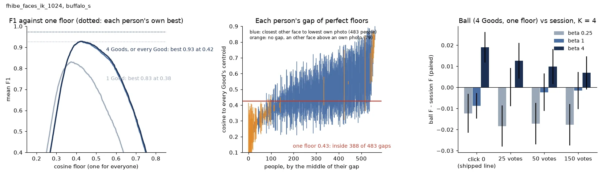

# Face Balls: is finding a person a centre and a radius? — 2026-10-30 (#5474)

**Mostly yes. Take the centroid of a person's four starting photos and cut at one cosine floor that is
the same for everyone: 0.44 at β ¼, 0.41 at β 1, 0.36 at β 4. That alone scores as well as the whole
150-vote session at β 1 (−0.00 at 1024 px, +0.00 at 640 px, paired by person) and better at β 4
(+0.01, +0.01). It is a little worse at β ¼ (−0.02, −0.02). The floor does not depend on crop size, and from
two Goods on it barely depends on how many Goods there are. It does depend on the balance.** People do have
radii of their own, though. The one floor lands inside 80% of the gaps that separate a person from everyone
else, and 14% of people have no such gap at all. A per-person radius picked with the answers would add
another +0.05 at β 1. How tightly the Goods sit around their own centroid recovers a sixth to a third of that.

Measured on buffalo_s (`fhibe_faces_ik_{1024,640}`), #4699's 562 people, the review's own splits and
example draws. No new session ran. The balls are scored from the vectors, and the sessions are #5325's
shipped arm (`2026-10-27-5325z55-ik`).



## A ball is a hyperplane with its normal fixed

On unit vectors, "cosine to the centroid c is at least r" is the half-space c·x ≥ r. So a ball is the
linear head with the normal fixed at the Goods' centroid and the offset fixed at r. The session fits
both, from Goods and Bads. The question is what that fitting buys on faces.

## The answer per question in the issue

| K = 4 sessions (559 / 558 people), F-β on the withheld half | 1024 px | 640 px |
|---|---:|---:|
| **β 1**: session at 150 votes | 0.93 | 0.91 |
| ball, the 4 starting photos, one floor (0.43 / 0.42) − session, paired (95% CI) | −0.00 (−0.01, +0.01) | +0.00 (−0.01, +0.01) |
| ball, the 4 photos, floor moved by the Goods' spread − session | +0.01 (−0.00, +0.01) | +0.01 (+0.00, +0.02) |
| ball, the 4 photos, each person's own best floor (with the answers) − session | +0.05 | +0.05 |
| **β 4**: session at 150 votes | 0.93 | 0.92 |
| ball, one floor (0.39 / 0.38) − session | +0.01 (−0.00, +0.02) | +0.01 (−0.00, +0.02) |
| ball, floor moved by the spread − session | +0.02 (+0.01, +0.02) | +0.02 (+0.01, +0.02) |
| **β ¼**: session at 150 votes | 0.97 | 0.97 |
| ball, one floor (0.49 / 0.47) − session | −0.02 (−0.03, −0.01) | −0.02 (−0.04, −0.01) |
| ball, floor moved by the spread − session | −0.01 (−0.01, −0.00) | −0.01 (−0.02, −0.01) |

The ball here uses only the four photos the session starts from, with no votes. By 25 votes the session has
found 4.2 of the voting half's 4.3 Goods. A ball on every one of them (`K=all` in `vs_session.csv`) scores
within 0.01 of the four-photo ball.

**"Find the centre."** The centroid is most of the work. With all of a person's Goods, 86% (1024 px) and
83% (640 px) of people are perfectly separable by cosine to it: every own photo in the withheld half is
above every other face. From one photo it is 72% and 67%.

**"Find the radius."** A floor fitted on half the people and scored on the other half (`global`) leaves
0.03 to 0.05 of F-β against each person's own best floor at K ≥ 4, at every β and size.

**"Is there a different radius per person?"** Partly. The one floor lands inside 388 of the 483 gaps at
1024 px, β 1 (figure, middle). For 53 of the 562 people the gap sits wholly below the floor: their own
photos are spread out. For 42 it sits wholly above it: someone else's face is close. A further 79 people
have no gap at all. Moving the floor by how close each Good sits to the centroid of the others (the
`adaptive` rule: floor + slope × (spread − median), both fitted on the other half of the people) closes
a sixth to a third of the gap to the own-radius bound: +0.01 at K = 4.

**"Is there a global close-enough radius?"** Yes, per balance. A single floor fitted across both sizes and
every K (`global_one`: 0.44, 0.41, 0.36) is within 0.01 of the floor fitted per size and K, from K = 2 up.
The floor must drop as β rises, because β 4 pays for recall.

| one floor for every size and K (cross-fitted) | β ¼ | β 1 | β 4 |
|---|---:|---:|---:|
| cosine floor | 0.44 | 0.41 | 0.36 |
| F-β at K = 4, 1024 / 640 px | 0.95 / 0.95 | 0.93 / 0.91 | 0.94 / 0.93 |
| people perfect at it, K = 4, 1024 px | 68% | 66% | 45% |

## Where the ball is not enough

- **One starting photo.** The K = 1 ball wants a lower floor (0.38 at β 1, 0.32 at β 4) and scores 0.07 to
  0.10 below the session at 150 votes. One photo is a poor centre. At click 0 its floor is level with the shipped
  z5.5 line: −0.03 / −0.02 at β 1 and +0.01 at β 4. The session earns its keep here by finding the other Goods. Once
  it has them, the ball on them is level with the session (as above).
- **People who are not a ball.** For 14% to 17% of people some other face sits above one of their own
  photos, even with every Good in the centroid. A fixed normal cannot fix that. This study does not measure
  whether the session's fitted normal does any better for them.
- **She/her.** Own floors sit lower for she/her people (median 0.46 against 0.50 at K = 4, β 1, 1024 px),
  so one floor costs them more: ball F 0.91 against 0.94 for he/him, while the own-radius bound is 0.96
  against 0.98. The session's pronoun gap on the same cells was not recomputed here.

Literal examples (top 10 cosines of the withheld half to every Good's centroid, own photos starred) are in
`examples.md`. For instance, `d2024347`'s four own photos sit at 0.88–0.78 and the next face is at 0.49.
That is a clean ball whose gap sits wholly above the one floor of 0.43, where six other faces between 0.45 and
0.49 get in.

## Caveats

- The floors are cosines in buffalo_s's space (`oss-arcface-mbf:1`), fitted on FHIBE: about 10,000 faces of
  about 2,000 adults. Another face pack, or a corpus with relatives or
  near-twins, needs its own fit. #5325's z-line adapts to the corpus. A cosine floor does not.
- The session numbers are #5325's arm, which predates #5413 and #5409. Those changes move only β 4 for
  the 51 hard-face people (+0.05 F after the session on them, so about +0.005 over everyone). That would
  roughly halve the ball's β 4 edge.
- The intervals are ±1.96 SE over people (one seed: people are the replication). The floors are
  cross-fitted over two folds by person, so no person is scored by a floor fitted on them.

## Files and reproduce

- `summary.csv`: per size × K (1, 2, 3, 4, all) × β × rule (`oracle`, `global`, `global_anyk`, `global_one`,
  `adaptive`): the floor (median, IQR), precision, recall, F-β, the gap to `oracle` (± SE), the share of
  people perfect at the rule, the share separable, and the share whose gap holds the floor.
- `vs_session.csv`: ball against the session paired by person, at the session's opening (click 0) and at
  25, 50 and 150 votes, for K = 1 and 4 sessions, with the share of people where the ball wins or loses
  by more than 0.005.
- `examples.md`, `balls.webp`.

```
# work dir /expscratch/sgreenberg/fhibe/balls-5474 (owner-only: dumps, cells.csv name people)
bash dump.sh    # face_balls_5474.py dump in the 2026-10-27-5325z55-ik k1-b1 run environment (~2 min)
bash price.sh   # price + compare against <runs>/2026-10-27-5325z55-ik-analysis
bash post.sh    # compare, figure, examples
```

Script: `scripts/experiments/fhibe/face_balls_5474.py` (`dump`, `price`, `compare`, `figure`, `examples`).
