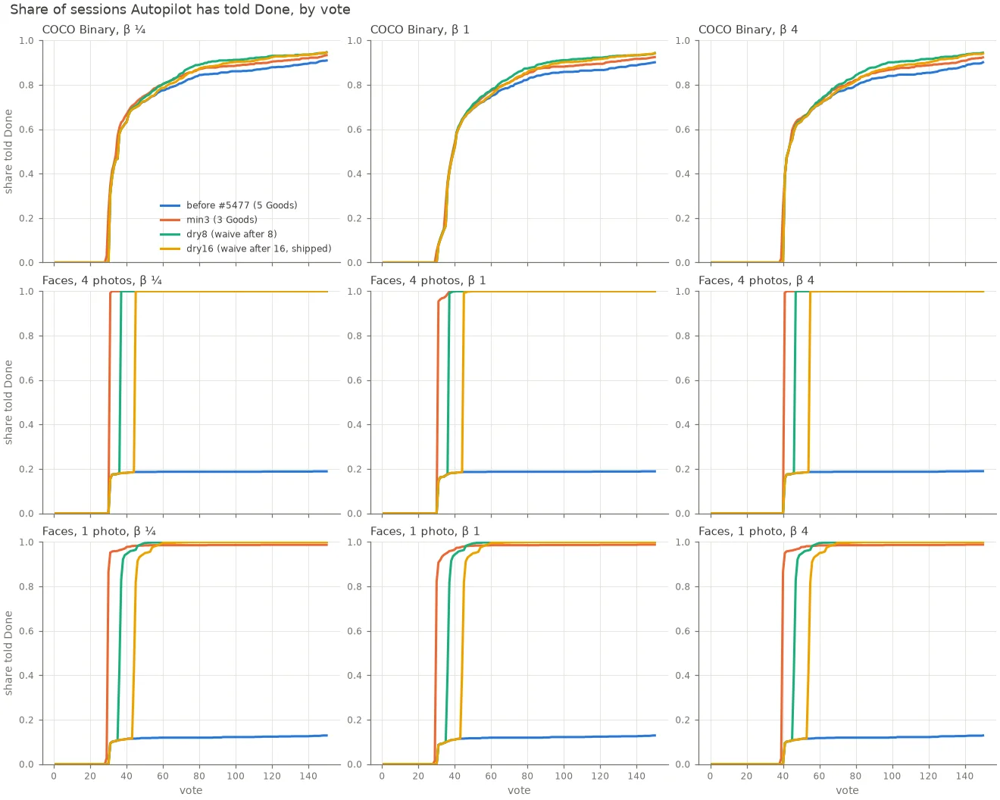
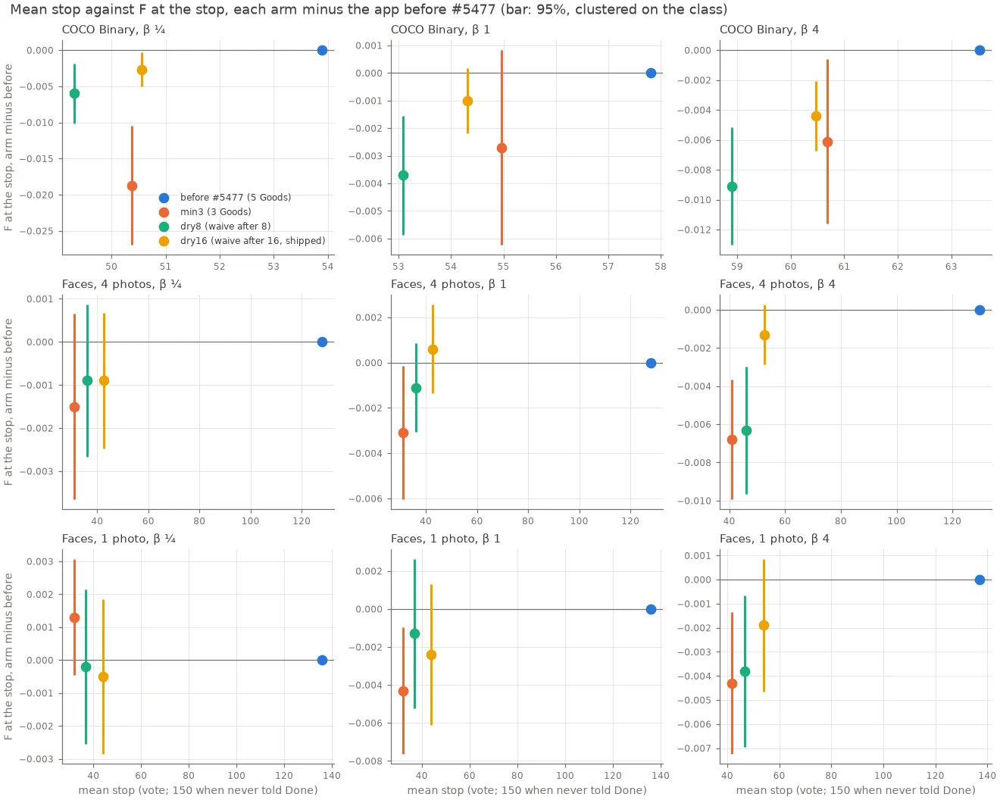

# Most face sessions are never told to stop: Smart and Stable need 5 Goods (#5477)

**Status (2026-10-30): shipped in this PR, as `dry16`.** Smart and Stable stayed red until a session held 5 Goods (`MIN_PER_CLASS`), so a target with only 3 or 4 to find never reached Done. That was 81% of FHIBE sessions with 4 starting photos and 87% with 1. Now, once **16 votes in a row past the opening held no Good**, the two lights judge the detector on the Goods in hand. On faces, the share of sessions told Done goes from 13–19% to ~100%, at a mean vote of 42–54 instead of ~130. F at the stop is unchanged: every Δ is between −0.0024 and +0.0006, each inside two standard errors. On COCO, Done comes about 3 votes sooner at 0.001 to 0.004 lower F. Of the three arms, this one costs COCO the least.

## The question

Done waits on the Smart and Stable lights (Span is green by default since #5473), or on the labels line's level route (#4878). Both lights are red below `MIN_PER_CLASS` = 5 Goods or 5 Bads (`vtscore/detectors/stability.py`). On faces the level route never fires, because the head's count line serves all session. So a face session with fewer than 5 Goods in reach has no route to Done at all. In #5473's runs, 81% (4 photos) and 87% (1 photo) of sessions were never told to stop. Should the lights' minimum follow what the target can supply, or should Done get a route that doesn't need 5 Goods? And does the change stop COCO sessions too early, where Goods are plentiful?

## The arms

Two harness knobs (`simulate_voting_iterations`, env `CALIB_MIN_GOOD` and `CALIB_HARD_DRY_RUN`, declared by preflight). The shared rules (`stable_status_from_entries`, `rising_status_from_scores`) take a `min_good` keyword, so the app and the harness cannot disagree about what it means.

| arm | rule |
|---|---|
| `ctl` | the app before #5477: the lights need 5 Goods |
| `min3` | the lights need 3 Goods (Autopilot's Good target), always |
| `dry8` | once 8 votes in a row past the opening held no Good, the lights need only the Goods in hand (latched) |
| `dry16` | the same after 16, the Good walk's own dry run (`MORE_DRY_RUN`) |

"Past the opening" means Boundary, Diversity, or a spot check. The Good, Bad and More phases don't count, since the Bad phase picks Bads on purpose. Any Good resets the run.

Paired runs, 150 votes, β ¼, 1 and 4, all four arms on the same cells and seeds:

| bench | sessions per β and arm | launcher | run dirs |
|---|---:|---|---|
| COCO Better Binary (SigLIP) | 720 (144 cells × 5 seeds) | `scripts/experiments/state_of_app/min_goods_5477.sh` | `state-of-the-app/2026-10-30-mingood5477-{ctl,min3,dry8,dry16}-b*` |
| FHIBE faces, 4 starting photos | 1,117 (562 people × 2 sizes, less the 7 person-sizes with too few photos to open with 4, as in #5473) | `fhibe/sota_face.sh`, `SOTA_FACE_TAG=5477<arm>` | `fhibe/.../runs/2026-10-30-5477<arm>-ik-k4-b*` |
| FHIBE faces, 1 starting photo | 1,124 | the same | `...-ik-k1-b*` |

The objective is F-beta of the withheld half above Find's line, at the session's β (#4776's reader). **The stop** is the first vote Autopilot says Done, or 150 when it never does. Standard errors are paired and clustered on the class (the COCO category, the FHIBE person). **Pairing check:** a pair's picks may differ only from the first vote where the two arms' phases differ. No pair, of either bench in any arm, departs earlier.

Analysis: `scripts/experiments/state_of_app/min_goods_5477.py`; figures `min_goods_5477_figures.py`.

## Results

### Faces: every arm stops the sessions, dry16 at the same F

| set | β | told Done, before → min3 / dry8 / dry16 | mean stop, before → min3 / dry8 / dry16 | F at the stop, before | Δ F min3 | Δ F dry8 | Δ F dry16 |
|---|---:|---|---|---:|---:|---:|---:|
| 4 photos | ¼ | 19% → 100 / 100 / 100% | 128 → 31 / 36 / 42 | 0.97 | −0.0015 ± 0.0011 | −0.0009 ± 0.0009 | −0.0009 ± 0.0008 |
| 4 photos | 1 | 19% → 100 / 100 / 100% | 128 → 31 / 36 / 43 | 0.92 | −0.0031 ± 0.0015 | −0.0011 ± 0.0010 | +0.0006 ± 0.0010 |
| 4 photos | 4 | 19% → 100 / 100 / 100% | 130 → 41 / 46 / 52 | 0.93 | −0.0068 ± 0.0016 | −0.0063 ± 0.0017 | −0.0013 ± 0.0008 |
| 1 photo | ¼ | 13% → 99 / 100 / 100% | 136 → 32 / 37 / 44 | 0.96 | +0.0013 ± 0.0009 | −0.0002 ± 0.0012 | −0.0005 ± 0.0012 |
| 1 photo | 1 | 13% → 99 / 100 / 100% | 136 → 32 / 37 / 44 | 0.91 | −0.0043 ± 0.0017 | −0.0013 ± 0.0020 | −0.0024 ± 0.0019 |
| 1 photo | 4 | 13% → 99 / 100 / 100% | 137 → 42 / 47 / 54 | 0.92 | −0.0043 ± 0.0015 | −0.0038 ± 0.0016 | −0.0019 ± 0.0014 |

- **The sessions that were never told Done** (ctl under 5 Goods: 905 of 1,117 with 4 photos, 979 of 1,124 with 1) are the change. With `dry16` they stop at a median vote of 45. The F they have there is the F they would have had at vote 150: Δ F is −0.0025 to +0.0008, and F still to come after the stop is at most 0.001. The dry run latches at a median vote of 24, and the check before Done takes the votes after that.
- **The sessions that already reached 5 Goods** stop at most a few votes sooner under `dry16` (40 → 34 with 1 photo at β 1), and their F at the stop does not move (every Δ is inside two SEs).
- **`min3` and `dry8` stop sooner but cost more at β 4**: −0.0068 and −0.0063 with 4 photos, against −0.0013 for `dry16`.

### COCO: the check the issue asked for

| β | told Done by 150, before → min3 / dry8 / dry16 | mean stop, before → min3 / dry8 / dry16 | F at the stop, before | Δ F min3 | Δ F dry8 | Δ F dry16 |
|---:|---|---|---:|---:|---:|---:|
| ¼ | 91% → 93 / 95 / 95% | 54 → 50 / 49 / 51 | 0.61 | −0.019 ± 0.0042 | −0.0060 ± 0.0021 | −0.0027 ± 0.0012 |
| 1 | 90% → 92 / 94 / 94% | 58 → 55 / 53 / 54 | 0.49 | −0.0027 ± 0.0018 | −0.0037 ± 0.0011 | −0.0010 ± 0.0006 |
| 4 | 90% → 92 / 94 / 94% | 64 → 61 / 59 / 60 | 0.56 | −0.0061 ± 0.0028 | −0.0091 ± 0.0020 | −0.0044 ± 0.0012 |

- **`min3` stops COCO too early at β ¼.** 21% of its sessions end more than 0.05 worse, against 11% better.
- **The cost falls on COCO sessions that do reach 5 Goods** (91% of them). Each arm can let the lights read the detector while the session still holds 3 or 4 Goods, before the 5th arrives, so Done comes a few votes sooner. Under `dry16` this costs −0.0025 ± 0.0017 at β ¼ (stop 45 → 43). The 9% of COCO sessions that never reach 5 Goods are now told Done 41–42% of the time under `dry16`, where none were before.
- **F at vote 150 is unchanged in every arm** (|Δ| ≤ 0.0015), so the arms change when a session stops, not where it ends up.

### Literal examples

**FHIBE person `0dfac3de`, 640 px, 1 photo, β 1.** The session holds 3 Goods.
- **Before:** Boundary to vote 150, never told Done. F 0.62 at 150.
- **dry16:** the same picks to vote 23. There the dry run has latched (16 picks past the opening without a Good), Smart and Stable read the Goods in hand and turn green, the check before Done runs, and Done comes at **44**. F 0.62, the same as 150 votes would give.

FHIBE person `002b6487` (1024 px, 4 photos, β 1) is the same story: never told Done before, Done at 45 with F 1.0.

**COCO `bird@small`, seed 3, β ¼: the cost.** Before, the session is told Done at vote 97 with F 0.36, holding 9 Goods by then. Under `dry16` the phases part at vote 37, with the dry run latched while the session held fewer than 5 Goods (the waiver changes nothing at 5), and Done comes at **58** with F 0.0. Of 720 COCO sessions at β ¼, 2.5% end more than 0.05 worse under `dry16` and 1.3% more than 0.05 better.

## What it means

- **The minimum should follow what the target can supply, and a dry run tells you what that is.** A fixed lower minimum (`min3`) treats every target as scarce and costs COCO 0.019 at β ¼. The dry run waives the minimum only once the learned sort has shown it is out of Goods.
- **16 is the right length.** It is the cheapest on COCO in every β, and on faces it is within one SE of the others' F while stopping 11–12 votes later than `min3`. Those votes buy F at β 4 (−0.0013 against −0.0068).
- **Shipped:** the app reads the run off the label history and each vote's provenance (`labeling_progress.hard_ran_dry`). Autopilot's Boundary and Diversity picks and spot-check votes count; votes in the opening or by hand do not. The rule lives in `stability.HardDryRun` and `goods_minimum`, which the harness's phase machine feeds too. The harness default follows (`HARD_DRY_RUN` = 16; `hard_dry_run=0` is the app before #5477, and `min_goods_5477.sh`'s `ctl` arm sets it). After Done, the app records a vote as list review, so the harness counts the run only in `hard`, `new` and `spot`. That changes nothing before the first Done, which is where every number above is read.

The data tables (`mingood_5477_summary.csv`, `mingood_5477_curves.csv`, `mingood_5477_per_run.csv`) are on the `experiments-data` release (`archived-data.json`). Put them back with `python scripts/experiments/study_data.py fetch 2026-10-30-min-goods-5477`.
