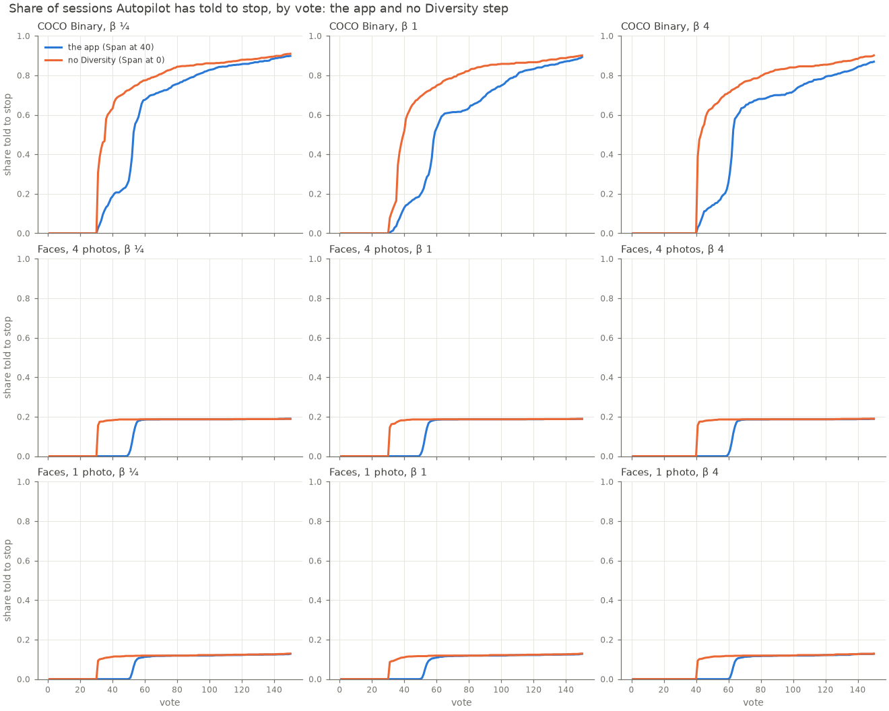
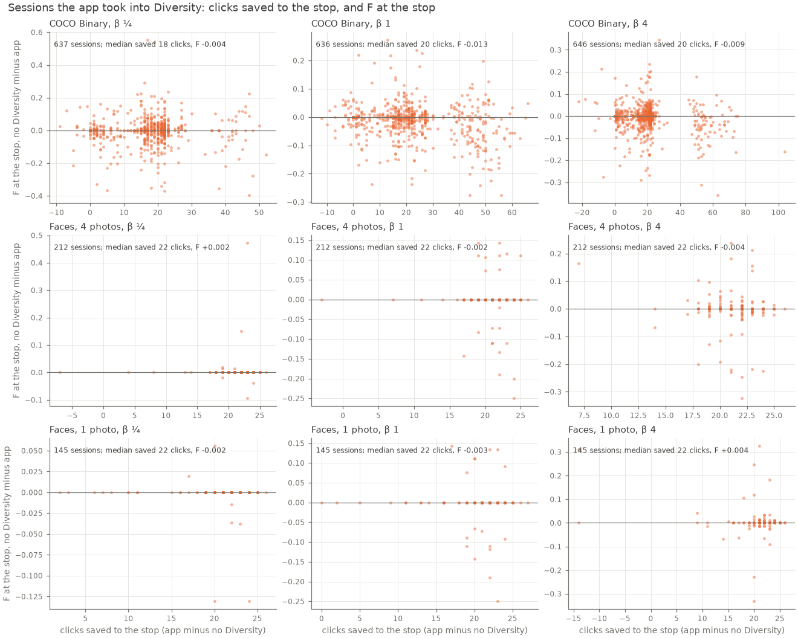
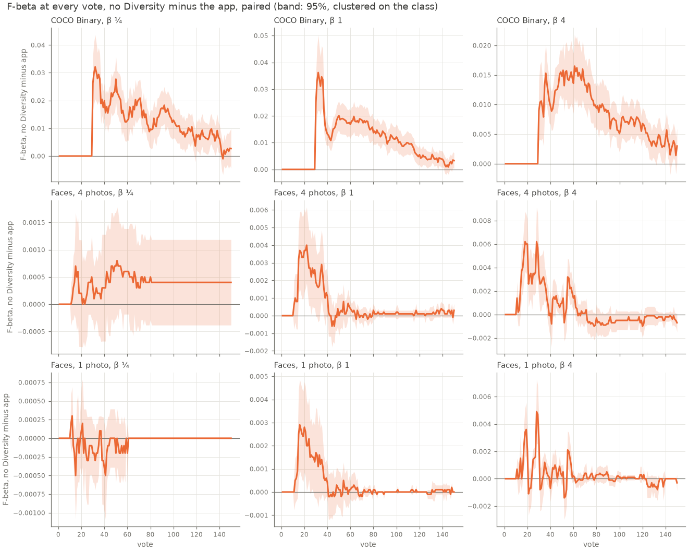

# Skip Autopilot's Diversity step? (#5473)

**Status (2026-10-30): shipped in this PR.** The owner chose to skip the step everywhere: `autopilot_goal_diversity` now defaults to 0, and any positive goal (40 was the default) turns it back on, since what it is worth depends on the embedder and the data. Without the Diversity step, Autopilot tells a session to stop about 20 clicks sooner, on faces and on COCO alike. On faces the detector it stops with is as good: F at the stop moves by less than 0.005 in every set, inside its standard error. On COCO it is slightly worse at the stop, by 0.004 to 0.012. The cause is the earlier stop, not the picks: at the same click count, no Diversity is ahead at every vote, by +0.009 to +0.034 at its own stop and by +0.017 to +0.021 at the app's.

## The question

Autopilot's phases run Good → Bad → Hard → **New** (Diversity, the Coverage Atlas walk) → Spot (the check) → Done. Done waits on three lights: Smart, Stable and Span. Span is green once the atlas has `autopilot_goal_diversity` (40) evidence-bearing nodes, and New is the phase that walks the atlas to light it. The owner's hunch: a person is one convex blob in face space, so Diversity buys nothing on faces and maybe nothing on semantic search either. Does skipping it stop sooner, and is the detector at that stop worse?

Earlier arms kept the gate. #4671's `nowalk` swapped the atlas picks for Hard picks but left Span gating Done, and #4739 showed that without the walk Span never greens, so Done comes only by the labels line's level route. This study removes the gate instead.

## The arm

The harness gets `span_green` (`vtscore/eval/voting_iterations.py`, env `CALIB_SPAN_GREEN`, declared by preflight). `None` keeps the app's 40. **`0` reads Span green from the first vote**, so Autopilot never enters New: once Smart and Stable are green it goes straight to the spot check, and Done follows as it does today. The app clamped its own setting to at least 1 when this ran, which the first vote meets, so `autopilot_goal_diversity = 1` was this arm in the app; as shipped, 0 is allowed and is the default.

Paired runs, the app (`ctl`) against no Diversity (`nodiv`), same cells and seeds, 150 votes, β ¼, 1 and 4:

| bench | sessions per β and arm | launcher | run dirs |
|---|---:|---|---|
| COCO Better Binary (SigLIP) | 720 (144 cells × 5 seeds) | `scripts/experiments/state_of_app/skip_diversity_5473.sh` | `state-of-the-app/2026-10-30-nodiv5473-{app,nodiv}-b*` |
| FHIBE faces, 4 starting photos | 1,117 (562 people × 2 sizes, less 7 person-sizes with only 3 Goods in the voting half, which cannot open with 4; the same 7 in both arms) | `fhibe/sota_face.sh`, `SOTA_FACE_TAG=5473ctl/5473nodiv` | `fhibe/.../runs/2026-10-30-5473{ctl,nodiv}-ik-k4-b*` |
| FHIBE faces, 1 starting photo | 1,124 | the same | `...-ik-k1-b*` |

The objective is F-beta of the withheld half above Find's line, at the session's β (#4776's reader: check rows left out, carried between rows). **The stop** is the first vote Autopilot says Done, or 150 when it never does. Standard errors are paired and clustered on the class (the COCO category, the FHIBE person). **Pairing check:** a pair's picks may differ only from the app's first New vote on. 2, 5 and 6 of 720 COCO pairs depart earlier (by tie order), and no face pair does.

Analysis: `scripts/experiments/state_of_app/skip_diversity_5473.py`, figures `skip_diversity_5473_figures.py`.

## Results

### How often the step runs

| bench | sessions the app takes into New | first New vote (median) | votes in New (mean) | told to stop by 150, app → no Diversity |
|---|---:|---:|---:|---|
| COCO Binary | 88–90% | 11–13 | 17–18 | 87–89% → 90–91% |
| Faces, 4 photos | 19% | 10 | 21 | 19% → 19% |
| Faces, 1 photo | 13% | 10 | 21 | 13% → 13% |

The faces' 81–87% that never enter New are never told to stop at all, with either arm; see *Faces that are never told to stop* below. **The arm can change only the sessions that enter New**, and every other session is identical vote for vote.

### The stop, and the detector there

Sessions the app took into New, no Diversity minus the app (all sessions in the last column):

| bench | β | sessions | mean stop, app → no Diversity | F at the stop, app | Δ F at the stop | Δ F at the stop, all sessions |
|---|---:|---:|---|---:|---:|---:|
| COCO Binary | ¼ | 637 | 61 → 45 | 0.67 | −0.0041 ± 0.0037 | −0.0036 ± 0.0033 |
| COCO Binary | 1 | 636 | 70 → 49 | 0.55 | −0.013 ± 0.0027 | −0.012 ± 0.0025 |
| COCO Binary | 4 | 646 | 76 → 55 | 0.62 | −0.0087 ± 0.0029 | −0.0078 ± 0.0026 |
| Faces, 4 photos | ¼ | 212 | 54 → 33 | 0.97 | +0.0024 ± 0.0040 | +0.0005 ± 0.0005 |
| Faces, 4 photos | 1 | 212 | 55 → 33 | 0.93 | −0.0024 ± 0.0034 | −0.0005 ± 0.0005 |
| Faces, 4 photos | 4 | 212 | 64 → 43 | 0.92 | −0.0038 ± 0.0045 | −0.0007 ± 0.0009 |
| Faces, 1 photo | ¼ | 145 | 60 → 39 | 0.95 | −0.0019 ± 0.0017 | −0.0002 ± 0.0002 |
| Faces, 1 photo | 1 | 145 | 61 → 40 | 0.91 | −0.0031 ± 0.0043 | −0.0004 ± 0.0005 |
| Faces, 1 photo | 4 | 145 | 70 → 49 | 0.92 | +0.0039 ± 0.0047 | +0.0005 ± 0.0005 |

- **About 20 clicks sooner on every bench.** That is a third of the clicks to the stop on faces (54 → 33) and a quarter on COCO (70 → 49 at β 1).
- **Faces: no loss.** Every Δ is inside two standard errors, and the per-session spread is symmetric. At β 1 with 4 photos, 5.2% of sessions end more than 0.05 worse and 4.3% more than 0.05 better.
- **COCO: a small loss at the stop**, significant at β 1 and β 4. At β 1, 20% of the sessions end more than 0.05 worse and 9.4% more than 0.05 better.

### The same clicks: Diversity's picks are the weaker ones

Read both arms at the same vote and no Diversity is ahead. Its Hard picks teach the detector more than the atlas walk does (#4671 found the same: +0.009 / +0.007 / +0.003):

| bench | β | Δ F at vote 50 | Δ F over votes 1–150 | Δ F at vote 150 | both at no Diversity's stop | both at the app's stop |
|---|---:|---:|---:|---:|---:|---:|
| COCO Binary | ¼ | +0.028 ± 0.0042 | +0.011 ± 0.0012 | +0.0027 ± 0.0036 | +0.034 ± 0.0055 | +0.017 ± 0.0041 |
| COCO Binary | 1 | +0.020 ± 0.0028 | +0.010 ± 0.0010 | +0.0033 ± 0.0015 | +0.030 ± 0.0050 | +0.021 ± 0.0030 |
| COCO Binary | 4 | +0.015 ± 0.0021 | +0.0072 ± 0.0008 | +0.0030 ± 0.0015 | +0.0086 ± 0.0020 | +0.017 ± 0.0028 |
| Faces, 4 photos | 1 | +0.0000 ± 0.0006 | +0.0006 ± 0.0002 | +0.0003 ± 0.0002 | +0.0020 ± 0.0009 | −0.0000 ± 0.0004 |
| Faces, 1 photo | 1 | +0.0001 ± 0.0004 | +0.0003 ± 0.0001 | +0.0000 ± 0.0000 | +0.0015 ± 0.0009 | −0.0004 ± 0.0003 |

(Face rows at β ¼ and 4 match β 1 to within 0.002; all of them are in `nodiv_5473_summary.csv`.)

So on COCO the shortfall at the stop is the stop rule firing sooner, not a weaker detector. Had no Diversity kept clicking to the app's stop, it would have ended +0.017 to +0.021 ahead. The app's 20 New votes act as a floor on effort: on COCO, Smart and Stable are typically both green by vote 11 (6 Goods, 5 Bads), so without New the spot check alone stands between the session and Done.

On COCO both arms carry the same F from vote 10 to about vote 30 (the line holds its early value), so the curves cannot part before then.

### Literal examples

**FHIBE person `00513479`, 1024 px, 4 photos, β 4.**
- **The app:** Hard to vote 10, New for 22 votes, then the spot check, Done at **63** with F 0.99.
- **No Diversity:** Hard to vote 10, the spot check from vote 11, Done at **41** with F 0.99.

Persons `16065dbd` and `19206a73` are the same story: stop 63 → 41 at the same F. `0f227ea5` stops at 41 with F 0.97 against the app's 0.99 at 63.

**COCO `airplane@large`, seed 0, β 1.**

| vote | app phase | app F | no-Diversity phase | no-Diversity F |
|---:|---|---:|---|---:|
| 10 | hard (6 Goods, 4 Bads) | 0.83 | hard | 0.83 |
| 11 | new (Smart, Stable green; Span red) | 0.83 | spot (all three green) | 0.83 |
| 31 | new | 0.30 | spot check | 0.74 |
| 37 | spot check | 0.35 | **done** | 0.76 |
| 58 | **done** | 0.70 | done | 0.88 |

The app reaches Done 21 clicks later with a weaker detector than no Diversity had at its own Done. Seed 1 of the same cell goes the other way: the stop moves from 59 to 39 and F at the stop from 0.95 to 0.92.

### Faces that are never told to stop

On faces, 81% of 4-photo sessions and 87% of 1-photo sessions are never told to stop, in either arm. Smart and Stable are red at every vote, because both need `MIN_PER_CLASS` = 5 Goods (`vtscore/detectors/stability.py`). Most FHIBE people have only 3 or 4 Goods within a session's reach, so it never gets to 5. In a sample of 100 sessions at β 1 with 1 photo:

| Goods by vote 150 | sessions | told to stop |
|---:|---:|---:|
| 3 | 40 | 0 |
| 4 | 48 | 0 |
| 5 | 12 | 12 |

Diversity does not cause this, and skipping it does not fix it. It is a separate issue: #5477.

## What it means

- **Faces:** the owner's hunch holds. Diversity spends about 21 clicks and buys nothing measurable in the detector a session stops with.
- **COCO (semantic search):** Diversity is a poor way to spend clicks, and Hard picks beat it at every vote. Its one use is that it delays Done by about 20 votes, which buys about 0.004 to 0.012 F at the stop. A fixed effort floor spent on Hard picks would buy more (+0.017 to +0.021 at the same stop). That rule is untested; this run only shows what no Diversity had at the app's stop vote.
- **Shipped:** `autopilot_goal_diversity` defaults to 0 (clamped ≥ 0), which reads Span green, so Done waits on Smart and Stable and the Autopilot panel leaves the step out. The harness follows (`SPAN_GREEN_DEFAULT` = 0, `SPAN_GREEN_ON` = 40). A positive goal turns the step back on, in the app's Settings or with `CALIB_SPAN_GREEN=40` in the harness.

The data tables (`nodiv_5473_summary.csv`, `nodiv_5473_curves.csv`, `nodiv_5473_per_run.csv`) are on the `experiments-data` release (`archived-data.json`). Put them back with `python scripts/experiments/study_data.py fetch 2026-10-30-skip-diversity-5473`.
