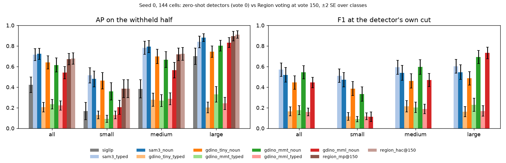
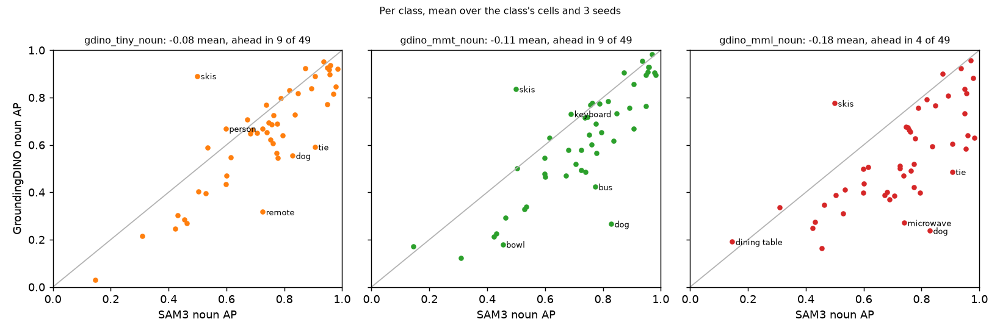

# GroundingDINO's zero-shot text prompt on Region Photo: below SAM3, and only with bare nouns (issue #5395)

**Status (2026-10-31): zero-shot only, three GroundingDINO checkpoints that never trained on COCO, on every image of
#4711's grid (COCO Better, 24,507 images, 144 class x band cells). Graded exactly as #5213 graded SAM3: each cell's
own pool and withheld half, against SigLIP's typed sort and #4711's Region arms. Nothing ships from this PR. The
follow-up is filed as an issue.**

**GroundingDINO is a usable zero-shot ranker, but SAM3 is better on every measure that matters, and GroundingDINO
is not cheaper per new query.**

1. **Best checkpoint, best prompt:** the original GroundingDINO-T with a bare noun ("frisbee") ranks at AP **0.64**,
   against **0.72** for SAM3's noun prompt (-0.082 ± 0.017, SAM3 ahead in 40 of 49 classes) and **0.42** for
   SigLIP's typed sort (+0.22 ± 0.025, ahead in 45 of 49).
2. **Against Region after 150 votes (seed 0, paired by cell):** 0.64 vs 0.67 for `max_patch` (-0.033 ± 0.016). Region
   passes it at vote 82 (`max_patch`) or 68 (the HAC tree). Region never passes it on small objects; on large ones it
   does by vote 3-7. SAM3, by contrast, holds off Region on small and medium objects through 150 votes.
3. **The typed prompts collapse.** The text every cell opens on ("a frisbee", "a person wearing a necktie") scores AP
   **0.21-0.23** on every checkpoint, below SigLIP's 0.42. "a frisbee" scores 0.07 and "frisbee" 0.92; "a baseball
   bat" 0.04 and "baseball bat" 0.90. The article in the caption does it, not the scoring (see
   [Prompt wording](#prompt-wording)). SAM3 reads both sets alike (0.72 / 0.72).
4. **The bigger checkpoint is worse here.** MM-GDINO-L (COCO zero-shot mAP 53.0 on its model card, against 48.4 and
   50.4 for the two tiny ones) ranks at AP **0.54**: 0.20 on small objects against 0.46 for GroundingDINO-T. The
   transformers port scores small objects low on its own one-prompt path as well, so it is the checkpoint as
   shipped, not this pipeline (see [MM-GDINO-L and small objects](#mm-gdino-l-and-small-objects)).
5. **At its own cut, MM-GDINO-T matches SAM3's operating point.** Keeping an image when a detection scores over 0.35
   (GroundingDINO's box threshold) gives MM-GDINO-T **F1 0.55** (precision 0.58, recall 0.60), level with SAM3's noun
   prompt at 0.5 (0.52; +0.022 ± 0.022) and just under SAM3's typed prompt (0.57). GroundingDINO-T at 0.35 is 0.45:
   it keeps too much (precision 0.36).
6. **Cost:** all 102 prompts over the pool take **~2 GPU-h** on V100 for either tiny checkpoint (packed captions),
   against ~12 for SAM3. But that is because one caption carries ~50 prompts. A single new query costs a full pass of
   GroundingDINO's text-image fusion and decoder per image, ~130 ms on V100, which a feature cache cannot remove:
   **~53 min on one V100** for this pool, against ~7 min for SAM3 with its backbone cached (see [Cost](#cost)).

**Training overlap: checked, and it does not explain anything.** All three checkpoints train on GoldG, which holds
GQA's Visual Genome images, and those are COCO images: 41.5% of this pool (#5240's split). Graded apart, no
checkpoint ranks the images it trained on better (difference-in-difference against SigLIP: -0.008 ± 0.011,
-0.002 ± 0.010 and +0.006 ± 0.009 for the noun prompts). See [Training overlap](#training-overlap).

| seed 0, mean over cells (± SE over classes) | all (144) | small (46) | medium (49) | large (49) |
|---|---|---|---|---|
| **AP**, SigLIP typed sort (vote 0) | 0.42 (± 0.04) | 0.17 | 0.38 | 0.70 |
| **AP**, SAM3 noun prompt (#5213) | **0.72** (± 0.03) | **0.48** | **0.79** | **0.88** |
| **AP**, GroundingDINO-T noun | 0.64 (± 0.03) | 0.46 | 0.70 | 0.75 |
| **AP**, MM-GDINO-T noun | 0.62 (± 0.03) | 0.36 | 0.67 | 0.80 |
| **AP**, MM-GDINO-L noun | 0.54 (± 0.03) | 0.20 | 0.57 | 0.83 |
| AP, GroundingDINO-T / MM-T / MM-L typed | 0.21 / 0.23 / 0.22 | 0.13 / 0.09 / 0.13 | 0.28 / 0.27 / 0.29 | 0.20 / 0.33 / 0.24 |
| AP, Region `max_patch` / `hac` at vote 150 | 0.67 / 0.68 | 0.39 / 0.38 | 0.72 / 0.72 | 0.90 / 0.91 |
| Oracle F1, SAM3 noun / GDINO-T / MM-T / MM-L noun | 0.73 / 0.64 / 0.62 / 0.56 | 0.56 / 0.50 / 0.41 / 0.27 | 0.78 / 0.69 / 0.66 / 0.59 | 0.85 / 0.72 / 0.78 / 0.80 |
| **F1 shown**, SAM3 typed / noun, score > 0.5 | **0.57** / 0.52 | 0.51 / 0.47 | 0.59 / 0.54 | 0.60 / 0.55 |
| **F1 shown**, GDINO-T / MM-T / MM-L noun, score > 0.35 | 0.45 / **0.55** / 0.45 | 0.39 / 0.33 / 0.11 | 0.46 / 0.60 / 0.47 | 0.49 / 0.69 / **0.73** |
| F1 shown, SigLIP typed set (app's line) | 0.37 | 0.16 | 0.35 | 0.58 |
| Vote at which Region's AP reaches GDINO-T noun's (`mp` / `hac`) | 82 / 68 | never | 82 / 74 | 3 / 7 |

*Zero-shot rows are seed 0, to pair with #4711's Region arms (seed 0 only); over seeds 0-2 every zero-shot mean moves
by under 0.005. Every cell is in `tables/gdino_5395_per_cell.csv`, paired gains in `tables/gdino_5395_paired.csv`,
crossover votes for every arm and band in `tables/gdino_5395_crossover.csv`, per class in
`tables/gdino_5395_per_class_AP.csv`.*

## The question

#5395 asked how GroundingDINO does as a zero-shot text-query baseline, now that #5213 showed SAM3 out-ranks SigLIP's
typed sort and 150 Region votes. This study repeats #5213's setup with GroundingDINO in SAM3's place: every image of
the grid, both prompt sets, the same grading, the same training-overlap check (#5240), and cost.

## Setup

- **Checkpoints** (transformers 5.19 ports, `AutoModelForZeroShotObjectDetection`). The pool is COCO train2017, so
  only checkpoints that never trained on COCO are in:
  - **GroundingDINO-T** `IDEA-Research/grounding-dino-tiny` (Swin-T; O365, GoldG, Cap4M; COCO zero-shot 48.4);
  - **MM-GDINO-T** `openmmlab-community/mm_grounding_dino_tiny_o365v1_goldg_v3det` (Swin-T; O365, GoldG, V3Det; 50.4);
  - **MM-GDINO-L** `openmmlab-community/mm_grounding_dino_large_o365v2_oiv6_goldg` (Swin-L; O365v2, OpenImages v6,
    GoldG; 53.0).

  Left out: `grounding-dino-base` and the MM `*_all` checkpoints, which trained on COCO.
- **Prompts:** #5213's, unchanged. `typed` is the text every cell opened on (SigLIP's string). `noun` is a short
  noun phrase, one per member of a merged class ("car" / "truck"), with the image taking the max.
- **Score:** an image's score for a prompt is its best detection: the max over GroundingDINO's 900 queries of the
  sigmoid logit averaged over the prompt's own tokens. That is GroundingDINO's own COCO evaluation (`prob @
  positive_map.T`, each row normalised).
- **Captions:** prompts are packed into period-separated captions of at most 250 tokens ("airplane. apple. backpack.
  ..."), GroundingDINO's COCO protocol. Its text self-attention is masked to each phrase, so phrases do not read each
  other. The two prompt sets are packed apart. All 102 prompts fit in 2 captions, so an image costs one backbone
  pass and two fusion-and-decoder passes.
- **Runs:** 12 shards per checkpoint on V100 at fp16, batch 1 (`state_of_app/gdino_5395.sh score MODEL 12`), no
  failures. Grading: `text_baseline.py --sam3 DIR --zs-name gdino_MODEL --native-cut 0.35`, the same pool, split and
  columns as SAM3's rows.
- **Checks behind those choices** (labelled subset: 1,024 images, 4 of 96 shards, every class with a positive in it,
  graded per class at any size):

  | check | result | table |
  |---|---|---|
  | fp16 vs fp32, MM-GDINO-L | AP -0.002 (typed) / -0.003 (noun) ± 0.003; GDINO-T fp16: Spearman >= 0.997 per prompt, 0.35 cut agrees on 99.7% | `gdino_5395_mml_precision_ap.csv` |
  | batched (padded) vs batch 1 | padding shifts an image's scores by up to 0.1 with its batch-mates' sizes; AP within 0.01 | `gdino_5395_mode_ap.csv` |
  | packed captions vs one prompt per pass | packed is better: noun 0.47 vs 0.40 (GDINO-T), 0.48 vs 0.20 (MM-T); typed 0.24 vs 0.13, 0.26 vs 0.06 | `gdino_5395_mode_ap.csv` |
  | token mean vs token max | within 0.015 on every arm (GDINO-T typed 0.25 vs 0.24) | `gdino_5395_tokenmean_ap.csv` |
  | "a" / "an" / "the" left out of the mean | under 0.003 | `gdino_5395_noart_ap.csv` |
  | backbone cache vs none | identical scores | (smoke) |

  On this subset SAM3 scores 0.54 (noun) and 0.53 (typed). The subset's AP is not the grid's: it grades a class at
  any size over 1,024 images, where a cell grades one size band over ~24,500.

## Reading the result

**Ranking.** With bare nouns, GroundingDINO does what SAM3 does, a little worse. Both lift the classes SigLIP cannot
rank (chair 0.06 -> 0.25 for GDINO-T, 0.42 for SAM3; person 0.10 -> 0.67 and 0.60), and both tie SigLIP where it is
already good. GroundingDINO-T is ahead of SAM3 in 9 of 49 classes, and only one by much: "skis" (0.89 vs 0.50), the
noun SAM3 reads badly. Its worst losses are remote (0.32 vs 0.73), tie (0.59 vs 0.91) and dog (0.55 vs 0.83).

**Against voting.** Region's 150 votes reach AP 0.67-0.68. GroundingDINO-T starts at 0.64, so the vote loop passes it
around vote 70-80 overall. The size bands split as they did for SAM3, more sharply. On large objects Region passes
GroundingDINO-T almost at once (vote 3-7): its 0.75 is barely above SigLIP's 0.70. On small objects Region never
reaches it (0.39 at vote 150 vs 0.46). Both MM checkpoints trade the other way: better on large objects (0.80, 0.83),
worse on small (0.36, 0.20). Region passes MM-GDINO-T at vote 65 / 44 overall and MM-GDINO-L at 23 / 17.

**Which checkpoint.** On ranking, GroundingDINO-T. On the operating point, MM-GDINO-T: its scores are better
calibrated at the 0.35 cut (precision 0.58, recall 0.60, ~87 images kept per withheld half), while GroundingDINO-T
over-fires (precision 0.36, ~193 kept). Neither changes the comparison with SAM3, which ranks better than both and
whose cut is as good as MM-T's.

**Bands at the operating point.** Small objects are where GroundingDINO's cut fails: F1 0.11 for MM-GDINO-L and
0.33 for MM-T, against 0.47 for SAM3. On large objects MM-L's cut is the best of all arms (F1 0.73, against 0.55-0.60
for SAM3), because it only fires on what it is sure of.

## Prompt wording

**GroundingDINO wants the bare category name.** The typed prompts lose up to 0.86 AP on the classes where they
differ from the noun by little more than an article:

| class | typed prompt | GDINO-T typed / noun | MM-T | MM-L | SAM3 |
|---|---|---|---|---|---|
| baseball bat | "a baseball bat" | 0.04 / 0.90 | 0.33 / 0.93 | 0.07 / 0.82 | 0.96 / 0.96 |
| frisbee | "a frisbee" | 0.07 / 0.92 | 0.31 / 0.91 | 0.13 / 0.58 | 0.96 / 0.95 |
| surfboard | "a surfboard" | 0.09 / 0.92 | 0.14 / 0.91 | 0.10 / 0.90 | 0.89 / 0.87 |
| kite | "a kite in the sky" | 0.10 / 0.92 | 0.32 / 0.89 | 0.37 / 0.63 | 0.93 / 0.98 |
| airplane | "an airplane" | 0.22 / 0.94 | 0.30 / 0.93 | 0.18 / 0.64 | 0.97 / 0.96 |

(per class, mean over the class's cells and 3 seeds)

Three explanations were tested and ruled out on the labelled subset:

- **The scoring:** "a" is a token of every typed phrase, and a token that matches every object could swamp the
  max over tokens. The mean over tokens instead of the max changes AP by under 0.015, and leaving the articles out of
  the mean by under 0.003. The score is not reading "a".
- **Packing:** the phrases are masked from each other, and one prompt per forward pass is worse still (typed 0.13 /
  0.06 for GDINO-T / MM-T, against 0.24 / 0.26 packed).
- **Precision:** fp32 changes nothing (above).

What remains is the caption itself: with "a" in front, GroundingDINO's fusion encoder does not ground the noun. Its
detection training data label objects with category names, and its COCO evaluation feeds bare names, so this is
plausibly a training-distribution property. SAM3 does not have it.

## MM-GDINO-L and small objects

MM-GDINO-L reports the best COCO zero-shot mAP of the three (53.0), yet ranks worst here (noun AP 0.54), and the gap
is almost all small objects (0.20 against 0.46 for GDINO-T; large 0.83, the best of the three). Cell by cell:
airplane@small 0.34 (GDINO-T 0.89), kite@small 0.30 (0.85), dog@medium 0.11 (0.64).

The scores, not the grading, are low: on airplane@small, MM-L's median positive scores 0.26 (GDINO-T 0.74), and 286
images with no airplane score above it (GDINO-T: 27). The top false positives are ordinary scenes with buses, boats
and bicycles, not a broken image or a prompt firing everywhere.

Checked, each on its own:

- **Precision:** fp32 and fp16 differ by 0.003 AP (above).
- **The full run against a rerun:** the subset rerun reproduces the full run's scores exactly (max |difference| 0).
- **This pipeline:** `gdino_small_probe_5395.py` takes 30 small airplanes, 30 small kites and 30 images with
  neither, and scores them on transformers' own path: processor, one prompt ("airplane."), one forward pass, fp32,
  no cache, no packing. Median score of positives / negatives, and AUROC (positives against the 30 negatives):

  | | airplane, 800 | kite, 800 | airplane, 1200 | kite, 1200 |
  |---|---|---|---|---|
  | GroundingDINO-T | 0.81 / 0.11, AUROC 0.97 | 0.56 / 0.11, 0.99 | 0.42 / 0.28, 0.71 | 0.42 / 0.22, 0.83 |
  | MM-GDINO-T | 0.27 / 0.12, 0.87 | 0.26 / 0.06, 0.95 | 0.16 / 0.11, 0.77 | 0.18 / 0.07, 0.95 |
  | MM-GDINO-L | 0.30 / 0.15, 0.80 | 0.28 / 0.11, 0.85 | 0.28 / 0.17, 0.76 | 0.24 / 0.10, 0.84 |

  On the plain path the order is the grid's: GroundingDINO-T separates small objects almost perfectly, MM-T less
  well, MM-L worst. Both MM checkpoints give small objects low scores; MM-L's negatives sit closer to them. A larger
  input (shortest edge 1200 instead of 800) helps no checkpoint. Table: `tables/gdino_5395_small_probe.csv`.
- **Configuration:** the port's preprocessing matches the tiny checkpoints' (800 / 1333, ImageNet normalisation),
  and its 5 feature levels from Swin stages 1-4 match MM-GDINO-L's mmdet config.

So the deficit belongs to the checkpoint as transformers ships it. Whether mmdet's original weights do the same
(that is, whether the port loses small-object recall or the model has it) is the open follow-up (#5488).

## Cost

Measured on the full runs (V100, fp16, batch 1, 102 prompts in 2 captions):

| | GroundingDINO-T | MM-GDINO-T | MM-GDINO-L | SAM3 (#5213, V100 fp16) |
|---|---|---|---|---|
| Backbone, per image | 21 ms | 19 ms | 53 ms | 126 ms |
| Per caption per image (text, fusion, decoder) | 131 ms | 117 ms | 405 ms | 16.7 ms per prompt |
| Images/s at 102 prompts | 3.5 | 3.9 | 1.2 | 0.55 |
| The whole 24.5k pool at 102 prompts | ~2.0 GPU-h | ~1.7 GPU-h | ~5.9 GPU-h | ~12 GPU-h |
| One new query over the pool, no cache | ~62 min | ~56 min | ~3.1 h | ~58 min |
| One new query, backbone cached | ~53 min | ~48 min | ~2.8 h | ~7 min |

The two models spend their time in different places. SAM3's cost is its backbone, which a cache removes, and its
per-prompt step is light. GroundingDINO's backbone is light, and the cost is the text-image fusion encoder and
decoder, which must run per image per caption and which no image-side cache removes. Packing makes GroundingDINO
cheap when many prompts are known up front (the full prompt set at 1/6 of SAM3's cost), but a user's one new
query costs as much as SAM3 uncached, and ~7x SAM3 cached. One prompt per pass (which a user query is) also ranks
worse than packed captions (see Setup).

## Training overlap

Same design as #5240: the pool splits, inside the same cells, into images in Visual Genome (10,161, 41.5%) and the
rest (14,346). GoldG, in all three checkpoints' training, holds GQA's VG images with grounded phrases.
`text_baseline.py --keep-ids` grades each slice with the whole cell's pool, split and cuts; SigLIP, which never had
VG labels, is the control. Means over 144 cells x 3 seeds, all 432 paired.

| AP, mean over cells | seen (in VG) | unseen | lead over SigLIP, unseen | seen - unseen, minus SigLIP's (± SE) |
|---|---|---|---|---|
| SAM3 noun (#5240) | 0.72 | 0.73 | +0.31 | -0.012 (± 0.010) |
| GroundingDINO-T noun | 0.64 | 0.65 | +0.22 | -0.008 (± 0.011) |
| MM-GDINO-T noun | 0.61 | 0.62 | +0.19 | -0.002 (± 0.010) |
| MM-GDINO-L noun | 0.55 | 0.54 | +0.12 | +0.006 (± 0.009) |
| GroundingDINO-T / MM-T / MM-L typed | 0.22 / 0.24 / 0.24 | 0.21 / 0.24 / 0.22 | -0.21 / -0.19 / -0.20 | +0.008 / +0.007 / +0.020 (± 0.010-0.012) |

No checkpoint ranks the images it had labels for better than the rest beyond its SE; the largest is MM-L typed,
+0.020 ± 0.012. As for SAM3, "unseen" means "never given labels for": the image encoders' pretraining may have seen
COCO's Flickr images unlabelled, as SigLIP's may.

Tables: `tables/gdino_5395_overlap.csv`. Reproduce: `gdino_5395.sh overlap MODEL` (one CPU job, ~2 min).

## What this means for the app

Nothing to add. SAM3 is the zero-shot detector to build on (#5241, #5312): it ranks better than every GroundingDINO
checkpoint, reads the typed prompts, and costs less per new query once its backbone is cached. GroundingDINO's one
edge, scoring a fixed list of many prompts at once cheaply, is not the app's case: a user types one query.

If a detector of GroundingDINO's family is ever used with typed text, the article has to go first: "a frisbee"
loses 0.85 AP to "frisbee".

## Follow-ups (filed)

- **MM-GDINO-L's small objects, port or model (#5488):** score the probe's images with mmdet's original
  MM-GDINO-L weights, to tell whether the transformers port loses small-object recall. If it does, the port is the
  bug and MM-L's numbers here understate the model.

## Files

- `scripts/experiments/state_of_app/gdino_score_5395.py`: the GPU half (packing, scores, timing).
- `scripts/experiments/calibration/text_baseline.py`: `--zs-name`, `--native-cut` (the SAM3 path, renamed).
- `scripts/experiments/state_of_app/gdino_small_probe_5395.py`: the small-object probe.
- `scripts/experiments/state_of_app/gdino_5395.sh`: `smoke GPU`, `score MODEL N`, `baseline MODEL`, `overlap MODEL`,
  `probe`.
- `scripts/experiments/state_of_app/gdino_analyze_5395.py`: the tables and figures here.
- `scripts/experiments/state_of_app/gdino_modecheck_5395.py`: the labelled-subset grader behind the Setup checks.
- Raw scores (12 `.npz` shards per checkpoint, 24,507 x 102 x {top1, top2, top1max, n>0.35}), the `text_baseline`
  CSVs and the subset runs live in the study's results directory on the GRID, `gdino-5395/` under the owner's
  `/expscratch`.
- The tables named here (`tables/gdino_5395_*`) are on the `experiments-data` release (`archived-data.json`). Put
  them back with `python scripts/experiments/study_data.py fetch 2026-10-31-gdino-5395`.
