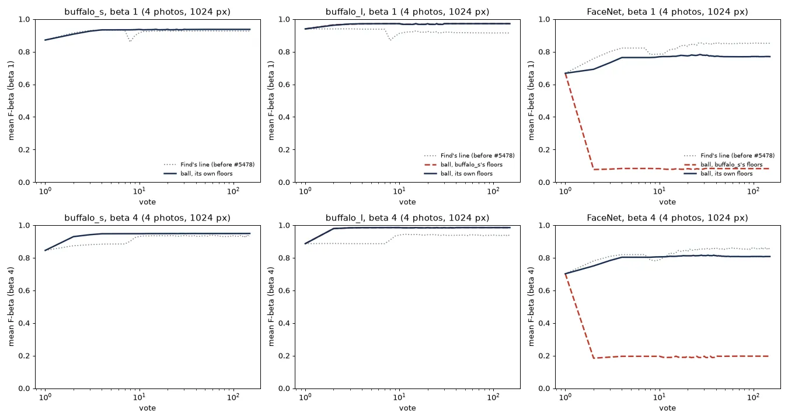

# Face ball on other embedders: does a cosine floor travel? (#5486)

**Status (2026-11-02): measured. Owner's call: refit per embedder**, as practice for the proprietary face embedders a
server may bring (`ext`). A compat tag without a fitted entry keeps the pre-ball line, with a visible warning. That
work is #5497; this report changes no app code.

#5478's face ball (the Goods' centroid cut at a cosine
floor, from β 1 up with two Goods) was fitted on FHIBE's buffalo_s crops. Here it is priced the same way on two
**hypothetical** face embedders, chosen to bracket buffalo_s. They are not proposals for the app (the owner's framing:
"examining balls in a variety of situations, not considering those situations for VTSearch"):

- **buffalo_l** (InsightFace w600k_r50, its own crops): a stronger embedder.
- **FaceNet** (MTCNN crops, the face arm before #5320): a weaker one.

Each is priced twice: at **buffalo_s's shipped floors** (transfer) and at **its own floors**, refitted the #5474 way
and cross-fitted by person (refit). Mean F-beta over votes 1-150, 4 starting photos, 1024 px, against Find's line
before #5478, paired by person:

| embedder | floors | β 1 | β 4 |
|---|---|---:|---:|
| buffalo_s (#5478, shipped) | its own | **+0.01** [+0.00, +0.02] | **+0.02** [+0.01, +0.02] |
| buffalo_l | buffalo_s's | **+0.05** [+0.05, +0.06] | **+0.05** [+0.04, +0.05] |
| buffalo_l | its own | **+0.05** [+0.05, +0.06] | **+0.05** [+0.04, +0.05] |
| FaceNet | buffalo_s's | **−0.76** [−0.77, −0.74] | **−0.65** [−0.67, −0.63] |
| FaceNet | its own | **−0.08** [−0.09, −0.06] | **−0.04** [−0.05, −0.03] |

Three findings:

1. **The floors are the embedder's, not the idea's.** buffalo_s's floors happen to fit buffalo_l: its own refit
   lands within 0.01 of them. On FaceNet they keep 240-440 faces where a person has 3 or 4, and F collapses to 0.09
   (β 1).
2. **Refitting does not rescue the ball everywhere.** FaceNet's own floors still lose to Find's line by 0.04-0.08.
   The ball needs an embedder where a person *is* a ball. FaceNet's own photos and its closest stranger sit 0.02
   apart in cosine. buffalo_s's sit 0.23 apart.
3. **The better the embedder, the more the ball pays.** On buffalo_l the ball gains 4-5× what it gains on buffalo_s,
   and the she/her gap reverses. The trained head's line does not use the extra separation; the ball does.

So of the issue's three outcomes: **the floors do not hold across embedders in general** (they hold on buffalo_l by
coincidence of scale and fail by 0.65-0.76 on FaceNet). **A refit per embedder is necessary but not sufficient**
(it fixes buffalo_l-like spaces, not FaceNet-like ones). Today's app has exactly one face space (`oss-arcface-mbf:1`),
so nothing is wrong in the app now. But `centroid_line_rule("face")` hands the ball to any face detector, and an `ext`
provider (#5341) brings its own space. Restricting the ball to the compat tag it was fitted on, as
`HARD_VIEW_QUALITY` already is, is the guard this suggests. That is the owner's call.



*4 starting photos, 1024 px. Dotted: Find's line before #5478. Solid: the ball at the embedder's own floors
(cross-fitted). Dashed red: the ball at buffalo_s's shipped floors. On buffalo_l the red line lies under the solid
one. On FaceNet it drops at vote 2, where the ball first holds (two Goods).*

## How it was measured

The #5478 shadow replay, unchanged, on new sessions:

- **Sessions.** The face review's recipe (562 people × 1024/640 px × K 1/4 × β ¼/1/4, 150 votes, one seed) on each
  embedder's existing vectors: FaceNet's `fhibe_faces_{1024,640}` × `face` (grids `2026-10-09-k{1,4}`) and buffalo_l's
  `fhibe_faces_ik_*` × `imagekit_face` (#5321, grids `2026-10-26-prep-ik-k{1,4}`). No embedding was rerun. The code is
  `374261a4c` with `CALIB_SPAN_GREEN=0`, the commit and setting of the buffalo_s sessions #5478 replayed
  (`2026-10-30-5473nodiv-ik`). So Find's line is the pre-ball line (`count_gap_floor_skip25_b1_z5.5`, then the trained
  head) on all three embedders. That gives 13,485 sessions (sets `2026-11-02-5486fn`, `2026-11-02-5486bl-ik`). Three
  buffalo_l K 4 sessions cannot open: one person has 3 own photos in the voting half on buffalo_l's crops, as on
  buffalo_s.
- **Check.** At the centroid tier's clicks, the pre-ball line redrawn from vectors reproduces the cell's F at 49,887
  of 49,887 FaceNet clicks and 47,112 of 47,115 buffalo_l clicks (the 3 misses are at β 4). The Goods counted agree
  at every click.
- **Floors.** *Refit:* #5474's dumps on each embedder (`face_balls_5474.py dump`, the K 1 grid), then
  `face_ball_line_5478.py fit`, cross-fitted: each person is scored by floors fitted on the other half. *Transfer:*
  buffalo_s's pooled, shipped floors (β 1 0.4425, β 4 0.385, slope 0.25, centre 0.6371) for every person.

| B floors (pooled) | β 1 | β 4 | slope | centre (typical spread) |
|---|---:|---:|---:|---:|
| buffalo_s (shipped) | 0.44 | 0.39 | 0.25 | 0.64 |
| buffalo_l | 0.45 | 0.41 | 0.25 | 0.72 |
| FaceNet | 0.77 | 0.72 | 0.25 | 0.80 |

buffalo_l's Goods sit tighter (spread 0.72 against 0.64). Its floors, moved to buffalo_s's centre, are 0.43 and 0.39,
within 0.01 of buffalo_s's. That is why the transfer works there. FaceNet's cosines live 0.3 higher.

## All sets

The shipped form (the ball from β 1 up with two Goods, else Find's line) minus Find's line, mean over votes 1-150,
95% CI. Below β 1 the ball does not hold, so every set reads 0.

| px | K | β | buffalo_s | buffalo_l, transfer | buffalo_l, refit | FaceNet, transfer | FaceNet, refit |
|---|---|---|---:|---:|---:|---:|---:|
| 1024 | 4 | 1 | +0.01 [+0.00, +0.02] | +0.05 [+0.05, +0.06] | +0.05 [+0.05, +0.06] | −0.76 [−0.77, −0.74] | −0.08 [−0.09, −0.06] |
| 1024 | 4 | 4 | +0.02 [+0.01, +0.02] | +0.05 [+0.04, +0.05] | +0.05 [+0.04, +0.05] | −0.65 [−0.67, −0.63] | −0.04 [−0.05, −0.03] |
| 1024 | 1 | 1 | +0.00 [−0.00, +0.01] | +0.05 [+0.04, +0.06] | +0.05 [+0.04, +0.06] | −0.73 [−0.75, −0.71] | −0.07 [−0.09, −0.06] |
| 1024 | 1 | 4 | +0.02 [+0.01, +0.02] | +0.05 [+0.04, +0.05] | +0.05 [+0.04, +0.05] | −0.62 [−0.64, −0.60] | −0.04 [−0.05, −0.03] |
| 640 | 4 | 1 | +0.01 [+0.00, +0.02] | +0.06 [+0.05, +0.07] | +0.06 [+0.05, +0.07] | −0.74 [−0.76, −0.72] | −0.09 [−0.11, −0.08] |
| 640 | 4 | 4 | +0.02 [+0.01, +0.03] | +0.05 [+0.04, +0.05] | +0.05 [+0.04, +0.05] | −0.63 [−0.65, −0.61] | −0.04 [−0.06, −0.03] |
| 640 | 1 | 1 | +0.01 [+0.00, +0.02] | +0.06 [+0.05, +0.07] | +0.06 [+0.05, +0.07] | −0.70 [−0.73, −0.68] | −0.08 [−0.10, −0.07] |
| 640 | 1 | 4 | +0.01 [+0.01, +0.02] | +0.04 [+0.04, +0.05] | +0.04 [+0.04, +0.05] | −0.60 [−0.62, −0.58] | −0.04 [−0.05, −0.03] |

Votes 25 and 150 read the same to within 0.01 (`table.csv`). Find's line itself scores 0.92-0.94 on buffalo_l (the
same as on buffalo_s) and 0.82-0.85 on FaceNet. The ball reaches 0.97-0.98 on buffalo_l against 0.94-0.95 on
buffalo_s. People who gain / lose more than 0.005 (K 4, 1024 px): buffalo_l 39% / 5% at β 1, 97% / 3% at β 4; FaceNet
refit 21% / 45% and 44% / 47%.

## Is a person a ball? (#5474's static read)

The share of people for whom some floor separates their withheld photos from everyone else's at 4 Goods (1024 px),
with the medians of their own lowest cosine and the closest other face:

| embedder | separable | own photos' lowest cosine | closest other face | gap |
|---|---:|---:|---:|---:|
| buffalo_s | 86% | 0.58 | 0.35 | 0.23 |
| buffalo_l | 95% | 0.68 | 0.33 | 0.35 |
| FaceNet | 56% | 0.76 | 0.74 | 0.02 |

On FaceNet, a typical person's lowest own photo sits level with the closest stranger, and 44% of people have no
floor that separates them. Each person's own best floor (#5474's oracle) still scores F 0.90 at β 1, but those
floors spread (IQR 0.09) where the gap is 0.02 wide, so one floor for everyone scores 0.72. On buffalo_l the gap is
0.35 and one floor fits almost everyone.

## By pronoun

Mean over votes 1-150, the shipped form against Find's line (± SE), 4 photos, 1024 px:

| | β 1 she/her | β 1 he/him | β 4 she/her | β 4 he/him |
|---|---:|---:|---:|---:|
| buffalo_s | +0.007 ± 0.005 | +0.014 ± 0.005 | +0.016 ± 0.004 | +0.019 ± 0.004 |
| buffalo_l, refit | +0.069 ± 0.007 | +0.039 ± 0.006 | +0.049 ± 0.004 | +0.047 ± 0.003 |
| FaceNet, refit | −0.109 ± 0.012 | −0.043 ± 0.007 | −0.064 ± 0.009 | −0.022 ± 0.007 |

The pronoun gap follows the embedder. On buffalo_s the ball helps she/her people less. On buffalo_l it helps them
more: Find's line scores she/her people 0.90 against he/him 0.94 (β 1), and the ball brings both to 0.97. On FaceNet it hurts them 2-3× more. This is
#5325's she/her finding (own photos sit lower and further apart) scaled by how much room the embedder leaves.

## Literal examples

Vote 150, β 1, four starting photos, 1024 px: the withheld half's top cosines to the centroid of the Goods, own photos
starred, `|` at the ball's floor. FHIBE ids cut to 8 characters.

**FaceNet at buffalo_s's floors (the transfer's failure).** Everything is above 0.46:

- `7a9e1398`: floor 0.46, keeps 717, F 0.01; Find's line F 1.00. `0.92* 0.90* 0.88* 0.77 0.75 0.74 0.73 0.73 ...`
  The person is clearly separable: three own photos at 0.88-0.92, then strangers from 0.77 down. Only the floor is in
  the wrong place.

**FaceNet at its own floors (no single radius).**

- `6005f50a`: floor 0.76, keeps 0, F 0.00; Find's line F 1.00. `| 0.73* 0.73* 0.67* 0.66* 0.62 0.60 ...`
  This person's photos all sit below the floor that suits most people, though they clear the strangers by 0.04.
- `825dd11b`: floor 0.74, keeps 3 strangers, F 0.00; Find's line F 0.80. `0.77 0.76 0.75 | 0.74 0.74 0.74* ...`
  Strangers above the person's own photos: no ball centred here works.
- Where it gains, `2c1d4b99`: floor 0.74, F 1.00 against Find's 0.67. `0.91* 0.90* 0.86* | 0.71 0.70 ...`

**buffalo_l at its own floors.**

- Gains, `9279c613`: floor 0.50, F 1.00; Find's line F 0.50 (P 0.33, R 1.00). `0.89* 0.89* 0.86* | 0.42 0.41 ...`
  A 0.44 gap, and the trained head's line falls through it into the look-alikes. This is the common case on buffalo_l.
- Loses, `b47e88dc`: floor 0.49, keeps 7, F 0.73; Find's line F 0.89. `0.92* 0.90* 0.90* 0.79* 0.62 0.60 0.59 | 0.32 ...`
  Three faces labelled as other people sit at 0.59-0.62, far above the bulk at 0.32. **Possibly a label error** (the
  same person under another id), like #5478's `69b20e79` (#5485).
- Loses, `bde4ae54`: floor 0.38, F 0.80; Find's line F 1.00. `0.55* 0.49* | 0.30* 0.24 ...` A tight spread (0.41) and
  one own photo just under the floor.

## Caveats

- **Hypothetical embedders.** buffalo_l and FaceNet stand in for "a stronger and a weaker face space"; neither is
  proposed for the app. Two points do not make a law: a third space could put buffalo_s's floors anywhere.
- FaceNet runs on MTCNN's crops and buffalo_l on its own detector's, so each arm differs in its crops as well as its
  recogniser. The comparison is between face *packs*, as the issue asked.
- Find's line before #5478 was itself tuned on buffalo_s (#5325's z 5.5), so the ball's gain on buffalo_l is partly
  the old line's loss there.
- One seed; people are the replication.

## Reproduce

```
# work dir /expscratch/sgreenberg/fhibe/emb-5486 (owner-only: replay rows and examples name people)
ARM_NAME=fn bash dirs.sh; ARM_NAME=bl bash dirs.sh      # run dirs on the K 1/4 grids
sbatch pack.sbatch (x16)                                 # tasks.txt via cell.sh on the frozen vts-5486-run @ 374261a4c
ARM_NAME=fn sbatch dump.sh; ARM_NAME=bl sbatch dump.sh   # #5474 dumps -> constants-<arm>.json
sbatch replays.sbatch                                    # replay x {transfer, refit} -> analysis-<arm>-<floors>
bash post.sh                                             # table.csv, embedders.webp, examples-*.md
```

Scripts: `scripts/experiments/fhibe/face_ball_embedders_5486.py` (table, figure), `face_ball_line_5478.py` (replay,
analyze, examples; its size map now knows FaceNet's datasets), `face_balls_5474.py` (dump, price).
