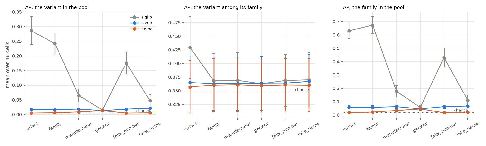
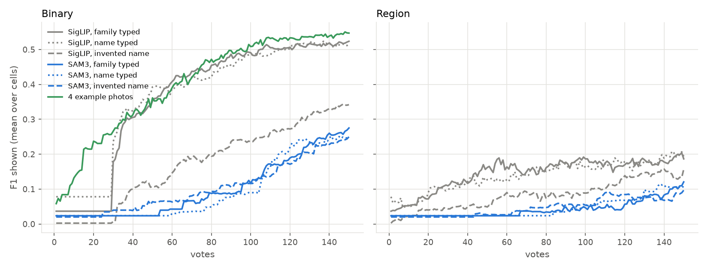
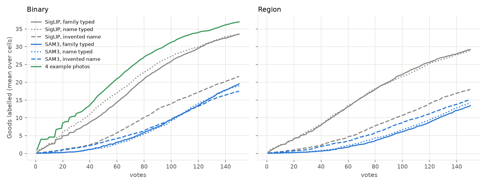
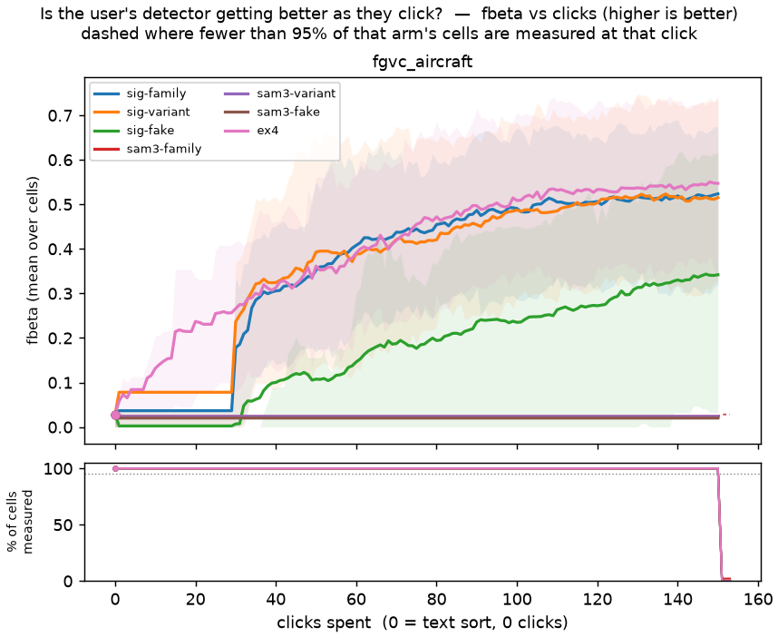
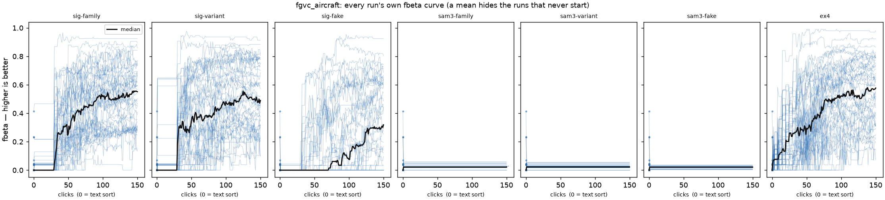
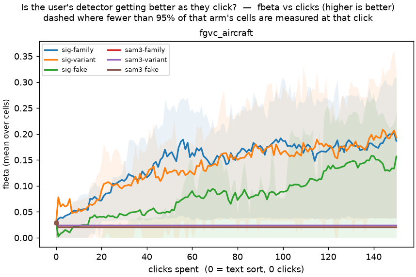
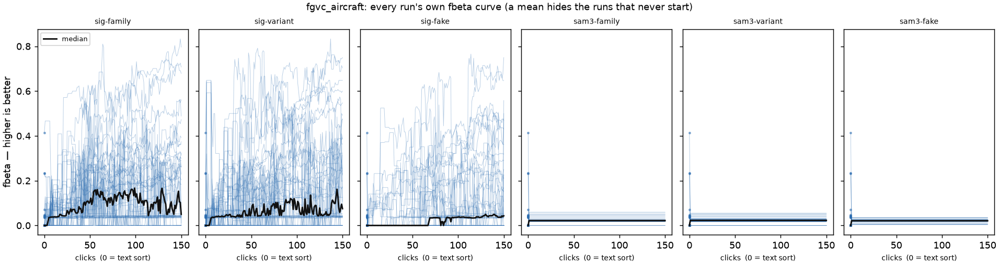

# A class no model knows: SAM3 does not suffer *more* from an unknown name, because it ignores every sub-type name, known or not (issue #5490)

**Status (2026-11-02): zero-shot grading of SigLIP, SAM3 and GroundingDINO-T at six prompt levels, and seven vote
arms (seed 0, beta 1, 150 votes, 46 cells a path) on a new sibling-variant bench, FGVC-Aircraft. Nothing ships from
this PR. The follow-up (#5521, a size guard on SAM3's opening) is filed.**

**SAM3 reads every aircraft name as "airplane".** "Boeing 737" scores 0.95 on a 737 and 0.93 on any other aircraft;
"Cessna Citation" scores *higher* on non-Cessnas (0.99 against 0.97). Across the 46 variants, SAM3's family AP is
0.057 with the family name typed, 0.058 with the real variant name, 0.067 with an invented one ("Boeing Veltra") and
0.046 with "airplane"; SigLIP's is **0.67**, 0.63, 0.11 and 0.057. So the owner's worry is answered from the other
side: SAM3 cannot lose what it never had. The unknown name costs SAM3 nothing (-0.003 ± 0.022 F1, family vs invented
name, Binary) and costs SigLIP **0.19 ± 0.03**. But SAM3 opening *with the real name* is still far below SigLIP opening
with the invented one.

1. **Zero-shot, finding the target variant among 20,000 images** (AP, mean over 46 cells; chance 0.005): SigLIP
   0.29 (real name), 0.24 (family), 0.18 (a never-built number, "Boeing 737-1100"), 0.047 (an invented nameplate);
   SAM3 0.017-0.021 and GroundingDINO-T 0.005-0.009 at every level. Every model is at chance *among the siblings*
   (0.36-0.37 against 0.35), except SigLIP with the real name (0.43 ± 0.06).
2. **In a voting session, SAM3's opening is a large loss** against today's SigLIP opening with the family typed
   (F1 shown, mean over votes 1-150, paired by cell, SE over the 16 families): **-0.27 ± 0.03** on Binary and
   **-0.11 ± 0.02** on Region under #5312's route (SAM3's set, then the head from the 20th Good); -0.20 / -0.06 even
   when the head takes over at the first click it exists. SAM3's set holds ~7,000 images, so it shows F1 0.024; its
   ranking finds the first Good at vote **72** (median) against **3** for SigLIP, and only half the sessions ever
   reach 20 Goods.
3. **Typing the real name buys SigLIP nothing over the family name** once the user votes (+0.007 ± 0.016 Binary,
   -0.006 ± 0.016 Region), though it leads at vote 0 (AP 0.29 vs 0.24). The sibling distinction comes from the votes.
4. **Four example photos beat every typed opening** on Binary: +0.038 ± 0.009 over the family text (+0.090 ± 0.015
   over votes 1-50; ahead in 70% of cells). The app has no example opening on Region (below).

| Binary, seed 0, 46 cells | F1 shown, votes 1-150 | vs SigLIP + family | F1 at vote 150 | AP at vote 150 | Goods by vote 150 | first Good (median vote) |
|---|---|---|---|---|---|---|
| SigLIP, family typed (today) | **0.37** | - | 0.52 | 0.58 | 34 | 3 |
| SigLIP, real name typed | 0.37 | +0.007 ± 0.016 | 0.51 | 0.57 | 34 | 2 |
| SigLIP, invented name typed | 0.17 | -0.19 ± 0.03 | 0.34 | 0.39 | 22 | 49 |
| SAM3, family typed, head at 20th Good | 0.10 | -0.27 ± 0.03 | 0.28 | 0.32 | 20 | 72 |
| SAM3, real name typed, head at 20th Good | 0.094 | -0.27 ± 0.03 | 0.25 | 0.32 | 19 | 63 |
| SAM3, invented name, head at 20th Good | 0.10 | -0.26 ± 0.03 | 0.25 | 0.28 | 18 | 61 |
| SAM3, family typed, head from its quota | 0.16 | -0.20 ± 0.03 | 0.31 | 0.37 | 20 | 72 |
| SAM3's set held (no hand-over) | 0.024 | -0.34 ± 0.04 | 0.024 | 0.017 | 20 | 72 |
| **4 example photos** | **0.40** | **+0.038 ± 0.009** | 0.55 | 0.57 | 37 | 1 |

| Region, seed 0, 46 cells | F1 shown, votes 1-150 | vs SigLIP + family | F1 at vote 150 | AP at vote 150 | Goods by vote 150 |
|---|---|---|---|---|---|
| SigLIP, family typed (today) | **0.15** | - | 0.19 | 0.38 | 29 |
| SigLIP, real name typed | 0.14 | -0.006 ± 0.016 | 0.19 | 0.37 | 29 |
| SigLIP, invented name typed | 0.083 | -0.064 ± 0.019 | 0.16 | 0.27 | 18 |
| SAM3, family typed, head at 20th Good | 0.042 | -0.11 ± 0.02 | 0.12 | 0.15 | 14 |
| SAM3, family typed, head from its quota | 0.088 | -0.059 ± 0.017 | 0.17 | 0.21 | 14 |

*F1 shown is what the session's Test returns at each vote, averaged over votes 1-150 (the area under the curve
divided by its span). A SAM3 session whose head never forms (12-16 of 46 cells per arm never meet the quota) shows
SAM3's set throughout and stays in every mean. Every cell is in `tables/votes_per_click.csv`; paired differences,
including the difference-in-differences, in `tables/votes_paired.csv`.*

The interactive record of every arm is [viewer.html](viewer.html) (SAM3 arms show its held set there; the head's
rows are the `hold:head` rows read above).

## The question

The owner, 2026-11-02: *"if I'm looking to distinguish a 2027 Ford Foo from a 2028 Ford Bar, neither of those cars
will be in the training. We're going to have to type 'Ford Car' and then wait until we're presented with one. Or
supply some examples. The point is, 0-shot won't work in any case. Is SAM3 going to suffer more here than other
embedders?"*

The worry was that SAM3's presence head, which decides whether the concept is in the image at all, might collapse
on a name it has never seen, where SigLIP's text tower degrades gracefully to "something like a Ford". In the app SAM3
is only an opening (#5241, #5312): the votes still train SigLIP (Binary) or DINOv3 patches (Region). So the question
has two halves: how good each model's zero-shot sort is when the name is unknown, and what that does to a session
that opens on it.

## Setup

**The bench: FGVC-Aircraft** (Maji et al. 2013, research use only; images stay on the GRID). 10,000 photos of 100
aircraft variants, each in a family and a manufacturer. The cells are the **46 variants that have siblings**: 16
families with 2-8 variants each (Boeing 737-200 ... 737-900, A318 ... A321, ...). Each cell's 100 photos are the
positives, its siblings' photos provable negatives, so this is the Ford Foo / Ford Bar case: same maker, same family
look, different model. The other 54 variants (5,400 aircraft) are negatives too, and 10,000 COCO images with no
airplane annotation dilute the pool to 20,000 (prevalence 0.5% a cell). The images are cropped of FGVC's 20-pixel
copyright banner. New pile dataset `fgvc_aircraft` (`pilebuild/loaders/fgvc_aircraft.py`), boxed, with SigLIP and
DINOv3-patch cells.

**What the user types, six levels** (`prompt_levels`):

| level | example (cell 737-400) | stands for |
|---|---|---|
| `variant` | Boeing 737-400 | the real name: an upper bound, the case where the model *does* know the class |
| `family` | Boeing 737 | "Ford Car": the general class the user can type |
| `manufacturer` | Boeing airplane | coarser still |
| `generic` | airplane | the base class |
| `fake_number` | Boeing 737-1100 | a model number that was never built, in a known family |
| `fake_name` | Boeing Veltra | an invented nameplate: the 2028 Ford Bar |

The invented names were checked against every real one (a registry test fails on an overlap). No articles: #5395
found "a frisbee" collapses GroundingDINO.

**Zero-shot.** SigLIP sorts as the app's typed query does (`embed_text_query` into the whole-image style). SAM3
(`facebook/sam3`, #5213's scorer) and GroundingDINO-T (#5395's) score every image for all 104 prompts; an image's
score is its best detection. GroundingDINO packs prompts into captions, so a caption holds one level's prompts and
never two siblings' names, which would make one variant's score depend on its siblings'. Graded four ways per cell:
the variant among the pool, the variant **among its family** (does the text tell siblings apart; chance 1 / the
family's variant count), the family among the pool, and aircraft vs COCO (AUROC).

**Vote arms** (`unknown_class_5490.sh`, today's app at beta 1, 150 votes, trajectory pass, seed 0, Binary
(`siglip`) and Region (`siglip+dinov3_patch`, `max_patch`)):

- `sig-family`, `sig-variant`, `sig-fake`: SigLIP's typed opening with the family, the real name, or the invented
  name;
- `sam3-family`, `sam3-variant`, `sam3-fake`: #5241's SAM3 arm, SAM3's set at its 0.5 cut held through the session,
  the head trained all the same and scored as `hold:head` rows. A hand-over rule is then a per-vote choice between
  two rows of one session: `hold` (never), `quota` (the head from the first vote it exists), `g20` (the head from the
  20th Good, #5312's planned route) and `best` (the better of the two each vote, a bound no rule reaches);
- `ex4`: the first 4 votes are photos of the target (FHIBE's example opening, #4699), the "supply examples" route.
  **Binary only.** The app's example opening ranks whole-image vectors (`example_sort` refuses a patch dataset), and
  the harness refuses the Region pair any opening but text (the pair exists to carry the text sort). So with
  examples and no text, the app has no Region route to measure.

## Zero-shot: SigLIP knows families, SAM3 knows "airplane"

*Left: the variant among all 20,000 images. Middle: the variant among its family's photos only, where chance is
0.35 on average (a family of 2-8). Right: the family among all images. The error bars are clustered by family (16
clusters), since a family's cells share every prompt but `variant`.*

| AP, mean over 46 cells (± SE) | SigLIP | SAM3 | GroundingDINO-T |
|---|---|---|---|
| variant in pool, real name | **0.29** (± 0.05) | 0.017 | 0.005 |
| variant in pool, family typed | **0.24** (± 0.04) | 0.017 | 0.006 |
| variant in pool, never-built number | 0.18 (± 0.04) | 0.018 | 0.005 |
| variant in pool, invented name | 0.047 (± 0.02) | 0.021 | 0.006 |
| variant in pool, "airplane" | 0.015 | 0.013 | 0.013 |
| variant among siblings, real name | **0.43** (± 0.06) | 0.37 | 0.36 |
| variant among siblings, any other level | 0.36-0.37 | 0.36-0.37 | 0.36 |
| family in pool, family typed | **0.67** (± 0.06) | 0.057 | 0.022 |
| aircraft vs COCO (AUROC), family typed | 0.93 | **0.99** | 0.61 |
| images over the model's own cut, family typed | - | 7,000 | 340 |

Chance: variant in pool 0.005, among siblings 0.35, family in pool 0.019.

**SAM3 collapses every name to the base class.** It is near perfect at "is there an aircraft" (AUROC 0.99-1.0 at
every level) and near blind to which one. The literal scores, median over photos:

| SAM3 prompt | on its own family's photos | on other aircraft | on COCO |
|---|---|---|---|
| Boeing 737 | 0.95 | 0.93 | 0.000 |
| Boeing 737-200 | 0.92 | 0.89 | 0.000 |
| Boeing 737-1100 (never built) | 0.78 | 0.63 | 0.000 |
| Airbus A320 family | 0.70 | 0.72 | 0.001 |
| Cessna Citation | 0.97 | **0.99** | 0.000 |
| airplane | 0.99 | 0.98 | 0.001 |

Per family, SigLIP's family AP with the family typed runs from 0.26 (Embraer E-Jet) to 0.97 (Gulfstream); SAM3's from
0.01 to 0.12 (Boeing 737 and 747, the two best known, where chance is 0.04 and 0.02). So this is not one hard family:
SAM3 does not resolve aircraft identity at the family level anywhere.

**GroundingDINO is worse still.** With a specific name it scores most aircraft *low* (median 0.21 on the target's own
photos; 340 images over its 0.35 cut with the family typed), so it even loses aircraft vs COCO (AUROC 0.61). With
"airplane" it recovers (0.998). A specific name turns it off rather than narrowing it.

**SigLIP degrades the way the owner hoped.** A never-built number in a known family still finds the family (AP 0.43
against 0.67 for the real family name): the "Boeing 737" part carries. An invented nameplate keeps the maker and
little else (0.11). The real name is the only prompt that separates siblings at all (0.43 against chance 0.35).

## In a session: SAM3's opening sinks it, and the name is not why

*Lines are means over cells, not a cell's path; a SigLIP Binary session shows its typed query's set until the label
quota (the flat start to vote ~29), then the head. The SAM3 lines step up where sessions reach their 20th Good. This
figure does not show spread; [viewer.html](viewer.html) has every cell.*

*What each opening finds for the user to vote on. The 4-example arm starts at 4.*

**Why SAM3 loses: its set is the pool's aircraft, and its order inside that set is noise.** SAM3's 0.5 set holds
~7,000 images for a cell with 100 positives, so it shows F1 0.024 for as long as it is held. Worse, the session's
picks walk SAM3's ranking, and inside the aircraft that ranking barely prefers the target (AP 0.017), so Goods come
slowly: 2.1 by vote 50 against 11 for SigLIP (Binary), and the 20th Good, where #5312 hands over, arrives in only
**52%** of Binary sessions and **37%** of Region ones by vote 150. The head the SAM3 sessions train is fine once it
has Goods; it simply gets them late. Even the `best` bound (the better of SAM3's set and the head at every vote) is
-0.20 ± 0.03 on Binary.

**The unknown name costs SigLIP a lot, and SAM3 nothing** (paired differences, F1 shown, votes 1-150):

| | Binary | Region |
|---|---|---|
| SigLIP: family typed minus invented name | **+0.19 ± 0.03** | +0.064 ± 0.019 |
| SAM3 (20th-Good route): family minus invented | -0.003 ± 0.022 | -0.005 ± 0.010 |
| difference-in-differences, SAM3 minus SigLIP | -0.20 ± 0.035 | -0.069 ± 0.020 |
| SigLIP: real name minus family | +0.007 ± 0.016 | -0.006 ± 0.016 |
| SAM3 (20th-Good route): real name minus family | -0.006 ± 0.018 | +0.003 ± 0.009 |

So in the owner's terms: SAM3 does not suffer *more* from the unknown class. It suffers the same with the known one.
SigLIP is the model with something to lose, and loses it (an invented name finds the first Good at vote 49 instead
of 3), and still ends above SAM3 with the real name (0.17 against 0.094 on Binary).

**Typing the real name buys nothing once the user votes.** SigLIP opens better on it (AP 0.29 vs 0.24, F1 shown over
votes 1-50 +0.039 ± 0.025), but the votes erase the gap by vote ~50. Everything that tells a 737-400 from a 737-300
comes from the user's labels: at vote 150 the Binary head's AP is 0.58 with either text.

**Examples are the best opening** where the app offers them (Binary): 4 photos of the target put it at F1 0.13 by vote
10 (SigLIP with the family: 0.037, still on the typed set), +0.090 ± 0.015 over votes 1-50, +0.038 ± 0.009 over
1-150. The gap closes by vote ~100; by then both sessions have found the same Goods.

### Quality over clicks, the shared figures

`curves.py`'s pair, one path at a time, anchored at click 0 on SigLIP's family text sort (`text_baseline.py`, F1
0.029 at the app's cut). These draw what the harness's untagged row shows, so **a SAM3 arm here is SAM3's held set**
(flat at ~0.02 in every run); its head, and the hand-over rules, are the tables above.

*The individuals are the reason to read past the mean: SigLIP's sessions fan out from 0.1 to 0.9 by vote 150 with
either the family or the real name, the invented name's median stays at 0 until vote ~70, and every SAM3-held run
is flat. Region below.*

## What this means for the app

- **SAM3 should not open a query whose class is a sub-type of something SAM3 knows.** #5241 found SAM3's opening
  +0.12 on COCO's basic categories; here it is -0.27. The app cannot know which case it is in, but it can see the
  symptom: a SAM3 set of ~35% of the pool where the user expects a rare class. #5521 measures a size guard (fall back
  to SigLIP when SAM3's set is too broad) on both studies' arms before #5312 ships its route.
- **Nothing in the default path changes.** The default opening is SigLIP's; it is the best typed opening here at
  every level, and the gap it leaves is the one votes are for.
- **For the Ford Bar case, the advice to a user is: type the family and vote, or give example photos (Binary).**
  An invented or unreleased name is worse than the family name for SigLIP (-0.19), and SAM3 or GroundingDINO do not
  help with either.
- **Region has no example opening.** A user who has photos and wants Region voting has to type text first. Not filed:
  whether to add it is a product question, and this study measured only that Binary's version is worth +0.038 here.

## Limits

- **One seed.** Every paired difference is within one seed's cells (46, clustered into 16 families for the SE).
- **The positives run thin.** A cell has 100 photos, ~50 in the half the session votes on, and SigLIP's Binary
  sessions find 34 by vote 150 (`cells_reach_20_goods` 0.91). A loss for an arm that harvests less is still a loss;
  the ceiling compresses gains, not this study's losses.
- **FGVC is not cars, and the "unknown" classes are simulated.** Real 737 variants are in every model's web-scale
  training; the invented names stand in for an unreleased one. That SAM3 fails on the *real* names is the stronger
  result, since it cannot be the novelty.
- **SAM3 scored as #5213 scores it** (best detection per image, SAM3 at bf16/fp16 on V100); its presence score is not
  separately read. GroundingDINO-T is the only GroundingDINO checkpoint run (#5395's best).
- **The Region-pair's text arms and the Binary arms share one prepared grid**, built at commit `65d6c5c1e` with cells
  built at `ea12e4ffa`; the pile code between the two is identical.

## Files

- `scripts/experiments/pile/pilebuild/loaders/fgvc_aircraft.py`: the bench, its families, prompt levels and invented
  names.
- `scripts/experiments/state_of_app/unknown_class_5490.sh`: prepare, score (SAM3 / GroundingDINO), the arms, the
  zero-shot grading, the vote analysis and the viewer, in that order.
- `scripts/experiments/state_of_app/unknown_class_5490.py`: `zeroshot` and `votes`, which write every table and the
  three figures here.
- `viewer.html`: every arm, by vote, both paths.
- Tables (archived to the `experiments-data` release; `study_data.py fetch 2026-11-02-unknown-class-5490`):
  `zeroshot_per_cell.csv` (model x level x cell), `zeroshot_summary.csv`, `zeroshot_paired.csv`,
  `zeroshot_chance.csv`, `votes_summary.csv`, `votes_paired.csv`, `votes_per_click.csv`, `votes_info.json`.
- Run directories on the GRID: `/expscratch/sgreenberg/state-of-the-app/2026-11-02-uc5490-*`, zero-shot scores in
  `/expscratch/sgreenberg/fgvc-5490/scores-{sam3,gdino}`.
