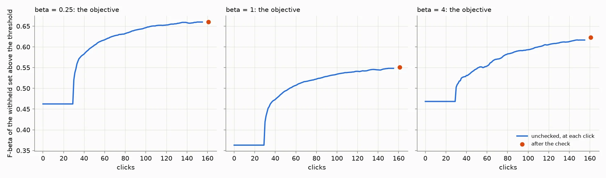
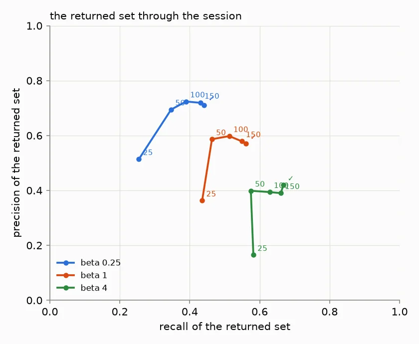
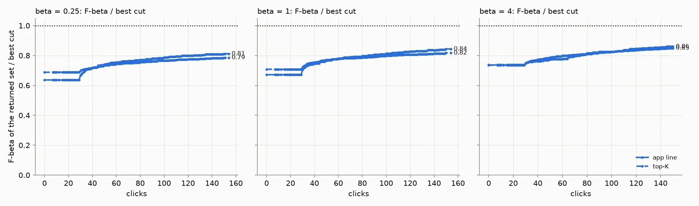
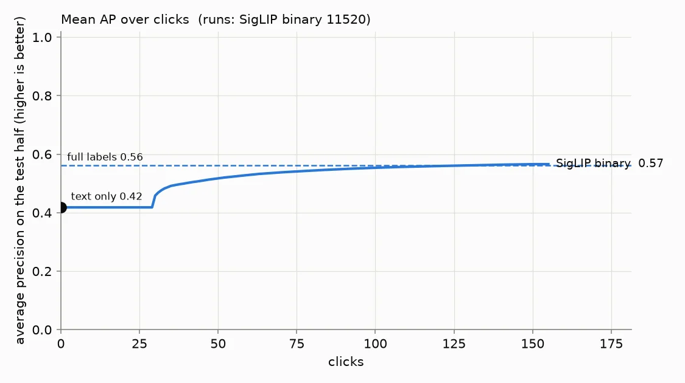
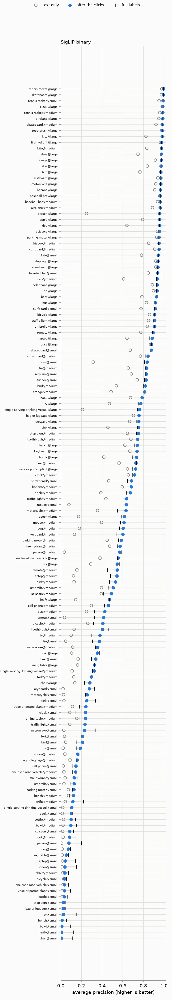
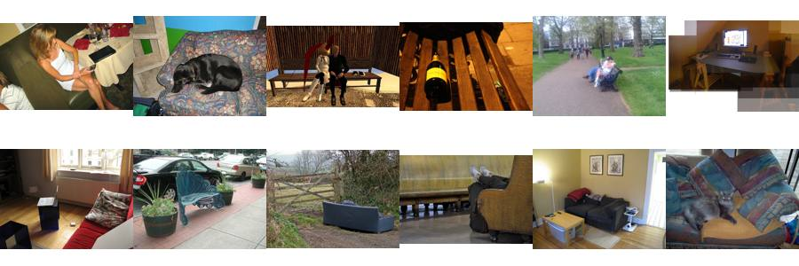
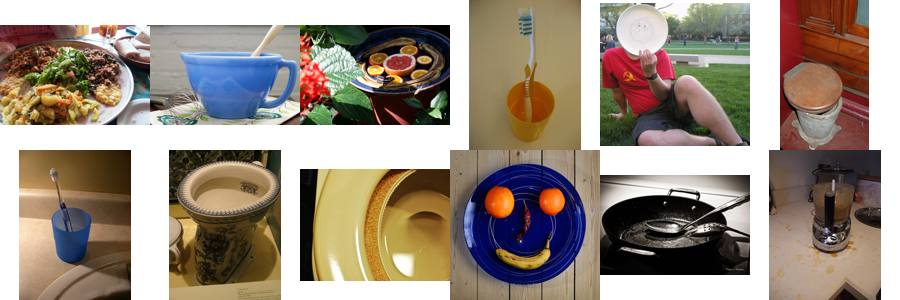
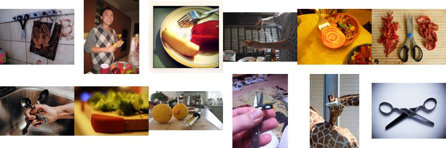
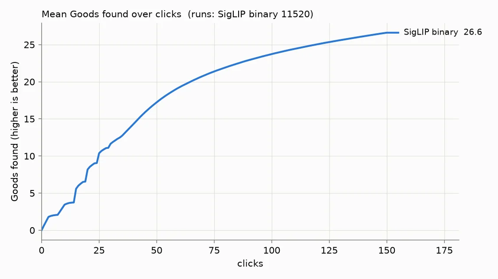

# State of the App: Binary Photo — 2026-11-03

**Issue:** #5525. **Recipe:** `.claude/skills/state-of-the-app/SKILL.md`.
**Interactive viewer:** [`viewer.html`](viewer.html), with all three session sets on one page and a chip per preset
(#4636), each averaged over all 80 seeds. It draws no per-seed lines (`SOTA_RUNS_BUDGET_MB=0`), and **Show › where
the app said stop** draws a dot per session (#4939). The viewer draws what the saved labels give (#4640); this
report reads what the session shows, so the two differ through the opening (to vote 30, #4736).

**App:** `dev` at `605274e2e`. A **review**, not an experiment: this maps the app as it ships, the way a user meets
it. Since the last Binary review (#4951, `7b3a3d1e3`), the changes with a study behind them that move a Binary
session are:
- **The labels line:** the early line's Good component (#4937), its Bad component fitted on the corpus (#5040), the
  head's count line following beta (#5039), and the count of what stands out (#5084, #5215).
- **The lights and Done:** the Smart light reads F-beta (#5134); Done needs Goods in hand after a dry run (#5477).
- **The walk:** Diversity off by default (#5473); a hard Good's line reach (#5409).
- **Kept as shipped after pricing:** the weak spot check (#4797) and the fused-cut fallback (#5261).

This review does not split the change among them; their own A/B reports do.

**Path:** SigLIP whole-image embedding, binary (Good/Bad) votes, Autopilot's shipped session.
**Bench:** `coco_better`, all 49 classes at every size they have: 144 cells.
**Seeds:** 80. The owner set a cap of 100 and a 06:00 deadline, then at 01:5x on 2026-11-04 stopped new seeds at 80
for earlier results. **Sessions:** one set per preset (`SOTA_BETA=0.25|1|4`), 11,520 each and 34,560 in all. One
full-label ceiling pass at beta 1 is shared by the three.
**Runs:** `/expscratch/sgreenberg/state-of-the-app/2026-11-03-b025`, `-b1` and `-b4`, with the ceiling in
`-b1/ceiling`. Every cell ran from one frozen worktree at `605274e2e`, from 11:02 on 2026-11-03 to 02:54.
- **Two lanes, one order,** as on 2026-10-16: cpu-partition arrays and cpu packs filling the 360-CPU cap, and up to
  four V100 packs (the GPU hidden). A trajectory cell took 6.0 minutes on the cpu lane.
- **Every seed is whole:** all 80 claimed seeds finished in all four dirs (the three presets and the ceiling). Cells
  are gzipped (#5092), and the driver would have paused below 30 GB free; it never did.

**Analysis:** `analyze.sh` per run, then `perp.py --kind balance`, `by_click.py` and `stops_by_preset.py`; the
tables are `report_tables.py` over them (Files, below).

**The objective** (#4427) is the F-beta, at the preset's beta, of the withheld test half above the threshold the
app holds, at the labels line Find draws there. **AP** measures the ranking alone.

## Headline

**The objective, each preset off its own sessions.** Every run counts; a run whose detector the app never shows
scores its typed query's set.

| preset | 25 clicks | 50 clicks | 150 clicks, unchecked | **after the check** | returned, median (unchecked / after) | returned > 200 (unchecked / after) |
|---:|---:|---:|---:|---:|---:|---:|
| 1/4 | 0.46 | 0.60 | 0.66 | **0.66** | 25 / 27 | 0% / 0% |
| 1 | 0.36 | 0.49 | 0.55 | **0.55** | 47 / 48 | 0% / 0% |
| 4 | 0.47 | 0.55 | 0.62 | **0.62** | 91 / 87 | 16% / 19% |

1. **The session gets there sooner than on 2026-10-16, and ends a little higher.** At 50 clicks the objective is
   0.60 / 0.49 / 0.55, against 0.54 / 0.44 / 0.52 then (+0.06 / +0.05 / +0.03). After the check it is
   **0.66 / 0.55 / 0.62**, against 0.65 / 0.54 / 0.61 (+0.01 each).
2. **The presets return what they promise.** After the check:
   - the 1/4 preset returns a median of 27 images at precision 0.71 and recall 0.44 (17 at 0.76 and 0.36 on 10-16);
   - the balanced preset returns 48 at 0.57 and 0.56;
   - the recall preset returns 87 at 0.42 and 0.67.
3. **For the first 30 votes the user sees the typed query's set (#4736), and the hand-over costs nothing.** From
   vote 30 the app shows a detector: 86% of sessions by click 40, 90% by 50 and 96% by 150. The objective never
   drops below the typed query.
4. **150 clicks reach the full-label ranking.** Mean AP goes 0.42 (typed query) → 0.52 at 50 clicks → **0.57** at
   150, against a full-label ceiling of 0.56. Sessions find 27 Goods: 10 by click 25 (6 on 10-16), 17 by 50.
5. **Done comes earlier and more often.** 95% of sessions are told they can stop, at a Kaplan-Meier median of click
   36, 40 and 44 (90% at 55–64 on 10-16). Clicking on to 150 still adds +0.06 at every preset
   ([below](#where-the-app-said-stop-3560-4878)).
6. **The end-of-session check adds little:** +0.000 ± 0.001, +0.003 ± 0.000 and +0.006 ± 0.000 per session, for 20,
   20 and 30 votes.

### The returned set through the session

Per preset, the returned set's precision against its recall from the typed query through 25, 50, 100 and 150
clicks to after the check (#4519). The values are means over every run; the returned size is a median.

| preset | point | precision | recall | F-beta | returned, median |
|---:|---|---:|---:|---:|---:|
| 1/4 | typed query | 0.51 | 0.25 | 0.46 | 19 |
| 1/4 | 50 | 0.69 | 0.35 | 0.60 | 18 |
| 1/4 | 100 | 0.72 | 0.39 | 0.65 | 21 |
| 1/4 | 150 | 0.72 | 0.43 | 0.66 | 25 |
| 1/4 | after the check | 0.71 | 0.44 | 0.66 | 27 |
| 1 | typed query | 0.36 | 0.44 | 0.36 | 50 |
| 1 | 50 | 0.59 | 0.46 | 0.49 | 38 |
| 1 | 100 | 0.60 | 0.51 | 0.53 | 42 |
| 1 | 150 | 0.58 | 0.55 | 0.55 | 47 |
| 1 | after the check | 0.57 | 0.56 | 0.55 | 48 |
| 4 | typed query | 0.16 | 0.58 | 0.47 | 204 |
| 4 | 50 | 0.40 | 0.57 | 0.55 | 74 |
| 4 | 100 | 0.39 | 0.63 | 0.59 | 85 |
| 4 | 150 | 0.39 | 0.66 | 0.62 | 91 |
| 4 | after the check | 0.42 | 0.67 | 0.62 | 87 |

The 25-click row equals the typed query's at every preset (the query hold) and is left out.

**Until click 100 the clicks buy mostly precision; after it, recall.**
- From the typed query to click 100, precision rises +0.21, +0.23 and +0.23, and recall +0.13, +0.08 and +0.05.
  The 1/4 preset buys more recall early than it did on 10-16 (+0.03 then).
- From click 100 to 150 the objective climbs +0.014, +0.014 and +0.023, now through recall.
- The check buys recall (+0.011, +0.012, +0.008). At 1/4 and 1 it gives back a little precision (−0.008, −0.009);
  at 4 it adds some (+0.029).

### The returned set, one rule per row

Two rules, and only rows under the same rule compare:
- **"App line"** is what each sort's own line returns: the text sort's line at the preset (#4603), the detector's
  labels line, and for the full-label ceiling, Find's labels line from every training label (#4486, #4490).
- **"Top-K"** is set-constant at the old cap on every sort: 32 at beta ≤ 1 and 128 at beta 4.

The values are F-beta at the preset. The detector columns are the last click before the check.

| preset | rule | text sort | 50 clicks | 150 clicks | full labels |
|---:|---|---:|---:|---:|---:|
| 1/4 | app line | 0.46 | 0.60 | **0.66** | 0.63 |
| 1/4 | top 32 | 0.47 | 0.58 | **0.63** | 0.62 |
| 1 | app line | 0.36 | 0.49 | **0.55** | 0.53 |
| 1 | top 32 | 0.38 | 0.47 | **0.51** | 0.50 |
| 4 | app line | 0.47 | 0.55 | **0.62** | 0.65 |
| 4 | top 128 | 0.48 | 0.55 | **0.60** | 0.63 |

- **The app's own line beats top-K at 50 and 150 clicks at every preset** (+0.00 to +0.04). On 10-16 it trailed
  top-K at 50 clicks at 1/4 (0.54 against 0.56); now it leads (0.60 against 0.58).
- **On the typed query it sits 0.01 to 0.02 under top-K**, as before.
- **The line reaches a slightly larger share of its best cut:** 0.81, 0.84 and 0.86 of the best F-beta any cut of
  the same ranking reaches at 150 clicks (0.79, 0.83 and 0.84 on 10-16; `perbeta_summary.md`).
- **With every label known, the β 4 line still goes deep:** Find returns 414 images at precision 0.33, for 0.65
  against the session's 0.62. At 1/4 and 1 the session beats the full-label line (0.66 against 0.63, 0.55 against
  0.53).

### The ranking

The ranking barely depends on the preset (the beta-1 sessions):

| | text only | 25 clicks | 50 clicks | 150 clicks | full labels |
|---|---:|---:|---:|---:|---:|
| **AP** | 0.42 | 0.42 | 0.52 | **0.57** | 0.56 |
| **Goods found** | — | 10 | 17 | **27** | — |

Through vote 29 the session shows the typed query, so the 25-click column is the query's. By click 50 AP is up
+0.10 (+0.08 on 10-16), and by 150 it passes full labels by 0.005.

## The spot check

The check walks bands of the unvoted ranking, about 5 picks a band. It never moves the line; its picks are votes
the next retrain learns from.

- **At the end of the session**, 11,202 of 11,520 runs per preset check once. The precision range runs from about
  0.31 to 0.66, 0.35 to 0.37 wide, and held the truth in 97.8%, 97.0% and 97.0% of checks.
- **Mid-session, Autopilot runs it once in 95% of sessions, and now early:**

| preset | sessions prompted | first prompt, median click (quartiles) | checks per prompted session | clicks spent checking, median | Goods among those picks |
|---:|---:|---|---|---:|---:|
| 1/4 | 95% | 15 (15, 26) | 1: 10,910, 2: 57 | 20 (15%) | 41% |
| 1 | 95% | 16 (15, 27) | 1: 10,865, 2: 97 | 25 (16%) | 38% |
| 4 | 95% | 15 (15, 26) | 1: 10,754, 2: 133 | 30 (21%) | 30% |

On 10-16 the first prompt came at a median of click 36, 56–58% of the time out of `hard`. Now it comes at click 15,
always out of `hard`, and at least three sessions in four run it inside the query hold, before the app shows a
detector. The shares spent and the Goods among the picks are unchanged.

## Where the app said stop (#3560, #4878)

The app announces *All quality indicators are green* the first time every light is green, or when the labels
line's own F-beta reading reaches its level (#4878). A user may stop there; the simulated session clicks on to 150
either way. A session's **stop** is that first click.
- The KM median keeps the sessions that never fired, censored at click 150.
- Every column after it covers only the sessions that fired.
- The gain is Fβ at click 150 minus at the stop, paired within session, with its SE over the 49 class means.

From `stopping_by_preset.csv` (`stops_by_preset.py` over each run's `stops.csv`). The viewer's stop view draws the
same stops, one dot a session.

| preset | fired | stop, KM median | Fβ at stop (median) | gain to 150, mean ± SE | ended ≥0.02 better | ended ≥0.02 worse | short of own best (median) | clicks past own best (median) |
|---:|---:|---:|---:|---|---:|---:|---:|---:|
| 1/4 | 95% | 36 | 0.75 | +0.060 ± 0.006 | 50% | 19% | 0.08 | −28 |
| 1 | 95% | 40 | 0.54 | +0.063 ± 0.005 | 62% | 10% | 0.07 | −38 |
| 4 | 95% | 44 | 0.63 | +0.064 ± 0.005 | 60% | 7% | 0.07 | −42 |

- **The stop comes about 20 clicks earlier than on 10-16** (55, 58 and 64 then), and it fires more often (95%
  against 90%). The objective at the stop is level or higher (0.75 / 0.54 / 0.63 against 0.72 / 0.51 / 0.63).
- **Clicking on past it still pays:** +0.06 at every preset, more than ten SEs, a little less than on 10-16 (+0.07).
  The median session stops 28–42 clicks before its own best.
- **Where the clicks before it go.** The median stopped session spends 7 clicks in the opening and 3–6 in Hard, then
  20–30 in the check before Done. New is not reached before the stop in the median session.
- **By band, small objects are told least.** Fired: large 100%, medium 100%, small 84–85% (70–72% on 10-16). KM
  median stop 32–41, 36–44 and 67–79.

## Where the app does well and where it does poorly

**By size band** (beta 1, every run; the objective after the check, AP of the ranking):

| band (cells) | objective | returned, median | text AP | AP at 150 | full-label AP | Goods found |
|---|---:|---:|---:|---:|---:|---:|
| large (49) | 0.80 | 50 | 0.70 | 0.84 | 0.83 | 33 |
| medium (49) | 0.54 | 49 | 0.38 | 0.55 | 0.53 | 29 |
| small (46) | 0.30 | 42 | 0.16 | 0.29 | 0.31 | 17 |

At large and medium, 150 clicks reach or pass the full-label AP. Small is the only band with headroom left, as on
10-16.

**Well:** sports equipment and things a scene is *about* (beta 1, objective after the check):

| class | objective | text AP | AP at 150 | full-label AP |
|---|---:|---:|---:|---:|
| tennis racket | 0.98 | 0.96 | 0.99 | 0.99 |
| kite | 0.91 | 0.81 | 0.97 | 0.97 |
| skateboard | 0.91 | 0.86 | 0.95 | 0.95 |
| airplane | 0.89 | 0.84 | 0.93 | 0.92 |
| surfboard | 0.88 | 0.88 | 0.95 | 0.94 |
| baseball bat | 0.88 | 0.91 | 0.95 | 0.95 |

**Poorly:** furniture, tableware and cutlery, the same ten as on 10-16 in nearly the same order. Each class has 240
runs at beta 1; the last column counts the runs whose detector the app never shows.

| class | objective | returned, median | text AP | AP at 150 | full-label AP | never shown | why (below) |
|---|---:|---:|---:|---:|---:|---:|---|
| chair | 0.13 | 27 | 0.05 | 0.11 | 0.14 | 80 | embedding |
| bowl | 0.17 | 45 | 0.04 | 0.15 | 0.21 | 66 | loop |
| knife | 0.21 | 40 | 0.06 | 0.20 | 0.27 | 80 | loop |
| dining table | 0.24 | 56 | 0.11 | 0.21 | 0.19 | 0 | embedding |
| enclosed road vehicle | 0.25 | 41 | 0.14 | 0.25 | 0.25 | 2 | embedding |
| spoon | 0.28 | 45 | 0.07 | 0.27 | 0.31 | 33 | mixed |
| bench | 0.29 | 22 | 0.23 | 0.29 | 0.28 | 25 | embedding |
| bottle | 0.30 | 39 | 0.15 | 0.29 | 0.30 | 8 | embedding |
| bag or luggage | 0.33 | 37 | 0.27 | 0.31 | 0.31 | 9 | embedding |
| book | 0.34 | 46 | 0.24 | 0.32 | 0.35 | 5 | embedding |

**Why.** The ceiling separates two cases: when it is also low, the embedding can't separate the class; when it is
high but the final AP is not, the loop failed to collect the labels. The confusers are the images Autopilot most
often showed as Bad (`why.py`, `why/why.csv`), ranked by lift over the corpus. They are the same as on 10-16:
- **chair: the embedding.** Ceiling 0.14 against a final 0.11. Its Bad clicks hold a **couch (20%, 10×) or a bench (13%, 8×)**, then a tv (7×)
  and a toilet (4×).
  
- **bowl: the loop.** Ceiling 0.21 against 0.15. Its Bad clicks hold **broccoli (9%, 19×) and a toilet (18%, 9×)**.
  
- **knife: the loop.** Ceiling 0.27 against 0.20. Its Bad clicks hold **scissors (8%, 35×)**, then oranges and
  pizza (9× each).
  
- **dining table, enclosed road vehicle, bench, bottle, bag or luggage, book: the embedding.** Each ends at or
  above its ceiling. Dining table's Bads are couches (15%, 8×) and chairs (9%, 7×); enclosed road vehicle's hold
  none of COCO's 80 categories (20%, 23×), stop signs and buses.
- **spoon: mixed.** Ceiling 0.31 against 0.27; its confusers are knives (26×) and broccoli (13×).

## Headroom (full labels minus 150 clicks)

The mean is −0.005 (0.561 − 0.566): on average 150 clicks match or pass full labels.
- **Where it concentrates:** tableware and person. Knife has 0.07 left, bowl and person 0.05, spoon and chair 0.03.
- **At or above the ceiling:** 36 classes. Remote (−0.06), bus (−0.05) and clock (−0.04) are furthest above, as on
  10-16.

## What the clicks bought (150 clicks minus text only)

The mean is +0.15 AP (0.42 → 0.57).
- **Most:** person +0.44 (0.10 → 0.54), skis +0.33, sink +0.31, remote +0.30, single serving drinking vessel +0.28,
  dog +0.27.
- **Least:** tennis racket +0.03, baseball bat and stop sign +0.04, bag or luggage and chair +0.05, bench +0.06.

## Images (#4658)

Credit is what a click taught the trained head. An image is flagged when its credit, net of cell, label and phase,
passes |z| > 3, and its raw credit does too, the same way.

At beta 1, 15,863 images were clicked 10+ times on the trained head: **1,232 helpful, 659 harmful** (713 and 318 at
45 seeds). The same test with images shuffled within their buckets flags 7–17 helpful and 1–3 harmful, so about
one flag in a hundred is chance. [`images.md`](images.md) has the 12 flagged images each side that moved AP most
per click, with thumbnails.

The images at the top recur from 10-16, at 80 seeds as at 45:
- **Helpful:** 262284 (an empty glass shower stall, a Bad), +0.15 a click; 314865 (an empty room under
  renovation, a Bad), +0.06; 369087 (two women swinging game remotes, a Good for remote), +0.03; 473745 (a resort
  bathroom open onto a pool), +0.03.
- **Harmful:** 21595 (a pizza with glasses at its edge, a Good for single serving drinking vessel), −0.02 a click;
  218253 (a squat-toilet bathroom with a folding chair, a Good for chair), −0.02.

The other images in `images.md` are new to this list and were not looked at for this report.

## Known regimes to flag, not to fix

- **Sessions whose detector the app never shows:** 418 of 11,520 runs per preset (3.6%, as on 10-16), all at small.
  They score the typed query's set for all 150 clicks: 0.01–0.03 after the check. Most are chair and knife (80 each),
  bowl (66), laptop (37), spoon (33) and person (32).
- **Runs that exhaust their positives:** 98, 71 and 55 runs per preset (0.9%, 0.6%, 0.5%; 2–3% on 10-16) find
  every positive in their click half before click 150, mostly at large.
- **Weak sessions still over-return at beta 4:** 19% of runs return more than 200 images after the check, as on
  10-16. At 1/4 and 1 none do.
- **The stop comes 28–42 clicks before a session's best, with +0.06 still to come.** The owner chose the stop rule
  knowing this (#4878); read it as the cost of stopping at Done.
- **Small objects:** 15–16% of small sessions are never told to stop, and every run never shown a detector is
  small.
- **No prevalence pages this time.** The 2026-10-16 review added two prevalence scenarios (#4959); this one ran the
  bench's own prevalence only.

## What to A/B next

- **The mid-session check now fires at click 15, inside the query hold, in three sessions in four or more.** Its votes
  land before the app shows a detector. #5530 A/Bs holding the check until the app shows a detector.

## Files

- `perbeta_summary.md`: every per-preset table above, from `perp.py --kind balance`.
- `precision_recall_path.csv`: each preset's returned set at 25, 50, 100 and 150 clicks and after the check.
- `objective_by_click.csv`: each preset's objective at every click (`by_click.py`).
- `stopping_by_preset.csv`: where the app said stop, per preset and band (`stops_by_preset.py`).
- `figures/`: the objective, the returned set and its path, per preset; AP and Goods over clicks; every cell.
- `why/`: the confuser sheets for chair, bowl and knife, and `why.csv` for the ten worst classes.
- `images.md` and `images/`: the 12 flagged images each side at beta 1 (`thumbs.py`).
- **Runs and full analyses:** `/expscratch/sgreenberg/state-of-the-app/2026-11-03-b025|b1|b4/analysis-binary/`.
  `perp.py` and `by_click.py` over them are in `2026-11-03-perp/`, and the viewer's build in `2026-11-03-betas/`.
- **Scripts** are in `/expscratch/sgreenberg/sota-1103/`:
  - `go.sh`, which prepared the three preset dirs;
  - `drive.sh`, which claimed the seeds in order on both lanes and then ran the analysis. Its `perp.py` step sourced
    the retired `$WT/gridenv.sh` and failed; it was rerun by hand with `scripts/grid/gridenv.sh`;
  - `bin-report/report_tables.py` (output `bin-report/out/tables.md`), 10-16's copy with the picks glob reading
    gzipped cells.
