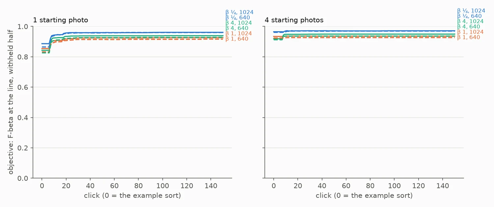
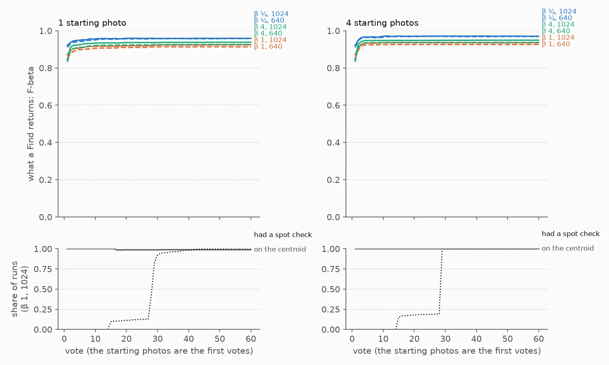
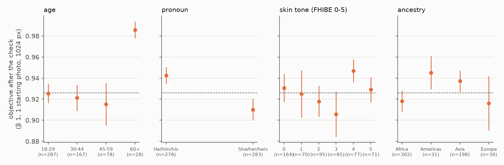

# State of the App: Face — 2026-11-03

**The second review of the face path, and the first on the face provider's crops and buffalo_s**
(#5320, #5341), on FHIBE, as the app ships at `605274e2e` plus the harness fix #5527. Since the
2026-10-10 review the path also gained the face ball (#5482), the dry run before Done (#5483), the
hard-Good weights and reach (#5415, #5453), and Diversity off by default (#5479). The bench is the
same: the #4699 baseline's 562 people, each from **1 and from 4** starting photos, at both stored
sizes (1024 and 640 px), one set of sessions per preset (β ¼, 1, 4). That is 6,723 sessions of 150
votes, scored on each person's withheld photos (#5526).

**A face session now starts near the ceiling and stays there.** From one photo at 1024 px, the set
a Find returns after the check has F-beta **0.96 / 0.93 / 0.94** at β ¼ / 1 / 4:
- precision 0.97 / 0.95 / 0.89, recall 0.88 / 0.92 / 0.95;
- a median of 3, 4 and 4 faces.

Its final AP, 0.956, is 0.014 below the full-label ceiling's 0.970. The example sort the user
starts from already scores **0.89 / 0.85 / 0.84** (Figure 1), and the mean over clicks 1–150 is
**0.96 / 0.92 / 0.93**. Starting from 4 photos adds about 0.01 after the check (0.015 over clicks 1–150); 640 px costs
0.00 to 0.01.

**Against the last review** (2026-10-10, FaceNet on MTCNN crops) the same quantity at β 1, from one
photo at 1024 px, went from 0.79 to **0.93** after the check, and from 0.32 to **0.85** at click 0.
That is the whole path changing at once (embedder, crops, lines, stop), so this review does not split
it among the PRs above. Their own A/B reports do.

**What it no longer has:**
1. **No hand-over dip.** At β ≥ 1 the face ball keeps the Goods' centroid as the session's line
   (99–100% of runs, every vote, #5482), so there is no hand-over. At β ¼, where the trained head
   still takes over at vote 7 (8 from four photos), Find moves −0.002 to +0.005 at the switch,
   against −0.13 to −0.29 on 2026-10-10.
2. **No mid-session plateau.** Find is within 0.01 of its final value by vote 10 from one photo and
   by vote 4 from four (Figure 2).
3. **Done comes for everyone.** Every session reaches Done: a median of **click 45 (55 at β 4)**,
   interquartile range 44–45 (54–55), after the check before Done. The objective at Done is within
   0.002 of the objective at 150.

**Failures from one photo remain: 6–7 of 562 per set.** Each ends with AP under 0.1, five of the
seven at β 1 against a ceiling AP of 1.00 (below). From four photos one person fails, and their own
ceiling AP is 0.15.

**The gaps between people narrowed but did not close.** she/her **0.91** against he/him **0.94**
(0.12–0.15 on 2026-10-10); age 60+ **0.99** against 0.92 for 18–29; skin tone 3 **0.91** against
tone 4 **0.95** (β 1, one photo, 1024 px; SE about 0.01).



*Figure 1. What the session shows at every click: F-beta of the withheld set at the app's line, at
each set's own beta, over 562 people (559/558 from four photos). Click 0 is the example sort at its
own line; the session shows it until Autopilot shows a detector, which from one photo is at vote 7.
Colour is the preset (β ¼ blue, β 1 orange, β 4 green), solid 1024 px, dashed 640 px. The viewer
(`viewer.html`) draws what Test gives instead, so the two differ through the opening on purpose.*

## The bench

- **People:** the #4699 baseline's 562 (`<release>-derived/runs/2026-10-09-k4/identities.txt`),
  7 to 10 one-person photos each. The stratified split leaves each about four photos to vote on and
  about four withheld.
- **Opening:** the example sort. The K starting photos are the first K votes; the screen shows
  their centroid's sort at its count line (#4732), and Autopilot walks it. There is no typed query.
- **Path:** `fhibe_faces_ik_1024` and `fhibe_faces_ik_640`, the face provider's crops and buffalo_s
  vectors (the GRID default, #5341), from the prepared grids `2026-10-27-prep-ik-bs-k{1,4}`.
- **Sessions:** shipped defaults; 150 votes; the stratified split; one seed, since people are the
  replication; the full-label ceiling. Six session sets (K × β), 1,124 cells each.
- **Missing cells:** 21 of 6,744. On the face provider's crops, four people have only six photos
  with a face at one size or both (3 cells at 1024 px, 4 at 640), too few to start from four
  (`only 6 positives for 4 example(s)`); each of those cells fails once per preset. Every other run
  is in every average (#4631).
- **Run:** `scripts/experiments/fhibe/sota_face.sh` as four claiming V100 pack jobs, 15:00–17:07.
- **A first run was set aside.** The same sessions at `605274e2e` wrote no rank frames on the
  centroid tier, where a face-ball session spends all of it, and the analysis could not read the
  line at β 1 and 4 (#5527). The fix (#5528) only records the frames: every session's rows and
  final objective match the first run exactly (max |ΔF| 0.0000, all 9 sets both runs had).

## Headline: the returned set at each balance

Each preset's sessions, read at their own beta (`headline.csv`, `session_means.csv`).

| start | size | β | click 0 (example sort) | click 10 | click 25 | after the check | precision / recall after | returned | mean over 1–50 | mean over 1–150 |
|---|---|---|---|---|---|---|---|---|---|---|
| 1 photo | 1024 | ¼ | 0.89 | 0.94 | 0.96 | **0.96** | 0.97 / 0.88 | 3 | 0.95 | **0.96** |
| 1 photo | 1024 | 1 | 0.85 | 0.91 | 0.92 | **0.93** | 0.95 / 0.92 | 4 | 0.91 | **0.92** |
| 1 photo | 1024 | 4 | 0.84 | 0.92 | 0.94 | **0.94** | 0.89 / 0.95 | 4 | 0.92 | **0.93** |
| 1 photo | 640 | ¼ | 0.87 | 0.94 | 0.96 | 0.96 | 0.97 / 0.86 | 3 | 0.94 | 0.95 |
| 1 photo | 640 | 1 | 0.83 | 0.89 | 0.91 | 0.92 | 0.95 / 0.91 | 4 | 0.90 | 0.91 |
| 1 photo | 640 | 4 | 0.83 | 0.91 | 0.92 | 0.93 | 0.88 / 0.94 | 4 | 0.91 | 0.92 |
| 4 photos | 1024 | ¼ | 0.97 | 0.97 | 0.97 | **0.97** | 0.98 / 0.89 | 3 | 0.97 | **0.97** |
| 4 photos | 1024 | 1 | 0.93 | 0.94 | 0.94 | **0.94** | 0.96 / 0.93 | 4 | 0.94 | **0.94** |
| 4 photos | 1024 | 4 | 0.92 | 0.95 | 0.95 | **0.95** | 0.89 / 0.96 | 4 | 0.94 | **0.95** |
| 4 photos | 640 | ¼ | 0.96 | 0.96 | 0.97 | 0.97 | 0.98 / 0.87 | 3 | 0.97 | 0.97 |
| 4 photos | 640 | 1 | 0.92 | 0.93 | 0.93 | 0.93 | 0.96 / 0.92 | 4 | 0.93 | 0.93 |
| 4 photos | 640 | 4 | 0.91 | 0.94 | 0.94 | 0.94 | 0.88 / 0.95 | 4 | 0.93 | 0.94 |

**The ranking** (`headline.csv`): from one photo, AP goes 0.91 (example sort) → 0.95 (click 25) →
**0.96** final, against a ceiling of 0.97. From four it starts at 0.97 and stays there: the session
matches its ceiling. Autopilot finds a mean of 4.1 of the person's photos from one photo (4.3 from
four), essentially all of the ~4 in the voting half, and 3.8 of them by click 25.

## The opening and the hand-over



*Figure 2. What a Find returns at every vote (Test, which the viewer draws), votes 1–60; the colours
and styles as in Figure 1. Below: the share of runs (β 1, 1024 px) whose Find gives the Goods'
centroid, and the share that has had a prompted spot check by then.*

From one photo, Find starts at 0.84–0.92 at vote 1 and is within 0.01 of its end by vote 10. From
four, it starts at the same level and is flat from vote 4.

**At β ¼ the trained head still takes over, and it is level with the centroid now** (`handover.csv`,
paired per run, the last vote on the centroid against the first on the head):

| start | size | vote | Find's F-beta: centroid → head | ΔF | ΔAP | runs whose F drops |
|---|---|---|---|---|---|---|
| 1 photo | 1024 | 7 | 0.953 → 0.951 | −0.002 ± 0.002 | −0.000 ± 0.002 | 5% |
| 1 photo | 640 | 7 | 0.948 → 0.953 | +0.005 ± 0.003 | +0.004 ± 0.002 | 7% |
| 4 photos | 1024 | 8 | 0.967 → 0.965 | −0.002 ± 0.002 | +0.001 ± 0.001 | 5% |
| 4 photos | 640 | 8 | 0.964 → 0.961 | −0.003 ± 0.002 | +0.002 ± 0.001 | 5% |

On 2026-10-10 the same switch cost AP 0.17–0.22. **At β 1 and 4 the face ball holds the centroid
for the whole session**, so there is no switch to price. The six runs per set that do hand over
there, at vote 17, are failures that never find a second Good (F 0.00 on both sides).

## The spot check and Done

The prompted check fires in every session: in 10–17% first at vote 15, in the rest at vote 28–30,
as the check before Done. Its rounds take 20 votes (30 at β 4). The end-of-run check moves the
objective by 0.000 to +0.002.

| start | size | β | Done at (median, IQR) | objective at Done | at 150 |
|---|---|---|---|---|---|
| 1 photo | 1024 | ¼ | 45 (44–45) | 0.959 | 0.961 |
| 1 photo | 1024 | 1 | 45 (44–45) | 0.924 | 0.926 |
| 1 photo | 1024 | 4 | 55 (54–55) | 0.938 | 0.939 |
| 4 photos | 1024 | ¼ | 45 (45–45) | 0.970 | 0.971 |
| 4 photos | 1024 | 1 | 45 (45–45) | 0.936 | 0.936 |
| 4 photos | 1024 | 4 | 55 (55–55) | 0.949 | 0.950 |

640 px is the same to within 0.01. A user who stops at Done takes home what a user who clicks to 150
does. The 2026-10-10 page counted Done in 1,447 of 6,744 sessions; here it is 6,723 of 6,723.

## Where the app does well and where it does poorly



*Figure 3. The objective after the check, ±1 SE, per stratum (β 1, one photo, 1024 px; strata with
5+ people). The dashed line is everyone (0.93). Skin tone is FHIBE's `natural_skin_color` scale:
0 is its darkest anchor and 5 its lightest.*

| stratum | 1 photo, 1024 | 1 photo, 640 | 4 photos, 1024 | 4 photos, 640 |
|---|---|---|---|---|
| he/him (278 people) | 0.94 | 0.94 | 0.95 | 0.94 |
| she/her (283) | 0.91 | 0.90 | 0.93 | 0.91 |
| age 18–29 (287) | 0.93 | 0.92 | 0.94 | 0.92 |
| age 30–44 (167) | 0.92 | 0.90 | 0.93 | 0.93 |
| age 45–59 (78) | 0.92 | 0.92 | 0.93 | 0.93 |
| age 60+ (28) | 0.99 | 0.98 | 0.99 | 0.98 |
| skin tone 0, darkest (164) | 0.93 | 0.93 | 0.94 | 0.94 |
| skin tone 2 (95) | 0.92 | 0.91 | 0.92 | 0.91 |
| skin tone 3 (85) | 0.91 | 0.91 | 0.93 | 0.91 |
| skin tone 4 (77) | 0.95 | 0.92 | 0.95 | 0.93 |
| skin tone 5, lightest (71) | 0.93 | 0.91 | 0.93 | 0.92 |
| ancestry Africa (302) | 0.92 | 0.91 | 0.93 | 0.92 |
| ancestry Asia (198) | 0.94 | 0.92 | 0.94 | 0.93 |

**The pronoun gap is 0.03 (0.94 against 0.91, SE 0.008 and 0.010)**, down from 0.12–0.15, and it
holds in every set. Older people still do best. Skin tone is not monotone, as before, and its spread
is 0.04. The strata are correlated with each other and with how photos were taken, and this review
does not separate them (#4780 asked which carries the gap, on FaceNet). Every stratum, with SEs and
the face-size and photo-count strata too, is in `strata.csv`.

**The hardest people.** From one photo at 1024 px, **7 of 562 sessions fail** at β 1 (6 at β ¼).
Each ends with AP at or below 0.04 after finding no second photo. Five of them have a ceiling AP of
1.00, so the person's photos separate given the labels. The session could not get there from the
starting photo. Subject ID prefixes: `0cdec9c8, a99c00ee, b2e04b02, 2b76ec95, a26217aa, 4afc6446`,
and `49b8483a` (ceiling AP 0.15). Three of the six (`0cdec9c8, a99c00ee, 2b76ec95`) were among the
2026-10-10 review's twelve, all of whose starting photos were hard views. The 2026-10-28 buffalo_s
review of the one-photo failures (#5348) found the same thing there: each starts from the person's
lowest Face Quality photo. The app now warns on such a photo (#5372) but does not repair it; #5373
asks to re-detect a sideways face. This review did not look at the starting photos of
`b2e04b02, a26217aa, 4afc6446`.

From four photos one person fails: `49b8483a-61c5-4044-aa9b-34a346c3185d`, ceiling AP 0.15, F 0.00.
The next are low for the same reason: `4bde1af4` (ceiling AP 0.16, F 0.23) and `3ac430c4` (0.29,
F 0.40). There the embedder cannot tell the person's photos apart even with every label.

## Headroom

The ceiling's AP minus the final AP: **0.010–0.014** from one photo, and **−0.001 to +0.004** from
four, where the session matches its ceiling. In F the session's line is 0.01 below the best F any
point of the session reached (0.937 against 0.926 at β 1 from one photo), which is about what a
maximum over 150 noisy draws gives, not a line to chase.

## What the clicks bought

The final AP minus the example sort's: **+0.04** from one photo at 1024 px (0.91 → 0.96) and +0.06
at 640; **+0.00 to +0.01** from four. In the objective: from one photo, +0.07 to +0.10 (0.85 → 0.93
at β 1); from four, +0.00 to +0.03. With buffalo_s the starting photos already rank the person
nearly as well as 150 votes do. The clicks' value is now the first ten votes from one photo, and the
line.

## Images

No per-image claim is possible, as on 2026-10-10. With one seed per person an image is clicked at
most a handful of times, under the 10 the analyzer asks for before an image's residual z means
anything. The image tables (`<analysis>/k*/images.csv`) are not read here.

## Known regimes to flag, not to fix

- **The positives run out early.** A person has about four photos in the voting half, and Autopilot
  has found 3.8 of them by click 25. The rest of the session votes negatives.
- **The bench is near its ceiling.** Mean ceiling AP is 0.970 (0.963 at 640). The review can still
  see failures and gaps between people, but a session-loop A/B on these 562 has little left to show
  in the mean.
- **The population is the most-photographed** (7–10 photos each), as on 2026-10-10.

## What to A/B next

Nothing new is filed from this review. The open items it points at already exist:
- #5373: re-detect at 90/180/270° when the face quality is low. That targets the one-photo failures.
- #4780: what carries the remaining pronoun and skin-tone gaps (studied on FaceNet; the gaps are
  a quarter of the size now).

## The viewer

`viewer.html` holds all six session sets: a chip per beta, and the dataset menu as size × starting
photos (`fhibe_faces_ik_1024, 1 photo`, and so on). It shows people as strata (age bracket, pronoun,
skin tone), never by subject ID, and where each session said Done. It draws what Test gives, opening
included, as every review's viewer does.

## Provenance

| | |
|---|---|
| App / harness | `8a7b10dc1` (`605274e2e` + #5527's fix, branch `claude/centroid-frames-5527`; merged as `4dd20820b`) |
| FHIBE release | `fhibe-full-resolution-674a7dcf`; prepared grids `2026-10-27-prep-ik-bs-k{1,4}` (buffalo_s) |
| Run dirs (owner-only) | `<release>-derived/runs/2026-11-03-sota5527-ik-k{1,4}-b{025,1,4}` |
| Analysis (owner-only, names people) | `<release>-derived/runs/2026-11-03-sota5527-ik-analysis`, `…-baseline` (click 0, strata) |
| Superseded | `<release>-derived/runs/2026-11-03-sota-ik-*` (same sessions at `605274e2e`, no centroid frames) |
| Files here | `headline.csv`, `session_means.csv`, `strata.csv`, `find_by_vote.csv`, `handover.csv` (aggregates), figures, `viewer.html` |

Reproduce (`SOTA_FACE_DATE=2026-11-03 SOTA_FACE_BASE=2026-10-27-prep-ik-bs SOTA_FACE_TAG=sota5527`
on every step):

```bash
bash scripts/experiments/fhibe/sota_face.sh dirs && bash scripts/experiments/fhibe/sota_face.sh tasks
bash scripts/experiments/fhibe/sota_face.sh pack 4
bash scripts/experiments/fhibe/sota_face.sh baseline                       # click 0
bash scripts/experiments/fhibe/sota_face_analyze.sh <runs>/2026-11-03-sota5527-ik-analysis
python scripts/experiments/fhibe/person_strata.py --identities <ids> --out <baseline dir>/person_strata.csv
python scripts/experiments/fhibe/sota_face_tables.py --analysis <analysis> --runs <runs> --date 2026-11-03 \
  --tag sota5527 --arm ik --strata <baseline dir>/person_strata.csv --out <analysis>/tables --worst 12
python scripts/experiments/fhibe/sota_face_figures.py --analysis <analysis> --tables <analysis>/tables --out <dir>
bash scripts/experiments/fhibe/sota_face_viewer.sh <dir>/viewer.html
```

`sota_face.sh dirs` stops at K = 4 on the seven cells above (its preflight refuses them); the K = 4
β 1 and 4 dirs were made by hand from the same template, and those 21 cells fail at run time.
