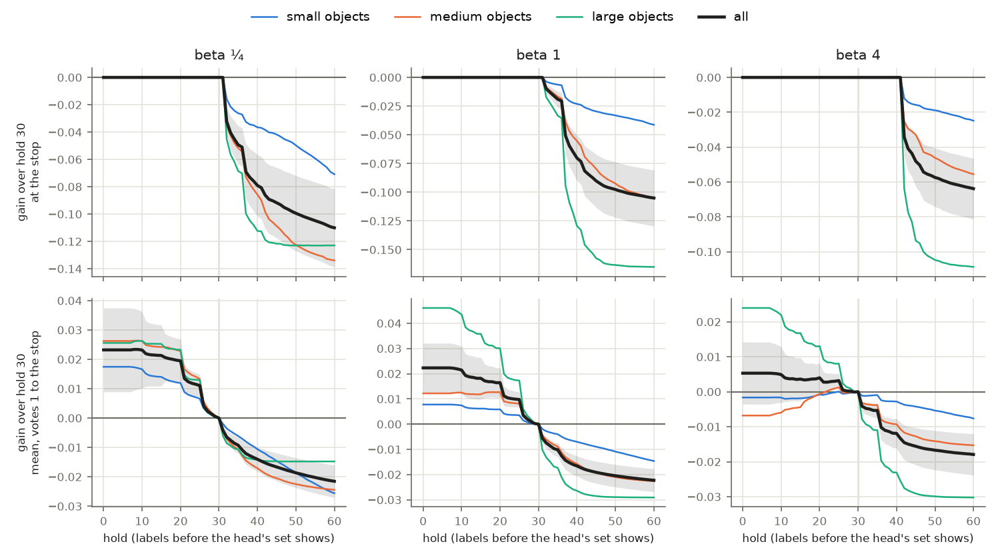
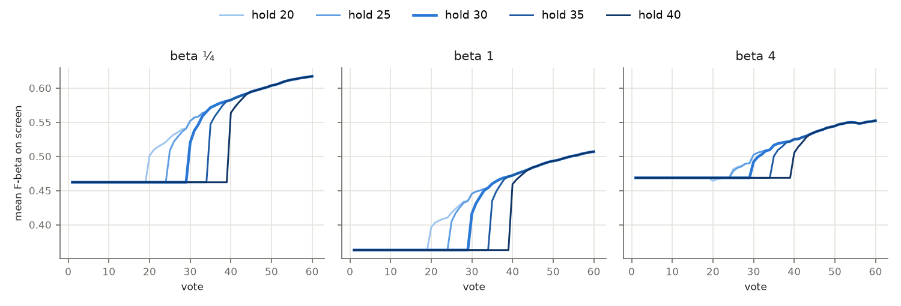
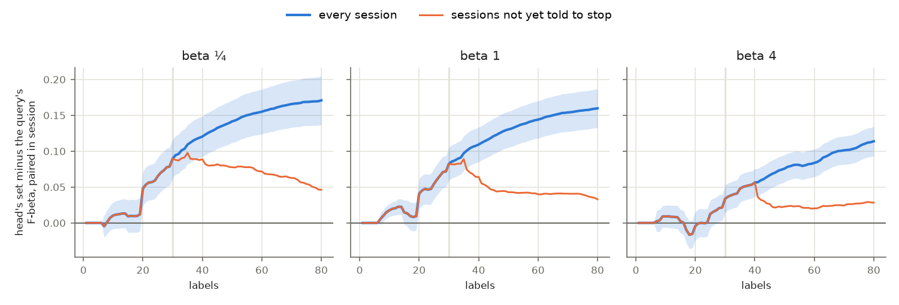

# The typed-query hold's count: no count moves the stop, and an earlier hand-over gives a better path (#5556)

**2026-11-04.** #4736 holds the typed query's own set on Find until the session has 30 labels (on a
single-vector space, the Binary path). The 2026-11-03 Binary Photo review (#5525) shows the objective flat on the
query's set until click 30, then a step up when Find hands over to the trained head. This study prices every count
from 0 to 60 on that review's 11,520 sessions a preset. It uses two reads, in the owner's order. First, does the
count change where the app says stop, or what the user has there? Second, what does the user see on the way
there?

**The stop: no count up to 30 changes anything.** The stop click is the same at every count. The stop rule reads
only the head, and four confirmation runs (288 sessions) stopped on the same click in every session. No session
is told to stop before 31 labels at beta ¼ and 1, or before 41 at beta 4. That floor is set by the stretches
before Done: the 7-vote opening, at least 3 Hard votes, then a check of 20 votes (30 at beta 4). So every count
from 0 to 30 shows the head's set at every stop, and the objective there is identical, to the last digit. A count
**above** 30 does reach the stop, and costs there. At 35 it costs **−0.049 / −0.019 / 0** (beta ¼ / 1 / 4), and at
40 it costs −0.079 / −0.070 / 0. Those sessions show the query's set where they would have shown the head's, and
they lose about 0.12-0.14 each.

**The path: handing over earlier is better at beta ¼ and 1.** Each session's mean objective over votes 1 to its
stop, minus the shipped count's:

| | beta ¼ | beta 1 | beta 4 |
|---|---|---|---|
| hold 0 (the head from the quota) | **+0.023 ± 0.007** | **+0.022 ± 0.005** | +0.005 ± 0.004 |
| hold 8 | +0.023 ± 0.007 | +0.022 ± 0.005 | +0.005 ± 0.004 |
| hold 20 | +0.020 ± 0.004 | +0.016 ± 0.003 | +0.004 ± 0.002 |
| hold 25 | +0.011 ± 0.002 | +0.010 ± 0.002 | +0.003 ± 0.001 |
| hold 30 (shipped), its mean | 0.49 | 0.39 | 0.49 |
| hold 35 | −0.009 ± 0.001 | −0.010 ± 0.001 | −0.005 ± 0.001 |
| hold 40 | −0.014 ± 0.002 | −0.017 ± 0.002 | −0.012 ± 0.002 |
| the best count, and the counts within 2 SE of it | 8 (0-20) | 0 (0-8) | 0 (0-35) |

Mean ± SE clustered on the class (49 classes). Positive means the count beats 30. A count of 7 or less is the
same as 0, because the hold starts at the label quota (3 Goods and 4 Bads). Counts 0-10 agree within 0.001 at
every preset.

**The decision rule (fixed before the numbers were read) gives 8 at beta ¼, 0 at beta 1, and 30 at beta 4.** No
count beats 30 at the stop, and counts above 30 are out at beta ¼ and 1. So the path decides. At beta ¼ the best
path is 8 (+0.023 ± 0.007), and at beta 1 it is 0 (+0.022 ± 0.005). Both clear 2 SE. At beta 4 the best path is 0
(+0.005 ± 0.004), which does not clear 2 SE, so 30 stays. Count 8 and count 0 differ by 0.0002 at beta ¼, so in
practice the rule says **hand over at the quota at beta ¼ and 1, and keep 30 at beta 4.**

**One count for every preset: 0 does as well as a table.** Pooled over the three presets, 0 gains
**+0.017 ± 0.005** on the path. Each preset's own best count gains 0.0001 ± 0.0001 more than that, which is
nothing. Count 0 also costs beta 4 nothing (+0.005 ± 0.004), and the rule is not met there only because the gain
is too small to tell from zero. So the choice is between two things. A per-beta table {¼: 0, 1: 0, 4: 30} is the
rule's answer, read literally. A single count, 0, is the same at beta ¼ and 1 and differs at beta 4 by an amount
within the noise.

*Figure 1. Each count minus hold 30. Top: the objective where the app says stop. Bottom: each session's mean over
votes 1 to its stop. Black: every session, with two clustered SEs shaded. Colours: the size bands. At the stop,
every count up to 30 (beta 4: up to 40) is exactly 30's, because no session stops earlier, and counts past that
lose. On the path, every label held past the quota costs at beta ¼ and 1. At beta 4 only large objects pay.*

*Figure 2. The set on screen, averaged over sessions, at holds 20, 25, 30, 35 and 40. Each curve sits flat on the
query's set until its count, then joins the head's curve. The step the review drew at click 30 moves with the
count. The head's curve it joins is the same for all five, because the picks are the same.*

## The head's set against the query's, by label count

The two sets differ by much less than the step in Figure 2 suggests until 20 labels. The gap jumps at 20 labels,
which is where the mid-session check ends. The check fires at click 15 as a single round that writes its next row
at vote 20, so its picks reach the head all at once.

*Figure 3. The head's F-beta minus the typed query's, by label count, paired within session (blue, with two
clustered SEs). Orange: only the sessions not yet told to stop at that count. The grey line is the shipped 30.*

| | beta ¼ | beta 1 | beta 4 |
|---|---|---|---|
| the head's set is ahead for good from (labels) | 8 | 7 | 24 |
| the 2-SE band covers zero (labels) | 1-19 | 7-19 | 1-27 |
| the gap at 20 / 30 labels | +0.05 / +0.09 | +0.04 / +0.08 | −0.00 / +0.03 |

So the crossing is not sharp: there is a long stretch near zero from the quota to about 20 labels at beta ¼ and
1, and to about 27 at beta 4. In that stretch the head's set is ahead by about 0.01 on average, but it is ahead in
only 34-50% of sessions. From 20 labels it is clearly ahead. At beta 4 the head stays level with the query until
about 24 labels, which is why the hold neither costs nor earns much there.

## By size band (explains the count; the app cannot see the band)

The path, the count the rule picks and its gain over 30:

| | beta ¼ | beta 1 | beta 4 |
|---|---|---|---|
| small (stops latest: KM median 67 / 71 / 79) | 0, +0.018 ± 0.006 | 0, +0.008 ± 0.003 | 30 (0: −0.002 ± 0.003) |
| medium | 9, +0.026 ± 0.009 | 20, +0.013 ± 0.003 (0: +0.012) | 30 (0: −0.007 ± 0.006) |
| large (stops earliest: 32 / 36 / 41) | 9, +0.026 ± 0.012 | 0, +0.046 ± 0.010 | 0, +0.024 ± 0.008 |

Large objects gain most from an early hand-over at every preset. At beta 4 they gain +0.024, while medium and small
objects lose a little, because the query's broad beta-4 set is hard to beat on them. So beta 4's tie is a mix of
those two, not the absence of an effect. At the stop, counts above 30 cost large objects most (−0.13 at 40, beta 1),
because large-object sessions stop earliest, and so most of them stop inside a long hold.

## Literal examples

The path is the mean over votes 1 to the stop. Every session below shows the same set at its stop under both
counts.

| session | typed query's F-beta | head at 20 labels | stop | path, hold 30 | path, hold 0 | what happens |
|---|---|---|---|---|---|---|
| beta 1, person@large, seed 68 | 0.07 | 0.76 | 33 | 0.16 | 0.51 | The query's line barely finds a large person. The head has it from about vote 8, and the hold hides it for 22 votes. |
| beta 4, traffic light@large, seed 37 | 0.23 | 0.80 | 41 | 0.40 | 0.69 | |
| beta ¼, skis@small, seed 76 | 0.19 | 0.83 | 34 | 0.23 | 0.70 (hold 8) | |
| beta 1, mouse@medium, seed 32 | 0.41 | 0.00 | 39 | 0.38 | 0.19 | The early head returns nothing on the withheld half. This is the case the hold was built for. |
| beta 4, mouse@medium, seed 32 | 0.60 | 0.02 | 41 | 0.62 | 0.36 | The same session at beta 4. |
| beta 1, bicycle@medium, seed 10 | 0.34 | 0.04 | 33 | 0.32 | 0.15 | |

The hold's wins are real, but they are fewer than its losses at beta ¼ and 1. Over the path, hold 0 beats 30 in 54%
of beta-1 sessions and loses in 31%; at beta ¼ the split is 44% / 38%, with larger wins. At beta 4 it is 44% /
45%.

## App screens

No current Apptitude run exists. The newest is #4876's 2026-10-14 run at a common 1% prevalence (110 sessions a
preset, from `1c430aeec`), which predates this review's build by three weeks (#5477's Done needing Goods in hand,
#5479's Diversity off and others). Read the same way as an old-build side read, it agrees with photos and is
stronger. No count up to 42 (50 at beta 4) moves the stop there: no session stops before 42 labels (50 at beta 4),
and the medians are 51 / 52 / 60. On the
path, hold 0 beats 30 by **+0.044 ± 0.012 / +0.076 ± 0.020 / +0.056 ± 0.028**, and 0 is the best count at every
preset. So neither the per-beta table nor the single count 0 costs screens on this read, and a current screens
price is the one gap left. The tables are in `measurements/screens/summary_stop.md`.

## Checks

**The confirmation runs match the offline price exactly**, at a count above 30 (40, which #4876 never ran) and at
the counts the rule picks. All of them replay seeds 1 and 3 of the review's grid, every fourth SigLIP cell (72
sessions a preset), at `CALIB_QUERY_HOLD`, from a frozen tree at the review's commit `605274e2e`
(`hold_4876.sh review`). `hold_4876.py check` compares each with its review session:

| | hold 40, beta ¼ | hold 40, beta 1 | hold 40, beta 4 | hold 0, beta 1 | hold 8, beta ¼ |
|---|---|---|---|---|---|
| same picks | 72 / 72 | 72 / 72 | 72 / 72 | 72 / 72 | 72 / 72 |
| same stop click | 72 / 72 | 72 / 72 | 72 / 72 | 72 / 72 | 72 / 72 |
| largest gap, run minus offline price | 0 | 0 | 0 | 1 × 10⁻⁶ (CSV rounding) | 3 × 10⁻⁶ (CSV rounding) |

So the stop does not move with the count, now measured rather than read from the code. Hold 40 shows the query's set
at labels 30-39, exactly where the offline price put it. Beta 4's count of 30 is the review itself, so it needs no
run.

**The invariants the price rests on**, checked on all 34,560 photo sessions and 330 screen sessions, with 0
violations:

- one `hold:head` row per held vote, none at 30 labels or more, and each matched to a shown row;
- the query's set is one value per session (largest spread across a session's query rows: 0);
- no query-tier row after the head has trained at 30 labels or more;
- the stop each cell gives matches `analyze.py`'s `stops.csv` in 11,520 of 11,520 sessions at each preset.

## What was run

- **Sessions:** the 2026-11-03 Binary Photo review, `state-of-the-app/2026-11-03-b{025,1,4}`, 80 seeds × 144 SigLIP
  cells, from `605274e2e`. The objective is F-beta at the preset's beta, of the set Find returns, on the withheld
  half. A vote with no row carries the last one (a check round writes one row for its votes), as the review reads
  them.
- **The price is exact offline.** The hold changes what Find returns, never what Autopilot asks or when the app says
  stop. Below 30 labels the harness keeps the head's row tagged `hold:head`. At 30 or more the untagged row is the
  head's. The query's set is one value per session. So hold *h* shows the query's value at every vote whose labels
  number fewer than *h*, and the head's from *h* on. The objective at the stop is that value at the session's first
  `done` click. A session never told to stop (5%) is read at click 150, and its path runs 1-150.
- **Analyzer:** `scripts/experiments/state_of_app/hold_4876.py`. `extract` now prices every count to 60 and reads
  each session's stop. The new `stop` subcommand gives both reads, the decision rule, the bands, the one-count
  comparison, the gap and Figures 1-3. `check` now compares the stop click too, and reads gzipped cells' picks.
  Every table is in `measurements/{photos,screens}/summary_stop.md`.

## Owner's ruling, and the build

**2026-11-04: hold 0 everywhere.** The app now hands over to the trained head at the label quota at every preset
(`label_quota.QUERY_HOLD_LABELS = 0`, in the same PR as this report). Only beta 4 departs from the rule's literal
30, and by an amount within the noise (+0.005 ± 0.004). The server's `query_hold` mark, the sort runner's
`heldRanking` and the eval knob `CALIB_QUERY_HOLD` all read that constant, so they keep working at any later count.

## Recommendation (as made before the ruling)

Per the rule: **hand over at the label quota at beta ¼ and 1, and keep 30 at beta 4.** The rule's literal counts
are 8 / 0 / 30, and 8 is indistinguishable from 0. This gains +0.023 / +0.022 on the path to the stop and changes
nothing at the stop. A single count of 0 for every preset does as well within noise (+0.017 ± 0.005 pooled), and
is the simpler build. The build is the issue's list: `label_quota.QUERY_HOLD_LABELS` (a per-beta table, if that
is chosen), the server's `query_hold` mark on the learned sort, the sort runner's `heldRanking`, the docs that
describe the hold, and the `check-eval-app-sync.py` mirror. #5530 (holding the mid-session check until a detector
shows) depends on this. At beta ¼ and 1 the detector would show at the quota, before the check at click 15.
