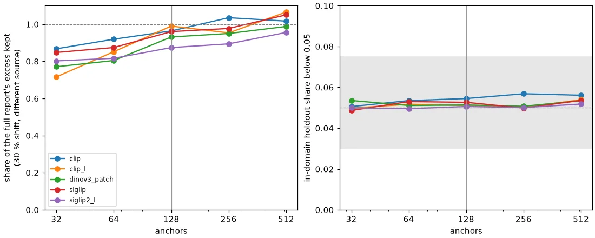

# The training-domain summary on real embedders: 128 anchors stand (#5568)

**Run 2026-11-05**, 15 tasks (5 embedders x 3 seeds), job 1194795, code `84b7184df`. It ran on the #3348
bench's matrices and splits ([#3348 report](../2026-10-23-atlas-node-model-3348/REPORT.md)). Results
root `/expscratch/sgreenberg/summary-5568`. Aggregates are in [`agg/`](agg/), and `tables.md` has every arm
on every embedder.

## The short version

1. **The summary is valid on every real embedder.** On the in-domain holdout, the share of items below
   α = 0.05 is 0.049-0.057 for every summary arm on every embedder, and the full report's is 0.051-0.052.
   KS from uniform is at most 0.040 for the shipped summary (full report: at most 0.032). This is the
   by-construction validity #5567 claimed, measured.
2. **At 128 anchors the summary keeps 94 % of the full report's signal on a 30 % shift.** On the worst
   embedder (`siglip2_l`) it keeps 87 %. Item for item, it flags 75 % of what the full report flags. On
   whole-dataset pairs its separation is 0.79 against the full report's 0.80. The synthetic bench
   predicted about 85 %, so real embedders are a little kinder to the summary.
3. **`SUMMARY_ANCHORS = 128` stands.** Doubling to 256 adds 0.02 of capture and 0.03 of item recall, and
   it doesn't move detection (0.46 vs 0.47), while doubling what a receiving instance fetches and embeds.
   Halving to 64 costs 0.09 of capture, and 0.13 on `dinov3_patch`. No follow-up PR is needed. This PR
   updates the constant's comment to cite these numbers instead of the synthetic ones.
4. **Choosing anchors by k-means earns its keep.** 128 random fit-half items keep 87 % (k-means: 94 %),
   and item recall is 0.66 (k-means: 0.75).
5. **The radius-normalised score is no better, as #5567 found on synthetic data.** Its capture (0.96) is
   level with the raw cosine. But it flags different items: its item recall is 0.65 and 35 % of its flags
   are items the full report does not flag. Its minimum separation over embedders is 0.54 (raw cosine:
   0.61).

## The grid

The grid is the #3348 grid, unchanged: five embedders (`siglip`, `dinov3_patch`, `clip`, `clip_l`,
`siglip2_l`), three seeds, and five datasets (`coco_better`, `o365_better`, `coco_val`, `caltech101_m`,
`visual_genome_m`). Each dataset's build 80 % is the reference. Its held-out 20 % is the in-domain null.
Two kinds of query were scored against every reference:

- **Whole-dataset pairs**: all 25 ordered pairs, exactly as #3348 scored them. The diagonal is the
  holdout.
- **30 % shift** (new here): for each of the 20 off-diagonal pairs, the reference's own holdout topped up
  to 30 % with items of the other dataset. Most whole-dataset pairs saturate every arm, and #5567's
  synthetic bench measured a 30 % shift.

Every arm scores the same query rows (at most 4 000 per pair, as #3348 did), so the comparison is paired
item for item. Every arm is split-conformal over the same fit and calibration halves of the reference:

| arm | what it reads |
|---|---|
| `full` | shipped `typicality_pvalues`: mean top-5 cosine to the fit half (the report the summary stands in for) |
| `sum32` ... `sum512` | shipped `summarize_reference` / `summary_pvalues` at that many anchors |
| `rand128` | 128 random fit-half items as anchors, the same calibration rule |
| `radius128` | the 128 shipped anchors, cosine distance over the anchor's radius (90th percentile of its cluster) |

## Validity

| arm | share below 0.05 (range over embedders) | KS, worst embedder | own-holdout false alarm |
|---|---|---|---|
| `full` | 0.051-0.052 | 0.032 | 0 / 75 |
| `sum64` | 0.050-0.053 | 0.040 | 0 / 75 |
| **`sum128`** | **0.051-0.055** | **0.040** | **0 / 75** |
| `sum256` | 0.050-0.057 | 0.038 | 1 / 75 |
| `sum512` | 0.052-0.056 | 0.038 | 1 / 75 |

*Each share is a mean over 15 cells (5 datasets x 3 seeds) per embedder. KS is the median over those
cells, and the column shows the worst embedder's median.*

The two false alarms are the same cell: `clip`, seed 0, `caltech101_m`. That reference has 670 items, so
it has 335 calibration scores, and the 168-item holdout reads 0.12 and 0.11 below α, z 4.1 and 3.4. At
256 and 512 anchors the summary keeps most of that reference's 335-item fit half. The p-values in a cell
share one small calibration set, so they are correlated, and the binomial z of the `shifted` rule
overstates its confidence on a reference this small. That holds for the full report too. It is a limit
of the verdict on small references, not a defect of the summary.

## Power



*Left: of the full report's excess over α on the 30 % shift (different-source pairs only, and only where
the full report's own excess is at least 0.02), the share the summary keeps. One line per embedder, each
point a mean over 33-52 pairs x seeds. A value above 1 means the summary's excess was larger than the
full report's on those pairs. Right: the in-domain holdout's share below 0.05, inside the band #3348
pre-registered (grey).*

Means over the five embedders, with the worst embedder beside each:

| arm | 30 % shift: capture (worst) | item recall | detection | whole pairs: separation (worst) | query time per task |
|---|---|---|---|---|---|
| `full` | 1 | 1 | 0.49 | 0.80 (0.63) | 38 s |
| `sum32` | 0.80 (0.72) | 0.61 | 0.42 | 0.73 (0.52) | 0.67 s |
| `sum64` | 0.85 (0.81) | 0.69 | 0.43 | 0.78 (0.65) | 0.62 s |
| **`sum128`** | **0.94 (0.87)** | **0.75** | **0.47** | **0.79 (0.61)** | **0.73 s** |
| `sum256` | 0.96 (0.89) | 0.78 | 0.46 | 0.76 (0.61) | 1.0 s |
| `sum512` | 1.02 (0.96) | 0.82 | 0.50 | 0.78 (0.63) | 1.5 s |
| `rand128` | 0.87 (0.78) | 0.66 | 0.44 | 0.76 (0.56) | 0.76 s |
| `radius128` | 0.96 (0.85) | 0.65 | 0.48 | 0.77 (0.54) | n/a |

*Capture is the arm's excess over α as a share of the full report's excess on the same pair. Item recall
is the share of items the full report flags that the arm also flags. Detection is the share of
different-source 30 % pairs the `shifted` verdict fires on. That verdict needs an excess at least
double α, so at a 30 % shift it fires on only about half the pairs, even for the full report.
Separation is #3348's measure: detection on the 54 different-source whole-dataset pairs minus false
alarms on the 15 own holdouts, per embedder. Query time is the median per task for all 45 pairs.*

On `dinov3_patch`, the space the old guard refused: `sum128` keeps 93 % on the 30 % shift, and its
whole-pair separation is 1.00, the same as the full report's.

## Why 128 stands

Each anchor is an origin that the receiving instance resolves and embeds before its first check. The
cost of the summary is linear in anchors, and the curve flattens past 128:

- 64 → 128 adds 0.09 of capture and 0.06 of item recall, and lifts the worst embedder from 0.81 to 0.87.
- 128 → 256 adds 0.02 of capture and 0.03 of item recall, and no detection.
- 256 → 512 adds 0.06 of capture. At 512, though, the summary is no longer much smaller than the
  references measured here, which have 335-9 800 items per fit half.

**128 anchors keep `SUMMARY_ANCHORS = 128`.** The constant's comment now cites this run.

## Limits

- **One α, one shift share.** α = 0.05 and a 30 % shift. The p-values are kept in `pvals_*.npz`, so
  another α can be re-scored without a re-run.
- **The anchors are the reference's own vectors.** A receiving instance re-embeds them with the same
  embedder, so this is exact as long as embedding is deterministic. Cross-machine float drift (#4481) is
  far below the scores' 6-decimal rounding.
- **References up to 9 800 items per half.** The summary's calibration keeps at most 1 000 scores, so it
  is at its full size on every reference here except `caltech101_m`.
- **Source groups follow #3348.** VG and COCO count as different sources.

## Reproduce

```bash
cd scripts/experiments/structure
bash launch_summary_power_5568.sh run     # 15 tasks, ~1 min each, reads #3348's matrices
python analyze_summary_power_5568.py --results $EXP/results --out $EXP/analysis --figure anchors.png
```
