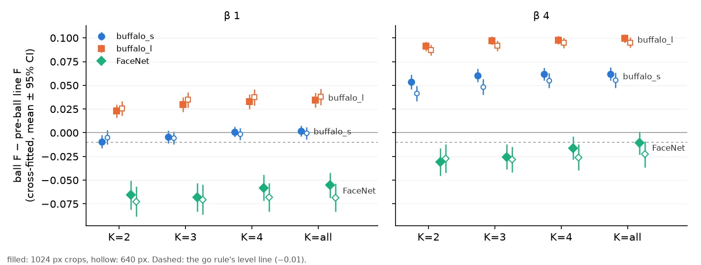

# Face ball floors per embedder: fit tool, per-space file, pre-ball fallback (#5497)

**Status (2026-11-06): shipped.** The face ball's floors (#5478) leave the code. Each face space, named by its
`Face Compat` tag, reads its own entry from `face_ball.json` beside the face pack. A tool fits that entry from a
labelled face set, and the fit's own check decides whether the ball is used in that space at all. A space with no
entry, or a no-go one, keeps the face line from before the ball and says so with a warning.

This follows #5486, where buffalo_s's floors fit buffalo_l by coincidence and lost 0.65-0.76 F on FaceNet. The
owner's call there was to refit per embedder, as practice for the proprietary face embedders a server may bring
through the `ext` provider.

## What ships

- **The file.** `$VTSEARCH_MODELS_DIR/imagekit/face_ball.json`, one entry per compat tag
  (`vtscore/media/face/face_ball.py`). An entry holds a floor and a slope at β 1 and β 4, the Goods' spread they are
  centred on, `use` (go/no-go), the check's numbers, and provenance: corpora, people, seeds, commit, time. It is a
  calculated asset, so it is not in the repo.
- **The rule names its space.** The face crops' line in a space with a ball is `face_ball[<compat>]`
  (`centroid_head.face_ball_rule`). Its floors come from that space's entry wherever the rule string goes: the
  detector's centroid line and its re-cut, the example sort, and the eval harness's `centroid_line`. The bare
  `face_ball` is now only the harness knob for "the medias' own space".
- **The fallback.** A face corpus whose tag has no entry, whose entry is no-go, or which carries no tag at all, is
  drawn by `count_gap_floor_skip25_b1_z5.5` (the line from before the ball). Past the quota it keeps the trained
  head, as the app did before #5478. The app shows a warning toast once per space and process:

  > **The face search line is not calibrated for this face embedder (oss-arcface-r50:1).**
  > Find and Test keep the face line drawn without a calibrated cosine floor.
  > `<models>/imagekit/face_ball.json` has no entry for it (`scripts/data/fit_face_ball.py` fits one).

  A no-go entry says instead that "its fit … found the ball no better than that line in this space". An unreadable
  file says why. People reads the same entry (its cut is the β 1 floor at the centre), so it is uncalibrated in
  exactly the spaces the ball is.
- **The harness mirror.** `production_centroid_line` resolves the default by the same `centroid_line_rule` on the
  medias' tag, and the centroid holds past the quota wherever its line is a face ball (`is_face_ball_rule`). The
  `check-eval-app-sync` mirrors are re-pinned.
- **The fit tool.** `scripts/data/fit_face_ball.py` over `vtscore/media/face/face_ball_fit.py`, which is #5474's
  `dump` and #5478's `fit` in one step that needs no eval run. It takes cell pickles (FHIBE's are the practice set)
  and a people file, and writes the space named by the medias' tag, or by `--compat` for an untagged set. Other
  spaces' entries are kept. `docs/DEPLOYMENT.md` (Face models) says how a deployment uses it.

## The go/no-go check

The entry is fitted on every person, and the check runs on two folds by person: each fold's floors are scored on the
other fold's people, against the pre-ball line drawn on the same cosines. The cells are K = 2, 3, 4 and every Good of
the voting half, at both crop sizes. The second input is the share of K = 4 cells whose own photos all clear every
other face (a clean gap).

**The ball is used when it is no more than 0.01 below the pre-ball line at β 1 and at β 4, and at least 75% of
people have a clean gap.**

| space (compat) | floors β 1 / β 4 (slope, centre) | gain β 1 | gain β 4 | clean gap | verdict |
|---|---|---:|---:|---:|---|
| buffalo_s (`oss-arcface-mbf:1`) | 0.4425 / 0.385 (0.25, 0.6371) | −0.003 ± 0.001 | **+0.055** ± 0.001 | 84% | **go** |
| buffalo_l (`oss-arcface-r50:1`) | 0.4525 / 0.4075 (0.25, 0.7161) | **+0.032** ± 0.001 | **+0.094** ± 0.001 | 94% | **go** |
| FaceNet (`facenet-vggface2:practice`) | 0.77 / 0.72 (0.25, 0.8046) | **−0.066** ± 0.003 | **−0.023** ± 0.002 | 54% | **no-go** |

Gains are mean F-beta (ball − line) over about 4,500 cells per space (562 people × 2 sizes × 4 K), ± one standard
error. FaceNet's pickles predate the face provider and carry no tag, so its practice entry is named
`facenet-vggface2:practice` and matches no dataset.



The verdict does not depend on K or crop size. FaceNet loses at every K at both balances, and buffalo_l gains at
every one. buffalo_s is level at β 1 (−0.009 to +0.002 by K) and gains at β 4 (+0.04 to +0.06).

**Why "level", not "gains".** The first draft required a gain at every balance, and it made buffalo_s no-go on its
β 1 reading of −0.003. The check is static, on cosines alone. Its pre-ball line is the centroid count a detector gets
under the quota. Past the quota a session's line is the trained head's, and that is what the ball replaced. #5478's
session replay measured buffalo_s's gain at β 1 as +0.010 [+0.00, +0.02], where this check reads −0.003. So the static
check is conservative at β 1, and its "level" band is that size. #5486's sessions agree in sign with the check
everywhere else: buffalo_l +0.05 / +0.05, FaceNet −0.08 / −0.04.

A perfectly separable synthetic set ties the line at F = 1, which is level, and the unit test reads it as go.

## The fit reproduces what shipped

- **buffalo_s's shipped floors, exactly**: 0.4425 at β 1 and 0.385 at β 4, slope 0.25, centre 0.6371. These are the
  constants #5478 shipped (`FACE_BALL_FLOORS`, `FACE_BALL_SLOPE` and `FACE_BALL_CENTRE` until this change).
- **#5486's refits, exactly**: buffalo_l and FaceNet's entries equal their `all` B constants from #5486's work
  directory.
- **The file gives the floors the code gave**: `FaceBall.floor` reproduces the old in-code formula bit for bit at
  every balance and spread tested (`test_the_file_gives_the_floors_the_code_gave`).
- **No pick or F moves on buffalo_s.** 72 face-review cells (12 person × size slots, chosen at random with seed 5497,
  at K 1 and 4 and every balance) were run on dev (1253e0507) and on this branch (c534adabf, reading the live file).
  All 864 files per arm (the cells, their picks and every side table) are identical, value for value, apart from
  the rule's recorded name. The `centroid_line` column now reads `face_ball[oss-arcface-mbf:1]` where it read
  `face_ball`; no analysis script filters on that column's value.

## Deploying

The GRID's live file is `/expscratch/sgreenberg/imagekit-models/grid-default/imagekit/face_ball.json`. Both the
live app's models folder and the pile's link their `imagekit` directory there. It holds the three practice entries
above, fitted at commit c534adabf on a clean tree. **A server without the file loses the ball on buffalo_s** and
shows the warning, so the laptop's pack needs a copy beside its `face.json` (or a fit of its own).

## Reproducing

```
python scripts/data/fit_face_ball.py --medias <data>/embeddings/fhibe_faces_ik_1024__face.pkl \
    <data>/embeddings/fhibe_faces_ik_640__face.pkl --people <runs>/2026-10-09-k4/identities.txt --corpus "FHIBE faces"
python scripts/experiments/fhibe/face_ball_fit_5497.py table --space bs --out <dir>   # and bl, fn
python scripts/experiments/fhibe/face_ball_fit_5497.py figure --tables <dir> --out check.webp
```

buffalo_l's pickles are `fhibe_faces_ik_{1024,640}__imagekit_face.pkl` and FaceNet's are
`fhibe_faces_{1024,640}__face.pkl` (with `--compat`). Each fit takes about 3 minutes on 4 CPUs.
