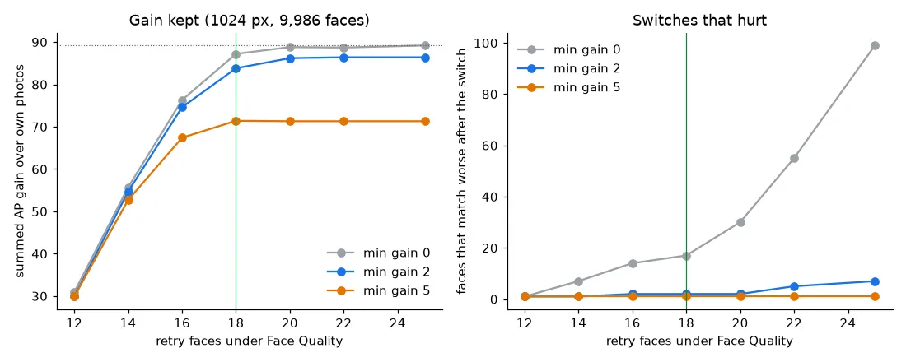
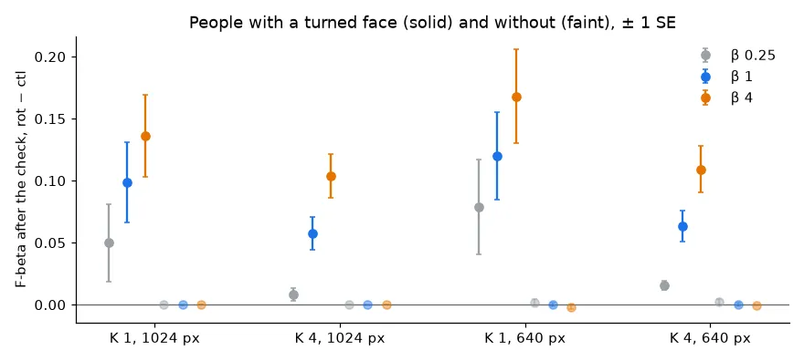

# Face rotation retry: re-detect a low-quality face in the turned photo (#5373)

**Status (2026-11-06): shipped.** When a face's Face Quality is under 18 on buffalo_s, VTSearch runs the
face pipeline again on the photo turned 90°, 180° and 270°. It keeps a turned face that overlaps the
first one (box IoU ≥ 0.5 once mapped back upright) and scores at least 2 more quality. About one face in
twelve is retried, and one in eighty is replaced. On the face bench, the people with a replaced face gain
0.06-0.17 F-beta after the check at β 1 and β 4, the other people are level, and no cell loses.

Two of the six one-photo sessions that fail on buffalo_s (#5348, #5372) are people lying down. The
detector finds their face sideways, ArcFace embeds a badly aligned crop, and the vector misses the person.
Through the shipped converter, both faces now come out upright: quality 13.0 → 23.2 and 12.8 → 23.0
(the pile median is 23).

## What ships

- **`process_upright`** (`vtscore/media/face/imagekit_bridge.py`) wraps `FacePipeline.process`. Every
  record under its space's cut is a candidate. Each of the three turned photos goes through the same
  pipeline, its records are mapped back to the upright frame (box and landmarks), and a candidate is
  replaced by the best turned record that overlaps it and beats its quality by the minimum gain. Records
  are only replaced, never added or dropped, so face indices and counts don't change.
- **Per space.** The cut and the gain are keyed on the record's compat tag:
  `UPRIGHT_RETRY_QUALITY = {"oss-arcface-mbf:1": 18.0}`, `UPRIGHT_MIN_GAIN = {"oss-arcface-mbf:1": 2.0}`.
  A space with no entry (buffalo_l, an `ext` server's embedder) is never retried. Quality is the raw
  embedding's norm, and its scale differs by embedder.
- **Ahead of the pipeline, not inside it.** The image→face converter, the face embedder and
  `hard_view_of_file` call `process_upright` instead of `process`. An `ext` provider gets the retry as soon
  as its space has an entry, and imagekit's contract is unchanged.
- **Cost.** Three extra pipeline calls per retried face's photo: +26% calls over the 1024 px pile (852
  of 9,986 faces).

## Sizing

Every FHIBE subject face (the detection matching the annotated box, as `face_crops` picks it) was
re-embedded at 0/90/180/270 from `long1024`. The 640 px run covered the 853 faces under 18. The 0° pass
reproduces the cell exactly. A face *switches* when a turned record overlaps it and has more quality.
"Better" means a higher mean cosine to the person's other photos, and ΔAP is the change in that face's AP
as a query over the pile.

| size | cut | min gain | retried | switched | match worse (cos / AP) | ΣΔAP |
|---|---:|---:|---:|---:|---:|---:|
| 1024 | 16 | 0 | 419 | 124 | 14 / 9 | 76 |
| 1024 | 18 | 0 | 852 | 165 | 17 / 11 | 87 |
| 1024 | **18** | **2** | **852** | **125** | **2 / 2** | **84** |
| 1024 | 25 | 0 | 7,315 | 367 | 99 / 35 | 89 |
| 640 | **18** | **2** | **853** | **118** | **1 / 2** | **82** |

The full grid (cuts 12-25, gains 0-5) is in `cuts.csv`.

- **The cut.** ΣΔAP flattens at 18: it holds 98% of the most any cut reaches (89 at 25). Above 18, the
  retry runs on nine times as many faces for 2 more AP.
- **The gain.** A quality gain predicts a match gain (Pearson r 0.84 at 1024, 0.89 at 640 over every
  turned record), but a small gain is a coin toss (`gain_bins.csv`):

| quality gain | turned records (1024) | match better |
|---|---:|---:|
| ≤ 0 | 11,484 | 2% |
| 0-2 | 240 | 49% |
| 2-5 | 100 | 90% |
| > 5 | 119 | 98% |

  A minimum gain of 2 drops 40 switches, and with them 15 of the 17 that match worse, for 3 of the 87 AP.

## Bench

The face review (`sota_face.sh`, K 1 and 4, 1024 and 640 px, β 0.25/1/4, 562 people, 150 clicks) ran
twice from one frozen tree at the shipped commit. **ctl** read the face cells as built. **rot** read
cells rebuilt with the retry, in a private pile (`VTS_PILE`, `VTS_FHIBE_ROOT`) so the live cells were
never touched. The rebuild turned 126 faces of 10,102 at 1024 (121 people) and 119 of 9,790 at 640 (112
people). The 640 rebuild also holds one face the live cells lack (quality 14.8, not a turned one). In both arms, the 21 cells of K 4's seven six-photo people fail as they always have.

Paired over people, rot − ctl, ± one SE (`paired.csv`). *Touched* = the session set's people with a
turned face (about 45 of 562).

| K | size | β | F after the check, ctl → rot | Δ all people | Δ touched | Δ untouched | Δ final AP (all) |
|---|---|---:|---|---:|---:|---:|---:|
| 1 | 1024 | 0.25 | 0.961 → 0.965 | +0.004 ± 0.003 | +0.050 ± 0.031 | 0.000 | +0.010 |
| 1 | 1024 | 1 | 0.926 → 0.934 | **+0.008** ± 0.003 | **+0.099** ± 0.032 | 0.000 | +0.011 |
| 1 | 1024 | 4 | 0.939 → 0.950 | **+0.011** ± 0.003 | **+0.14** ± 0.033 | 0.000 | +0.011 |
| 4 | 1024 | 0.25 | 0.971 → 0.972 | +0.001 ± 0.000 | +0.008 ± 0.005 | 0.000 | +0.006 |
| 4 | 1024 | 1 | 0.936 → 0.940 | **+0.005** ± 0.001 | **+0.058** ± 0.013 | 0.000 | +0.007 |
| 4 | 1024 | 4 | 0.950 → 0.958 | **+0.008** ± 0.002 | **+0.10** ± 0.017 | 0.000 | +0.007 |
| 1 | 640 | 0.25 | 0.960 → 0.968 | +0.008 ± 0.004 | +0.079 ± 0.038 | +0.002 | +0.014 |
| 1 | 640 | 1 | 0.917 → 0.927 | **+0.010** ± 0.003 | **+0.12** ± 0.036 | 0.000 | +0.014 |
| 1 | 640 | 4 | 0.930 → 0.942 | **+0.011** ± 0.004 | **+0.17** ± 0.038 | −0.002 | +0.014 |
| 4 | 640 | 0.25 | 0.969 → 0.973 | +0.003 ± 0.002 | +0.015 ± 0.004 | +0.002 | +0.010 |
| 4 | 640 | 1 | 0.926 → 0.932 | **+0.005** ± 0.002 | **+0.063** ± 0.013 | 0.000 | +0.009 |
| 4 | 640 | 4 | 0.937 → 0.945 | **+0.008** ± 0.002 | **+0.11** ± 0.019 | 0.000 | +0.009 |

- **Nothing moves where nothing turned.** At 1024, the untouched people's sessions are identical to 4
  decimals. At 640, the extra face sits in every pool, so they wobble by ±0.002.
- **The gain is in the session, not just the end.** The session mean over clicks 1-150 rises with the
  final F (`d_session_mean` in `paired.csv`: +0.001 to +0.012 over all people). Click 0, the typed-query
  sort before any vote, rises too (+0.001 to +0.012).
- **Starting from a turned face** (K 1, five sessions per set): F after the check rises 0.40 at 1024 and
  0.55-0.60 at 640. That is two (1024) or three (640) of the five sessions going from a failed start to a
  near-perfect one. The issue's two lying-down people are among them at both sizes.
- **β 0.25 gains least.** Its line sits high, and the touched people mostly passed it already.

## Provenance

- Code: branch `claude/face-rotation-5373`, retry at `c5fc82f38`. Both bench arms ran from the frozen
  tree `vts-5373-run` at that commit, buffalo_s (`oss-arcface-mbf:1`), on cpu.
- Sizing: `face_rotation_5373_size.sh` (jobs 1201001, 1201002) → `face_rotation_5373_analyze.py`,
  `face_rotation_5373_margin.py` → `face_rotation_5373_tables.py` (`cuts.csv`, `gain_bins.csv`).
- Rebuild: `build_pile` for `fhibe_faces_ik_{1024,640}` into the private pile (jobs 1201131, 1201132).
- Bench: `SOTA_FACE_ARM=ik SOTA_FACE_DATE=2026-11-06`, `SOTA_FACE_TAG=5373ctl` (live pile; packs
  1201157-60) and `5373rot` (`VTS_PILE` = the private pile; packs 1201272-75). Then `sota_face.sh baseline`
  and `sota_face_analyze.sh` per arm (jobs 1201407, 1201608).
- Compare: `face_rotation_5373_compare.py --ctl <analysis>,<baseline> --rot <analysis>,<baseline>
  --ctl-cells <live cells> --rot-cells <private cells> --runs <runs> --ctl-set 2026-11-06-5373ctl-ik`
  → `paired.csv`, `turned.csv`. A dry run with ctl on both sides gives 0 everywhere.
- Figures: `face_rotation_5373_figure.py`.
- Committed files hold aggregates only. The per-face sizing rows stay owner-only in the work dir.
- The four CSVs (`cuts.csv`, `gain_bins.csv`, `paired.csv`, `turned.csv`) are on the `experiments-data`
  release: `python scripts/experiments/study_data.py fetch 2026-11-06-face-rotation-5373` puts them back.

The live FHIBE face cells were not rebuilt here. The next `build_pile` of `fhibe_faces_ik_*` picks up the
retry, and later face benches read it from there.
