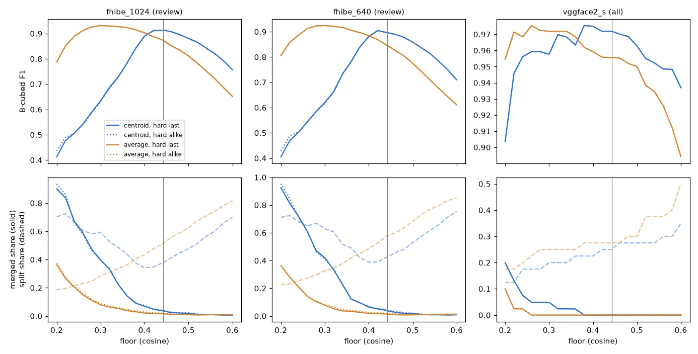

# The People cut: how well the partition recovers real identities — 2026-11-06 (#5591)

**The shipped cut stands.** The people partition (#5586) cuts at the face ball's β 1 floor, 0.4425 on
buffalo_s, with centroid linkage and hard views attached last. On FHIBE's 562 review people at 1024 px it
scores B-cubed F1 0.91 (precision 0.97, recall 0.87) and pairwise F1 0.87. It errs the way the plan asks: 38%
of people are split over more than one partition person, and 3.6% of partition people hold more than one
identity. No other floor or linkage beats it on B-cubed F1 at both crop sizes without raising the merged
share. Attaching hard views last against treating them like any face makes no difference (±0.002). The answer
is the same at 640 px, on all 1,772 FHIBE subjects, and on the VGGFace2 (S) demo.

Two things the sweep found that the cut's choice did not need:

* **Centroid linkage has a cliff just below the shipped floor.** Under about 0.42, the neighbour graph's
  components chain into one blob, and centroid linkage turns that blob into a few large mixed people and a
  crowd of singletons. B-cubed F1 falls by 0.07 at 0.38 and by 0.13 at 0.36. The shipped floor sits about
  0.02 above that edge. Any floor that #5497's per-compat file sets lower than about 0.42 for this method
  would land on the cliff.
* **Average linkage has no cliff, and a higher peak in exchange for more merges.** Its best floor
  (0.30–0.32) scores +0.02 to +0.03 B-cubed F1 over the shipped cut, but merges about twice as often
  (8–9% of partition people against 3.6–3.8%). At the floor where its merged share falls to the
  shipped one (0.38–0.40), it is level with the shipped cut (−0.006 to +0.001).



Measured on buffalo_s (`fhibe_faces_ik_{1024,640}__face`), every arm fitted by
`vtscore.datasets.people.fit_people` itself. The average-linkage arm swaps the module's
`_centroid_linkage` for scipy's average linkage for the length of the fit. Everything else (the neighbour
graph, the reassignment, the hard-view attachment, the ordering) is the shipped code. Scripts:
`scripts/experiments/people_cut_5591/`. Every arm's numbers: `arms.csv`.

## The measures

A partition is scored against each face's true identity. A face the fit left unplaced counts as a person of
its own.

* **Pairwise** precision and recall over face pairs: of the pairs placed in one person, the share that are
  one identity; of the pairs that are one identity, the share placed in one person.
* **B-cubed** precision and recall per face, averaged over faces: the share of the face's partition person
  that is its identity, and the share of its identity that is in its partition person. B-cubed F1 is the
  headline because it weighs every face equally, where pairwise weighs a large person by the square of its
  size.
* **Split share**: identities whose faces are spread over more than one partition person. **Merged share**:
  partition people with two or more faces that hold more than one identity. The merged share is also given
  by face (the faces that sit in a merged person) and by identity (the identities with a face in one).
* The **gap** to the shipped cut carries a 95% CI from 1,000 resamples of the identities with their faces,
  paired, since every arm partitions the same faces.

## The answers per question in the issue

### 1. How good is the shipped partition?

| Shipped cut (0.4425, centroid, hard last) | FHIBE 562, 1024 px | FHIBE 562, 640 px | FHIBE all, 1024 px | FHIBE all, 640 px | VGGFace2 (S) |
|---|---:|---:|---:|---:|---:|
| faces / identities | 4,526 / 562 | 4,485 / 562 | 10,027 / 1,772 | 9,734 / 1,769 | 598 / 40 |
| partition people (singletons) | 917 (363) | 1,001 (442) | 2,953 (1,361) | 3,116 (1,564) | 52 (6) |
| pairwise precision / recall / F1 | 0.91 / 0.84 / 0.87 | 0.90 / 0.81 / 0.85 | 0.84 / 0.79 / 0.82 | 0.84 / 0.77 / 0.80 | 1.00 / 0.94 / 0.97 |
| **B-cubed** precision / recall / **F1** | 0.97 / 0.87 / **0.91** | 0.96 / 0.84 / **0.90** | 0.96 / 0.82 / **0.88** | 0.96 / 0.80 / **0.87** | 1.00 / 0.95 / **0.97** |

The "all" columns add FHIBE's other 1,210 subjects as distractors. They are a harder test than the 562 alone:
more lookalikes, and many subjects with four photos or fewer.

### 2. How often is a person split, and how often merged?

| Shipped cut | FHIBE 562, 1024 | FHIBE 562, 640 | FHIBE all, 1024 | FHIBE all, 640 | VGGFace2 (S) |
|---|---:|---:|---:|---:|---:|
| **split**: identities in more than one person | **38%** | 42% | 43% | 47% | 25% |
| partition people per identity (mean) | 1.7 | 1.8 | 1.7 | 1.8 | 1.3 |
| an identity's faces outside its largest part (mean) | 8% | 11% | 14% | 16% | 3% |
| **merged**: people (2+ faces) holding 2+ identities | **3.6%** | 3.8% | 3.8% | 3.8% | 0% |
| faces in a merged person | 6.4% | 6.7% | 7.6% | 7.4% | 0% |
| identities with a face in a merged person | 7.7% | 8.0% | 8.1% | 7.8% | 0% |

Splits outnumber merges by about ten to one, the way the plan prefers. A split is usually small: among the
562, the mean identity keeps 89–92% of its faces in one partition person, and 363 of the 917 partition people
at 1024 px are single faces.

### 3. Does another floor or linkage beat the shipped cut without raising the merged share?

No, not at both sizes.

| B-cubed F1 gap to the shipped cut (95% CI), merged share in brackets | FHIBE 562, 1024 | FHIBE 562, 640 |
|---|---:|---:|
| shipped: centroid 0.4425 | 0.91 [3.6%] | 0.90 [3.8%] |
| centroid 0.42 | −0.00 (−0.01, +0.00) [4.8%] | +0.01 (+0.00, +0.01) [5.1%] |
| centroid 0.46 | −0.01 (−0.01, −0.00) [2.5%] | −0.01 (−0.01, −0.00) [2.7%] |
| centroid 0.40 | −0.02 (−0.03, −0.01) [6.9%] | −0.02 (−0.03, −0.01) [6.5%] |
| centroid 0.38 | −0.07 (−0.09, −0.06) [9.1%] | −0.06 (−0.07, −0.04) [9.6%] |
| centroid 0.36 | −0.13 (−0.15, −0.11) [14%] | −0.11 (−0.13, −0.09) [12%] |
| average 0.30 (its best) | +0.02 (+0.01, +0.03) [8.0%] | +0.03 (+0.02, +0.04) [7.9%] |
| average 0.34 | +0.01 (+0.01, +0.02) [5.3%] | **+0.02 (+0.02, +0.03) [3.7%]** |
| average 0.38 | +0.00 (−0.00, +0.01) [3.0%] | −0.00 (−0.01, +0.01) [2.6%] |
| average 0.40 | −0.01 (−0.02, −0.00) [2.1%] | −0.01 (−0.02, −0.01) [1.9%] |

Across both linkages, both hard-view rules and floors 0.20 to 0.60 in steps of 0.02 (`arms.csv`), the only
arms whose CI clears the shipped cut with no more merging are average linkage at 0.34 and 0.36 at 640 px
(+0.021, +0.009). Their merged share ties the shipped one (3.7% and 3.5% against 3.8%). At 1024 px the same
two arms merge more (5.3%, 3.9% against 3.6%), and on all 1,772 subjects every average-linkage floor that
gains also merges more. On VGGFace2 (S), every centroid arm from 0.34 to 0.50 and every average arm from 0.22 to 0.38 is within
0.01 of the shipped one. So the
gain does not hold across sizes, and the shipped cut stands.

**The centroid cliff.** On FHIBE's 562 at 1024 px, the largest component of the neighbour graph has 30 faces
at the shipped floor, 63 at 0.42, 138 at 0.40, 1,057 at 0.38 and 2,027 at 0.36. Centroid linkage over a
component that size merges whole people into one cluster whose unit centroid drifts between them. At 0.38
the largest partition person has 144 faces from 39 identities. Many of those faces then clear no centroid in
the reassignment and are left alone: singletons rise from 363 at the floor to 947 at 0.36. So precision and
recall both fall as the floor drops, which is the opposite of what a lower cut usually does. Average
linkage judges a merge by every pair between the clusters, not by two drifting centroids, so a chained
component does not collapse into one person.

### 4. Does attaching hard views last help?

Not measurably. FHIBE has few hard views among the faces scored (54 of 4,526 at 1024 px, 50 of 4,485 at
640 px). Treating them like any face moves B-cubed F1 by −0.000 and −0.001 at the shipped floor, and by no
more than 0.003 at any floor near it. The merged share moves by +0.4 points at 1024 px and +0.5 at 640 px
when hard views join the graph, which is the direction the rule exists to prevent. VGGFace2 (S) has none.
The rule stays: it costs nothing here, and the merged share is the side to protect.

### 5. Does the answer hold at both crop sizes?

Yes. The shipped floor is at or within 0.02 of centroid linkage's B-cubed F1 peak at both sizes and on both
populations (0.42–0.44). 640 px scores about 0.02 below 1024 px throughout, from more splits (42% against
38%), not more merges. That matches the 0.02–0.03 face F-β gap between the sizes in #4699's baseline.

## VGGFace2 (S) demo

The demo through the app's own `image2face` load (no cache): 632 faces in 598 photos of 40 people. The
largest face per photo carries the photo's label, and the other 34 are dropped. At the shipped cut it is
nearly perfect: no merge, B-cubed precision 1.00, recall 0.95. Ten of the 40 people are split, and the
mean person has 3% of their faces outside their largest part.

## Celebrities in Context (S) demo: co-occurrence only

4,217 faces in 1,200 photos (20 per named person, 60 people), every face kept, partitioned at the shipped cut
into 1,962 people, 423 of them with two or more faces. A photo names one person and holds others, so it cannot
score a partition. The check asks instead, for each named person, how many of their 20 photos the most
frequent partition person in those photos appears in.

| Partition person in the most of a named person's photos | |
|---|---:|
| share of the photos it appears in, mean / median | 0.95 / 0.98 |
| named people where it appears in most photos (> 50%) | 60 of 60 |
| named people where it appears in 80% or more | 58 of 60 |
| lowest share | 0.70 |

Contact sheets for four named people (the lowest share, the lower quartile, the median and the highest) show
one person each, with no one else's face among them. The lowest-share person is a split, not a merge: their
top partition person holds 14 faces, all theirs. In the other 6 photos their face went to another
partition person or was not found. The sheets are not committed. The demo's photos are agency and press photos with no stated
licence (see [demos](../../demos.md)), and this repository is public. They are on the GRID in the study's
owner-only work directory (`cic/sheets/`).

## The decision

**The shipped cut stands:** 0.4425, centroid linkage, hard views last. Nothing in this study changes
`vtscore/datasets/people.py`. The one arm that beat it under the issue's rule (average linkage at 0.34) did so
at one crop size only, by a tie on the merged share.

Average linkage is the safer method if the floor ever moves. It has no cliff, and it is level with the
shipped cut at a matched merged share. It is not adopted here because it does not pay at the shipped floor.

## Reproduce

On the GRID, from a worktree of this branch (the work directory holds FHIBE subject ids and celebrity photos,
so it is owner-only):

```bash
cd scripts/experiments/people_cut_5591
bash run.sh dump     # FHIBE cells -> dumps/fhibe_{1024,640}.npz
bash run.sh demos    # vggface2_faces_s, celebrity_together_s through image2face -> dumps/
bash run.sh sweep    # one sbatch job per dump x population x linkage (~5 min each)
bash run.sh post     # sweep/all/{arms.csv,summary.md}, cic/
python people_cut_5591.py figure --arms <work>/sweep/all/arms.csv --out cut.webp
```

The fit is deterministic, so a rerun reproduces every partition exactly. The bootstrap is seeded (5591).
