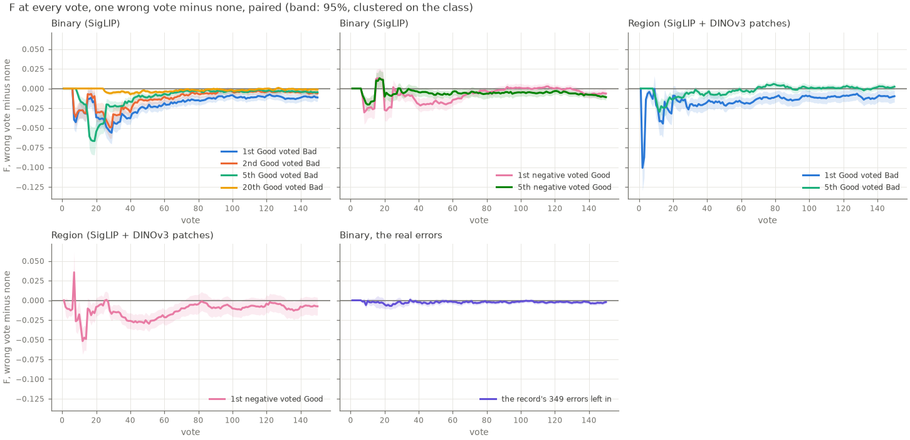
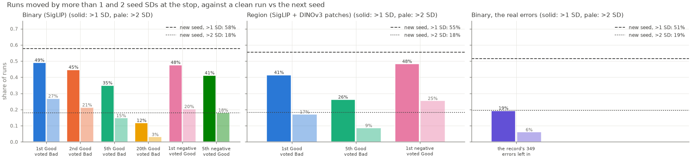

# One wrong vote early in a run moves it about as far as a new seed does, and which side hurts depends on the path (#3688)

**2026-11-12.** A sequential loop does not average a label error away. The wrong vote trains the head, and the head
picks every later image. `vg_scale`'s datasheet left that as a row ("a run's trajectory: unmeasured, and
structurally hazardous"). This study measures it on COCO Better, the bench that replaced `vg_scale`. It asks one
question: **how often does one wrong vote, at the position the loop serves it, change a run's outcome by more than
the run's own seed-to-seed spread?**

**The answer on Binary: about as often as drawing a new seed does, when the wrong vote is among the first few, and
a fifth as often by the 20th Good.** One wrong vote among a run's first ten moves F at the stop by more than one of
its cell's seed SDs in **41-49%** of runs. A clean run against the same cell's next seed does so in **58%**. The
spread of the wrong vote's effect is **1.4-1.6** seed SDs, against **1.4** for a new seed. Unlike a new seed, the
wrong vote also has a direction: it costs **−0.019 to −0.040** F at the stop on average (control 0.49). The 20th
Good voted Bad costs −0.005, and its spread is 0.50 seed SDs. Most of those runs have stopped before the loop
serves a 20th Good.

**The real errors cost less.** The owner's 349-row label record (`COCO_BETTER__label_review_4179.json`) lists
COCO labels that are wrong. Voting those images with COCO's wrong labels, against leaving them out, costs
**−0.0028 ± 0.0019** F at the stop. That is 19% of runs moved by more than one seed SD (a new seed: 51%), because
a record image reaches only 55% of runs by vote 150 and 16% by vote 10.

**Region agrees on the size and splits on the side.** On Region (SigLIP + DINOv3 patches, the same cells and
seeds) one wrong vote among the first few moves 41-48% of runs by more than a seed SD (a new seed: 55%). But
which error hurts is reversed. A Good voted Bad costs Region less than half what it costs Binary (−0.017 against
−0.040 at the 1st Good; −0.006 against −0.018 at the 5th). A negative voted Good costs it more (−0.045 against
−0.026), most at `@small` (−0.077), where it ends the session 32 clicks early. One error's effect on a run is
unrelated across the two paths (r = 0.06 over the 720 runs of the 1st Good), so it is a property of the path's
trajectory, not of the image.

## Design

**The knob.** `CALIB_FLIP_VOTE=good:K` makes the simulated user answer the K-th true positive it is served with
Bad; `bad:K` answers the K-th true negative with Good. Exactly one vote in the run is wrong
(`vtscore/eval/voting_iterations.py::parse_flip_vote`; the pick log's new `picked_vote` column sits beside the
truth in `picked_label`). The Test side reads the truth, never the vote. The flipped run is the clean run pick for
pick up to the wrong vote: the analysis checks it on every pair, and no pair in this study parted before its flip
(`parted_before_flip = 0`).

**The arms.** Same 144 cells (49 classes × large/medium/small), same 5 seeds, same 150-vote horizon, app opening
(text sort first), beta 1. Binary runs all six; Region runs `g1`, `g5` and `b1`:

| arm | the wrong vote | runs where it happens within 150 votes | where it lands (median vote, 90th pct) |
|---|---|---|---|
| `g1` | 1st Good voted Bad | 98% | 1, 27 |
| `g2` | 2nd Good voted Bad | 95% | 2, 42 |
| `g5` | 5th Good voted Bad | 91% | 10, 64 |
| `g20` | 20th Good voted Bad | 73% | 36, 95 |
| `b1` | 1st negative voted Good | 100% | 3, 4 |
| `b5` | 5th negative voted Good | 100% | 8, 11 |

`g1` and `g2` land in the Good phase of the opening, `g5` mostly in Hard (76%), and `g20` mostly after the clean
run has said Done (53%) or in its check (40%). Only 262 of the 720 `g20` runs (36%) serve the 20th Good before the
clean run stops.

**The control and the yardstick.** Each arm is paired with the same cell and seed without the wrong vote, so the
difference is that vote's alone. The denominator is the control's own seed-to-seed SD per cell (5 seeds). Two
clean runs of one cell differ with SD √2 times that, so a pure reseed scores a spread ratio of about 1.41 and
moves about half its runs by more than one SD. The yardstick row measures exactly that: every control run against
the same cell's next seed, read the same way (`flip_3688_ab.py --reseed`).

**Arm 1, the real errors.** The record excludes pairs rather than flipping labels, so the corrected bench is a
**staging build** of `coco_better` without the record (`VTS_COCO_BETTER_CORRECTIONS` pointed at nothing; 144 cells,
14,400 positives, 9,900 shared negatives, `--verify` ok). In it the record's images carry COCO's labels. The
as-built arm votes them that way; the fixed arm never serves them (`CALIB_HOLD_OUT_SCOPE=both`). Both arms leave
them out of the withheld half, so the two are scored on the same images. Arm 1 runs on Binary only. One shortcut:
the staging pile links the live `coco_better_full__clip.pkl`, because the grid's prepare step gates on the
full-corpus band pool. No run reads that file (`CALIB_FIND_CORPUS` is unset), and the staging build's own log shows
the one shared negative pool the gate checks for.

**Preconditions.** `build_pile.py --verify` passed on dev `1e01dd61d`. The parent-label digest of the two pickles
the paths read agree: `coco_better__siglip.pkl` and `coco_better__dinov3_patch.pkl` both hash to `f7695b55…` over
24,507 labelled images, the check #3292 ran.

## Binary: one wrong vote against the seed spread

F at each run's own stop (what the user leaves with), paired, 720 runs an arm. Mean ± SE clustered on the class:

| | F change at stop | runs moved >1 seed SD | >2 SD | effect spread / seed SD | runs changed at all | F change at vote 150 | stop change (clicks) |
|---|---|---|---|---|---|---|---|
| **new seed (yardstick)** | 0 | **58%** | **18%** | **1.36** | 97% | 0 | 0 |
| 1st Good voted Bad | **−0.040 ± 0.005** | 49% | 27% | 1.63 | 94% | −0.011 ± 0.003 | +6.8 ± 1.1 |
| 2nd Good voted Bad | −0.030 ± 0.004 | 45% | 21% | 1.49 | 90% | −0.006 ± 0.002 | +0.9 ± 0.4 |
| 5th Good voted Bad | −0.018 ± 0.003 | 35% | 15% | 1.13 | 85% | −0.005 ± 0.002 | +0.4 ± 0.2 |
| 20th Good voted Bad | −0.005 ± 0.001 | 12% | 3% | 0.50 | 34% | −0.001 ± 0.001 | −0.2 ± 0.0 |
| … only where it lands before the stop (262) | −0.013 ± 0.004 | 32% | 8% | 1.08 | 93% | −0.001 | −0.6 ± 0.1 |
| 1st negative voted Good | −0.026 ± 0.005 | 48% | 20% | 1.45 | 94% | −0.006 ± 0.003 | **−10.8 ± 2.0** |
| 5th negative voted Good | −0.019 ± 0.005 | 41% | 18% | 1.52 | 94% | −0.011 ± 0.002 | **−10.0 ± 1.9** |





**It is a perturbation with a downward mean, not a steady loss.** A wrong vote improves F at the stop in 32-40% of
runs; the 10th / 50th / 90th percentiles of the 1st Good's effect are −0.17 / −0.02 / +0.06. What the mean adds is
that the tail is on the bad side: 27% of `g1` runs move by more than two seed SDs, against 18% for a new seed.

**Most of it is gone by vote 150.** The cost at vote 150 is a quarter of the cost at the stop for `g1` (−0.011
against −0.040), and the spread ratio falls to 1.1. The stop is where it matters because that is where Autopilot
says Done, at vote 54 on average (37 at `@large`, 82 at `@small`).

**A wrong Good shortens the session; a wrong Bad lengthens it.** One negative voted Good stops the run 11 clicks
sooner (30 sooner at `@small`); one Good voted Bad at vote 1 stops it 7 clicks later.

**Per band**, the 1st Good costs most where F is highest: −0.054 ± 0.011 at `@large`, −0.034 at `@medium`, −0.032 at
`@small` (spread ratio 2.1 / 1.6 / 1.2). A wrong negative is the reverse: −0.034 ± 0.009 at `@small`, −0.019 at
`@large`.

**Literal examples** (`flip_3688_binary_per_run.csv`):

- `tie@large`, seed 0: the 1st Good, at vote 1, voted Bad. Both runs stop at vote 36; F there falls 0.87 → 0.40.
  At vote 150 the wrong run is 0.018 *ahead*. Its cell's seed SD is 0.024.
- `keyboard@small`, seed 2: the 1st negative, at vote 1, voted Good. The clean run never says Done (stop 150, F
  0.44); the wrong run stops at 54 with F 0.
- `orange@large`, seed 3: the 20th Good comes at vote 25, inside the Done check, and is voted Bad. Both runs stop at
  41; F there falls 0.86 → 0.48.

## Region: the same question on the patch path

Region trains a Good on the object's box (a patch vector); a negative voted Good has no box, so it trains on the
whole image's vector, as the app does when a user marks Good without drawing (`region_box_for_category` returns
`None`). Four arms instead of seven (the owner's cut; estimated at ~28 h, it took 46 h on 3 GPU and 6 CPU
lanes): control, `g1`, `g5`, `b1`. Control F at the stop is 0.58.

| | F change at stop | runs moved >1 seed SD | >2 SD | effect spread / seed SD | F change at vote 150 | stop change (clicks) |
|---|---|---|---|---|---|---|
| **new seed (yardstick)** | 0 | **55%** | **18%** | **1.40** | 0 | 0 |
| 1st Good voted Bad | −0.017 ± 0.004 | 41% | 17% | 1.19 | −0.010 ± 0.004 | +5.0 ± 1.1 |
| 5th Good voted Bad | −0.006 ± 0.002 | 26% | 9% | 0.78 | +0.002 ± 0.002 | +1.0 ± 0.2 |
| 1st negative voted Good | **−0.045 ± 0.007** | 48% | 25% | **1.71** | −0.008 ± 0.006 | **−12.1 ± 2.0** |

Per band, the 1st negative voted Good costs −0.015 ± 0.006 at `@large`, −0.043 at `@medium` and **−0.077 ± 0.014 at
`@small`**, where the session ends 32 clicks sooner (control: 85). The 1st Good voted Bad costs −0.017 / −0.008 /
−0.025, and at `@small` it is still −0.035 at vote 150.

The 5th Good lands later on Region (median vote 14, against 10): 58% in Hard and 41% inside the Done check.

**Why the sides swap** is a reading, not a measurement: a Region head holds a Good as a patch, so one missing patch
among a few is a small hole, while a whole-image vector voted Good is a different kind of point from every other
Good it has. On `@small`, where the object is a sliver of the frame, that point is mostly background, and the head
learns background.

**Literal examples** (`flip_3688_region_per_run.csv`):

- `person@medium`, seed 2: the 1st negative, at vote 1, voted Good. The clean run stops at 100 with F 0.80; the
  wrong run stops at 54 with F 0, and is still 0.77 behind at vote 150.
- `skateboard@medium`, seed 4: the 1st Good, at vote 1, voted Bad. The wrong run stops at 37 instead of 46, with F
  0.51 instead of 0.92; at vote 150 the two are within 0.003.

## Arm 1: the record's real errors

| | F change at stop | runs moved >1 seed SD | >2 SD | effect spread / seed SD | runs changed at all | F change at vote 150 |
|---|---|---|---|---|---|---|
| new seed (yardstick) | 0 | 51% | 19% | 1.39 | 97% | 0 |
| as built, minus fixed | **−0.0028 ± 0.0019** | 19% | 6% | 0.78 | 54% | −0.0022 ± 0.0010 |

**Exposure** (Arm 3 of the issue): the as-built arm serves a record image in 16% of runs by vote 10, 28% by 25, 41%
by 50 and 55% by 150, 1.1 images a run on average by 150. A run that is never served one is the fixed run click for
click, which is why 46% are unchanged. In the 390 runs that do change, the mean is −0.005 and the 10th / 90th
percentiles −0.085 / +0.068.

So COCO Better's known residual errors are about a tenth of the early-flip effect: they arrive later, and only in
half of the runs. The worst run: `person@large`, seed 2, stops at 32 as built with F 0.39, where the fixed run
stops at 31 with 0.79; at vote 150 the as-built run is 0.031 ahead. The best: `sink@large`, seed 4, gains 0.26
(`flip_3688_arm1_per_run.csv`).

## What the register should say

The row for COCO Better (in the `coco_better` loader's docstring, which is its datasheet; `vg_scale`'s
`DATASHEET.md` keeps its own row):

| question shape | verdict | what decides it |
|---|---|---|
| Any claim about **one run's trajectory or outcome**, or a difference of single runs | **measured: one early wrong vote moves a run about as far as a new seed does** | #3688: one wrong vote among a run's first ten moves F at the stop by more than its cell's seed SD in 41-49% of runs on Binary and Region alike (a new seed: 55-58%), with a downward mean of −0.02 to −0.045. Which error costs more depends on the path: a Good voted Bad costs Binary −0.040 and Region −0.017; a negative voted Good costs Binary −0.026 and Region −0.045 (−0.077 at `@small`). By the 20th Good (Binary) it moves 12% of runs. The record's residual errors cost −0.003 ± 0.002 and move 19%. So: read one run as one draw, and compare arms paired over cells and seeds; a result that rests on a few runs, or on one class, is inside this noise. |

## Reproduce

```
bash scripts/experiments/state_of_app/flip_3688.sh dirs && … cpack/gpack ARM PATH   # the runs
python scripts/experiments/state_of_app/flip_3688_ab.py --pair g1=<g1 cells>::<ctl cells> … --reseed <ctl cells> --out <dir>
python scripts/experiments/state_of_app/flip_3688_figures.py --tables binary=<dir> --tables region=<dir> --tables arm1=<dir> --out <dir>
```

The tables are archived with the study (`archived-data.json`). The run cells (~230 MB an arm, 13 arms) stay on the
GRID under `/expscratch/sgreenberg/state-of-the-app/2026-11-12-flip3688*`.
