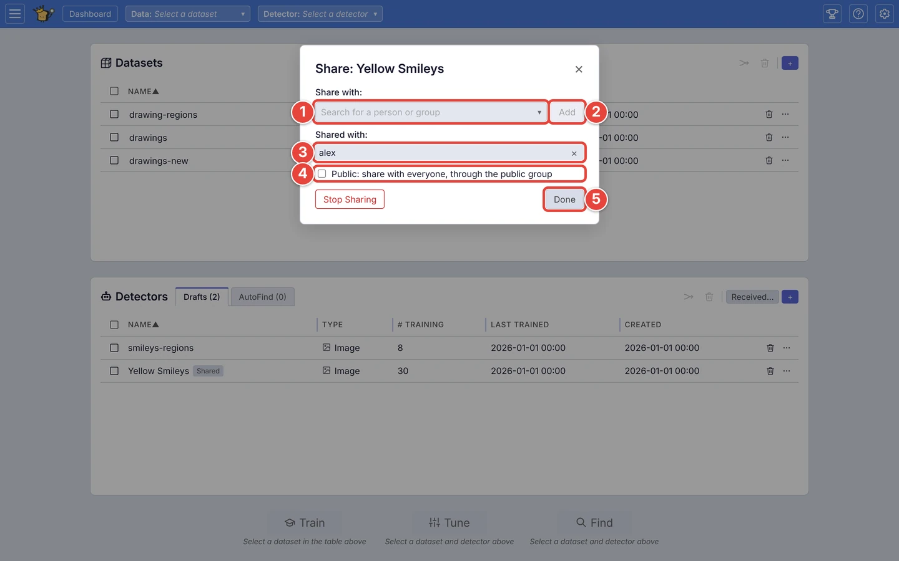
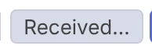
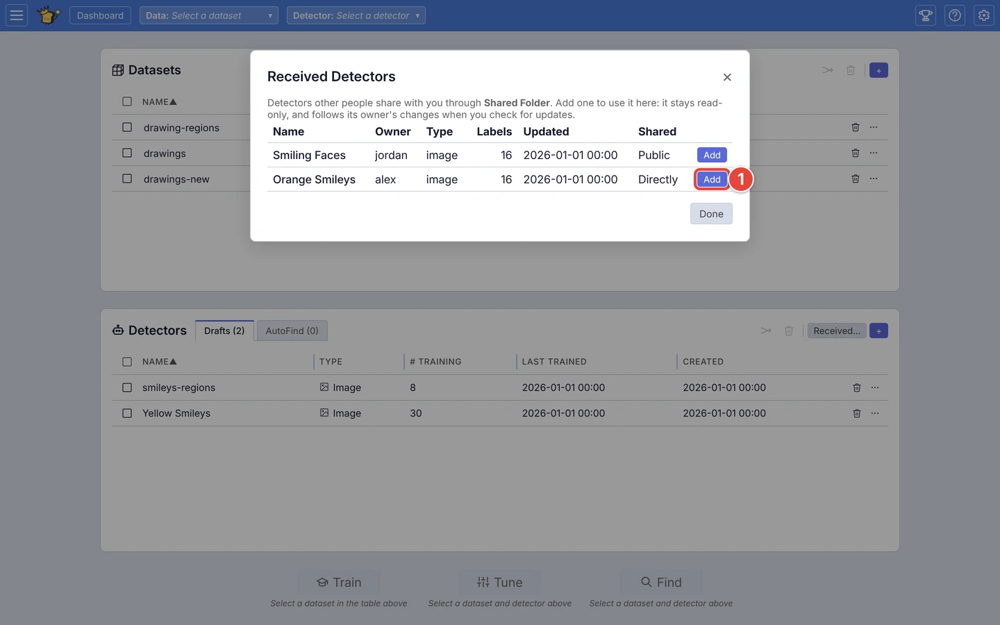
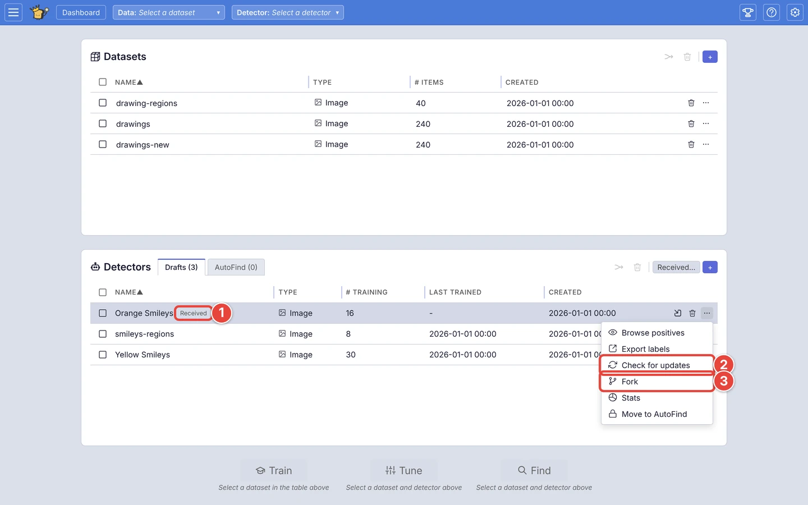
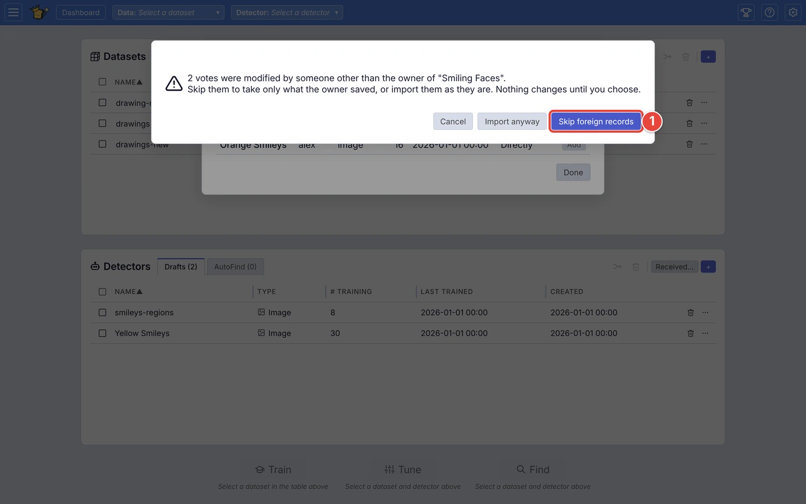

# Share a detector, receive one, fork one

On a VTSearch whose administrator has connected it to a sharing service, you
can give a detector to other people without exporting a file. Each detector
you share gets a *shared copy* in that service: its answers (the pictures
marked **Good** and **Bad**), kept up to date as you label. The people you
share it with add it to their own detectors as a read-only copy, and fetch
your changes when they want them.

Sharing is on when the **Detectors** card has a **Received…** button beside
its **+**, and a detector's **⋯** menu has **Share…**. If yours has neither,
this VTSearch doesn't share detectors; to give one to someone, see
[Move a detector to another VTSearch](move-a-detector.md) instead.

This page shares the `Yellow Smileys` detector from
[Step by step: your first search](../USER_GUIDE.md#step-by-step-your-first-search),
and receives two detectors other people share. The red numbers in each
screenshot show where to click, in order.

## Share a detector

### Step 1: Open Share…

On the dashboard, click the **⋯** <picture><source media="(prefers-color-scheme: dark)" srcset="../assets/icon-overflow.dark.webp" /></picture> at the end of the detector's row
(`Yellow Smileys`), then **Share…**. Only the person who made a detector can
share it.

### Step 2: Choose who gets it

In the **Share** window:

1. Type a name under **Share with**. VTSearch suggests the people and groups
   the sharing service knows as you type; click one to share with them.
2. Or type the name as the service spells it and click **Add** (or press
   Enter).
3. **Shared with** lists everyone it is shared with. Click the **×** beside a
   name to stop sharing with them.
4. Tick **Public** to share it with everyone, through the service's public
   group.
5. Click **Done**.

<picture>
  <source media="(prefers-color-scheme: dark)" srcset="../assets/share-dialog.dark.webp" />
  
</picture>

Each change happens as you make it, so there is nothing to save: **Done**
just closes the window. The first one shares the detector, and the window
says what that means before you make it. If the detector's answers were being
auto-exported somewhere, the window says that too: sharing takes the place of
auto-export.

The detector's row now carries a **Shared** badge. From now on, every change
you make to its answers is saved to the shared copy shortly afterwards
(VTSearch saves at most once a minute, so a burst of votes costs one save).
The people you share it with don't get your changes on their own: they get
them when they check for updates.

**⚠ Remote sync failed** on the row means the last save to the shared copy
didn't get there, because the sharing service couldn't be reached, say, or
refused it. Hover over the link for the reason. Your detector and its answers
on this VTSearch are untouched: only the shared copy is behind. VTSearch tries
again the next time the detector is saved, which any vote does, and the
warning goes once a save gets through. Click the link to open **Share…**.

To stop sharing, open **Share…** again and click **Stop Sharing**. The shared
copy is archived and leaves everyone's **Received** list. The people who
already added it keep their copies, which stop getting your changes. Your
detector stays exactly as it is.

## Receive a detector

### Step 1: Open the Received list

On the **Detectors** card, click **Received…** <picture><source media="(prefers-color-scheme: dark)" srcset="../assets/icon-received.dark.webp" /></picture>. **Received
Detectors** lists the detectors other people share with you: who owns each
one, what kind of media it is for, how many answers it holds, when its owner
last changed it, and how it came to you (**Directly**, **By group**, or
**Public**, shared with everyone).

1. Click **Add** beside the one you want (`Orange Smileys`).

<picture>
  <source media="(prefers-color-scheme: dark)" srcset="../assets/share-received-list.dark.webp" />
  
</picture>

The new detector appears on the **Drafts** tab, selected. The list stays
open, so you can add another; a detector you already have shows **Added**,
and **Show** finds your copy of it on the **Detectors** card. Click **Done**
when you have what you want.

### Step 2: Use your copy

1. Your copy's row carries a **Received** badge. Hover over it to see who it
   came from and when you last checked it for updates.
2. **Check for updates**, in its **⋯** menu, fetches the owner's latest
   answers.
3. **Fork**, in the same menu, makes a copy you can change (see
   [Fork a detector](#fork-a-detector) below).

<picture>
  <source media="(prefers-color-scheme: dark)" srcset="../assets/share-received-row.dark.webp" />
  
</picture>

A received detector is read-only: its answers and its name are its owner's.
You can find with it, browse its matches, and put it on the **AutoFind** tab,
but you can't rename it or import labels into it, and in **Train** its
**Good** and **Bad** buttons are off, with **Read-only: fork to edit** and a
**Fork** button beside them.

It doesn't change unless you ask it to. **Check for updates** replaces your
copy's answers with the shared copy's as they are now, and says what changed
(or that it is up to date). Deleting it, with the bin icon at the end of its
row, removes only your copy; the owner's detector, and everyone else's copy,
are untouched.

## If someone other than the owner changed it

The services VTSearch shares through let anyone a detector is shared with
write to its shared copy, so VTSearch checks. Every answer in a shared copy
records who last changed it, and every save the owner makes records how many
answers there are, so VTSearch can tell when anyone else has added, changed
or deleted one. When you **Add** such a detector, or **Check for updates** on
one, it changes nothing until you choose:

<picture>
  <source media="(prefers-color-scheme: dark)" srcset="../assets/share-integrity.dark.webp" />
  
</picture>

- **Skip foreign records** (1) takes only the answers the owner saved, and
  leaves out every one someone else added or changed. It is the safe choice
  when you don't know who changed them, or why.
- **Import anyway** takes every answer as it is, whoever changed it.
- **Cancel** takes nothing: the detector isn't added, or, when you were
  checking for updates, your copy stays as it was.

Whatever you choose, a copy of such a detector has an amber **Received**
badge, whose tooltip says how many answers someone other than the owner
changed, until a later **Check for updates** finds none. Answers someone else *deleted* are
gone from the shared copy, so no choice brings them back; ask the owner.

## Fork a detector

A *fork* is a copy of a detector that is yours: you can vote on it, rename it,
import labels into it and share it like any detector you made. Fork when you
want to change a detector you received, or to try something on one of your
own without touching the original.

1. Click the **⋯** on the detector's row, then **Fork**.
2. Name the copy, or keep the name VTSearch suggests (`Orange Smileys
   (fork)`), and click **OK**.

The fork appears on the **Drafts** tab, selected. It starts with the
original's answers as your copy holds them: so if you skipped someone else's
changes when you last checked for updates, the fork leaves them out too.

From then on the two are separate. The fork records which detector it came
from, but your changes to it don't reach the original, and the original's
changes don't reach it: **Check for updates** is for received copies, and a
fork is not one. On a VTSearch that shares, a fork is shared from the start,
with nobody yet: its row carries a **Shared** badge, and **Share…** adds
people to it.

## When a row has a note

A detector shared through one sharing service stays tied to that service. If
the administrator turns sharing off, or moves this VTSearch to another
service, the detectors shared through the old one carry a note instead: their
**Shared** or **Received** badge turns amber, and its tooltip, like the
greyed-out **Share…** or **Check for updates** in the **⋯** menu, says why
(`Shared through …, but …; this is a local copy until that changes`).

Nothing is lost. The detector keeps its answers and works as before on this
VTSearch; only the shared copy is out of reach, so nothing is saved to it or
fetched from it. A received detector stays read-only, and **Fork** still
works on it. If the administrator brings that service back, the note goes
and the detector picks up where it left off.

## Where next

- [Move a detector to another VTSearch](move-a-detector.md): give a detector
  to someone by exporting its answers to a file, on any VTSearch.
- [Decide how far to trust a detector](trust-a-detector.md): what to check
  before relying on a detector someone else trained.
- [Run your detectors on new pictures from the command line](autofind-from-the-command-line.md):
  a received detector can go on the **AutoFind** tab like any other.
